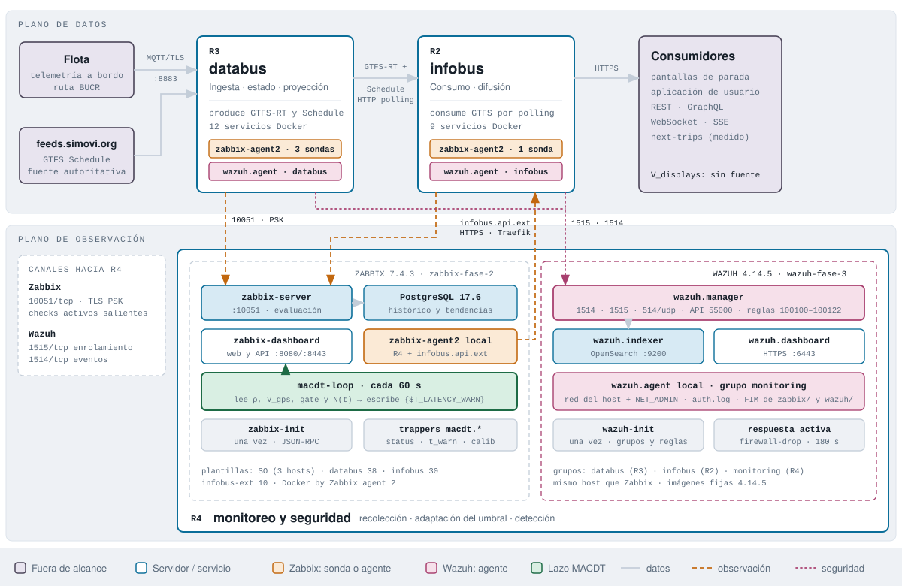
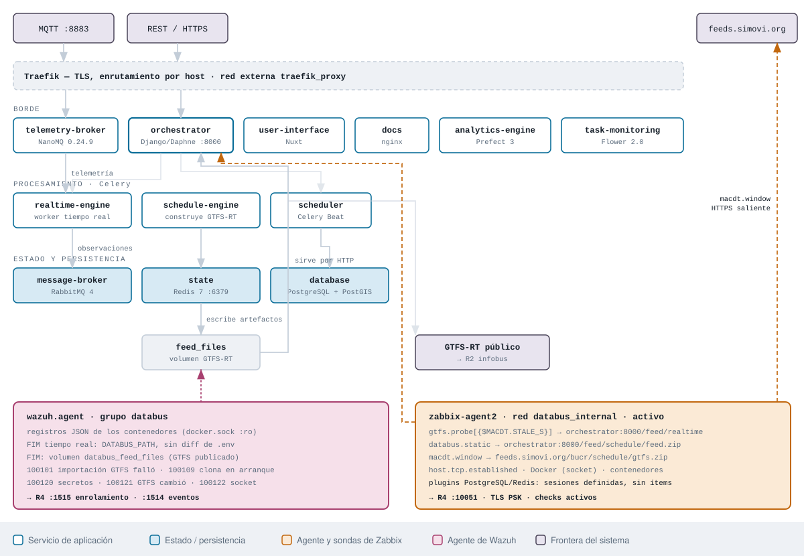
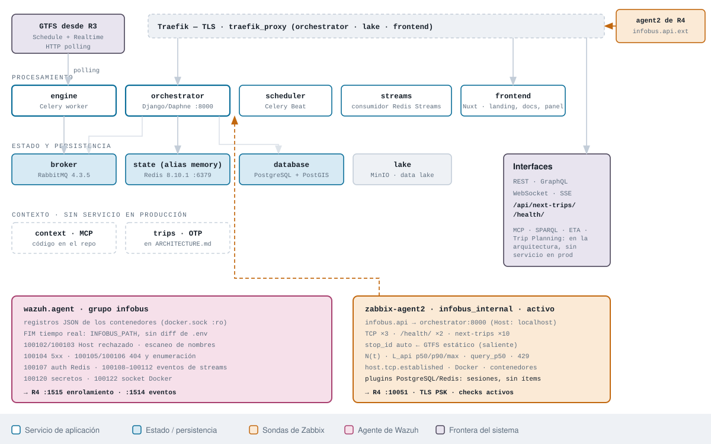
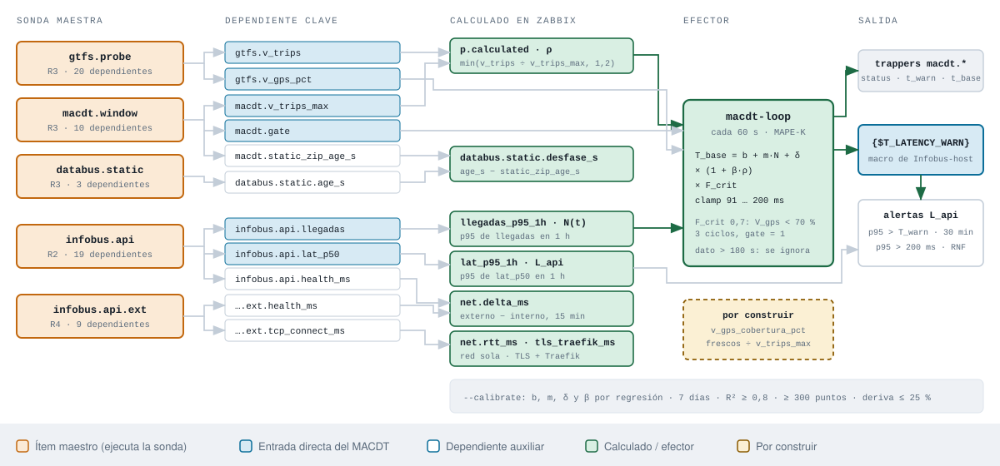

# Flujo de datos y puntos de observación

Arquitectura de los tres servidores del prototipo y ubicación de cada sonda (Zabbix) y de cada agente de seguridad (Wazuh).

| Fuente | Rama o commit | Fecha |
| --- | --- | --- |
| [simovilab/databus](https://github.com/simovilab/databus) · `compose.prod.yml`, `ARCHITECTURE.md` | `1be2da1` | 7 sep 2026 |
| [simovilab/infobus](https://github.com/simovilab/infobus) · `compose.prod.yml`, `ARCHITECTURE.md` | `9482328` | 30 oct 2026 |
| [rsol9000-01/zabbix](https://github.com/rsol9000-01/zabbix/tree/zabbix-fase-2) | `zabbix-fase-2` · `5c82b53` | 11 nov 2026 |
| [rsol9000-01/wazuh](https://github.com/rsol9000-01/wazuh/tree/wazuh-fase-3) | `wazuh-fase-3` · `ec9b9c8` | 11 nov 2026 |

## Nivel 1 — Vista de sistema

Plano de datos arriba, plano de observación abajo. Cada servidor de aplicación lleva dos agentes: Zabbix Agent 2 para el dominio y el rendimiento, y Wazuh para la seguridad. R4 concentra Zabbix, el bucle MACDT y Wazuh.



| Canal | Puerto | Sentido |
| --- | --- | --- |
| Zabbix | `10051/tcp` · TLS PSK | Checks activos de R2 y R3 hacia R4 |
| Wazuh | `1515/tcp` enrolamiento · `1514/tcp` eventos | Agentes de R2 y R3 hacia R4 |
| Sonda externa | `443/tcp` | R4 hacia infobus por Traefik (`infobus.api.ext`) |

## Nivel 2A — R3 · databus

Los 12 servicios de `compose.prod.yml` están en las redes `internal` y `traefik_proxy`. El agente de Zabbix se une a `databus_internal` y consulta los servicios por nombre, sin pasar por Traefik. El agente de Wazuh lee los registros de todos los contenedores y vigila la integridad del despliegue y del GTFS publicado.



## Nivel 2B — R2 · infobus

`compose.prod.yml` tiene 9 servicios. `streams`, `lake` (MinIO) y `frontend` reemplazan a `streams-consumer`, `lake_data` y `user-interface`. `context` y `knowledge` ya no están en producción. El agente de Zabbix mide `next-trips` por dentro y R4 la mide por fuera, a través de Traefik.



## Nivel 2C — R4 · cadena MACDT

Cinco sondas maestras, con una ejecución por intervalo cada una, alimentan por dependencia 61 ítems. El servidor calcula ρ, N(t) y el p95 de L_api. `macdt-loop` los lee por API y escribe el umbral de advertencia como macro de host en Infobus-host.



```text
T_warn = clamp( (b + m·N(t) + δ) × (1 + β·ρ) × F_crit , 91 , 200 )   [ms]
F_crit = 0,7 si V_gps < 70 % durante 3 ciclos y gate = 1; si no, 1
```

## Inventario de sondas · Zabbix

Están definidas como `UserParameter` en `agent2/zabbix_agent2.conf` y como *plugins* nativos en `simovilab-plugins.conf`. El efector corre en su propio contenedor.

| Clave | Mecanismo | Agente → destino | Qué produce | Estado |
| --- | --- | --- | --- | --- |
| `gtfs.probe[{$MACDT.STALE_S}]` | `gtfsrt_probe.py --stale 60` | R3 → `orchestrator:8000/feed/realtime` | 20 dependientes: viajes, vehículos, GPS, frescura, completitud | 🟢 activa |
| `macdt.window` | `gtfs_window.py --now` | R3 → `feeds.simovi.org/bucr/schedule/gtfs.zip` | 10: ventana, gate, S_t, V_trips_max, calendario | 🟢 activa |
| `databus.static` | `gtfs_window.py --now` | R3 → `orchestrator:8000/feed/schedule/feed.zip` | 3 dependientes + desfase calculado | 🟢 activa |
| `infobus.api` | `infobus_probe.py --repeat 10` | R2 → `orchestrator:8000`, sin Traefik | 19: L_api, N(t), costo de consulta, 429 | 🟢 activa |
| `infobus.api.ext` | `infobus_probe.py` | R4 → `https://infobus.ucr.ac.cr` | 9: latencia externa; Zabbix calcula red y TLS + Traefik | 🟢 activa |
| `host.tcp.established` | script + `sudo` | los 3 hosts | conexiones TCP establecidas | 🟢 activa |
| Docker y contenedores | plugin Docker + descubrimiento | los 3 hosts, `docker.sock` | estado, código de salida y reinicios por contenedor | 🟢 activa |
| `macdt-loop` | `macdt_loop.py` en contenedor | R4 → API JSON-RPC de Zabbix | `{$T_LATENCY_WARN}` + 5 trappers | 🟢 activa |
| plugins PostgreSQL / Redis | Agent2 nativo | `database:5432` · `state:6379` | sesiones definidas; ninguna plantilla las usa | 🟡 sin ítems |
| `pgsql.bloat.detail` | `psql` directo | — | comentado en `zabbix_agent2.conf` | ⚪ retirada |
| V_displays | — | pantallas de parada | sin fuente de datos | 🟡 pendiente |

> [!NOTE]
> **Infobus se mide desde dos lados.** `infobus.api` entra por `infobus_internal` y aísla la aplicación (Daphne + consulta). `infobus.api.ext` sale desde R4 por el dominio público. La plantilla resta ambas mediciones: `infobus.net.delta_ms` es red + TLS + Traefik, y `infobus.net.tls_traefik_ms` descuenta el RTT. El umbral adaptativo sigue gobernando el servicio que origina la latencia, pero ahora se puede mostrar cuánto añade el borde.

## Plano de seguridad · Wazuh fase 3

Es un stack single-node en Docker sobre R4, junto a Zabbix. `wazuh-init` crea los grupos y sube por API el `agent.conf` de cada uno y las reglas locales. Los agentes remotos se enrolan solos con contraseña.

| Grupo | Host | Registros | Integridad (FIM, tiempo real) | Reglas propias que aplican |
| --- | --- | --- | --- | --- |
| `databus` | R3 | JSON de todos los contenedores | `DATABUS_PATH` y volumen `databus_feed_files` | 100101 importación GTFS · 100109 clona código en arranque · 100121 GTFS publicado cambió |
| `infobus` | R2 | JSON de todos los contenedores | `INFOBUS_PATH` | 100102–100106 Host, 5xx, 404 · 100107 Redis · 100108–100112 eventos de streams |
| `monitoring` | R4 | `/var/log/auth.log` + contenedores | `WAZUH_PATH` y `ZABBIX_PATH` | SSH (5712, 5720, 5763) con respuesta activa |
| todos | — | — | sin diff de `.env` ni `authd.pass` | 100120 configuración o secretos · 100122 socket Docker |

> [!WARNING]
> **La respuesta activa solo bloquea de verdad en R4.** El agente local comparte la red del host y tiene `NET_ADMIN`. En R2 y R3, `firewall-drop` queda dentro del contenedor del agente y no protege al host.

## Lo que el diagrama deja ver

1. **El histórico muestra el RNF de 200 ms incumplido en todo el horario de servicio.** `history_infobus.api.lat_p95_1h.csv` tiene 5 995 muestras del 4 al 10 de noviembre: mediana 256 ms, mínimo 115 y máximo 301. El 67 % de las muestras supera 200 ms. Por hora local, el p95 pasa de 200 ms entre las 4:00 y las 19:00 y baja a unos 120 ms de noche. Eso tiene dos consecuencias. Primero, `T_warn` queda pegado al techo `T_RNF = 200` casi todo el día, así que el umbral adaptativo pierde rango justo cuando debería actuar. Segundo, conviene aclarar que `lat_p95_1h` es el p95 de las medianas por ciclo, no de peticiones individuales.

   | Hora (CR) | 0 | 2 | 3 | 4 | 5 | 6 | 8 | 10 | 12 | 14 | 16 | 18 | 19 | 20 | 22 | 23 |
   | --- | --- | --- | --- | --- | --- | --- | --- | --- | --- | --- | --- | --- | --- | --- | --- | --- |
   | Mediana del p95 (ms) | 120 | 161 | 187 | **214** | **246** | **279** | **287** | **287** | **281** | **285** | **265** | **241** | **208** | 188 | 125 | 119 |

2. **R2 ya aporta al lazo.** Antes toda la cadena salía de R3. Ahora `infobus.api` da N(t) y L_api, y `macdt-loop` cierra el lazo entre los dos sistemas: lee ρ y V_gps de databus y escribe el umbral sobre infobus.
3. **V_gps sigue midiendo frescura, y ahora gobierna F_crit.** `gtfs.v_gps_pct` se calcula como vehículos con GPS fresco ÷ `v_vehicles`. Un bus que deja de transmitir del todo sale del denominador y el porcentaje no baja. Falta `v_gps_cobertura_pct` contra `macdt.v_trips_max`.
4. **El estado interno de las bases no se observa.** Los *plugins* de PostgreSQL y Redis solo tienen sesiones, y ninguna plantilla define ítems que las usen. Hay dos opciones: agregar dos o tres ítems con un usuario `zabbix_ro` (`pg_monitor`), o declararlo fuera de alcance.
5. **La comparación cruzada del estático es el mejor argumento de la plantilla.** `databus.static.desfase_s` resta lo que publica databus de la fuente autoritativa. Wazuh lo refuerza desde el otro plano con la regla 100121.
6. **R4 es un punto único de observación.** Zabbix, el efector MACDT y Wazuh comparten host. Si R4 cae, se pierden a la vez el monitoreo, el ajuste del umbral y la detección.
7. **Las sondas maestras amortizan el costo.** Cinco ejecuciones por intervalo producen 61 ítems por dependencia, así que instrumentar el dominio no multiplica la carga sobre el sistema observado.
