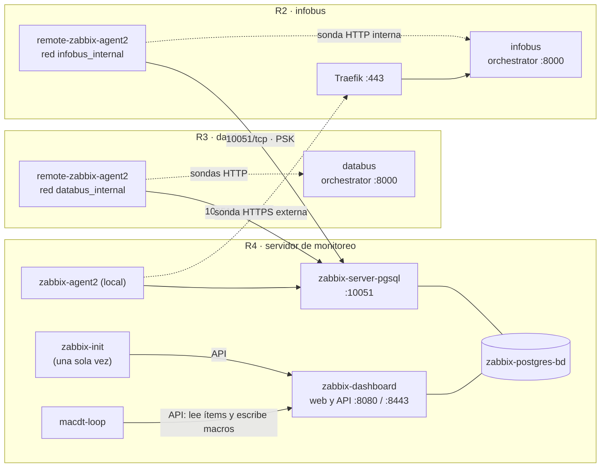
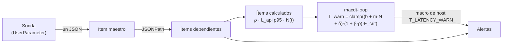
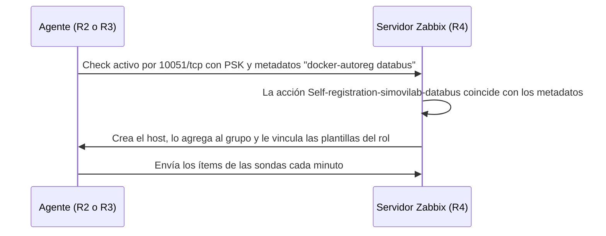

# Zabbix · monitoreo de databus e infobus

[English](README.md) · **Español**


Despliegue con Docker Compose del monitoreo de [databus](https://github.com/simovilab/databus) e [infobus](https://github.com/simovilab/infobus). El repositorio trae dos modos:

- **Servidor (`server`):** Zabbix Server, PostgreSQL, interfaz web, un agente local, el contenedor `zabbix-init`, que deja Zabbix configurado por API, y el bucle **MACDT**, que ajusta el umbral de latencia de infobus según la carga del transporte.
- **Agente (`agent`):** un Zabbix Agent 2 en cada servidor de aplicación. Se autorregistra en el servidor con su rol (`databus` o `infobus`), se cifra con PSK y corre las sondas de dominio (GTFS, GTFS-RT y la API de infobus).


## Arquitectura

| Servicio | Dónde | Función | Tecnología |
| --- | --- | --- | --- |
| **zabbix-postgres-bd** | Servidor | Base de datos de Zabbix | PostgreSQL 17.6 |
| **zabbix-server-pgsql** | Servidor | Recibe los datos de los agentes (10051/tcp) y evalúa las alertas | Zabbix Server 7.4.3 |
| **zabbix-dashboard** | Servidor | Interfaz web y API JSON-RPC | Zabbix Web (nginx) 7.4.3 |
| **zabbix-agent2** | Servidor | Agente local: sistema operativo y sonda externa de infobus | Zabbix Agent 2 7.4.3 + Python |
| **zabbix-init** | Servidor | Configuración inicial por API. Corre una vez y termina | alpine/curl + bash + jq |
| **macdt-loop** | Servidor | Bucle MACDT: calcula T_warn cada minuto y lo escribe como macro | Python 3.12 |
| **remote-zabbix-agent2** | Cada servidor de aplicación | Sistema operativo, contenedores y sondas de dominio | Zabbix Agent 2 7.4.3 + Python |



Las sondas son `UserParameter` del agente. Cada una consulta su endpoint, imprime **un JSON** (ítem maestro) y Zabbix lo separa en ítems dependientes. Con esos datos el servidor calcula ρ, el p95 de la latencia y N(t), y el bucle MACDT escribe el umbral que usan las alertas:



| Sonda (clave) | Script | Agente | Qué mide |
| --- | --- | --- | --- |
| `gtfs.probe[{$MACDT.STALE_S}]` | `gtfsrt_probe.py` | databus (R3) | Feeds GTFS-RT: viajes y vehículos activos, cobertura GPS, frescura y completitud |
| `macdt.window` | `gtfs_window.py` | databus (R3) | Horario del GTFS de la fuente: ventana de operación, viajes programados y V_trips_max |
| `databus.static` | `gtfs_window.py` | databus (R3) | GTFS estático que publica databus y su antigüedad |
| `infobus.api` | `infobus_probe.py` | infobus (R2) | Latencia interna de `next-trips` (sin Traefik), N(t) y costo de la consulta |
| `infobus.api.ext` | `infobus_probe.py` | servidor (R4) | Latencia externa de `next-trips` (red + TLS + Traefik) |
| `host.tcp.established` | `zabbix-host-tcp-established.sh` | todos | Conexiones TCP establecidas del host |

Las líneas `UserParameter` están en [`agent2/zabbix_agent2.conf`](agent2/zabbix_agent2.conf).

## Servidor

El servidor va en la máquina de monitoreo (R4). Levanta todo el stack con [`docker-compose.yml`](docker-compose.yml) y deja Zabbix configurado sin pasos manuales en la interfaz.

### Quick start

```bash
git clone -b zabbix-fase-2 https://github.com/rsol9000-01/zabbix.git /home/zabbix
cd /home/zabbix
cp .env.example .env     # cambiar contraseñas, usuario web y nombres (ver abajo)
sudo ./scripts/zabbix-dev.sh server 'MiSemilla.2026'
```

Al terminar, la interfaz queda en `http://<servidor>:8080`, con el usuario `API_WEB_USER` y la contraseña `API_WEB_PASS` del `.env`.

> La semilla **es obligatoria** y tiene que ser **la misma** en el servidor y en todos los agentes: de ella sale la clave PSK. Usar una propia, no la del ejemplo. Ver [Semilla y PSK](#semilla-y-psk).

### How to

#### 1. Requisitos

- Linux con Docker Engine y el plugin Docker Compose v2. El grupo `docker` tiene que existir.
- `python3`, que el script usa para derivar la PSK desde la semilla. `curl` y `openssl` también hacen falta, pero el script los instala con `apt-get` si no están.
- Ejecutar el script como **root** (`sudo`): ajusta dueños y permisos de archivos del repositorio.
- Puertos abiertos en el firewall del servidor:

| Puerto | Uso |
| --- | --- |
| `10051/tcp` | Datos de los agentes (checks activos) y trappers del bucle MACDT |
| `PORT_HTTP` (8080) | Interfaz web y API |
| `PORT_HTTPS` (8443) | Interfaz web con HTTPS. Necesita certificados en el volumen `zabbix_certificados`; el script no los genera |

#### 2. Configurar el `.env`

Copiar `.env.example` a `.env`. El archivo `.env` está en `.gitignore`: no subirlo nunca al repositorio. En modo servidor estas son las variables que hay que revisar; las del bloque **DO NOT EVER CHANGE** se dejan como vienen.

| Variable | Ejemplo | Qué es |
| --- | --- | --- |
| `API_WEB_USER`, `API_WEB_PASS` | `tfg` / *(propia)* | Usuario administrador que crea `zabbix-init`. Con él se entra a la web y lo usa el bucle MACDT. La contraseña debe cumplir la política de Zabbix (mínimo 8 caracteres, sin el nombre de usuario) |
| `POSTGRES_PASSWORD` | *(propia)* | Contraseña de la base de datos de Zabbix |
| `ZBX_METADATA` | `docker-autoreg` | Metadatos del autorregistro. En el servidor va sin rol |
| `ZBX_TLSPSKIDENTITY` | `zabbix-databus-psk` | Identidad PSK. Tiene que ser la misma en el servidor y en los agentes |
| `MACDT_HOST_DATABUS`, `MACDT_HOST_INFOBUS` | `Databus-host`, `Infobus-host` | Nombres de los hosts de los agentes. Deben ser iguales a `REMOTE_AGENT_HOSTNAME` de cada agente |
| `MACDT_INTERVAL`, `MACDT_MAX_AGE` | `60`, `180` | Periodo del bucle MACDT y antigüedad máxima de los datos que acepta (s) |
| `MACDT_CALIB_*` | ver `.env.example` | Calibración de T_base y β. Ver [Bucle MACDT y calibración](#bucle-macdt-y-calibración) |
| `LOCAL_TEMPLATE_FILES`, `LOCAL_TEMPLATE_NAMES` | ver `.env.example` | Plantillas del host local (R4) |
| `ROLE_DATABUS_TEMPLATE_*`, `ROLE_INFOBUS_TEMPLATE_*` | ver `.env.example` | Plantillas que recibe cada agente según su rol |
| `PORT_HTTP`, `PORT_HTTPS` | `8080`, `8443` | Puertos publicados de la interfaz web |
| `TZ`, `PHP_TZ` | `America/Costa_Rica` | Zona horaria de los contenedores y de la interfaz |

Las listas de plantillas van **en el mismo orden**: archivos separados por coma y nombres por barra vertical. El nombre tiene que ser idéntico al campo `name:` del YAML. Un `-` en lugar del archivo indica una plantilla que ya existe en Zabbix (por ejemplo, `Docker by Zabbix agent 2`).

#### 3. Desplegar

```bash
cd /home/zabbix
sudo ./scripts/zabbix-dev.sh server 'MiSemilla.2026'
```

El script hace esto, en orden:

1. Verifica Docker, el grupo `docker`, `curl`, `openssl`, el `.env` y el script de configuración inicial (`SCRIPT_POST_INSTALL`).
2. Ajusta los permisos de `scripts/user_scripts/` y de `agent2/` (sudoers, `Dockerfile` y `zabbix_agent2.conf`).
3. Agrega a `zabbix_agent2.conf` los `UserParameter` declarados en `.env` como `AGENT_PARAMS_<sufijo>=clave:script.sh`.
4. Deriva la PSK desde la semilla y la guarda en `psk/zabbix_agentd.psk`.
5. Levanta el stack con `docker compose up -d` y muestra el registro de `zabbix-init` hasta que termina.

Cuando `zabbix-init` termina sin errores, el script imprime `zabbix-init completed successfully` y arranca `macdt-loop`.

#### 4. Qué configura `zabbix-init`

`zabbix-init` corre [`scripts/zabbix-conf-en.sh`](scripts/zabbix-conf-en.sh) contra la API:

1. Espera a que la API responda.
2. **Primera vez:** entra con la cuenta inicial (`Admin`), crea `API_WEB_USER`, le pasa los mapas y dashboards de `Admin` y borra `Admin`. **Siguientes veces:** entra directamente con `API_WEB_USER`.
3. Crea el grupo de hosts `HOST_GROUP` si no existe.
4. Importa o actualiza las plantillas de `LOCAL_TEMPLATE_*` y `ROLE_*_TEMPLATE_*`, creando lo que falta y actualizando lo que existe.
5. Crea o actualiza el host local `Zabbix-server`, le vincula las plantillas locales y borra el host predeterminado `Zabbix server`.
6. Crea o actualiza una acción de autorregistro por rol (`Self-registration-simovilab-databus` y `-infobus`). Cada acción agrega el host al grupo, lo saca de *Discovered hosts* y le vincula las plantillas de su rol.
7. Configura el autorregistro con cifrado PSK (identidad `ZBX_TLSPSKIDENTITY` y la clave derivada de la semilla).

#### 5. Verificar

```bash
docker compose -f docker-compose.yml ps        # todo en running/healthy; zabbix-init en exited (0)
docker compose -f docker-compose.yml logs zabbix-init | tail -20
docker logs --tail 5 macdt-loop                # una línea por minuto con N, T_base, ρ y T_warn
```

En la web: **Data collection → Hosts** muestra `Zabbix-server` con la etiqueta ZBX en verde. Los hosts de los agentes aparecen al desplegar cada uno (ver [Agente](#agente)).

#### Bucle MACDT y calibración

`macdt-loop` corre `scripts/user_scripts/macdt_loop.py` en un bucle continuo, sin argumentos y sin cron. Cada `MACDT_INTERVAL` segundos:

1. Lee de Databus-host ρ, la cobertura GPS y la ventana de operación, y de Infobus-host N(t), todo por la API de Zabbix.
2. Calcula `T_warn = clamp((b + m·N(t) + δ) × (1 + β·ρ) × F_crit, T_floor, T_RNF)`.
3. Escribe el resultado en la macro de host `{$T_LATENCY_WARN}` de Infobus-host.
4. Envía su estado por trapper (`macdt.status`, `macdt.t_warn` y `macdt.t_base`).

Mientras no hay calibración, `m = 0` y `δ = 0`, así que T_base vale `{$MACDT.T_BASE}` (130 ms). La calibración ajusta una regresión `latencia = b + m·N + c·V` con los datos de los últimos `MACDT_CALIB_WINDOW_D` días y escribe b, m, δ y β como macros de host:

```bash
docker exec macdt-loop python3 /macdt_loop.py --calibrate --dry-run   # calcula y muestra, no escribe nada
docker exec macdt-loop python3 /macdt_loop.py --calibrate             # aplica si pasa las guardas
docker exec macdt-loop python3 /macdt_loop.py --calibrate --force     # aplica aunque cambie más de MACDT_CALIB_MAX_DRIFT
docker exec macdt-loop python3 /macdt_loop.py --once --dry-run        # un ciclo de prueba, sin escribir
```

La calibración solo se aplica si hay al menos `MACDT_CALIB_MIN_POINTS` puntos, R² ≥ `MACDT_CALIB_MIN_R2` y m > 0. Si la recta nueva cambia más de `MACDT_CALIB_MAX_DRIFT` respecto de la vigente, queda retenida (`macdt.calib = 2`) y salta la alerta *MACDT: la latencia de infobus cambió más de lo permitido*. Con `MACDT_CALIB_MODE=daily`, calibra sola una vez al día a la hora `MACDT_CALIB_HOUR`, en la zona horaria `TZ` del contenedor.

Si se cambia el script, basta con `docker compose restart macdt-loop`. Si se cambian variables del `.env`, recrear el contenedor:

```bash
docker compose up -d --no-deps --force-recreate macdt-loop
```

#### Actualizar plantillas en una instalación existente

Volver a correr el despliegue con la misma semilla. `zabbix-init` vuelve a importar las plantillas y actualiza lo que cambió:

```bash
sudo ./scripts/zabbix-dev.sh server 'MiSemilla.2026'
```

Las macros cambiadas **en el host** se conservan. Las cambiadas **en la plantilla** desde la web vuelven al valor del YAML.

#### Operaciones comunes

```bash
# El script exporta DOCKER_GID; a mano, definirlo antes para evitar advertencias de Compose
export DOCKER_GID=$(getent group docker | cut -d: -f3)

# Estado y registros
docker compose -f docker-compose.yml ps
docker compose -f docker-compose.yml logs -f zabbix-server-pgsql
docker logs -f macdt-loop

# Reiniciar un servicio
docker compose -f docker-compose.yml restart zabbix-server-pgsql

# Respaldo de la base de datos (queda en ./backups)
mkdir -p backups
docker exec zabbix-postgres-bd sh -c 'pg_dump -U "$POSTGRES_USER" "$POSTGRES_DB"' > backups/zabbix-$(date +%F).sql

# Detener (los volúmenes se conservan)
docker compose -f docker-compose.yml down
```

## Agente

El agente va en cada servidor de aplicación: R3 con databus y R2 con infobus. Se levanta con [`agent2/docker-compose-agent2.yml`](agent2/docker-compose-agent2.yml), se une a la red Docker de la aplicación para llegar a `orchestrator` por nombre y se registra solo en el servidor.

### Quick start

```bash
git clone -b zabbix-fase-2 https://github.com/rsol9000-01/zabbix.git /home/zabbix
cd /home/zabbix
cp .env.example .env     # completar el bloque del agente (ver abajo)
sudo ./scripts/zabbix-dev.sh agent 'MiSemilla.2026'   # la MISMA semilla del servidor
```

En un par de minutos el host aparece en **Data collection → Hosts**, con las plantillas de su rol y cifrado PSK.

### How to

#### 1. Requisitos

- El servidor ya desplegado, porque las acciones de autorregistro las crea `zabbix-init`.
- La aplicación (databus o infobus) ya corriendo, porque su red Docker tiene que existir.
- Docker Engine con Compose v2, el grupo `docker` y `python3`. Ejecutar el script como **root** (`sudo`).
- Salida hacia el servidor por `10051/tcp`, y que `SERVER_FQDN` resuelva desde el host.
- `10050/tcp` abierto solo si se van a usar checks pasivos (`ZBX_PORTS`). Las sondas usan checks activos.

Para saber el nombre de la red de la aplicación:

```bash
docker inspect $(docker ps -qf name=orchestrator) --format '{{json .NetworkSettings.Networks}}'
```

#### 2. Configurar el `.env`

En modo agente solo hay que completar el primer bloque del `.env`. El resto se deja como viene en `.env.example`.

| Variable | databus (R3) | infobus (R2) | Qué es |
| --- | --- | --- | --- |
| `AGENT_FQDN` | `databus.example.com` | `infobus.example.com` | Nombre DNS del host del agente |
| `REMOTE_AGENT_HOSTNAME` | `Databus-host` | `Infobus-host` | Nombre del host en Zabbix. Tiene que ser igual a `MACDT_HOST_DATABUS` o `MACDT_HOST_INFOBUS` del servidor |
| `AGENT_DOCKER_NETWORK` | `databus_internal` | `infobus_internal` | Red Docker de la aplicación a la que se une el agente |
| `AGENT_PGPASSWORD` | *(propia)* | *(propia)* | Contraseña de PostgreSQL para `psql` dentro del agente. Solo la usa el ítem `pgsql.bloat.detail`, hoy comentado en `zabbix_agent2.conf` |
| `SERVER_FQDN` | `zabbix.example.com` | `zabbix.example.com` | Nombre o IP del servidor Zabbix |
| `ZBX_METADATA` | `docker-autoreg databus` | `docker-autoreg infobus` | Metadatos del autorregistro. El rol decide qué plantillas recibe el host |

`ZBX_TLSPSKIDENTITY` tiene que ser igual a la del servidor. Ya viene así en `.env.example`.

#### 3. Desplegar

```bash
cd /home/zabbix
sudo ./scripts/zabbix-dev.sh agent 'MiSemilla.2026'
```

El script hace lo mismo que en el servidor (permisos, sudoers, `UserParameter` y PSK), pero levanta solo `remote-zabbix-agent2`. Además, la primera vez crea `agent2/simovilab-plugins.conf` a partir de `agent2/simovilab-plugins.conf.example`.

`simovilab-plugins.conf` tiene las sesiones de los plugins de PostgreSQL y Redis, con contraseñas de ejemplo. Está en `.gitignore`: cada servidor guarda su copia. Editarlo con las contraseñas reales de ese servidor. Para PostgreSQL, usar un usuario de solo lectura con el rol `pg_monitor`, no `postgres`:

```sql
CREATE ROLE zabbix_ro LOGIN PASSWORD '<una clave propia>';
GRANT pg_monitor TO zabbix_ro;
```

Después de editarlo, reiniciar el agente:

```bash
docker compose -f agent2/docker-compose-agent2.yml --env-file .env restart
```

#### 4. Qué pasa al arrancar



#### 5. Ajustar las sondas a la instalación

Las direcciones que consultan las sondas están en [`agent2/zabbix_agent2.conf`](agent2/zabbix_agent2.conf). Hay que revisarlas en cada instalación nueva:

| Clave | Parámetro | Qué poner |
| --- | --- | --- |
| `gtfs.probe[*]` | `--base` | Ruta del feed GTFS-RT de databus dentro de la red (`http://orchestrator:8000/feed/realtime`) |
| `macdt.window` | `--url` | GTFS estático de la fuente oficial del horario |
| `databus.static` | `--url` | GTFS estático que publica databus (`http://orchestrator:8000/feed/schedule/feed.zip`) |
| `infobus.api` | `--base`, `--host-header`, `--transit-system` | Orchestrator de infobus dentro de la red, un valor de su `ALLOWED_HOSTS` y el id del `TransitSystem` |
| `infobus.api.ext` | `--base` | URL pública de infobus, detrás de Traefik |

Los scripts se montan en modo solo lectura desde `scripts/user_scripts/`, y el agente los lee en cada ejecución: si se cambia un script, no hay que reiniciar nada. Si se cambia `zabbix_agent2.conf`, reiniciar el agente.

#### 6. Verificar

```bash
docker compose -f agent2/docker-compose-agent2.yml --env-file .env ps
docker logs --tail 20 remote-zabbix-agent2
```

En la web: **Data collection → Hosts** muestra el host con la etiqueta ZBX en verde y el candado PSK. En **Monitoring → Latest data** aparecen los ítems de su rol.

> `remote-zabbix-agent2` monta el `/proc` del host en modo solo lectura, así que `docker exec` sobre ese contenedor falla. Para probar una sonda a mano, correrla en un contenedor temporal con la misma imagen y en la misma red:
>
> ```bash
> docker run --rm --network databus_internal -v "$PWD/scripts/user_scripts":/s:ro --entrypoint bash \
>   simovilab/zabbix-agent2:ubuntu-7.4.3 -c '/s/gtfsrt_probe.py --base http://orchestrator:8000/feed/realtime --stale 60'
> ```

#### Operaciones comunes

```bash
export DOCKER_GID=$(getent group docker | cut -d: -f3)   # lo usa el compose del agente
docker compose -f agent2/docker-compose-agent2.yml --env-file .env ps
docker compose -f agent2/docker-compose-agent2.yml --env-file .env logs -f
docker compose -f agent2/docker-compose-agent2.yml --env-file .env restart
docker compose -f agent2/docker-compose-agent2.yml --env-file .env down
```

## Semilla y PSK

El segundo argumento de `zabbix-dev.sh` es una **semilla**, no la PSK. El script deriva la PSK con PBKDF2-HMAC-SHA256 (600 000 iteraciones y una sal fija del proyecto) y la guarda en `psk/zabbix_agentd.psk`. Como el cálculo es siempre el mismo, la misma semilla da la misma PSK en todas las máquinas, sin copiar archivos entre ellas.

Requisitos de la semilla:

- Entre 8 y 64 caracteres.
- Al menos una mayúscula, una minúscula, un número y uno de estos símbolos: `. * + ? -`.
- Sin `$`, `|`, `&` ni `\`.
- Siempre entre comillas simples: `'MiSemilla.2026'`.

Guardar la semilla fuera del repositorio. No publicar nunca la semilla ni la PSK. La carpeta `psk/` está en `.gitignore`.

## Referencia

### Plantillas

| Archivo | Plantilla | Se vincula a |
| --- | --- | --- |
| [`templates/simovilab-templates.yml`](templates/simovilab-templates.yml) | `simovilab servidor y sistema operativo` | Los 3 hosts: sistema operativo, ping desde el servidor y descubrimiento de contenedores. Incluye el dashboard *Servidor* |
| [`templates/simovilab-databus.yml`](templates/simovilab-databus.yml) | `simovilab-databus` | Rol `databus`: GTFS-RT, GTFS estático, ventana de operación y ρ. Incluye el dashboard *Operación databus* |
| [`templates/simovilab-infobus.yml`](templates/simovilab-infobus.yml) | `simovilab-infobus` | Rol `infobus`: latencia de la API, N(t), bucle MACDT y calibración. Incluye el dashboard *Operación infobus* |
| [`templates/simovilab-infobus-ext.yml`](templates/simovilab-infobus-ext.yml) | `simovilab-infobus-ext` | Host local del servidor: medición externa de infobus por Traefik |
| *(oficial de Zabbix)* | `Docker by Zabbix agent 2` | Los 3 hosts |

### Ítems

Los ítems *Dependiente* no consultan nada: toman un campo del JSON de su ítem maestro. Los *Calculado* los arma el servidor a partir de otros ítems. Los nombres son los que muestra Zabbix.

| Plantilla | Se aplica a | Ítems |
| --- | --- | --- |
| `simovilab servidor y sistema operativo` | los 3 hosts (Zabbix-server, Databus-host, Infobus-host) | 8 + 1 descubrimiento con 5 prototipos por contenedor |
| `simovilab-databus` | Databus-host (R3) | 38 |
| `simovilab-infobus` | Infobus-host (R2) | 30 |
| `simovilab-infobus-ext` | Zabbix-server (R4) | 10 |
| `Docker by Zabbix agent 2` | los 3 hosts | Plantilla oficial de Zabbix, sin cambios |

<details>
<summary><code>simovilab servidor y sistema operativo</code> — 8 ítems</summary>

| Nombre | Clave | Tipo |
| --- | --- | --- |
| TCP connections ESTABLISHED | `host.tcp.established` | Agente (activo) |
| Server UP/DOWN | `icmpping[,3]` | Chequeo simple |
| Load average per CPU (1 min) | `system.cpu.load[percpu,avg1]` | Agente (activo) |
| CPU utilization (user + system) | `system.cpu.util` | Agente (pasivo) |
| Disk I/O wait | `system.cpu.util[,iowait]` | Agente (activo) |
| Uptime | `system.uptime` | Agente (activo) |
| Disk space free (/) | `vfs.fs.size[/hostfs,pfree]` | Agente (activo) |
| Memory utilization (% used) | `vm.memory.size[pused]` | Agente (activo) |
| *Contenedores (todos, incluidos los detenidos)* | `docker.containers.discovery[true]` | Descubrimiento |
| ↳ Contenedor {#NAME}: info (short) | `docker.container_info["{#NAME}",short]` | Prototipo |
| ↳ Contenedor {#NAME}: código de salida | `simovilab.contenedor.exitcode["{#NAME}"]` | Prototipo |
| ↳ Contenedor {#NAME}: reinicios automáticos | `simovilab.contenedor.restart_count["{#NAME}"]` | Prototipo |
| ↳ Contenedor {#NAME}: corriendo | `simovilab.contenedor.running["{#NAME}"]` | Prototipo |
| ↳ Contenedor {#NAME}: hora de inicio | `simovilab.contenedor.started["{#NAME}"]` | Prototipo |

</details>

<details>
<summary><code>simovilab-databus</code> — 38 ítems</summary>

| Nombre | Clave | Tipo |
| --- | --- | --- |
| GTFS estático publicado por databus | `databus.static` | Agente (activo) |
| databus: antigüedad del estático | `databus.static.age_s` | Dependiente |
| databus: desfase del estático frente a la fuente | `databus.static.desfase_s` | Calculado |
| databus: código HTTP del estático | `databus.static.http` | Dependiente |
| databus: lectura del estático correcta | `databus.static.ok` | Dependiente |
| V_completeness de predicciones | `gtfs.completeness_tu_pct` | Dependiente |
| V_completeness de posiciones | `gtfs.completeness_vp_pct` | Dependiente |
| Calibrar el --stale contra la cadencia real | `gtfs.data_age_p95_s` | Dependiente |
| V_age del publicador de predicciones | `gtfs.feed_age_tu_s` | Dependiente |
| V_age del publicador de posiciones | `gtfs.feed_age_vp_s` | Dependiente |
| Raíz del árbol de alertas | `gtfs.fetch_ok` | Dependiente |
| Latencia del endpoint de predicciones | `gtfs.fetch_tu_ms` | Dependiente |
| Latencia del endpoint de posiciones | `gtfs.fetch_vp_ms` | Dependiente |
| gtfs-Maestro | `gtfs.probe[{$MACDT.STALE_S}]` | Agente (activo) |
| Sospecha de relleno de timestamps | `gtfs.ts_igual_header_pct` | Dependiente |
| V_gps. Entrada de F_crit | `gtfs.v_gps_pct` | Dependiente |
| V_trips. Entrada de F_load y G_load | `gtfs.v_trips` | Dependiente |
| Denominador real de V_gps | `gtfs.v_vehicles` | Dependiente |
| Vehículos con GPS fresco | `gtfs.v_gps_frescos` | Dependiente |
| Vehículos con GPS viejo | `gtfs.v_gps_viejos` | Dependiente |
| Vehículos sin timestamp | `gtfs.v_gps_sin_ts` | Dependiente |
| Viajes sin paradas por delante | `gtfs.v_trips_sin_paradas` | Dependiente |
| Umbral de GPS fresco usado por la sonda | `gtfs.stale_s` | Dependiente |
| Edad máxima de la posición GPS | `gtfs.data_age_max_s` | Dependiente |
| Edad de la posición GPS por vehículo | `gtfs.vehiculos_texto` | Dependiente |
| Tabla de vehículos del feed (HTML) | `gtfs.vehiculos_html` | Dependiente |
| Calendar age | `macdt.cal_dias_vigencia` | Dependiente |
| Schedule | `macdt.gate` | Dependiente |
| Horario de servicio (texto) | `macdt.horario_texto` | Dependiente |
| Huecos sin buses programados (texto) | `macdt.huecos_texto` | Dependiente |
| scheduled slot | `macdt.hueco_programado` | Dependiente |
| static_zip_age | `macdt.static_zip_age_s` | Dependiente |
| SIMOVI: código HTTP del GTFS estático | `macdt.static_zip_http` | Dependiente |
| Scheduled trips | `macdt.s_t` | Dependiente |
| Max trips | `macdt.v_trips_max` | Dependiente |
| macd-Maestro | `macdt.window` | Agente (activo) |
| Raíz del árbol de la ventana | `macdt.window_ok` | Dependiente |
| Calculo de p | `p.calculated` | Calculado |

</details>

<details>
<summary><code>simovilab-infobus</code> — 30 ítems</summary>

| Nombre | Clave | Tipo |
| --- | --- | --- |
| Sonda de la API de InfoBus | `infobus.api` | Agente (activo) |
| Parada medida por la sonda | `infobus.api.stop_id` | Dependiente |
| Horas de paso en 5 h de la parada medida (pico) | `infobus.api.stop_pico_5h` | Dependiente |
| Eleccion automatica de parada activa | `infobus.api.stop_auto` | Dependiente |
| Día sin servicio (next-trips responde 204) | `infobus.api.sin_servicio` | Dependiente |
| Tabla API INFOBUS (HTML) | `infobus.api.tabla_html` | Dependiente |
| API de InfoBus responde correctamente | `infobus.api.ok` | Dependiente |
| Llegadas programadas en 5 h, N(t) | `infobus.api.llegadas` | Dependiente |
| Buses en camino a la parada medida | `infobus.api.buses_parada` | Dependiente |
| N(t) para MACDT: p95 de llegadas, ventana de 1 h | `infobus.api.llegadas_p95_1h` | Calculado |
| L_api p50 del ciclo | `infobus.api.lat_p50` | Dependiente |
| Latencia en día sin servicio (respuestas 204) | `infobus.api.lat_sin_servicio` | Dependiente |
| L_api p90 del ciclo | `infobus.api.lat_p90` | Dependiente |
| L_api maxima del ciclo | `infobus.api.lat_max` | Dependiente |
| Costo de la consulta, aislado del transporte | `infobus.api.query_p50` | Dependiente |
| Piso de transporte, conexion abierta | `infobus.api.health_ms` | Dependiente |
| Primera peticion de la sesion (abre la conexion) | `infobus.api.health_cold_ms` | Dependiente |
| Costo de abrir la conexión (DNS + TCP) | `infobus.api.setup_ms` | Dependiente |
| Disponibilidad de /health/ | `infobus.api.health_ok` | Dependiente |
| Too Many Requests (429): peticiones rechazadas por la cuota | `infobus.api.throttled` | Dependiente |
| L_api p95 real, ventana de 1 h | `infobus.api.lat_p95_1h` | Calculado |
| Conexion TCP al orchestrator | `infobus.api.tcp_connect_ms` | Dependiente |
| Red: RTT de R4 a R2, promedio 15 min | `infobus.net.rtt_ms` | Calculado |
| Externo - interno: red + TLS + Traefik | `infobus.net.delta_ms` | Calculado |
| TLS + Traefik (sin red) | `infobus.net.tls_traefik_ms` | Calculado |
| Estado del bucle MACDT | `macdt.status` | Trapper |
| T_warn escrito por MACDT | `macdt.t_warn` | Trapper |
| T_base(t) calculado por MACDT | `macdt.t_base` | Trapper |
| Resultado de la calibración de MACDT | `macdt.calib` | Trapper |
| Detalle de la calibración de MACDT | `macdt.calib.info` | Trapper |

</details>

<details>
<summary><code>simovilab-infobus-ext</code> — 10 ítems</summary>

| Nombre | Clave | Tipo |
| --- | --- | --- |
| Sonda externa de la API de InfoBus | `infobus.api.ext` | Agente (activo) |
| Externo: API responde correctamente | `infobus.api.ext.ok` | Dependiente |
| Externo: Too Many Requests (429): peticiones rechazadas por la cuota | `infobus.api.ext.throttled` | Dependiente |
| Externo: L_api p50 del ciclo | `infobus.api.ext.lat_p50` | Dependiente |
| Externo: L_api p90 del ciclo | `infobus.api.ext.lat_p90` | Dependiente |
| Externo: costo de la consulta | `infobus.api.ext.query_p50` | Dependiente |
| Externo: piso con conexion abierta (red + TLS + Traefik + Daphne) | `infobus.api.ext.health_ms` | Dependiente |
| Externo: primera peticion (abre la conexion) | `infobus.api.ext.health_cold_ms` | Dependiente |
| Externo: costo de abrir la conexion (TCP + TLS) | `infobus.api.ext.setup_ms` | Dependiente |
| Externo: conexion TCP de R4 a Traefik (red) | `infobus.api.ext.tcp_connect_ms` | Dependiente |

</details>

### Macros

Para cambiar una macro sin perder el cambio en la siguiente importación de plantillas, sobrescribirla en el host: Data collection → Hosts → *host* → pestaña **Macros** → **Inherited and host macros** → **Change**. Para cambiar el valor por defecto, editar el YAML de la plantilla e importarlo.

**Las escribe el bucle MACDT**

| Macro | Valor por defecto | Plantilla | Qué controla |
| --- | --- | --- | --- |
| `{$T_LATENCY_WARN}` | `130` | `simovilab-infobus` | Umbral de advertencia de L_api. Lo sobrescribe el bucle MACDT cada minuto (macro de host). |

**Salen de la calibración (o de varios días de datos)**

| Macro | Valor por defecto | Plantilla | Qué controla |
| --- | --- | --- | --- |
| `{$MACDT.TSFILL.WARN}` | `50` | `simovilab-databus` | % de vehículos con la hora del encabezado que se considera relleno. |
| `{$MACDT.T_BASE}` | `130` | `simovilab-infobus` | Semilla de T_base. Se usa solo si N(t) falta o está viejo. |
| `{$MACDT.B}` | `130` | `simovilab-infobus` | b de T_base(t): costo fijo de la petición (ms). Lo escribe la calibración. |
| `{$MACDT.M}` | `0` | `simovilab-infobus` | m de T_base(t): ms por cada hora de paso en 5 h. Con 0, T_base es constante. |
| `{$MACDT.DELTA}` | `0` | `simovilab-infobus` | δ de T_base(t): margen, P95 de los residuos de la regresión. |
| `{$MACDT.BETA}` | `0.35` | `simovilab-infobus` | β: peso de los buses activos (ρ). β = c·V_max ÷ promedio de T_base con buses. |

**Revisar en cada instalación nueva**

| Macro | Valor por defecto | Plantilla | Qué controla |
| --- | --- | --- | --- |
| `{$CONTENEDOR.IGNORAR}` | `-init\|migrat\|-run-` | `simovilab servidor y sistema operativo` | Regex de contenedores que terminan a propósito (init, migraciones, run) y no se vigilan. |
| `{$MACDT.STALE_S}` | `60` | `simovilab-databus` | Segundos para contar como fresca una posición. Igual a TELEMETRY_GRACE_S de databus. |
| `{$MACDT.V_AGE.CRIT}` | `70` | `simovilab-databus` | Edad máxima del feed de predicciones antes de la alerta alta (bajo los 75 s que tolera infobus). |
| `{$MACDT.V_AGE.WARN}` | `45` | `simovilab-databus` | Edad máxima del feed de predicciones antes de avisar (3 ciclos de 15 s). |

**Ajuste fino de alertas (solo si hacen ruido o se quedan cortas)**

| Macro | Valor por defecto | Plantilla | Qué controla |
| --- | --- | --- | --- |
| `{$CONTENEDOR.REINICIO.VENTANA}` | `600` | `simovilab servidor y sistema operativo` | Segundos que la alerta "se reinició" queda activa. |
| `{$MACDT.CAL.DIAS.WARN}` | `7` | `simovilab-databus` | Días de anticipación para avisar que vence el calendario del GTFS. |
| `{$MACDT.COMPL.CRIT}` | `80` | `simovilab-databus` | Completitud mínima de predicciones (nivel crítico, %). |
| `{$MACDT.COMPL.WARN}` | `90` | `simovilab-databus` | Completitud mínima de predicciones antes de avisar (%). |
| `{$MACDT.ZIP.DESFASE.WARN}` | `21600` | `simovilab-databus` | Desfase máximo (s) entre el GTFS de databus y el de la fuente. |
| `{$T_LATENCY_WARN.SOSTENIDO}` | `30m` | `simovilab-infobus` | Tiempo que el p95 debe mantenerse sobre T_warn para la alerta alta "sostenido". |
| `{$INFOBUS.SETUP.FACTOR}` | `2` | `simovilab-infobus` | Veces la mediana diaria del costo de abrir la conexión que dispara la alerta. |
| `{$INFOBUS.SETUP.MIN_MS}` | `5` | `simovilab-infobus` | Mínimo (ms) para alertar el costo de abrir la conexión. |
| `{$INFOBUS.T204.FACTOR}` | `2` | `simovilab-infobus` | Veces la mediana diaria de la latencia 204 que dispara la alerta. |
| `{$INFOBUS.EXT.SETUP.FACTOR}` | `2` | `simovilab-infobus-ext` | Igual que INFOBUS.SETUP.FACTOR, para la conexión pública. |
| `{$INFOBUS.EXT.SETUP.MIN_MS}` | `5` | `simovilab-infobus-ext` | Igual que INFOBUS.SETUP.MIN_MS, para la conexión pública. |

**Casi fijas: cambian solo si cambia el requisito o el diseño**

| Macro | Valor por defecto | Plantilla | Qué controla |
| --- | --- | --- | --- |
| `{$MACDT.RHO_CAP}` | `1.2` | `simovilab-databus` | Tope de ρ (carga de la flota). |
| `{$MACDT.V_GPS.CRIT}` | `70` | `simovilab-databus` | % de GPS fresco bajo el que se activa F_crit (3 ciclos) y la alerta alta. |
| `{$MACDT.V_GPS.WARN}` | `85` | `simovilab-databus` | % de GPS fresco bajo el que se avisa. Sobre este valor se libera F_crit. |
| `{$T_LATENCY_CRIT}` | `200` | `simovilab-infobus` | Umbral crítico de L_api: el requisito no funcional. MACDT no lo cambia. |
| `{$MACDT.T_FLOOR}` | `91` | `simovilab-infobus` | Piso de T_warn (ms). |
| `{$MACDT.T_RNF}` | `200` | `simovilab-infobus` | Techo de T_warn (ms). |
| `{$MACDT.F_CRIT}` | `0.7` | `simovilab-infobus` | Factor que endurece T_warn con cobertura GPS crítica. |

**Sin uso**

| Macro | Valor por defecto | Plantilla | Qué controla |
| --- | --- | --- | --- |
| `{$Q_WARN}` | `80` | `simovilab-infobus` | Sin uso todavía (cola de eventos de Redis de infobus). |
| `{$Q_CRIT}` | `150` | `simovilab-infobus` | Sin uso todavía (cola de eventos de Redis de infobus). |

### Alertas por severidad

"Por contenedor" = una alerta por cada contenedor descubierto. Las de la plantilla oficial de Docker van marcadas con *(oficial)*.

**Desastre**

| Alerta | Plantilla | Se dispara cuando |
| --- | --- | --- |
| Server DOWN!!! | `simovilab servidor y sistema operativo` | 3 pings seguidos (unos 30 s) sin respuesta desde R4. "Capa D: sonda sin datos" depende de esta alerta. |
| GTFS estático vencido | `simovilab-databus` | El calendario del GTFS ya no tiene días vigentes. |
| Sin viajes activos sostenido | `simovilab-databus` | En horario de servicio y con viajes programados, 10 min sin ningún viaje en el feed. |

**Alta**

| Alerta | Plantilla | Se dispara cuando |
| --- | --- | --- |
| Too many established TCP connections | `simovilab servidor y sistema operativo` | Más de 1200 conexiones TCP establecidas durante 5 min. |
| System load per CPU is critical | `simovilab servidor y sistema operativo` | Carga por CPU > 1 durante 5 min. |
| CPU utilization critical | `simovilab servidor y sistema operativo` | CPU > 90 % durante 5 min. |
| Disk I/O wait critical | `simovilab servidor y sistema operativo` | Espera de disco > 30 % durante 5 min. |
| Disk space critical (/) | `simovilab servidor y sistema operativo` | Menos de 10 % libre en /. |
| Memory utilization critical | `simovilab servidor y sistema operativo` | Memoria > 90 % durante 5 min. |
| Feed GTFS-RT muy atrasado | `simovilab-databus` | El feed de predicciones tiene más de {$MACDT.V_AGE.CRIT} s durante 3 min. |
| Capa D: feed GTFS-RT no alcanzable | `simovilab-databus` | La sonda no pudo descargar el feed de tiempo real. |
| Capa D: sonda sin datos | `simovilab-databus` | 5 min sin datos de gtfs.probe. |
| GTFS estático por vencer | `simovilab-databus` | Quedan {$MACDT.CAL.DIAS.WARN} días o menos de calendario. |
| Capa D: ventana operativa no derivable | `simovilab-databus` | No se pudo calcular el horario de servicio desde el GTFS. |
| Cobertura GPS crítica | `simovilab-databus` | En horario, menos de {$MACDT.V_GPS.CRIT} % de vehículos con GPS fresco durante 5 min. |
| La API de InfoBus no responde correctamente | `simovilab-infobus` | La ráfaga de next-trips no respondió todo 200/204 (500, sin conexión, 429…). |
| L_api p95 sostenido sobre el umbral adaptativo de MACDT | `simovilab-infobus` | El p95 de la última hora no baja de {$T_LATENCY_WARN} durante {$T_LATENCY_WARN.SOSTENIDO}. La advertencia "sobre el umbral" depende de esta. |
| Container {#NAME}: Health state container is unhealthy *(oficial)* | `Docker by Zabbix agent 2` | Por contenedor: el healthcheck falla 2 veces en 2 min. |

**Media**

| Alerta | Plantilla | Se dispara cuando |
| --- | --- | --- |
| Contenedor {#NAME} apagado | `simovilab servidor y sistema operativo` | Por contenedor: existe y no está corriendo. |
| databus no publica el GTFS estático | `simovilab-databus` | El feed.zip de databus no devuelve 200. |
| SIMOVI no sirve el GTFS estático | `simovilab-databus` | La descarga del gtfs.zip de la fuente no devuelve 200. |
| Déficit de viajes | `simovilab-databus` | En horario, faltan en el feed la mitad o más de los viajes programados durante 5 min. |
| L_api p95 incumple el RNF de 200 ms | `simovilab-infobus` | El p95 de la última hora supera {$T_LATENCY_CRIT} (requisito no funcional, fijo). |
| El bucle MACDT no reporta: puede estar caido | `simovilab-infobus` | 5 min sin datos de macdt.status. |
| Container {#NAME}: Container has been stopped with error code *(oficial)* | `Docker by Zabbix agent 2` | Por contenedor: se detuvo con código de salida mayor a 0. |
| Docker: Service is down *(oficial)* | `Docker by Zabbix agent 2` | El agente no puede hablar con Docker. |

**Advertencia**

| Alerta | Plantilla | Se dispara cuando |
| --- | --- | --- |
| Too many established TCP connections | `simovilab servidor y sistema operativo` | Más de 800 conexiones TCP establecidas durante 5 min. |
| System load per CPU is high | `simovilab servidor y sistema operativo` | Carga por CPU > 0,7 durante 5 min. |
| CPU utilization high | `simovilab servidor y sistema operativo` | CPU > 70 % durante 5 min. |
| Disk I/O wait high | `simovilab servidor y sistema operativo` | Espera de disco > 15 % durante 5 min. |
| Server has been restarted recently | `simovilab servidor y sistema operativo` | El servidor lleva menos de 5 min encendido. |
| Disk space low (/) | `simovilab servidor y sistema operativo` | Menos de 20 % libre en /. |
| Memory utilization high | `simovilab servidor y sistema operativo` | Memoria > 75 % durante 5 min. |
| Contenedor {#NAME} se reinició | `simovilab servidor y sistema operativo` | Por contenedor: arrancó hace menos de {$CONTENEDOR.REINICIO.VENTANA} s. |
| Feed GTFS-RT atrasado | `simovilab-databus` | El feed de predicciones tiene más de {$MACDT.V_AGE.WARN} s durante 3 min. |
| Cobertura GPS baja | `simovilab-databus` | En horario, menos de {$MACDT.V_GPS.WARN} % de vehículos con GPS fresco durante 5 min. |
| Completitud de predicciones baja | `simovilab-databus` | En horario, completitud menor a {$MACDT.COMPL.WARN} % durante 5 min. |
| Más viajes que el máximo programado | `simovilab-databus` | Más viajes en el feed que el máximo del horario durante 5 min (viajes fantasma). |
| Sin viajes activos | `simovilab-databus` | En horario y con viajes programados, 3 min sin viajes en el feed. |
| Sospecha de relleno de timestamps | `simovilab-databus` | En horario, más de {$MACDT.TSFILL.WARN} % de vehículos con la hora del encabezado durante 10 min. |
| Latencia de día sin servicio fuera de lo normal (204) | `simovilab-infobus` | Promedio de 10 min mayor a {$INFOBUS.T204.FACTOR} × la mediana diaria. |
| Costo de abrir la conexión fuera de lo normal | `simovilab-infobus` | Promedio de 10 min mayor a {$INFOBUS.SETUP.FACTOR} × la mediana diaria y mayor a {$INFOBUS.SETUP.MIN_MS} ms. |
| La sonda agota su cuota: la medicion no es valida | `simovilab-infobus` | Alguna respuesta 429 en el ciclo. |
| L_api p95 sobre el umbral adaptativo de MACDT | `simovilab-infobus` | El p95 de la última hora supera {$T_LATENCY_WARN} (lo escribe el bucle MACDT). |
| MACDT degradado: el umbral no se esta actualizando | `simovilab-infobus` | El bucle corre pero no puede calcular (datos viejos o faltantes). |
| MACDT: la latencia de infobus cambió más de lo permitido | `simovilab-infobus` | La calibración quedó retenida: la recta nueva cambia más de MACDT_CALIB_MAX_DRIFT. Una persona decide si la aplica. |
| Externo: costo de abrir la conexión fuera de lo normal | `simovilab-infobus-ext` | Igual que la anterior, para la conexión pública (DNS + TCP + TLS). |
| Container {#NAME}: An error has occurred in the container *(oficial)* | `Docker by Zabbix agent 2` | Por contenedor: Docker reporta un error nuevo. |
| Docker: Failed to fetch info data *(oficial)* | `Docker by Zabbix agent 2` | El agente no puede leer la información de Docker. |

**Información**

| Alerta | Plantilla | Se dispara cuando |
| --- | --- | --- |
| Docker: Version has changed *(oficial)* | `Docker by Zabbix agent 2` | Cambió la versión de Docker. |

**Sin clasificar**

| Alerta | Plantilla | Se dispara cuando |
| --- | --- | --- |
| El GTFS que publica databus está desactualizado | `simovilab-databus` | Desfase entre el GTFS de databus y el de la fuente mayor a {$MACDT.ZIP.DESFASE.WARN} s durante 15 min. |


## Notas de seguridad

- **Credenciales:** van solo en `.env`, `agent2/simovilab-plugins.conf` y `psk/`, que están en `.gitignore`. Antes de desplegar, cambiar todos los valores de ejemplo.
- **Socket de Docker:** los agentes lo montan en modo solo lectura para descubrir contenedores. Eso da mucho acceso al host, así que los agentes se despliegan solo en servidores de confianza y ese acceso se vigila con Wazuh.
- **Usuario de PostgreSQL:** usar uno de solo lectura con `pg_monitor`, no `postgres`.
- **Firewall:** abrir solo `10051/tcp` y los puertos web en el servidor, y `10050/tcp` en los agentes solo si se usan checks pasivos.
- **Versiones fijas:** las imágenes de Zabbix están fijadas en `7.4.3` y PostgreSQL en `17.6`. Cambiarlas solo a propósito y probarlas antes.

## Documentación

- [`docker-compose.yml`](docker-compose.yml): stack del servidor.
- [`agent2/docker-compose-agent2.yml`](agent2/docker-compose-agent2.yml): agente remoto.
- [`agent2/zabbix_agent2.conf`](agent2/zabbix_agent2.conf): `UserParameter` de las sondas.
- [`scripts/zabbix-dev.sh`](scripts/zabbix-dev.sh): despliegue de servidor y agente.
- [`scripts/zabbix-conf-en.sh`](scripts/zabbix-conf-en.sh): configuración inicial que corre `zabbix-init`.
- [`scripts/user_scripts/`](scripts/user_scripts/): sondas y bucle MACDT.
- [`templates/`](templates/): plantillas de Zabbix.
- [`diagramas/`](diagramas/): diagrama de la arquitectura en draw.io, SVG y PNG.
