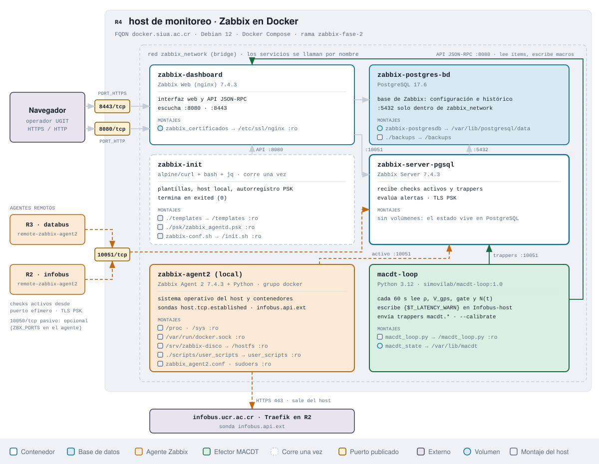
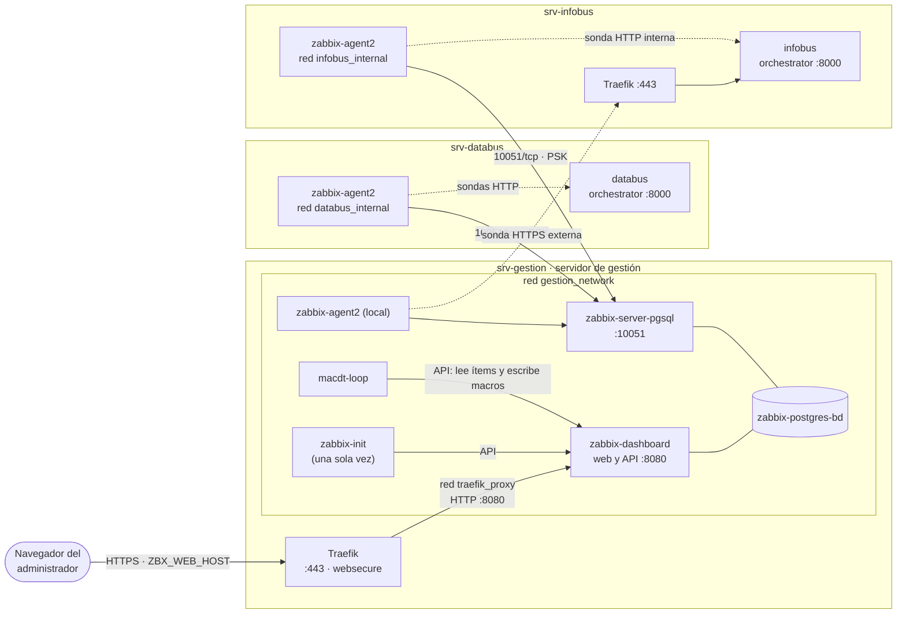
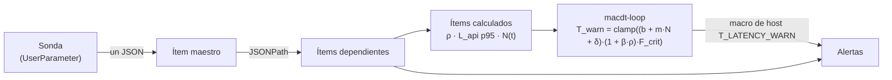
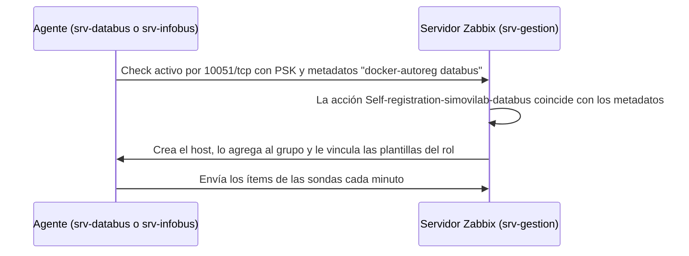

# Zabbix · monitoreo de databus e infobus

[English](README.md) · **Español**


Despliegue con Docker Compose del monitoreo de [databus](https://github.com/simovilab/databus) e [infobus](https://github.com/simovilab/infobus). El repositorio trae dos modos:

- **Servidor (`server`):** Zabbix Server, PostgreSQL, interfaz web, un agente local, el contenedor `zabbix-init`, que deja Zabbix configurado por API, y el bucle **MACDT**, que ajusta el umbral de latencia de infobus según la carga del transporte. Corre en el servidor de gestión (**srv-gestion**), y la interfaz web se publica **solo a través de Traefik**, que corre en el mismo servidor.
- **Agente (`agent`):** un Zabbix Agent 2 en cada servidor de aplicación (srv-databus y srv-infobus). Se autorregistra en el servidor con su rol (`databus` o `infobus`), se cifra con PSK y corre las sondas de dominio (GTFS, GTFS-RT y la API de infobus).

> **Nombres de los servidores.** srv-gestion es el servidor que antes se llamaba R4, srv-databus era R3 y srv-infobus era R2. Algunos documentos, diagramas y nombres de ítems de Zabbix (por ejemplo *Red: RTT de R4 a R2*) todavía usan R2, R3 y R4.



## Arquitectura

| Servicio | Dónde | Función | Tecnología |
| --- | --- | --- | --- |
| **Traefik** *(no está en este repositorio)* | srv-gestion | Proxy inverso: certificado TLS y enrutamiento por dominio hacia las interfaces web de Zabbix y Wazuh | Traefik |
| **zabbix-postgres-bd** | srv-gestion | Base de datos de Zabbix | PostgreSQL 17.6 |
| **zabbix-server-pgsql** | srv-gestion | Recibe los datos de los agentes (10051/tcp) y evalúa las alertas | Zabbix Server 7.4.3 |
| **zabbix-dashboard** | srv-gestion | Interfaz web y API JSON-RPC, accesible a través de Traefik | Zabbix Web (nginx) 7.4.3 |
| **zabbix-agent2** | srv-gestion | Agente local: sistema operativo y sonda externa de infobus | Zabbix Agent 2 7.4.3 + Python |
| **zabbix-init** | srv-gestion | Configuración inicial por API. Corre una vez y termina | alpine/curl + bash + jq |
| **macdt-loop** | srv-gestion | Bucle MACDT: calcula T_warn cada minuto y lo escribe como macro | Python 3.12 |
| **zabbix-agent2** | Cada servidor de aplicación (srv-databus, srv-infobus) | Sistema operativo, contenedores y sondas de dominio | Zabbix Agent 2 7.4.3 + Python |



Las sondas son `UserParameter` del agente. Cada una consulta su endpoint, imprime **un JSON** (ítem maestro) y Zabbix lo separa en ítems dependientes. Con esos datos el servidor calcula ρ, el p95 de la latencia y N(t), y el bucle MACDT escribe el umbral que usan las alertas:



| Sonda (clave) | Script | Agente | Qué mide |
| --- | --- | --- | --- |
| `gtfs.probe[{$MACDT.STALE_S}]` | `gtfsrt_probe.py` | srv-databus | Feeds GTFS-RT: viajes y vehículos activos, cobertura GPS, frescura y completitud |
| `macdt.window` | `gtfs_window.py` | srv-databus | Horario del GTFS de la fuente: ventana de operación, viajes programados y V_trips_max |
| `databus.static` | `gtfs_window.py` | srv-databus | GTFS estático que publica databus y su antigüedad |
| `infobus.api` | `infobus_probe.py` | srv-infobus | Latencia interna de `next-trips` (sin Traefik), N(t) y costo de la consulta |
| `infobus.api.ext` | `infobus_probe.py` | srv-gestion | Latencia externa de `next-trips` (red + TLS + Traefik) |
| `host.tcp.established` | `zabbix-host-tcp-established.sh` | todos | Conexiones TCP establecidas del host |
| `celery.probe` | `celery_probe.py` | srv-databus, srv-infobus | Colas de tareas Celery: tareas en espera y en ejecución, workers vivos (broker: RabbitMQ en databus, Redis en infobus) |

Las líneas `UserParameter` están en [`agent2/zabbix_agent2.conf`](agent2/zabbix_agent2.conf).

### Redes y acceso web

El stack del servidor usa dos redes de Docker. Las dos son **externas**: Compose no las crea, así que `zabbix-dev.sh` las revisa y crea las que falten antes de levantar el stack.

| Red | Nombre | Quién se une | Para qué sirve |
| --- | --- | --- | --- |
| Gestión | `gestion_network` (fijo) | Todos los servicios del servidor | Tráfico interno entre los servicios de Zabbix. El stack de Wazuh del mismo servidor también la usa |
| Proxy | `ZBX_TRAEFIK_NETWORK` del `.env` (hoy `traefik_proxy`) | Solo `zabbix-dashboard` | Permite que Traefik llegue a la interfaz. Tiene que ser la misma red que usa Traefik |

La interfaz no publica ningún puerto en el host. Traefik lee las etiquetas (labels) de Docker de `zabbix-dashboard` y enruta `https://ZBX_WEB_HOST` hacia `zabbix-dashboard:8080` (HTTP dentro de la red; el TLS termina en Traefik). Los contenedores del stack siguen usando la dirección interna `http://zabbix-dashboard:8080/api_jsonrpc.php` (`API_URL`).

Los agentes remotos no usan ninguna de las dos redes: se unen a la red de la aplicación (`AGENT_DOCKER_NETWORK`) y envían sus datos al `10051/tcp`, que `zabbix-server-pgsql` publica en el host.

## Servidor

El servidor va en srv-gestion, junto al servidor de Wazuh y a Traefik. Levanta todo el stack con [`docker-compose.yml`](docker-compose.yml) y deja Zabbix configurado sin pasos manuales en la interfaz.

### Inicio rápido

```bash
git clone -b zabbix-fase-2 https://github.com/rsol9000-01/zabbix.git /home/zabbix
cd /home/zabbix
cp .env.example .env     # cambiar contraseñas, usuario web y nombres (ver abajo)
sudo ./scripts/zabbix-dev.sh server 'MiSemilla.2026'
```

Al terminar, la interfaz queda en `https://<ZBX_WEB_HOST>` (por ejemplo `https://simovilab-zabbix.siua.ac.cr`), con el usuario `API_WEB_USER` y la contraseña `API_WEB_PASS` del `.env`.

Cada script tiene dos versiones con la misma lógica: `<nombre>.sh` (o `.py`), con comentarios y mensajes en inglés, y `<nombre>-es.sh` (o `-es.py`), en español. Se puede usar cualquiera de las dos.

> La semilla **es obligatoria** y tiene que ser **la misma** en el servidor y en todos los agentes: de ella sale la clave PSK. Usar una propia, no la del ejemplo. Ver [Semilla y PSK](#semilla-y-psk).

### Paso a paso

#### 1. Requisitos

- Linux con Docker Engine y el plugin Docker Compose v2. El grupo `docker` tiene que existir.
- `python3`, que el script usa para derivar la PSK desde la semilla. `curl` y `openssl` también hacen falta, pero el script los instala con `apt-get` si no están.
- Ejecutar el script como **root** (`sudo`): ajusta dueños y permisos de archivos del repositorio.
- **Traefik corriendo en el mismo servidor**, conectado a la red definida en `ZBX_TRAEFIK_NETWORK`, con:
  - Una entrada HTTPS llamada `websecure`.
  - Un resolver de certificados (`CERT_RESOLVER`, `letsencrypt` por defecto) o un certificado ya cargado para `ZBX_WEB_HOST`.
  - El file provider activado, con los middlewares `security-headers` y `compression`.
- Un registro DNS para `ZBX_WEB_HOST` que apunte a srv-gestion.
- Puertos abiertos en el firewall del servidor:

| Puerto | Uso | Abierto para |
| --- | --- | --- |
| `443/tcp` | Interfaz web y API, a través de Traefik | Red de administración |
| `10051/tcp` | Datos de los agentes (checks activos) y trappers del bucle MACDT | Agentes |

#### 2. Configurar el `.env`

Copiar `.env.example` a `.env`. El archivo `.env` está en `.gitignore`: no subirlo nunca al repositorio. En modo servidor estas son las variables que hay que revisar; las del bloque **DO NOT EVER CHANGE** se dejan como vienen.

| Variable | Ejemplo | Qué es |
| --- | --- | --- |
| `API_WEB_USER`, `API_WEB_PASS` | `tfg` / *(propia)* | Usuario administrador que crea `zabbix-init`. Con él se entra a la web y lo usa el bucle MACDT. La contraseña debe cumplir la política de Zabbix (mínimo 8 caracteres, sin el nombre de usuario) |
| `POSTGRES_PASSWORD` | *(propia)* | Contraseña de la base de datos de Zabbix |
| `ZBX_METADATA` | `docker-autoreg` | Metadatos del autorregistro. En el servidor va sin rol |
| `ZBX_TLSPSKIDENTITY` | `zabbix-databus-psk` | Identidad PSK. Tiene que ser la misma en el servidor y en los agentes |
| `MACDT_HOST_DATABUS`, `MACDT_HOST_INFOBUS` | `Databus-host`, `Infobus-host` | Nombres de los hosts de los agentes. Deben ser iguales a `REMOTE_AGENT_HOSTNAME` de cada agente |
| `MACDT_INTERVAL`, `MACDT_MAX_AGE` | `60`, `180` | Periodo del bucle MACDT y antigüedad máxima de los datos que acepta (s) |
| `MACDT_CALIB_*` | ver `.env.example` | Calibración de T_base y β. Ver [Bucle MACDT y calibración](#bucle-macdt-y-calibración) |
| `LOCAL_TEMPLATE_FILES`, `LOCAL_TEMPLATE_NAMES` | ver `.env.example` | Plantillas del host local (srv-gestion) |
| `ROLE_DATABUS_TEMPLATE_*`, `ROLE_INFOBUS_TEMPLATE_*` | ver `.env.example` | Plantillas que recibe cada agente según su rol |
| `ZBX_TRAEFIK_NETWORK` | `traefik_proxy` | Red de Docker compartida con Traefik. Tiene que ser exactamente la red que usa Traefik |
| `ZBX_WEB_HOST` | `simovilab-zabbix.siua.ac.cr` | Dominio que Traefik enruta hacia la interfaz |
| `CERT_RESOLVER` | `letsencrypt` | Resolver de certificados de Traefik. Opcional: si no se define, se usa `letsencrypt` |
| `ZBX_ALLOWED_IPS` | `10.20.0.0/16` | Redes que pueden abrir la interfaz, separadas por coma. Opcional: si no se define, se usa `10.20.0.0/16` |
| `DASHBOARD_NAME` | `simovilab` | Nombre del dashboard global que arma `zabbix-init`. Opcional: si no se define, se usa `simovilab` |
| `TZ`, `PHP_TZ` | `America/Costa_Rica` | Zona horaria de los contenedores y de la interfaz |

Las listas de plantillas van **en el mismo orden**: archivos separados por coma y nombres por barra vertical. El nombre tiene que ser idéntico al campo `name:` del YAML. Un `-` en lugar del archivo indica una plantilla que ya existe en Zabbix (por ejemplo, `Docker by Zabbix agent 2`).

#### 3. Desplegar

```bash
cd /home/zabbix
sudo ./scripts/zabbix-dev.sh server 'MiSemilla.2026'
```

El script hace esto, en orden:

1. Verifica Docker, el grupo `docker`, `curl`, `openssl`, el `.env` y el script de configuración inicial (`SCRIPT_POST_INSTALL`).
2. Ajusta los permisos de `scripts/user_scripts/` y de `agent2/` (sudoers, `Dockerfile` y `zabbix_agent2.conf`).
3. Agrega a `zabbix_agent2.conf` los `UserParameter` declarados en `.env` como `AGENT_PARAMS_<sufijo>=clave:script.sh`.
4. Deriva la PSK desde la semilla y la guarda en `psk/zabbix_agentd.psk`.
5. Revisa que existan las redes `gestion_network` y `ZBX_TRAEFIK_NETWORK`, y crea las que falten.
6. Levanta el stack con `docker compose up -d` y muestra el registro de `zabbix-init` hasta que termina.

Cuando `zabbix-init` termina sin errores, el script imprime el mensaje de éxito y arranca `macdt-loop`. Traefik detecta la interfaz solo cuando el contenedor arranca: no hay que reiniciar nada en Traefik.

#### 4. Qué configura `zabbix-init`

`zabbix-init` corre [`scripts/zabbix-conf.sh`](scripts/zabbix-conf.sh) contra la API:

1. Espera a que la API responda.
2. **Primera vez:** entra con la cuenta inicial (`Admin`), crea `API_WEB_USER`, le pasa los mapas y dashboards de `Admin` y borra `Admin`. **Siguientes veces:** entra directamente con `API_WEB_USER`.
3. Crea el grupo de hosts `HOST_GROUP` si no existe.
4. Importa o actualiza las plantillas de `LOCAL_TEMPLATE_*` y `ROLE_*_TEMPLATE_*`, creando lo que falta y actualizando lo que existe.
5. Crea o actualiza el host local `Zabbix-server`, le vincula las plantillas locales y borra el host predeterminado `Zabbix server`.
6. Crea o actualiza una acción de autorregistro por rol (`Self-registration-simovilab-databus` y `-infobus`). Cada acción agrega el host al grupo, lo saca de *Discovered hosts* y le vincula las plantillas de su rol.
7. Configura el autorregistro con cifrado PSK (identidad `ZBX_TLSPSKIDENTITY` y la clave derivada de la semilla).
8. Crea o reconstruye el dashboard global `DASHBOARD_NAME` (`simovilab`): tarjetas de los hosts, pings, reloj y los problemas de `HOST_GROUP`. Este bloque es la fuente de verdad: los cambios que se le hagan a ese dashboard desde la web se pierden en la siguiente corrida. Los paneles de agentes que todavía no se registraron se omiten y se agregan en una corrida posterior.

#### 5. Verificar

```bash
docker compose -f docker-compose.yml ps        # todo en running/healthy; zabbix-init en exited (0)
docker compose -f docker-compose.yml logs zabbix-init | tail -20
docker logs --tail 5 macdt-loop                # una línea por minuto con N, T_base, ρ y T_warn

# Acceso web a través de Traefik
docker network inspect traefik_proxy --format '{{range .Containers}}{{.Name}} {{end}}'   # tiene que listar traefik y zabbix-dashboard
docker logs traefik 2>&1 | grep -iE "zabbix|error" | tail -20                           # sin errores de router ni de middleware
curl -s -o /dev/null -w '%{http_code}\n' --resolve simovilab-zabbix.siua.ac.cr:443:<IP de srv-gestion> https://simovilab-zabbix.siua.ac.cr/   # 200
```

En la web: **Data collection → Hosts** muestra `Zabbix-server` con la etiqueta ZBX en verde. Los hosts de los agentes aparecen al desplegar cada uno (ver [Agente](#agente)).

Si la interfaz no abre:

| Síntoma | Causa probable |
| --- | --- |
| 404 de Traefik | `ZBX_WEB_HOST` no coincide con el dominio del navegador, o el router tiene un error en el log de Traefik (por ejemplo, un middleware que no existe) |
| 502 o 504 Bad Gateway | `zabbix-dashboard` no está en la red de Traefik, o el puerto del servicio no es `8080` |
| 403 Forbidden | Tu IP no está en `ZBX_ALLOWED_IPS` |
| Advertencia de certificado | Traefik está sirviendo su certificado por defecto: revisar `CERT_RESOLVER` o el certificado del dominio |
| Gráficos o botones que no funcionan | El middleware `security-headers` envía una Content-Security-Policy demasiado estricta para la interfaz de Zabbix |

#### Bucle MACDT y calibración

`macdt-loop` corre `scripts/user_scripts/macdt_loop.py` en un bucle continuo, sin argumentos y sin cron. Cada `MACDT_INTERVAL` segundos:

1. Lee de Databus-host ρ, la cobertura GPS y la ventana de operación, y de Infobus-host N(t), todo por la API de Zabbix.
2. Calcula `T_warn = clamp((b + m·N(t) + δ) × (1 + β·ρ) × F_crit, T_floor, T_RNF)`.
3. Escribe el resultado en la macro de host `{$T_LATENCY_WARN}` de Infobus-host.
4. Envía su estado por trapper (`macdt.status`, `macdt.t_warn` y `macdt.t_base`).

Mientras no hay calibración, `m = 0` y `δ = 0`, así que T_base vale `{$MACDT.B}` (130 ms). En un día sin servicio next-trips responde 204, así que no hay N(t) y T_base toma la semilla `{$MACDT.T_BASE}` (160 ms): es el umbral de reposo. La alerta *Latencia de día sin servicio sobre el umbral de MACDT (204)* compara contra él el p95 de la última hora de las respuestas 204. La calibración ajusta una regresión `latencia = b + m·N + c·V` con los datos de los últimos `MACDT_CALIB_WINDOW_D` días y escribe b, m, δ y β como macros de host:

```bash
docker exec macdt-loop python3 /macdt_loop.py --calibrate --dry-run   # calcula y muestra, no escribe nada
docker exec macdt-loop python3 /macdt_loop.py --calibrate             # aplica si pasa las guardas
docker exec macdt-loop python3 /macdt_loop.py --calibrate --force     # aplica aunque cambie más de MACDT_CALIB_MAX_DRIFT
docker exec macdt-loop python3 /macdt_loop.py --once --dry-run        # un ciclo de prueba, sin escribir
```

La calibración solo se aplica si hay al menos `MACDT_CALIB_MIN_POINTS` puntos, R² ≥ `MACDT_CALIB_MIN_R2` y m > 0. Si la recta nueva cambia más de `MACDT_CALIB_MAX_DRIFT` respecto de la vigente, queda retenida (`macdt.calib = 2`) y salta la alerta *MACDT: la latencia de infobus cambió más de lo permitido*. Con `MACDT_CALIB_MODE=daily`, calibra sola una vez al día a la hora `MACDT_CALIB_HOUR`, en la zona horaria `TZ` del contenedor.

Si se cambia el script, basta con `docker compose restart macdt-loop`. Si se cambian variables del `.env`, recrear el contenedor:

```bash
docker compose up -d --no-deps --force-recreate macdt-loop
```

#### Actualizar plantillas en una instalación existente

Volver a correr solo `zabbix-init`. Importa las plantillas de `templates/` y actualiza lo que cambió; los demás contenedores no se tocan:

```bash
cd /home/zabbix
DOCKER_GID=$(getent group docker | cut -d: -f3) \
  docker compose --env-file .env up --force-recreate --no-deps zabbix-init
```

- `DOCKER_GID` no está en el `.env`: lo calcula `zabbix-dev.sh` cada vez que corre, y `docker-compose.yml` lo necesita aunque solo arranque `zabbix-init`.
- `--force-recreate` hace que `zabbix-init` lea el `.env` actual. `--no-deps` deja los demás contenedores como están.
- La salida debe terminar con `User configuration completed` o `No new user required`.

Correr el despliegue completo (`zabbix-dev.sh server`) solo cuando cambia `docker-compose.yml` o la PSK, o en una instalación nueva.

Las macros cambiadas **en el host** se conservan. Las cambiadas **en la plantilla** desde la web vuelven al valor del YAML.

#### Operaciones comunes

```bash
# El script exporta DOCKER_GID; a mano, definirlo antes para evitar advertencias de Compose
export DOCKER_GID=$(getent group docker | cut -d: -f3)

# Estado y registros
docker compose -f docker-compose.yml ps
docker compose -f docker-compose.yml logs -f zabbix-server-pgsql
docker logs -f macdt-loop

# Reiniciar un servicio
docker compose -f docker-compose.yml restart zabbix-server-pgsql

# Respaldo de la base de datos (queda en ./backups)
mkdir -p backups
docker exec zabbix-postgres-bd sh -c 'pg_dump -U "$POSTGRES_USER" "$POSTGRES_DB"' > backups/zabbix-$(date +%F).sql

# Detener (los volúmenes se conservan)
docker compose -f docker-compose.yml down
```

## Agente

El agente va en cada servidor de aplicación: srv-databus y srv-infobus. Se levanta con [`agent2/docker-compose-agent2.yml`](agent2/docker-compose-agent2.yml), se une a la red Docker de la aplicación para llegar a `orchestrator` por nombre y se registra solo en el servidor. No usa la red `gestion_network` ni la de Traefik de srv-gestion.

### Inicio rápido

```bash
git clone -b zabbix-fase-2 https://github.com/rsol9000-01/zabbix.git /home/zabbix
cd /home/zabbix
cp .env.example .env     # completar el bloque del agente (ver abajo)
sudo ./scripts/zabbix-dev.sh agent 'MiSemilla.2026'   # la MISMA semilla del servidor
```

En un par de minutos el host aparece en **Data collection → Hosts**, con las plantillas de su rol y cifrado PSK.

### Paso a paso

#### 1. Requisitos

- El servidor ya desplegado, porque las acciones de autorregistro las crea `zabbix-init`.
- La aplicación (databus o infobus) ya corriendo, porque su red Docker tiene que existir.
- Docker Engine con Compose v2, el grupo `docker` y `python3`. Ejecutar el script como **root** (`sudo`).
- Salida hacia el servidor por `10051/tcp`, y que `SERVER_FQDN` resuelva desde el host.
- `10050/tcp` abierto solo si se van a usar checks pasivos (`ZBX_PORTS`). Las sondas usan checks activos.

Para saber el nombre de la red de la aplicación:

```bash
docker inspect $(docker ps -qf name=orchestrator) --format '{{json .NetworkSettings.Networks}}'
```

#### 2. Configurar el `.env`

En modo agente solo hay que completar el primer bloque del `.env`. El resto se deja como viene en `.env.example`.

| Variable | srv-databus | srv-infobus | Qué es |
| --- | --- | --- | --- |
| `AGENT_FQDN` | `databus.siua.ac.cr` | `infobus.example.com` | Nombre DNS del host del agente |
| `REMOTE_AGENT_HOSTNAME` | `Databus-host` | `Infobus-host` | Nombre del host en Zabbix. Tiene que ser igual a `MACDT_HOST_DATABUS` o `MACDT_HOST_INFOBUS` del servidor |
| `AGENT_DOCKER_NETWORK` | `databus_internal` | `infobus_internal` | Red Docker de la aplicación a la que se une el agente |
| `AGENT_PGPASSWORD` | *(propia)* | *(propia)* | Contraseña de PostgreSQL para `psql` dentro del agente. Solo la usa el ítem `pgsql.bloat.detail`, hoy comentado en `zabbix_agent2.conf` |
| `SERVER_FQDN` | `srv-gestion.siua.ac.cr` | `srv-gestion.siua.ac.cr` | Nombre o IP del servidor donde corre `zabbix-server-pgsql` |
| `ZBX_METADATA` | `docker-autoreg databus` | `docker-autoreg infobus` | Metadatos del autorregistro. El rol decide qué plantillas recibe el host |

`ZBX_TLSPSKIDENTITY` tiene que ser igual a la del servidor. Ya viene así en `.env.example`.

#### 3. Desplegar

```bash
cd /home/zabbix
sudo ./scripts/zabbix-dev.sh agent 'MiSemilla.2026'
```

El script hace lo mismo que en el servidor (permisos, sudoers, `UserParameter` y PSK), pero levanta solo `zabbix-agent2`. Además, la primera vez crea `agent2/simovilab-plugins.conf` a partir de `agent2/simovilab-plugins.conf.example`.

`simovilab-plugins.conf` tiene las sesiones de los plugins de PostgreSQL y Redis, con contraseñas de ejemplo. Está en `.gitignore`: cada servidor guarda su copia. Editarlo con las contraseñas reales de ese servidor. Para PostgreSQL, usar un usuario de solo lectura con el rol `pg_monitor`, no `postgres`:

```sql
CREATE ROLE zabbix_ro LOGIN PASSWORD '<una clave propia>';
GRANT pg_monitor TO zabbix_ro;
```

Solo en srv-databus, además, permitir que `zabbix_ro` lea la tabla de la versión vigente del GTFS estático (ítems `databus.static.lm`, `databus.static.age_s` y `databus.static.version_texto`, consulta `agent2/pgsql-queries/databus_static.sql`). Se ejecuta una sola vez, con el dueño de la base:

```bash
DB=$(docker ps --format '{{.Names}}' | grep -m1 'databus.*database')
echo "$DB"     # debe mostrar el contenedor de PostgreSQL de databus
docker exec -it "$DB" psql -U postgres -d databus -c "GRANT SELECT ON feed_feed TO zabbix_ro;"
```

Si en el `.env` de databus `DB_USER` no es `postgres`, cambiar `-U postgres` por ese usuario. La respuesta debe ser `GRANT`.

Después de editarlo, reiniciar el agente:

```bash
docker compose -f agent2/docker-compose-agent2.yml --env-file .env restart
```

#### 4. Qué pasa al arrancar



#### Memoria y CPU en LXC, VM o nube

El agente corre en Docker. En una VM, una VM en la nube (AWS EC2, DigitalOcean, Azure, GCP) o un servidor físico, lee el `/proc` del propio servidor. Dentro de un LXC (Proxmox, OpenVZ) no:

- `/proc/meminfo`: lxcfs responde según el cgroup de quien lo lee, así que el agente ve **su propio contenedor** (por ejemplo, 0,45 % de uso en un LXC de 8 GiB que está al 52 %).
- `/proc/loadavg` y `/proc/stat`: muestran **todo el host Proxmox**, incluso desde la shell del LXC. La carga por CPU queda como la carga del host dividida entre los núcleos del LXC (1,76 en un LXC de 4 núcleos con el host en 7), y el % de CPU y la espera de disco son los del host.

Los ítems estándar del agente no lo pueden corregir desde Docker. Por eso `zabbix-dev.sh` (modo servidor y agente) instala en el servidor un timer de systemd, `simovilab-host-stats.timer`. Cada minuto escribe estos archivos en `/srv/zabbix-disco`, que el agente monta como `/hostfs`:

| Archivo | Fuente | Para qué |
| --- | --- | --- |
| `meminfo` | `/proc/meminfo` | Memoria total, usada, disponible y % usado (sin contar la caché de disco) |
| `cpu` | `usage_usec` de `/sys/fs/cgroup/cpu.stat` y `nproc` | % de CPU sobre los núcleos del propio servidor |
| `cpu.pressure` | `/sys/fs/cgroup/cpu.pressure`, o `/proc/pressure/cpu` si no existe | Presión de CPU (PSI) |
| `io.pressure` | `/sys/fs/cgroup/io.pressure`, o `/proc/pressure/io` si no existe | Presión de disco (PSI) |

Dentro de un LXC los archivos del cgroup son del LXC; en una VM o servidor físico el cgroup raíz es el sistema completo. La plantilla lee solo estos archivos, así que los valores significan lo mismo en cualquier plataforma.

La carga por CPU se reemplaza por la **presión de CPU** (PSI): Linux no lleva carga promedio por contenedor, y PSI da la parte del tiempo en que los procesos esperaron por CPU. La espera de disco se reemplaza igual por la **presión de disco**. Los dos umbrales son macros (`{$CPU.PSI.*}`, `{$IO.PSI.*}`).

| Plataforma | Ítems estándar del agente | Archivos exportados |
| --- | --- | --- |
| Servidor físico, VM, VM en la nube | Correctos, salvo que la memoria cuenta la caché como usada | Correctos |
| LXC, OpenVZ | Incorrectos: memoria del contenedor del agente, CPU y carga del host | Correctos |
| Contenedores administrados (Fargate, Kubernetes) | Incorrectos | No aplica: usar las métricas de la plataforma |

Requisitos: systemd (sin él, el script muestra una línea para agregar al crontab) y cgroup v2 con PSI (Linux 4.20 o posterior, activo por defecto en las distribuciones actuales y en Proxmox 7 y 8). Sin cgroup v2, el % de CPU usa `/proc/stat`, que solo es correcto fuera de un LXC.

Revisar en el servidor:

```bash
systemctl status simovilab-host-stats.timer
head -3 /srv/zabbix-disco/meminfo; cat /srv/zabbix-disco/cpu /srv/zabbix-disco/cpu.pressure
```

Si los archivos dejan de actualizarse, la alerta *Datos de memoria sin actualizar* salta a los 5 min.

#### 5. Ajustar las sondas a la instalación

Las direcciones que consultan las sondas están en [`agent2/zabbix_agent2.conf`](agent2/zabbix_agent2.conf). Hay que revisarlas en cada instalación nueva:

| Clave | Parámetro | Qué poner |
| --- | --- | --- |
| `gtfs.probe[*]` | `--base` | Ruta del feed GTFS-RT de databus dentro de la red (`http://orchestrator:8000/feed/realtime`) |
| `macdt.window` | `--url` | GTFS estático de la fuente oficial del horario |
| `databus.static` | `--url` | GTFS estático que publica databus (`http://orchestrator:8000/feed/schedule/feed.zip`) |
| `infobus.api` | `--base`, `--host-header`, `--transit-system` | Orchestrator de infobus dentro de la red, un valor de su `ALLOWED_HOSTS` y el id del `TransitSystem` (ver el [paso 6](#6-solo-srv-infobus-revisar-el-id-del-transitsystem-de-infobus)) |
| `infobus.api.ext` | `--base` | URL pública de infobus, detrás de Traefik |
| `celery.probe` | — | Broker del servidor en `agent2/simovilab-celery.conf` (no en este archivo). Ver la [guía de la sonda](docs/README-celery_probe.md) |

Los scripts se montan en modo solo lectura desde `scripts/user_scripts/`, y el agente los lee en cada ejecución: si se cambia un script, no hay que reiniciar nada. Si se cambia `zabbix_agent2.conf`, reiniciar el agente.

#### 6. Solo srv-infobus: revisar el id del `TransitSystem` de InfoBus

Las sondas `infobus.api` e `infobus.api.ext` consultan el endpoint `next-trips` de InfoBus con `--transit-system 1`. InfoBus exige ese parámetro, y tiene que ser el **id en la base de datos** del sistema de transporte bUCR. InfoBus asigna ese id cuando se crea el sistema, así que puede cambiar si InfoBus se reinstala o se vuelven a cargar sus datos. Si el valor no coincide, las sondas reportan estado `500` y los ítems de infobus se quedan sin datos.

Después de desplegar el agente, revisar el id en **srv-infobus**:

```bash
docker exec $(docker ps --format '{{.Names}}' | grep -i orchestrator | head -1) \
  uv run python manage.py shell -c "from feed.models import TransitSystem; print(list(TransitSystem.objects.values('id','code')))"
```

Salida esperada:

```
[{'id': 1, 'code': 'bUCR'}]
```

- **El id es `1`:** no hay que hacer nada.
- **El id es otro número:** cambiar `--transit-system` en `agent2/zabbix_agent2.conf` en **dos lugares**, porque cada sonda corre en un servidor distinto:

| Servidor | Línea de `agent2/zabbix_agent2.conf` | Después reiniciar |
| --- | --- | --- |
| srv-infobus | `UserParameter=infobus.api,...` | `docker compose -f agent2/docker-compose-agent2.yml --env-file .env restart` |
| srv-gestion | `UserParameter=infobus.api.ext,...` | `docker compose restart zabbix-agent2` |

En cada servidor, desde la carpeta del repositorio (`/home/zabbix`), reemplazar `<id>` por el número obtenido:

```bash
TS=<id>
sed -i -E "s/(--transit-system )[0-9]+/\1${TS}/" agent2/zabbix_agent2.conf
grep -n -- '--transit-system' agent2/zabbix_agent2.conf    # las dos líneas tienen que mostrar el id nuevo
```

La sonda toma el cambio en su siguiente ciclo (un minuto) después de reiniciar el agente.

> Si el id es correcto y la sonda sigue reportando `500`, el problema está dentro de InfoBus, no en el agente. InfoBus está en desarrollo; por ejemplo, después de importar un GTFS nuevo la misma parada puede quedar dos veces y `next-trips` falla para cualquier cliente. Hay que reportarlo al equipo de InfoBus. Este comando muestra si la parada de la sonda está duplicada (más de 1 significa duplicada):
>
> ```bash
> docker exec $(docker ps --format '{{.Names}}' | grep -i orchestrator | head -1) \
>   uv run python manage.py shell -c "from feed.models import Stop; print(Stop.objects.filter(stop_id='bUCR_0_01').count())"
> ```

#### 7. Verificar

```bash
docker compose -f agent2/docker-compose-agent2.yml --env-file .env ps
docker logs --tail 20 zabbix-agent2
```

En la web: **Data collection → Hosts** muestra el host con la etiqueta ZBX en verde y el candado PSK. En **Monitoring → Latest data** aparecen los ítems de su rol.

> Para probar una sonda a mano, correr su ítem a través del agente, con los mismos parámetros que usa Zabbix:
>
> ```bash
> docker exec zabbix-agent2 zabbix_agent2 -t 'gtfs.probe[60]'
> ```

#### Operaciones comunes

```bash
export DOCKER_GID=$(getent group docker | cut -d: -f3)   # lo usa el compose del agente
docker compose -f agent2/docker-compose-agent2.yml --env-file .env ps
docker compose -f agent2/docker-compose-agent2.yml --env-file .env logs -f
docker compose -f agent2/docker-compose-agent2.yml --env-file .env restart
docker compose -f agent2/docker-compose-agent2.yml --env-file .env down
```

## Semilla y PSK

El segundo argumento de `zabbix-dev.sh` es una **semilla**, no la PSK. El script deriva la PSK con PBKDF2-HMAC-SHA256 (600 000 iteraciones y una sal fija del proyecto) y la guarda en `psk/zabbix_agentd.psk`. Como el cálculo es siempre el mismo, la misma semilla da la misma PSK en todas las máquinas, sin copiar archivos entre ellas.

Requisitos de la semilla:

- Entre 8 y 64 caracteres.
- Al menos una mayúscula, una minúscula, un número y uno de estos símbolos: `. * + ? -`.
- Sin `$`, `|`, `&` ni `\`.
- Siempre entre comillas simples: `'MiSemilla.2026'`.

Guardar la semilla fuera del repositorio. No publicar nunca la semilla ni la PSK. La carpeta `psk/` está en `.gitignore`.

## Referencia

### Plantillas

| Archivo | Plantilla | Se vincula a | Guía |
| --- | --- | --- | --- |
| [`templates/simovilab-templates.yml`](templates/simovilab-templates.yml) | `simovilab servidor y sistema operativo` | Los 3 hosts: sistema operativo, ping desde el servidor y descubrimiento de contenedores. Incluye el dashboard *Servidor* | [guía](docs/README-template-simovilab-templates.es.md) |
| [`templates/simovilab-databus.yml`](templates/simovilab-databus.yml) | `simovilab-databus` | Rol `databus`: GTFS-RT, GTFS estático, ventana de operación y ρ. Incluye el dashboard *Operación databus* | [guía](docs/README-template-simovilab-databus.es.md) |
| [`templates/simovilab-infobus.yml`](templates/simovilab-infobus.yml) | `simovilab-infobus` | Rol `infobus`: latencia de la API, N(t), bucle MACDT y calibración. Incluye el dashboard *Operación infobus* | [guía](docs/README-template-simovilab-infobus.es.md) |
| [`templates/simovilab-infobus-ext.yml`](templates/simovilab-infobus-ext.yml) | `simovilab-infobus-ext` | Host local del servidor: medición externa de infobus por Traefik | [guía](docs/README-template-simovilab-infobus-ext.es.md) |
| [`templates/simovilab-database.yml`](templates/simovilab-database.yml) | `simovilab-database` | Roles `databus` e `infobus`: PostgreSQL y Redis de cada proyecto. Incluye el dashboard *DATABASE* | [guía](docs/README-template-simovilab-database.es.md) |
| [`templates/simovilab-celery.yml`](templates/simovilab-celery.yml) | `simovilab-celery` | Roles `databus` e `infobus`: colas de tareas Celery de cada proyecto. Incluye el dashboard *CELERY* | [guía](docs/README-template-simovilab-celery.es.md) |
| *(oficial de Zabbix)* | `Docker by Zabbix agent 2` | Los 3 hosts | — |

### Ítems

Los ítems *Dependiente* no consultan nada: toman un campo del JSON de su ítem maestro. Los *Calculado* los arma el servidor a partir de otros ítems. Los nombres son los que muestra Zabbix.

| Plantilla | Se aplica a | Ítems |
| --- | --- | --- |
| `simovilab servidor y sistema operativo` | los 3 hosts (Zabbix-server, Databus-host, Infobus-host) | 17 + 1 descubrimiento con 6 prototipos por contenedor |
| `simovilab-databus` | Databus-host (srv-databus) | 38 |
| `simovilab-infobus` | Infobus-host (srv-infobus) | 31 |
| `simovilab-infobus-ext` | Zabbix-server (srv-gestion) | 19 |
| `simovilab-database` | srv-databus y srv-infobus | 40 |
| `simovilab-celery` | srv-databus y srv-infobus | 10 + 2 reglas de descubrimiento con 3 prototipos por cola |
| `Docker by Zabbix agent 2` | los 3 hosts | Plantilla oficial de Zabbix, sin cambios |

<details>
<summary><code>simovilab servidor y sistema operativo</code> — 8 ítems</summary>

| Nombre | Clave | Tipo |
| --- | --- | --- |
| TCP connections ESTABLISHED | `host.tcp.established` | Agente (activo) |
| Server UP/DOWN | `icmpping[,3]` | Chequeo simple |
| CPU: uso y núcleos del servidor (archivo) | `vfs.file.contents[/hostfs/cpu]` | Agente (activo) |
| CPU utilization (user + system) | `simovilab.cpu.util` | Dependiente |
| CPU: presión (archivo) | `vfs.file.contents[/hostfs/cpu.pressure]` | Agente (activo) |
| CPU pressure (1 min) | `simovilab.cpu.psi` | Dependiente |
| Disco: presión (archivo) | `vfs.file.contents[/hostfs/io.pressure]` | Agente (activo) |
| Disk I/O pressure (1 min) | `simovilab.io.psi` | Dependiente |
| Uptime | `system.uptime` | Agente (activo) |
| Disk space free (/) | `vfs.fs.size[/hostfs,pfree]` | Agente (activo) |
| Memoria: /proc/meminfo del servidor | `vfs.file.contents[/hostfs/meminfo]` | Agente (activo) |
| Memoria total | `simovilab.mem.total` | Dependiente |
| Memoria libre (disponible) | `simovilab.mem.available` | Dependiente |
| Memoria usada | `simovilab.mem.used` | Dependiente |
| Memory utilization (% used) | `simovilab.mem.pused` | Dependiente |
| Memoria: usada + libre = total | `simovilab.mem.html` | Dependiente |
| Memoria: última actualización del archivo | `vfs.file.time[/hostfs/meminfo,modify]` | Agente (activo) |
| *Contenedores (todos, incluidos los detenidos)* | `docker.containers.discovery[true]` | Descubrimiento |
| ↳ Contenedor {#NAME}: info (short) | `docker.container_info["{#NAME}",short]` | Prototipo |
| ↳ Contenedor {#NAME}: código de salida | `simovilab.contenedor.exitcode["{#NAME}"]` | Prototipo |
| ↳ Contenedor {#NAME}: reinicios automáticos | `simovilab.contenedor.restart_count["{#NAME}"]` | Prototipo |
| ↳ Contenedor {#NAME}: corriendo | `simovilab.contenedor.running["{#NAME}"]` | Prototipo |
| ↳ Contenedor {#NAME}: hora de inicio | `simovilab.contenedor.started["{#NAME}"]` | Prototipo |
| ↳ Contenedor {#NAME}: arranques en 7 días | `simovilab.contenedor.arranques_7d["{#NAME}"]` | Prototipo |

</details>

<details>
<summary><code>simovilab-databus</code> — 43 ítems</summary>

| Nombre | Clave | Tipo |
| --- | --- | --- |
| GTFS estático publicado por databus | `databus.static` | Agente (activo) |
| databus: versión vigente del estático (raw) | `pgsql.custom.query["{$DB.SESSION}",,,,databus_static]` | Agente (activo) |
| databus: antigüedad del estático | `databus.static.age_s` | Dependiente |
| databus: desfase del estático frente a la fuente | `databus.static.desfase_s` | Calculado |
| databus: fecha de la versión vigente del estático | `databus.static.lm` | Dependiente |
| databus: versión vigente del estático (texto) | `databus.static.version_texto` | Dependiente |
| databus: código HTTP del estático | `databus.static.http` | Dependiente |
| databus: lectura del estático correcta | `databus.static.ok` | Dependiente |
| V_completeness de predicciones | `gtfs.completeness_tu_pct` | Dependiente |
| V_completeness de posiciones | `gtfs.completeness_vp_pct` | Dependiente |
| Calibrar el --stale contra la cadencia real | `gtfs.data_age_p95_s` | Dependiente |
| V_age del publicador de predicciones | `gtfs.feed_age_tu_s` | Dependiente |
| V_age del publicador de posiciones | `gtfs.feed_age_vp_s` | Dependiente |
| Raíz del árbol de alertas | `gtfs.fetch_ok` | Dependiente |
| Latencia del endpoint de predicciones | `gtfs.fetch_tu_ms` | Dependiente |
| Latencia del endpoint de posiciones | `gtfs.fetch_vp_ms` | Dependiente |
| gtfs-Maestro | `gtfs.probe[{$MACDT.STALE_S}]` | Agente (activo) |
| Sospecha de relleno de timestamps | `gtfs.ts_igual_header_pct` | Dependiente |
| V_gps. Entrada de F_crit | `gtfs.v_gps_pct` | Dependiente |
| V_trips. Entrada de F_load y G_load | `gtfs.v_trips` | Dependiente |
| Denominador real de V_gps | `gtfs.v_vehicles` | Dependiente |
| Vehículos con GPS fresco | `gtfs.v_gps_frescos` | Dependiente |
| Vehículos con GPS viejo | `gtfs.v_gps_viejos` | Dependiente |
| Vehículos sin timestamp | `gtfs.v_gps_sin_ts` | Dependiente |
| Viajes sin paradas por delante | `gtfs.v_trips_sin_paradas` | Dependiente |
| Umbral de GPS fresco usado por la sonda | `gtfs.stale_s` | Dependiente |
| Edad máxima de la posición GPS | `gtfs.data_age_max_s` | Dependiente |
| Edad de la posición GPS por vehículo | `gtfs.vehiculos_texto` | Dependiente |
| Tabla de vehículos del feed (HTML) | `gtfs.vehiculos_html` | Dependiente |
| Calendar age | `macdt.cal_dias_vigencia` | Dependiente |
| Schedule | `macdt.gate` | Dependiente |
| Horario de servicio (texto) | `macdt.horario_texto` | Dependiente |
| Huecos sin buses programados (texto) | `macdt.huecos_texto` | Dependiente |
| scheduled slot | `macdt.hueco_programado` | Dependiente |
| static_zip_age | `macdt.static_zip_age_s` | Dependiente |
| SIMOVI: fecha de la versión del GTFS estático | `macdt.static_zip_lm` | Dependiente |
| SIMOVI: versión del GTFS estático (texto) | `macdt.static_zip_version_texto` | Dependiente |
| SIMOVI: código HTTP del GTFS estático | `macdt.static_zip_http` | Dependiente |
| Scheduled trips | `macdt.s_t` | Dependiente |
| Max trips | `macdt.v_trips_max` | Dependiente |
| macd-Maestro | `macdt.window` | Agente (activo) |
| Raíz del árbol de la ventana | `macdt.window_ok` | Dependiente |
| Calculo de p | `p.calculated` | Calculado |

</details>

<details>
<summary><code>simovilab-infobus</code> — 31 ítems</summary>

| Nombre | Clave | Tipo |
| --- | --- | --- |
| Sonda de la API de InfoBus | `infobus.api` | Agente (activo) |
| Parada medida por la sonda | `infobus.api.stop_id` | Dependiente |
| Horas de paso en 5 h de la parada medida (pico) | `infobus.api.stop_pico_5h` | Dependiente |
| Eleccion automatica de parada activa | `infobus.api.stop_auto` | Dependiente |
| Día sin servicio (next-trips responde 204) | `infobus.api.sin_servicio` | Dependiente |
| Tabla API INFOBUS (HTML) | `infobus.api.tabla_html` | Dependiente |
| API de InfoBus responde correctamente | `infobus.api.ok` | Dependiente |
| Llegadas programadas en 5 h, N(t) | `infobus.api.llegadas` | Dependiente |
| Buses en camino a la parada medida | `infobus.api.buses_parada` | Dependiente |
| N(t) para MACDT: p95 de llegadas, ventana de 1 h | `infobus.api.llegadas_p95_1h` | Calculado |
| L_api p50 del ciclo | `infobus.api.lat_p50` | Dependiente |
| Latencia en día sin servicio (respuestas 204) | `infobus.api.lat_sin_servicio` | Dependiente |
| Latencia en día sin servicio p95, ventana de 1 h (204) | `infobus.api.lat_sin_servicio_p95_1h` | Calculado |
| L_api p90 del ciclo | `infobus.api.lat_p90` | Dependiente |
| L_api maxima del ciclo | `infobus.api.lat_max` | Dependiente |
| Costo de la consulta, aislado del transporte | `infobus.api.query_p50` | Dependiente |
| Piso de transporte, conexion abierta | `infobus.api.health_ms` | Dependiente |
| Primera peticion de la sesion (abre la conexion) | `infobus.api.health_cold_ms` | Dependiente |
| Costo de abrir la conexión (DNS + TCP) | `infobus.api.setup_ms` | Dependiente |
| Disponibilidad de /health/ | `infobus.api.health_ok` | Dependiente |
| Too Many Requests (429): peticiones rechazadas por la cuota | `infobus.api.throttled` | Dependiente |
| L_api p95 real, ventana de 1 h | `infobus.api.lat_p95_1h` | Calculado |
| Conexion TCP al orchestrator | `infobus.api.tcp_connect_ms` | Dependiente |
| Red: RTT de R4 a R2, promedio 15 min | `infobus.net.rtt_ms` | Calculado |
| Externo - interno: red + TLS + Traefik | `infobus.net.delta_ms` | Calculado |
| TLS + Traefik (sin red) | `infobus.net.tls_traefik_ms` | Calculado |
| Estado del bucle MACDT | `macdt.status` | Trapper |
| T_warn escrito por MACDT | `macdt.t_warn` | Trapper |
| T_base(t) calculado por MACDT | `macdt.t_base` | Trapper |
| Resultado de la calibración de MACDT | `macdt.calib` | Trapper |
| Detalle de la calibración de MACDT | `macdt.calib.info` | Trapper |

</details>

<details>
<summary><code>simovilab-infobus-ext</code> — 19 ítems</summary>

| Nombre | Clave | Tipo |
| --- | --- | --- |
| External InfoBus API probe | `infobus.api.ext` | Agente (activo) |
| External: API responds correctly | `infobus.api.ext.ok` | Dependiente |
| External: Too Many Requests (429): requests rejected by the rate limit | `infobus.api.ext.throttled` | Dependiente |
| External: L_api cycle p50 | `infobus.api.ext.lat_p50` | Dependiente |
| External: L_api cycle p90 | `infobus.api.ext.lat_p90` | Dependiente |
| External: query cost | `infobus.api.ext.query_p50` | Dependiente |
| External: baseline with an open connection (network + TLS + Traefik + Daphne) | `infobus.api.ext.health_ms` | Dependiente |
| External: first request (opens the connection) | `infobus.api.ext.health_cold_ms` | Dependiente |
| External: connection setup cost (TCP + TLS) | `infobus.api.ext.setup_ms` | Dependiente |
| External: TCP connection from R4 to Traefik (network) | `infobus.api.ext.tcp_connect_ms` | Dependiente |
| External: burst requests | `infobus.api.ext.n` | Dependiente |
| External: 200 responses in the burst | `infobus.api.ext.n_200` | Dependiente |
| External: 204 responses in the burst | `infobus.api.ext.n_204` | Dependiente |
| External: other or no responses in the burst | `infobus.api.ext.errors` | Dependiente |
| External: INFOBUS API table (HTML) | `infobus.api.ext.tabla_html` | Dependiente |
| External: cycle timings (HTML) | `infobus.api.ext.tiempos_html` | Dependiente |
| External: L_api real p95, 1 h window | `infobus.api.ext.lat_p95_1h` | Calculado |
| Internal: L_api real p95, 1 h window | `infobus.api.ext.int_p95_1h` | Calculado |
| External - internal: last hour p95 | `infobus.api.ext.delta_p95_1h` | Calculado |

</details>

<details>
<summary><code>simovilab-database</code> — 40 ítems</summary>

| Nombre | Clave | Tipo |
| --- | --- | --- |
| PostgreSQL: availability (ping) | `pgsql.ping["{$DB.SESSION}"]` | Agente (activo) |
| PostgreSQL: connections (raw) | `pgsql.connections["{$DB.SESSION}"]` | Agente (activo) |
| PostgreSQL: active connections | `pgsql.conn.active` | Dependiente |
| PostgreSQL: idle connections | `pgsql.conn.idle` | Dependiente |
| PostgreSQL: idle in transaction connections | `pgsql.conn.idle_in_tx` | Dependiente |
| PostgreSQL: connections waiting on a lock | `pgsql.conn.waiting` | Dependiente |
| PostgreSQL: total connections | `pgsql.conn.total` | Dependiente |
| PostgreSQL: connections used of max_connections | `pgsql.conn.total_pct` | Dependiente |
| PostgreSQL: database statistics (raw, all databases) | `pgsql.dbstat["{$DB.SESSION}"]` | Agente (activo) |
| PostgreSQL: database statistics (raw, this database) | `pgsql.db.stat` | Dependiente |
| PostgreSQL: commits per second | `pgsql.db.commits.rate` | Dependiente |
| PostgreSQL: rollbacks per second | `pgsql.db.rollbacks.rate` | Dependiente |
| PostgreSQL: blocks read from cache per second | `pgsql.db.blks_hit.rate` | Dependiente |
| PostgreSQL: blocks read from disk per second | `pgsql.db.blks_read.rate` | Dependiente |
| PostgreSQL: cache hit ratio | `pgsql.db.cache_hit` | Calculado |
| PostgreSQL: new deadlocks | `pgsql.db.deadlocks` | Dependiente |
| PostgreSQL: summary table (HTML) | `pgsql.db.summary_html` | Dependiente |
| PostgreSQL: running queries (raw, all databases) | `pgsql.queries["{$DB.SESSION}",,,,"{$PG.SLOW.QUERY.S}"]` | Agente (activo) |
| PostgreSQL: running queries (raw, this database) | `pgsql.db.queries` | Dependiente |
| PostgreSQL: slow queries running | `pgsql.db.slow_queries` | Dependiente |
| PostgreSQL: longest running query | `pgsql.db.query_time_max` | Dependiente |
| PostgreSQL: longest open transaction | `pgsql.db.tx_time_max` | Dependiente |
| PostgreSQL: database size | `pgsql.db.size["{$DB.SESSION}"]` | Agente (activo) |
| PostgreSQL: uptime | `pgsql.uptime["{$DB.SESSION}"]` | Agente (activo) |
| PostgreSQL: table statistics (raw) | `pgsql.custom.query["{$DB.SESSION}",,,,simovilab_tables]` | Agente (activo) |
| PostgreSQL: dead tuples (all tables) | `pgsql.db.dead_tuples` | Dependiente |
| PostgreSQL: dead tuples by table (HTML) | `pgsql.db.tables_html` | Dependiente |
| Redis: availability (ping) | `redis.ping["{$DB.SESSION}"]` | Agente (activo) |
| Redis: INFO (raw) | `redis.info["{$DB.SESSION}"]` | Agente (activo) |
| Redis: connected clients | `redis.clients` | Dependiente |
| Redis: blocked clients | `redis.clients.blocked` | Dependiente |
| Redis: memory used | `redis.mem.used` | Dependiente |
| Redis: memory limit (maxmemory) | `redis.mem.max` | Dependiente |
| Redis: memory used of maxmemory | `redis.mem.pct` | Dependiente |
| Redis: operations per second | `redis.ops` | Dependiente |
| Redis: keys | `redis.keys` | Dependiente |
| Redis: new evicted keys | `redis.evicted` | Dependiente |
| Redis: last RDB save status | `redis.rdb_status` | Dependiente |
| Redis: uptime | `redis.uptime` | Dependiente |
| Redis: summary table (HTML) | `redis.summary_html` | Dependiente |

</details>

<details>
<summary><code>simovilab-celery</code> — 10 ítems</summary>

| Nombre | Llave | Tipo |
| --- | --- | --- |
| Celery: queue probe | `celery.probe` | Agente (activo) |
| Celery: broker reachable | `celery.ok` | Dependiente |
| Celery: probe error | `celery.error` | Dependiente |
| Celery: broker type | `celery.broker` | Dependiente |
| Celery: tasks waiting (all queues) | `celery.ready_total` | Dependiente |
| Celery: tasks running (all queues) | `celery.unacked_total` | Dependiente |
| Celery: workers alive | `celery.workers` | Dependiente |
| Celery: unroutable messages | `celery.unroutable_rate` | Dependiente |
| Celery: probe duration | `celery.elapsed_ms` | Dependiente |
| Celery: queue table (HTML) | `celery.html` | Dependiente |
| *Celery: work queues* | `celery.queues.discovery` | Descubrimiento |
| ↳ Celery: tasks waiting in {#QUEUE} | `celery.queue.ready[{#QUEUE}]` | Prototipo |
| *Celery: queue workers (RabbitMQ)* | `celery.queues.detail.discovery` | Descubrimiento |
| ↳ Celery: tasks running in {#QUEUE} | `celery.queue.unacked[{#QUEUE}]` | Prototipo |
| ↳ Celery: consumers on {#QUEUE} | `celery.queue.consumers[{#QUEUE}]` | Prototipo |

</details>

### Macros

Para cambiar una macro sin perder el cambio en la siguiente importación de plantillas, sobrescribirla en el host: Data collection → Hosts → *host* → pestaña **Macros** → **Inherited and host macros** → **Change**. Para cambiar el valor por defecto, editar el YAML de la plantilla e importarlo.

**Las escribe el bucle MACDT**

| Macro | Valor por defecto | Plantilla | Qué controla |
| --- | --- | --- | --- |
| `{$T_LATENCY_WARN}` | `160` | `simovilab-infobus` | Umbral de advertencia de L_api. Lo sobrescribe el bucle MACDT cada minuto (macro de host). |

**Salen de la calibración (o de varios días de datos)**

| Macro | Valor por defecto | Plantilla | Qué controla |
| --- | --- | --- | --- |
| `{$MACDT.TSFILL.WARN}` | `50` | `simovilab-databus` | % de vehículos con la hora del encabezado que se considera relleno. |
| `{$MACDT.T_BASE}` | `160` | `simovilab-infobus` | Semilla de T_base. Se usa solo si N(t) falta o está viejo: días sin servicio o falla de la sonda. En día sin servicio es el umbral de reposo. Se puede cambiar en operación como macro de host de srv-infobus. |
| `{$MACDT.B}` | `130` | `simovilab-infobus` | b de T_base(t): costo fijo de la petición (ms). Lo escribe la calibración. |
| `{$MACDT.M}` | `0` | `simovilab-infobus` | m de T_base(t): ms por cada hora de paso en 5 h. Con 0, T_base es constante. |
| `{$MACDT.DELTA}` | `0` | `simovilab-infobus` | δ de T_base(t): margen, P95 de los residuos de la regresión. |
| `{$MACDT.BETA}` | `0.35` | `simovilab-infobus` | β: peso de los buses activos (ρ). β = c·V_max ÷ promedio de T_base con buses. |

**Revisar en cada instalación nueva**

| Macro | Valor por defecto | Plantilla | Qué controla |
| --- | --- | --- | --- |
| `{$CONTENEDOR.IGNORAR}` | `-init\|migrat\|-run-` | `simovilab servidor y sistema operativo` | Regex de contenedores que terminan a propósito (init, migraciones, run) y no se vigilan. |
| `{$MACDT.STALE_S}` | `60` | `simovilab-databus` | Segundos para contar como fresca una posición. Igual a TELEMETRY_GRACE_S de databus. |
| `{$MACDT.V_AGE.CRIT}` | `70` | `simovilab-databus` | Edad máxima del feed de predicciones antes de la alerta alta (bajo los 75 s que tolera infobus). |
| `{$MACDT.V_AGE.WARN}` | `45` | `simovilab-databus` | Edad máxima del feed de predicciones antes de avisar (3 ciclos de 15 s). |
| `{$DB.SESSION}` | `databus` / `infobus` | `simovilab-databus` / `simovilab-infobus` | Sesión del Agent 2 y nombre de la base PostgreSQL que lee `simovilab-database` en el mismo host. Debe coincidir con las sesiones de `agent2/simovilab-plugins.conf`. |

**Ajuste fino de alertas (solo si hacen ruido o se quedan cortas)**

| Macro | Valor por defecto | Plantilla | Qué controla |
| --- | --- | --- | --- |
| `{$CONTENEDOR.REINICIO.VENTANA}` | `600` | `simovilab servidor y sistema operativo` | Segundos que la alerta "se reinició" queda activa. |
| `{$CPU.PSI.CRIT}` | `40` | `simovilab servidor y sistema operativo` | Presión de CPU (% del tiempo esperando CPU, promedio de 1 min) para la alerta crítica. |
| `{$CPU.PSI.WARN}` | `20` | `simovilab servidor y sistema operativo` | Presión de CPU para la alerta de advertencia. Debajo de 2 % en el laboratorio sin carga anómala. |
| `{$IO.PSI.CRIT}` | `40` | `simovilab servidor y sistema operativo` | Presión de disco (% del tiempo esperando disco, promedio de 1 min) para la alerta crítica. |
| `{$IO.PSI.WARN}` | `20` | `simovilab servidor y sistema operativo` | Presión de disco para la alerta de advertencia. Entre 0 y 5 % en el laboratorio sin carga anómala. |
| `{$MACDT.CAL.DIAS.WARN}` | `7` | `simovilab-databus` | Días de anticipación para avisar que vence el calendario del GTFS. |
| `{$MACDT.COMPL.CRIT}` | `80` | `simovilab-databus` | Completitud mínima de predicciones (nivel crítico, %). |
| `{$MACDT.COMPL.WARN}` | `90` | `simovilab-databus` | Completitud mínima de predicciones antes de avisar (%). |
| `{$MACDT.ZIP.DESFASE.WARN}` | `0` | `simovilab-databus` | Desfase permitido (s) entre la fecha de versión de SIMOVI y la de databus. Con la misma versión es 0 exacto. |
| `{$T_LATENCY_WARN.SOSTENIDO}` | `30m` | `simovilab-infobus` | Tiempo que el p95 debe mantenerse sobre T_warn para la alerta alta "sostenido". |
| `{$INFOBUS.SETUP.FACTOR}` | `2` | `simovilab-infobus` | Veces la mediana diaria del costo de abrir la conexión que dispara la alerta. |
| `{$INFOBUS.SETUP.MIN_MS}` | `5` | `simovilab-infobus` | Mínimo (ms) para alertar el costo de abrir la conexión. |
| `{$INFOBUS.T204.FACTOR}` | `2` | `simovilab-infobus` | Veces la mediana diaria de la latencia 204 que dispara la alerta. |
| `{$INFOBUS.EXT.SETUP.FACTOR}` | `2` | `simovilab-infobus-ext` | Igual que INFOBUS.SETUP.FACTOR, para la conexión pública. |
| `{$INFOBUS.EXT.SETUP.MIN_MS}` | `5` | `simovilab-infobus-ext` | Igual que INFOBUS.SETUP.MIN_MS, para la conexión pública. |

**Umbrales de base de datos (documento de especificación, secciones 2.2 y 2.3)**

| Macro | Valor por defecto | Plantilla | Qué controla |
| --- | --- | --- | --- |
| `{$PG.CACHE.HIT.CRIT}` | `90` | `simovilab-database` | [ESP] 2.2 · cache hit crítico, %, promedio de 15 min |
| `{$PG.CACHE.HIT.WARN}` | `95` | `simovilab-database` | [ESP] 2.2 · cache hit de advertencia, %, promedio de 15 min |
| `{$PG.CONN.ACTIVE.CRIT}` | `120` | `simovilab-database` | [ESP] 2.2 · conexiones activas, 5 min |
| `{$PG.CONN.ACTIVE.WARN}` | `80` | `simovilab-database` | [ESP] 2.2 · conexiones activas, 5 min |
| `{$PG.CONN.IDLETX.CRIT}` | `20` | `simovilab-database` | [ESP] 2.2 · idle in transaction, 5 min |
| `{$PG.CONN.IDLETX.WARN}` | `10` | `simovilab-database` | [ESP] 2.2 · idle in transaction, 5 min |
| `{$PG.CONN.PCT.CRIT}` | `90` | `simovilab-database` | % de max_connections ocupado. Al 100 % se rechazan conexiones nuevas |
| `{$PG.DEAD.TUP.CRIT}` | `50000` | `simovilab-database` | [ESP] 2.2 · dead tuples, todas las tablas |
| `{$PG.DEAD.TUP.WARN}` | `10000` | `simovilab-database` | [ESP] 2.2 · dead tuples, todas las tablas |
| `{$PG.SLOW.QUERY.S}` | `1` | `simovilab-database` | [INF] Segundos desde los que una consulta en curso cuenta como lenta |
| `{$REDIS.CLIENTS.CRIT}` | `400` | `simovilab-database` | [ESP] 2.3 · clientes conectados, 5 min |
| `{$REDIS.CLIENTS.WARN}` | `200` | `simovilab-database` | [ESP] 2.3 · clientes conectados, 5 min |
| `{$REDIS.MEM.PCT.CRIT}` | `90` | `simovilab-database` | [ESP] 2.3 · % de maxmemory, 5 min |
| `{$REDIS.MEM.PCT.WARN}` | `75` | `simovilab-database` | [ESP] 2.3 · % de maxmemory, 5 min |

**Umbrales de Celery (documento de especificación, sección 2.4)**

Las tres macros por cola aceptan contexto: `{$CELERY.QUEUE.WARN:"realtime_engine"}` aplica solo a esa cola.

| Macro | Valor por defecto | Plantilla | Qué controla |
| --- | --- | --- | --- |
| `{$CELERY.QUEUE.WARN}` | `30` | `simovilab-celery` | [ESP] 2.4 · tareas en espera por cola, 5 min. Piso del rango MACDT 30–200 |
| `{$CELERY.QUEUE.CRIT}` | `60` | `simovilab-celery` | [ESP] 2.4 · tareas en espera por cola, 5 min. Piso del rango MACDT 60–400 |
| `{$CELERY.WORKERS.MIN}` | `1` | `simovilab-celery` | Workers vivos esperados en el broker. Solo RabbitMQ |
| `{$CELERY.CONSUMERS.MIN}` | `1` | `simovilab-celery` | Workers que deben escuchar cada cola de trabajo. Solo RabbitMQ |
| `{$CELERY.CONSUMERS.MIN:"celery"}` | `0` | `simovilab-databus` | Cola por defecto `celery`: ningún worker de databus la lee, así que su alerta "no worker listening" queda cerrada |

**Casi fijas: cambian solo si cambia el requisito o el diseño**

| Macro | Valor por defecto | Plantilla | Qué controla |
| --- | --- | --- | --- |
| `{$MACDT.RHO_CAP}` | `1.2` | `simovilab-databus` | Tope de ρ (carga de la flota). |
| `{$MACDT.V_GPS.CRIT}` | `70` | `simovilab-databus` | % de GPS fresco bajo el que se activa F_crit (3 ciclos) y la alerta alta. |
| `{$MACDT.V_GPS.WARN}` | `85` | `simovilab-databus` | % de GPS fresco bajo el que se avisa. Sobre este valor se libera F_crit. |
| `{$T_LATENCY_CRIT}` | `200` | `simovilab-infobus` | Umbral crítico de L_api: el requisito no funcional. MACDT no lo cambia. |
| `{$MACDT.T_FLOOR}` | `91` | `simovilab-infobus` | Piso de T_warn (ms). |
| `{$MACDT.T_RNF}` | `350` | `simovilab-infobus` | Techo de T_warn (ms). |
| `{$MACDT.F_CRIT}` | `0.7` | `simovilab-infobus` | Factor que endurece T_warn con cobertura GPS crítica. |

**Sin uso**

| Macro | Valor por defecto | Plantilla | Qué controla |
| --- | --- | --- | --- |
| `{$Q_WARN}` | `80` | `simovilab-infobus` | Sin uso todavía (cola de eventos de Redis de infobus). |
| `{$Q_CRIT}` | `150` | `simovilab-infobus` | Sin uso todavía (cola de eventos de Redis de infobus). |

### Alertas por severidad

"Por contenedor" = una alerta por cada contenedor descubierto. Las de la plantilla oficial de Docker van marcadas con *(oficial)*.

**Desastre**

| Alerta | Plantilla | Se dispara cuando |
| --- | --- | --- |
| Server DOWN!!! | `simovilab servidor y sistema operativo` | 3 pings seguidos (unos 30 s) sin respuesta desde srv-gestion. "Capa D: sonda sin datos" depende de esta alerta. |
| GTFS estático vencido | `simovilab-databus` | El calendario del GTFS ya no tiene días vigentes. |
| Sin viajes activos sostenido | `simovilab-databus` | En horario de servicio y con viajes programados, 10 min sin ningún viaje en el feed. |

**Alta**

| Alerta | Plantilla | Se dispara cuando |
| --- | --- | --- |
| Too many established TCP connections | `simovilab servidor y sistema operativo` | Más de 1200 conexiones TCP establecidas durante 5 min. |
| CPU pressure is critical | `simovilab servidor y sistema operativo` | Procesos esperando CPU más del {$CPU.PSI.CRIT} % del tiempo durante 5 min. |
| CPU utilization critical | `simovilab servidor y sistema operativo` | CPU usada por el servidor (solo sus núcleos) > 90 % durante 5 min. |
| Disk I/O pressure is critical | `simovilab servidor y sistema operativo` | Procesos esperando disco más del {$IO.PSI.CRIT} % del tiempo durante 5 min. |
| Disk space critical (/) | `simovilab servidor y sistema operativo` | Menos de 10 % libre en /. |
| Memory utilization critical | `simovilab servidor y sistema operativo` | Memoria en uso (sin la caché que se puede liberar) > 90 % durante 5 min. |
| Feed GTFS-RT muy atrasado | `simovilab-databus` | El feed de predicciones tiene más de {$MACDT.V_AGE.CRIT} s durante 3 min. |
| Capa D: feed GTFS-RT no alcanzable | `simovilab-databus` | La sonda no pudo descargar el feed de tiempo real. |
| Capa D: sonda sin datos | `simovilab-databus` | 5 min sin datos de gtfs.probe. |
| GTFS estático por vencer | `simovilab-databus` | Quedan {$MACDT.CAL.DIAS.WARN} días o menos de calendario. |
| Capa D: ventana operativa no derivable | `simovilab-databus` | No se pudo calcular el horario de servicio desde el GTFS. |
| Cobertura GPS crítica | `simovilab-databus` | En horario, menos de {$MACDT.V_GPS.CRIT} % de vehículos con GPS fresco durante 5 min. |
| La API de InfoBus no responde correctamente | `simovilab-infobus` | La ráfaga de next-trips no respondió todo 200/204 (500, sin conexión, 429…). |
| L_api p95 sostenido sobre el umbral adaptativo de MACDT | `simovilab-infobus` | El p95 de la última hora no baja de {$T_LATENCY_WARN} durante {$T_LATENCY_WARN.SOSTENIDO}. La advertencia "sobre el umbral" depende de esta. |
| Container {#NAME}: Health state container is unhealthy *(oficial)* | `Docker by Zabbix agent 2` | Por contenedor: el healthcheck falla 2 veces en 2 min. |
| PostgreSQL DOWN: database not reachable | `simovilab-database` | 2 lecturas seguidas sin respuesta. La aplicación no puede leer ni escribir datos. |
| PostgreSQL: active connections critical | `simovilab-database` | Más de {$PG.CONN.ACTIVE.CRIT} durante 5 min. La base está saturada y la API empieza a agotar tiempos. |
| PostgreSQL: connections stuck in a transaction critical | `simovilab-database` | Más de {$PG.CONN.IDLETX.CRIT} durante 5 min. Crecen los bloqueos y el tamaño de las tablas hasta que la aplicación se bloquea. |
| PostgreSQL: connections close to max_connections | `simovilab-database` | Más de {$PG.CONN.PCT.CRIT} % de max_connections durante 5 min. Al llegar a 100 % PostgreSQL rechaza toda conexión nueva. |
| PostgreSQL: cache hit ratio critical | `simovilab-database` | Cache hit bajo {$PG.CACHE.HIT.CRIT} %. La mayoría de las lecturas va a disco y los tiempos empeoran. |
| PostgreSQL: vacuum falling behind critical | `simovilab-database` | Más de {$PG.DEAD.TUP.CRIT} dead tuples. El crecimiento ya afecta el rendimiento; puede hacer falta un VACUUM manual. |
| Redis DOWN: state store not reachable | `simovilab-database` | 2 lecturas seguidas sin respuesta. El proyecto pierde su estado en vivo (viajes en curso, posiciones, canales WebSocket). |
| Redis: too many clients critical | `simovilab-database` | Más de {$REDIS.CLIENTS.CRIT} clientes durante 5 min. Cerca de rechazar conexiones nuevas. |
| Redis: memory usage critical | `simovilab-database` | Memoria sobre {$REDIS.MEM.PCT.CRIT} % de maxmemory durante 5 min. Están por fallar las escrituras del estado o por desalojarse llaves. |
| Celery DOWN: broker not reachable | `simovilab-celery` | 2 lecturas seguidas sin poder leer el broker. Las tareas no se pueden encolar ni vigilar: en databus deja de construirse el feed de tiempo real. |
| Celery: fewer workers than expected | `simovilab-celery` | Menos de {$CELERY.WORKERS.MIN} workers durante 5 min (solo RabbitMQ). Un contenedor worker se detuvo o perdió la conexión. |
| Celery: no worker listening on {#QUEUE} | `simovilab-celery` | Por cola. Menos de {$CELERY.CONSUMERS.MIN:"{#QUEUE}"} consumidores durante 5 min (solo RabbitMQ). Las tareas de esa cola nunca se ejecutan. |
| Celery: tasks piling up in {#QUEUE} critical | `simovilab-celery` | Por cola. Más de {$CELERY.QUEUE.CRIT:"{#QUEUE}"} tareas en espera durante 5 min. El atraso sigue creciendo. |

**Media**

| Alerta | Plantilla | Se dispara cuando |
| --- | --- | --- |
| Contenedor {#NAME} apagado | `simovilab servidor y sistema operativo` | Por contenedor: existe y no está corriendo. |
| databus no publica el GTFS estático | `simovilab-databus` | El feed.zip de databus no devuelve 200. |
| SIMOVI no sirve el GTFS estático | `simovilab-databus` | La descarga del gtfs.zip de la fuente no devuelve 200. |
| Déficit de viajes | `simovilab-databus` | En horario, faltan en el feed la mitad o más de los viajes programados durante 5 min. |
| L_api p95 incumple el RNF de 200 ms | `simovilab-infobus` | El p95 de la última hora supera {$T_LATENCY_CRIT} (requisito no funcional, fijo). |
| El bucle MACDT no reporta: puede estar caido | `simovilab-infobus` | 5 min sin datos de macdt.status. |
| Container {#NAME}: Container has been stopped with error code *(oficial)* | `Docker by Zabbix agent 2` | Por contenedor: se detuvo con código de salida mayor a 0. |
| Docker: Service is down *(oficial)* | `Docker by Zabbix agent 2` | El agente no puede hablar con Docker. |
| PostgreSQL: deadlock detected | `simovilab-database` | Algún deadlock en los últimos 15 min: PostgreSQL canceló una transacción y falló una operación de la aplicación. Se cierra sola. |
| Redis: keys evicted, state data lost | `simovilab-database` | Alguna llave desalojada en 15 min. En databus e infobus Redis guarda estado, no caché: cada llave desalojada es un dato perdido. Se cierra sola. |

**Advertencia**

| Alerta | Plantilla | Se dispara cuando |
| --- | --- | --- |
| Too many established TCP connections | `simovilab servidor y sistema operativo` | Más de 800 conexiones TCP establecidas durante 5 min. |
| CPU pressure is high | `simovilab servidor y sistema operativo` | Procesos esperando CPU más del {$CPU.PSI.WARN} % del tiempo durante 5 min. |
| CPU utilization high | `simovilab servidor y sistema operativo` | CPU usada por el servidor (solo sus núcleos) > 70 % durante 5 min. |
| Disk I/O pressure is high | `simovilab servidor y sistema operativo` | Procesos esperando disco más del {$IO.PSI.WARN} % del tiempo durante 5 min. |
| Server has been restarted recently | `simovilab servidor y sistema operativo` | El servidor lleva menos de 5 min encendido. |
| Disk space low (/) | `simovilab servidor y sistema operativo` | Menos de 20 % libre en /. |
| Memory utilization high | `simovilab servidor y sistema operativo` | Memoria en uso (sin la caché que se puede liberar) > 75 % durante 5 min. |
| Datos de memoria sin actualizar | `simovilab servidor y sistema operativo` | `/srv/zabbix-disco/meminfo` tiene más de 5 min o no se puede leer (los archivos de CPU y presión salen del mismo timer). |
| Contenedor {#NAME} se reinició | `simovilab servidor y sistema operativo` | Por contenedor: arrancó hace menos de {$CONTENEDOR.REINICIO.VENTANA} s. |
| Feed GTFS-RT atrasado | `simovilab-databus` | El feed de predicciones tiene más de {$MACDT.V_AGE.WARN} s durante 3 min. |
| Cobertura GPS baja | `simovilab-databus` | En horario, menos de {$MACDT.V_GPS.WARN} % de vehículos con GPS fresco durante 5 min. |
| Completitud de predicciones baja | `simovilab-databus` | En horario, completitud menor a {$MACDT.COMPL.WARN} % durante 5 min. |
| Más viajes que el máximo programado | `simovilab-databus` | Más viajes en el feed que el máximo del horario durante 5 min (viajes fantasma). |
| Sin viajes activos | `simovilab-databus` | En horario y con viajes programados, 3 min sin viajes en el feed. |
| Sospecha de relleno de timestamps | `simovilab-databus` | En horario, más de {$MACDT.TSFILL.WARN} % de vehículos con la hora del encabezado durante 10 min. |
| Latencia de día sin servicio fuera de lo normal (204) | `simovilab-infobus` | Promedio de 10 min mayor a {$INFOBUS.T204.FACTOR} × la mediana diaria. |
| Latencia de día sin servicio sobre el umbral de MACDT (204) | `simovilab-infobus` | El p95 de la última hora de las respuestas 204 supera {$T_LATENCY_WARN} (la semilla {$MACDT.T_BASE} en días sin servicio). |
| Costo de abrir la conexión fuera de lo normal | `simovilab-infobus` | Promedio de 10 min mayor a {$INFOBUS.SETUP.FACTOR} × la mediana diaria y mayor a {$INFOBUS.SETUP.MIN_MS} ms. |
| La sonda agota su cuota: la medicion no es valida | `simovilab-infobus` | Alguna respuesta 429 en el ciclo. |
| L_api p95 sobre el umbral adaptativo de MACDT | `simovilab-infobus` | El p95 de la última hora supera {$T_LATENCY_WARN} (lo escribe el bucle MACDT). |
| MACDT degradado: el umbral no se esta actualizando | `simovilab-infobus` | El bucle corre pero no puede calcular (datos viejos o faltantes). |
| MACDT: la latencia de infobus cambió más de lo permitido | `simovilab-infobus` | La calibración quedó retenida: la recta nueva cambia más de MACDT_CALIB_MAX_DRIFT. Una persona decide si la aplica. |
| External: connection setup cost out of the ordinary | `simovilab-infobus-ext` | Igual que la anterior, para la conexión pública (DNS + TCP + TLS). |
| Container {#NAME}: An error has occurred in the container *(oficial)* | `Docker by Zabbix agent 2` | Por contenedor: Docker reporta un error nuevo. |
| Docker: Failed to fetch info data *(oficial)* | `Docker by Zabbix agent 2` | El agente no puede leer la información de Docker. |
| PostgreSQL: too many active connections | `simovilab-database` | Más de {$PG.CONN.ACTIVE.WARN} conexiones ejecutando consultas durante 5 min. Se acumulan consultas: consultas lentas, bloqueos o una ráfaga de workers. |
| PostgreSQL: connections stuck in a transaction | `simovilab-database` | Más de {$PG.CONN.IDLETX.WARN} conexiones idle in transaction durante 5 min. Suele ser código que no hace commit; retienen bloqueos e impiden el vacuum. |
| PostgreSQL: low cache hit ratio | `simovilab-database` | Cache hit bajo {$PG.CACHE.HIT.WARN} % (promedio de 15 min). Las consultas van a disco: shared_buffers pequeño o recorridos completos sin índice. |
| PostgreSQL: slow queries for 5 minutes | `simovilab-database` | En cada lectura durante 5 min hubo al menos una consulta de más de {$PG.SLOW.QUERY.S} s. |
| PostgreSQL: vacuum falling behind | `simovilab-database` | Más de {$PG.DEAD.TUP.WARN} dead tuples sumando todas las tablas. Las tablas crecen y las consultas recorren filas inútiles. |
| Redis: too many clients | `simovilab-database` | Más de {$REDIS.CLIENTS.WARN} clientes durante 5 min. Suele ser una fuga de conexiones o demasiados suscriptores WebSocket. |
| Redis: memory usage high | `simovilab-database` | Memoria sobre {$REDIS.MEM.PCT.WARN} % de maxmemory durante 5 min. Al llegar a 100 % Redis desaloja llaves o rechaza escrituras. |
| Redis: snapshot to disk failed | `simovilab-database` | Falló el último snapshot RDB (disco lleno o sin permiso). Si Redis se reinicia ahora, se pierde el estado desde el último snapshot bueno. |
| Celery: tasks piling up in {#QUEUE} | `simovilab-celery` | Por cola. Más de {$CELERY.QUEUE.WARN:"{#QUEUE}"} tareas en espera durante 5 min. Feeds y predicciones salen tarde. |

**Información**

| Alerta | Plantilla | Se dispara cuando |
| --- | --- | --- |
| Docker: Version has changed *(oficial)* | `Docker by Zabbix agent 2` | Cambió la versión de Docker. |
| PostgreSQL: service restarted | `simovilab-database` | PostgreSQL lleva menos de 10 min encendido (despliegue, reinicio del contenedor o caída). Se cierra sola. |
| Redis: no memory limit set | `simovilab-database` | maxmemory = 0: sin límite, la alerta de memoria no puede dispararse y Redis puede crecer hasta agotar la memoria del servidor. No es una caída. |
| Redis: service restarted | `simovilab-database` | Redis lleva menos de 10 min encendido. Se cierra sola. |

**Sin clasificar**

| Alerta | Plantilla | Se dispara cuando |
| --- | --- | --- |
| El GTFS que publica databus está desactualizado | `simovilab-databus` | SIMOVI publica una versión del GTFS estático más nueva que la que tiene databus, durante {$MACDT.ZIP.DESFASE.TIEMPO}. |


## Notas de seguridad

- **Credenciales:** van solo en `.env`, `agent2/simovilab-plugins.conf`, `agent2/simovilab-celery.conf` y `psk/`, que están en `.gitignore`. Antes de desplegar, cambiar todos los valores de ejemplo.
- **Socket de Docker:** los agentes lo montan en modo solo lectura para descubrir contenedores. Eso da mucho acceso al host, así que los agentes se despliegan solo en servidores de confianza y ese acceso se vigila con Wazuh.
- **Usuario de PostgreSQL:** usar uno de solo lectura con `pg_monitor`, no `postgres`.
- **Usuario de RabbitMQ (databus):** usar `zabbix_mon` con la etiqueta `monitoring` y permisos vacíos, no el usuario de Celery. Pasos en la [guía de la sonda](docs/README-celery_probe.md).
- **Interfaz web:** solo se llega a ella a través de Traefik, con certificado válido y lista de IP permitidas (`ZBX_ALLOWED_IPS`). `zabbix-dashboard` no publica ningún puerto en el host.
- **Firewall:** en el servidor, abrir solo `10051/tcp` para los agentes y `443/tcp` para la red de administración; en los agentes, `10050/tcp` solo si se usan checks pasivos.
- **Versiones fijas:** las imágenes de Zabbix están fijadas en `7.4.3` y PostgreSQL en `17.6`. Cambiarlas solo a propósito y probarlas antes.

## Documentación

- [`docker-compose.yml`](docker-compose.yml): stack del servidor y etiquetas de Traefik de la interfaz.
- [`agent2/docker-compose-agent2.yml`](agent2/docker-compose-agent2.yml): agente remoto.
- [`agent2/zabbix_agent2.conf`](agent2/zabbix_agent2.conf): `UserParameter` de las sondas.
- [`scripts/zabbix-dev-es.sh`](scripts/zabbix-dev-es.sh) · [`en`](scripts/zabbix-dev.sh): despliegue de servidor y agente, incluida la revisión de redes.
- [`scripts/zabbix-conf.sh`](scripts/zabbix-conf.sh) · [`-es`](scripts/zabbix-conf-es.sh): configuración inicial que corre `zabbix-init`.
- [`scripts/user_scripts/`](scripts/user_scripts/): sondas y bucle MACDT, cada uno en inglés y en español (`-es`).
- [`templates/`](templates/): plantillas de Zabbix.
- [`docs/`](docs/): documentación detallada de cada script, y una guía por plantilla (`docs/README-template-*.es.md`): qué mide, requisitos, árbol de alertas, macros y dashboard.
- [`FLUJO-DATOS.md`](FLUJO-DATOS.md) y [`Variables.md`](Variables.md): flujo de datos y referencia de variables.
- [`diagramas/`](diagramas/): diagramas de la arquitectura en SVG.