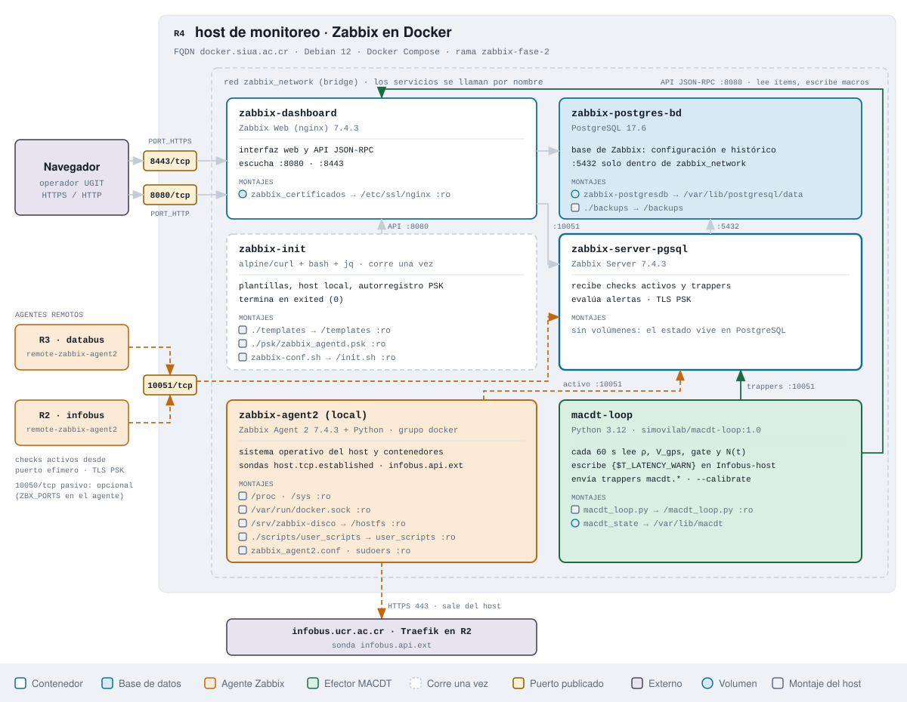
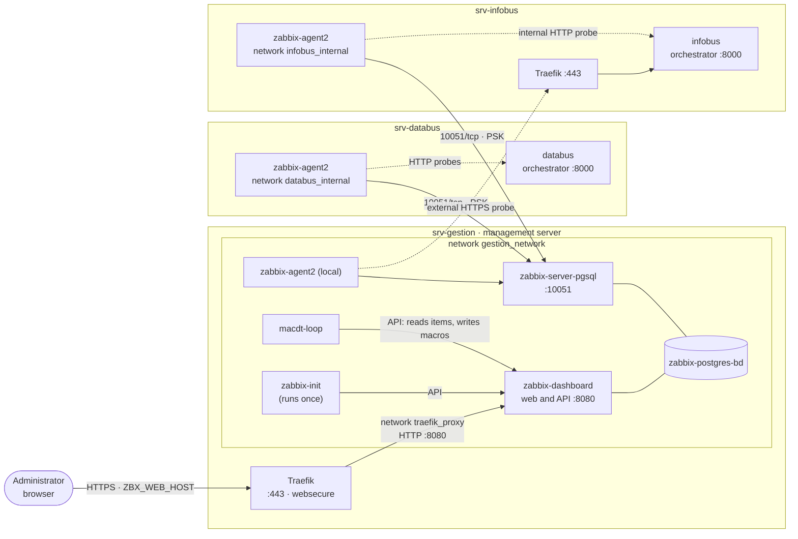
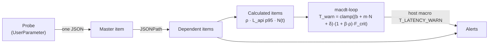
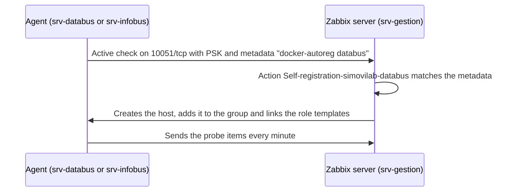

# Zabbix · databus and infobus monitoring

**English** · [Español](README%20es.md)


Docker Compose deployment for monitoring [databus](https://github.com/simovilab/databus) and [infobus](https://github.com/simovilab/infobus). The repository has two modes:

- **Server (`server`):** Zabbix Server, PostgreSQL, the web frontend, a local agent, the `zabbix-init` container that configures Zabbix through its API, and the **MACDT** loop, which adjusts the infobus latency threshold to the transit load. It runs on the management server (**srv-gestion**), and the web frontend is published **only through Traefik**, which runs on the same server.
- **Agent (`agent`):** a Zabbix Agent 2 on each application server (srv-databus and srv-infobus). It auto-registers with the server under its role (`databus` or `infobus`), is encrypted with PSK, and runs the domain probes (GTFS, GTFS-RT and the infobus API).

> **Server names.** srv-gestion is the server formerly called R4, srv-databus was R3 and srv-infobus was R2. Some older documents, diagrams and Zabbix item names (for example *Red: RTT de R4 a R2*) still use R2, R3 and R4.



## Architecture

| Service | Where | Role | Tech |
| --- | --- | --- | --- |
| **Traefik** *(not in this repository)* | srv-gestion | Reverse proxy: TLS certificate and host-based routing to the web frontends of Zabbix and Wazuh | Traefik |
| **zabbix-postgres-bd** | srv-gestion | Zabbix database | PostgreSQL 17.6 |
| **zabbix-server-pgsql** | srv-gestion | Receives agent data (10051/tcp) and evaluates alerts | Zabbix Server 7.4.3 |
| **zabbix-dashboard** | srv-gestion | Web frontend and JSON-RPC API, reached through Traefik | Zabbix Web (nginx) 7.4.3 |
| **zabbix-agent2** | srv-gestion | Local agent: operating system and external infobus probe | Zabbix Agent 2 7.4.3 + Python |
| **zabbix-init** | srv-gestion | Initial setup through the API. Runs once and exits | alpine/curl + bash + jq |
| **macdt-loop** | srv-gestion | MACDT loop: computes T_warn every minute and writes it as a macro | Python 3.12 |
| **zabbix-agent2** | Each application server (srv-databus, srv-infobus) | Operating system, containers and domain probes | Zabbix Agent 2 7.4.3 + Python |



Probes are agent `UserParameter`s. Each one queries its endpoint, prints **one JSON** (master item) and Zabbix splits it into dependent items. From that data the server computes ρ, the latency p95 and N(t), and the MACDT loop writes the threshold the alerts use:



| Probe (key) | Script | Agent | What it measures |
| --- | --- | --- | --- |
| `gtfs.probe[{$MACDT.STALE_S}]` | `gtfsrt_probe.py` | srv-databus | GTFS-RT feeds: active trips and vehicles, GPS coverage, freshness and completeness |
| `macdt.window` | `gtfs_window.py` | srv-databus | Source GTFS schedule: operating window, scheduled trips and V_trips_max |
| `databus.static` | `gtfs_window.py` | srv-databus | Static GTFS published by databus and its age |
| `infobus.api` | `infobus_probe.py` | srv-infobus | Internal `next-trips` latency (no Traefik), N(t) and query cost |
| `infobus.api.ext` | `infobus_probe.py` | srv-gestion | External `next-trips` latency (network + TLS + Traefik) |
| `host.tcp.established` | `zabbix-host-tcp-established.sh` | all | Established TCP connections on the host |
| `celery.probe` | `celery_probe.py` | srv-databus, srv-infobus | Celery task queues: tasks waiting and running, workers alive (broker: RabbitMQ in databus, Redis in infobus) |

The `UserParameter` lines live in [`agent2/zabbix_agent2.conf`](agent2/zabbix_agent2.conf).

### Networks and web access

The server stack uses two Docker networks. Both are **external**: Compose does not create them, so `zabbix-dev.sh` checks them and creates the missing ones before it starts the stack.

| Network | Name | Who joins it | What it is for |
| --- | --- | --- | --- |
| Management | `gestion_network` (fixed) | every server service | Internal traffic between the Zabbix services. The Wazuh stack on the same server uses it too |
| Proxy | `ZBX_TRAEFIK_NETWORK` in `.env` (today `traefik_proxy`) | `zabbix-dashboard` only | Lets Traefik reach the frontend. It must be the same network Traefik uses |

The frontend does not publish any port on the host. Traefik reads the Docker labels of `zabbix-dashboard` and routes `https://ZBX_WEB_HOST` to `zabbix-dashboard:8080` (plain HTTP inside the network; TLS ends at Traefik). The containers inside the stack keep using the internal address `http://zabbix-dashboard:8080/api_jsonrpc.php` (`API_URL`).

The remote agents do not use either network: they join the application network (`AGENT_DOCKER_NETWORK`) and send their data to `10051/tcp`, which `zabbix-server-pgsql` publishes on the host.

## Server

The server runs on srv-gestion, next to the Wazuh server and Traefik. It starts the whole stack with [`docker-compose.yml`](docker-compose.yml) and leaves Zabbix configured with no manual steps in the frontend.

### Quick start

```bash
git clone -b zabbix-fase-2 https://github.com/rsol9000-01/zabbix.git /home/zabbix
cd /home/zabbix
cp .env.example .env     # change passwords, web user and names (see below)
sudo ./scripts/zabbix-dev.sh server 'MySeed.2026'
```

When it finishes, the frontend is at `https://<ZBX_WEB_HOST>` (for example `https://simovilab-zabbix.siua.ac.cr`), with user `API_WEB_USER` and password `API_WEB_PASS` from `.env`.

There are two versions of every script with the same logic: `<name>.sh` (or `.py`) with comments and messages in English, and `<name>-es.sh` (or `-es.py`) in Spanish. Use either one.

> The seed **is required** and must be **the same** on the server and on every agent: the PSK is derived from it. Use your own, not the example. See [Seed and PSK](#seed-and-psk).

### How to

#### 1. Prerequisites

- Linux with Docker Engine and the Docker Compose v2 plugin. The `docker` group must exist.
- `python3`, which the script uses to derive the PSK from the seed. `curl` and `openssl` are also needed, but the script installs them with `apt-get` if they are missing.
- Run the script as **root** (`sudo`): it sets owners and permissions on repository files.
- **Traefik running on the same server**, attached to the network set in `ZBX_TRAEFIK_NETWORK`, with:
  - An HTTPS entry point named `websecure`.
  - A certificate resolver (`CERT_RESOLVER`, `letsencrypt` by default) or a certificate already loaded for `ZBX_WEB_HOST`.
  - The file provider enabled, with the `security-headers` and `compression` middlewares.
- A DNS record for `ZBX_WEB_HOST` that points to srv-gestion.
- Ports open in the server firewall:

| Port | Use | Open to |
| --- | --- | --- |
| `443/tcp` | Web frontend and API, through Traefik | Management network |
| `10051/tcp` | Agent data (active checks) and MACDT loop trappers | Agents |

#### 2. Configure `.env`

Copy `.env.example` to `.env`. `.env` is in `.gitignore`: never commit it. In server mode these are the variables to review; leave the **DO NOT EVER CHANGE** block as it is.

| Variable | Example | What it is |
| --- | --- | --- |
| `API_WEB_USER`, `API_WEB_PASS` | `tfg` / *(your own)* | Administrator created by `zabbix-init`. You log in to the frontend with it and the MACDT loop uses it. The password must meet the Zabbix policy (at least 8 characters, not containing the username) |
| `POSTGRES_PASSWORD` | *(your own)* | Zabbix database password |
| `ZBX_METADATA` | `docker-autoreg` | Auto-registration metadata. On the server it has no role |
| `ZBX_TLSPSKIDENTITY` | `zabbix-databus-psk` | PSK identity. Must be the same on the server and the agents |
| `MACDT_HOST_DATABUS`, `MACDT_HOST_INFOBUS` | `Databus-host`, `Infobus-host` | Agent host names. Must match each agent's `REMOTE_AGENT_HOSTNAME` |
| `MACDT_INTERVAL`, `MACDT_MAX_AGE` | `60`, `180` | MACDT loop period and maximum accepted data age (s) |
| `MACDT_CALIB_*` | see `.env.example` | T_base and β calibration. See [MACDT loop and calibration](#macdt-loop-and-calibration) |
| `LOCAL_TEMPLATE_FILES`, `LOCAL_TEMPLATE_NAMES` | see `.env.example` | Templates for the local host (srv-gestion) |
| `ROLE_DATABUS_TEMPLATE_*`, `ROLE_INFOBUS_TEMPLATE_*` | see `.env.example` | Templates each agent receives by role |
| `ZBX_TRAEFIK_NETWORK` | `traefik_proxy` | Docker network shared with Traefik. Must be exactly the network Traefik uses |
| `ZBX_WEB_HOST` | `simovilab-zabbix.siua.ac.cr` | Domain Traefik routes to the frontend |
| `CERT_RESOLVER` | `letsencrypt` | Traefik certificate resolver. Optional: `letsencrypt` is used if it is not set |
| `ZBX_ALLOWED_IPS` | `10.20.0.0/16` | Networks allowed to open the frontend, separated by commas. Optional: `10.20.0.0/16` is used if it is not set |
| `DASHBOARD_NAME` | `simovilab` | Name of the global dashboard `zabbix-init` builds. Optional: `simovilab` is used if it is not set |
| `TZ`, `PHP_TZ` | `America/Costa_Rica` | Container and frontend time zone |

Template lists go **in the same order**: files separated by commas and names by a vertical bar. The name must be identical to the YAML `name:` field. A `-` instead of a file means a template that already exists in Zabbix (for example, `Docker by Zabbix agent 2`).

#### 3. Deploy

```bash
cd /home/zabbix
sudo ./scripts/zabbix-dev.sh server 'MySeed.2026'
```

The script does this, in order:

1. Checks Docker, the `docker` group, `curl`, `openssl`, `.env` and the initial setup script (`SCRIPT_POST_INSTALL`).
2. Sets permissions on `scripts/user_scripts/` and `agent2/` (sudoers, `Dockerfile` and `zabbix_agent2.conf`).
3. Adds to `zabbix_agent2.conf` the `UserParameter`s declared in `.env` as `AGENT_PARAMS_<suffix>=key:script.sh`.
4. Derives the PSK from the seed and saves it to `psk/zabbix_agentd.psk`.
5. Checks that the `gestion_network` and `ZBX_TRAEFIK_NETWORK` networks exist, and creates the missing ones.
6. Starts the stack with `docker compose up -d` and follows the `zabbix-init` log until it ends.

When `zabbix-init` finishes without errors, the script prints `zabbix-init completed successfully` and `macdt-loop` starts. Traefik detects the frontend by itself when the container starts: there is nothing to restart in Traefik.

#### 4. What `zabbix-init` configures

`zabbix-init` runs [`scripts/zabbix-conf.sh`](scripts/zabbix-conf.sh) against the API:

1. Waits for the API to respond.
2. **First run:** logs in with the initial account (`Admin`), creates `API_WEB_USER`, transfers `Admin`'s maps and dashboards to it and deletes `Admin`. **Later runs:** logs in directly with `API_WEB_USER`.
3. Creates the `HOST_GROUP` host group if it does not exist.
4. Imports or updates the `LOCAL_TEMPLATE_*` and `ROLE_*_TEMPLATE_*` templates, creating what is missing and updating what exists.
5. Creates or updates the local `Zabbix-server` host, links the local templates and deletes the default `Zabbix server` host.
6. Creates or updates one auto-registration action per role (`Self-registration-simovilab-databus` and `-infobus`). Each action adds the host to the group, removes it from *Discovered hosts* and links the templates of its role.
7. Sets auto-registration to PSK encryption (identity `ZBX_TLSPSKIDENTITY` and the key derived from the seed).
8. Creates or rebuilds the global dashboard `DASHBOARD_NAME` (`simovilab`): host cards, pings, clock and the problems of `HOST_GROUP`. This block is the source of truth: changes made to this dashboard in the frontend are overwritten on the next run. Panels of agents that have not registered yet are skipped and added on a later run.

#### 5. Verify

```bash
docker compose -f docker-compose.yml ps        # everything running/healthy; zabbix-init exited (0)
docker compose -f docker-compose.yml logs zabbix-init | tail -20
docker logs --tail 5 macdt-loop                # one line per minute with N, T_base, ρ and T_warn

# Web access through Traefik
docker network inspect traefik_proxy --format '{{range .Containers}}{{.Name}} {{end}}'   # must list traefik and zabbix-dashboard
docker logs traefik 2>&1 | grep -iE "zabbix|error" | tail -20                           # no router or middleware errors
curl -s -o /dev/null -w '%{http_code}\n' --resolve simovilab-zabbix.siua.ac.cr:443:<srv-gestion IP> https://simovilab-zabbix.siua.ac.cr/   # 200
```

In the frontend: **Data collection → Hosts** shows `Zabbix-server` with a green ZBX tag. Agent hosts appear as each agent is deployed (see [Agent](#agent)).

If the frontend does not open:

| Symptom | Likely cause |
| --- | --- |
| Traefik 404 | `ZBX_WEB_HOST` does not match the domain in the browser, or the router has an error in the Traefik log (for example, a middleware that does not exist) |
| 502 or 504 Bad Gateway | `zabbix-dashboard` is not on the Traefik network, or the service port is not `8080` |
| 403 Forbidden | Your IP is not in `ZBX_ALLOWED_IPS` |
| Certificate warning | Traefik is serving its default certificate: check `CERT_RESOLVER` or the certificate for the domain |
| Broken charts or buttons | The `security-headers` middleware sends a Content-Security-Policy too strict for the Zabbix frontend |

#### MACDT loop and calibration

`macdt-loop` runs `scripts/user_scripts/macdt_loop.py` as a continuous loop, with no arguments and no cron. Every `MACDT_INTERVAL` seconds:

1. Reads ρ, GPS coverage and the operating window from Databus-host, and N(t) from Infobus-host, all through the Zabbix API.
2. Computes `T_warn = clamp((b + m·N(t) + δ) × (1 + β·ρ) × F_crit, T_floor, T_RNF)`.
3. Writes the result to the `{$T_LATENCY_WARN}` host macro on Infobus-host.
4. Sends its status through trappers (`macdt.status`, `macdt.t_warn` and `macdt.t_base`).

Until a calibration runs, `m = 0` and `δ = 0`, so T_base equals `{$MACDT.T_BASE}` (130 ms). Calibration fits the regression `latency = b + m·N + c·V` on the last `MACDT_CALIB_WINDOW_D` days of data and writes b, m, δ and β as host macros:

```bash
docker exec macdt-loop python3 /macdt_loop.py --calibrate --dry-run   # compute and show, write nothing
docker exec macdt-loop python3 /macdt_loop.py --calibrate             # apply if it passes the guards
docker exec macdt-loop python3 /macdt_loop.py --calibrate --force     # apply even if it changes more than MACDT_CALIB_MAX_DRIFT
docker exec macdt-loop python3 /macdt_loop.py --once --dry-run        # one test cycle, no writes
```

Calibration is applied only with at least `MACDT_CALIB_MIN_POINTS` points, R² ≥ `MACDT_CALIB_MIN_R2` and m > 0. If the new line changes more than `MACDT_CALIB_MAX_DRIFT` from the current one, it is held (`macdt.calib = 2`) and the alert *MACDT: la latencia de infobus cambió más de lo permitido* fires. With `MACDT_CALIB_MODE=daily`, it calibrates by itself once a day at `MACDT_CALIB_HOUR`, in the container `TZ`.

If you change the script, `docker compose restart macdt-loop` is enough. If you change `.env` variables, recreate the container:

```bash
docker compose up -d --no-deps --force-recreate macdt-loop
```

#### Update templates on an existing installation

Run the deployment again with the same seed. `zabbix-init` imports the templates again and updates what changed:

```bash
sudo ./scripts/zabbix-dev.sh server 'MySeed.2026'
```

Macros you changed **on the host** are kept. Macros you changed **on the template** from the frontend go back to the YAML value.

#### Common operations

```bash
# The script exports DOCKER_GID; by hand, set it first to avoid Compose warnings
export DOCKER_GID=$(getent group docker | cut -d: -f3)

# Status and logs
docker compose -f docker-compose.yml ps
docker compose -f docker-compose.yml logs -f zabbix-server-pgsql
docker logs -f macdt-loop

# Restart a service
docker compose -f docker-compose.yml restart zabbix-server-pgsql

# Database backup (saved in ./backups)
mkdir -p backups
docker exec zabbix-postgres-bd sh -c 'pg_dump -U "$POSTGRES_USER" "$POSTGRES_DB"' > backups/zabbix-$(date +%F).sql

# Stop (volumes are kept)
docker compose -f docker-compose.yml down
```

## Agent

The agent runs on each application server: srv-databus and srv-infobus. It starts with [`agent2/docker-compose-agent2.yml`](agent2/docker-compose-agent2.yml), joins the application Docker network to reach `orchestrator` by name, and registers itself with the server. It does not use the `gestion_network` or Traefik networks of srv-gestion.

### Quick start

```bash
git clone -b zabbix-fase-2 https://github.com/rsol9000-01/zabbix.git /home/zabbix
cd /home/zabbix
cp .env.example .env     # fill in the agent block (see below)
sudo ./scripts/zabbix-dev.sh agent 'MySeed.2026'   # the SAME seed as the server
```

Within a couple of minutes the host shows up in **Data collection → Hosts**, with the templates of its role and PSK encryption.

### How to

#### 1. Prerequisites

- The server already deployed, because `zabbix-init` creates the auto-registration actions.
- The application (databus or infobus) already running, because its Docker network must exist.
- Docker Engine with Compose v2, the `docker` group and `python3`. Run the script as **root** (`sudo`).
- Outbound access to the server on `10051/tcp`, and `SERVER_FQDN` resolvable from the host.
- `10050/tcp` open only if you use passive checks (`ZBX_PORTS`). The probes use active checks.

To find the application network name:

```bash
docker inspect $(docker ps -qf name=orchestrator) --format '{{json .NetworkSettings.Networks}}'
```

#### 2. Configure `.env`

In agent mode only the first block of `.env` needs to be filled in. Leave the rest as it comes in `.env.example`.

| Variable | srv-databus | srv-infobus | What it is |
| --- | --- | --- | --- |
| `AGENT_FQDN` | `databus.siua.ac.cr` | `infobus.example.com` | DNS name of the agent host |
| `REMOTE_AGENT_HOSTNAME` | `Databus-host` | `Infobus-host` | Host name in Zabbix. Must match the server's `MACDT_HOST_DATABUS` or `MACDT_HOST_INFOBUS` |
| `AGENT_DOCKER_NETWORK` | `databus_internal` | `infobus_internal` | Application Docker network the agent joins |
| `AGENT_PGPASSWORD` | *(your own)* | *(your own)* | PostgreSQL password for `psql` inside the agent. Only the `pgsql.bloat.detail` item uses it, currently commented out in `zabbix_agent2.conf` |
| `SERVER_FQDN` | `srv-gestion.siua.ac.cr` | `srv-gestion.siua.ac.cr` | Name or IP of the server that runs `zabbix-server-pgsql` |
| `ZBX_METADATA` | `docker-autoreg databus` | `docker-autoreg infobus` | Auto-registration metadata. The role decides which templates the host receives |

`ZBX_TLSPSKIDENTITY` must match the server's. It already does in `.env.example`.

#### 3. Deploy

```bash
cd /home/zabbix
sudo ./scripts/zabbix-dev.sh agent 'MySeed.2026'
```

The script does the same as on the server (permissions, sudoers, `UserParameter`s and PSK) but starts only `zabbix-agent2`. Also, on the first run it creates `agent2/simovilab-plugins.conf` from `agent2/simovilab-plugins.conf.example`.

`simovilab-plugins.conf` holds the PostgreSQL and Redis plugin sessions, with sample passwords. It is in `.gitignore`: each server keeps its own copy. Edit it with that server's real passwords. For PostgreSQL, use a read-only user with the `pg_monitor` role, not `postgres`:

```sql
CREATE ROLE zabbix_ro LOGIN PASSWORD '<your own password>';
GRANT pg_monitor TO zabbix_ro;
```

On srv-databus only, also allow `zabbix_ro` to read the table of the current static GTFS version (item `databus.static.age_s`, query `agent2/pgsql-queries/databus_static.sql`). Run it once, with the owner of the database:

```bash
DB=$(docker ps --format '{{.Names}}' | grep -m1 'databus.*database')
echo "$DB"     # must show the PostgreSQL container of databus
docker exec -it "$DB" psql -U postgres -d databus -c "GRANT SELECT ON feed_feed TO zabbix_ro;"
```

If `DB_USER` in the databus `.env` is not `postgres`, replace `-U postgres` with that user. The answer must be `GRANT`.

After editing it, restart the agent:

```bash
docker compose -f agent2/docker-compose-agent2.yml --env-file .env restart
```

#### 4. What happens at startup



#### Memory and CPU on LXC, VM or cloud

The agent runs in Docker. On a VM, a cloud VM (AWS EC2, DigitalOcean, Azure, GCP) or bare metal, it reads the server's own `/proc`. Inside an LXC (Proxmox, OpenVZ) it does not:

- `/proc/meminfo`: lxcfs answers according to the cgroup of the reader, so the agent sees **its own container** (for example 0.45 % used on an 8 GiB LXC at 52 %).
- `/proc/loadavg` and `/proc/stat`: they show the **whole Proxmox host**, even from the LXC shell. Load per CPU becomes the host load divided by the LXC cores (1.76 on a 4-core LXC with the host at 7), and CPU % and I/O wait are the host's.

Standard agent items cannot fix that from inside Docker. `zabbix-dev.sh` (server and agent mode) therefore installs a systemd timer on the server, `simovilab-host-stats.timer`. Every minute it writes these files to `/srv/zabbix-disco`, which the agent mounts as `/hostfs`:

| File | Source | Used for |
| --- | --- | --- |
| `meminfo` | `/proc/meminfo` | Memory total, used, available and % used (page cache not counted) |
| `cpu` | `usage_usec` from `/sys/fs/cgroup/cpu.stat` and `nproc` | CPU % over the server's own cores |
| `cpu.pressure` | `/sys/fs/cgroup/cpu.pressure`, or `/proc/pressure/cpu` if absent | CPU pressure (PSI) |
| `io.pressure` | `/sys/fs/cgroup/io.pressure`, or `/proc/pressure/io` if absent | Disk pressure (PSI) |

Inside an LXC the cgroup files belong to the LXC; on a VM or bare metal the root cgroup is the whole system. The template reads only these files, so values mean the same on any platform.

Load average per CPU is replaced by **CPU pressure** (PSI): Linux keeps no load average per container, and PSI gives the share of time tasks waited for CPU. Disk I/O wait is replaced by **disk pressure** the same way. Both thresholds are macros (`{$CPU.PSI.*}`, `{$IO.PSI.*}`).

| Platform | Standard agent items | Exported files |
| --- | --- | --- |
| Bare metal, VM, cloud VM | Correct, except memory counts page cache as used | Correct |
| LXC, OpenVZ | Wrong: memory of the agent container, CPU and load of the host | Correct |
| Managed containers (Fargate, Kubernetes) | Wrong | Not applicable: use the platform metrics |

Requirements: systemd (without it, the script prints a crontab line to add) and cgroup v2 with PSI (Linux 4.20 or later, default on current distributions and on Proxmox 7 and 8). Without cgroup v2, CPU % falls back to `/proc/stat`, which is only correct outside an LXC.

Check on the server:

```bash
systemctl status simovilab-host-stats.timer
head -3 /srv/zabbix-disco/meminfo; cat /srv/zabbix-disco/cpu /srv/zabbix-disco/cpu.pressure
```

If the files stop updating, the *Datos de memoria sin actualizar* alert fires after 5 min.

#### 5. Adapt the probes to the installation

The addresses the probes query are in [`agent2/zabbix_agent2.conf`](agent2/zabbix_agent2.conf). Review them on every new installation:

| Key | Parameter | What to set |
| --- | --- | --- |
| `gtfs.probe[*]` | `--base` | databus GTFS-RT feed path inside the network (`http://orchestrator:8000/feed/realtime`) |
| `macdt.window` | `--url` | Static GTFS from the official schedule source |
| `databus.static` | `--url` | Static GTFS published by databus (`http://orchestrator:8000/feed/schedule/feed.zip`) |
| `infobus.api` | `--base`, `--host-header`, `--transit-system` | infobus orchestrator inside the network, a value from its `ALLOWED_HOSTS`, and the `TransitSystem` id (see [step 6](#6-srv-infobus-only-check-the-infobus-transitsystem-id)) |
| `infobus.api.ext` | `--base` | infobus public URL, behind Traefik |
| `celery.probe` | — | Broker of the server in `agent2/simovilab-celery.conf` (not in this file). See the [probe guide](docs/README-celery_probe.md) |

Scripts are mounted read-only from `scripts/user_scripts/` and the agent reads them on every run: if you change a script, nothing needs restarting. If you change `zabbix_agent2.conf`, restart the agent.

#### 6. srv-infobus only: check the InfoBus `TransitSystem` id

The `infobus.api` and `infobus.api.ext` probes call the InfoBus `next-trips` endpoint with `--transit-system 1`. InfoBus requires that parameter, and it must be the **database id** of the bUCR transit system. InfoBus assigns that id when the transit system is created, so it can change if InfoBus is reinstalled or its data is loaded again. If the value does not match, the probes report status `500` and the infobus items stay without data.

After deploying the agent, check the id on **srv-infobus**:

```bash
docker exec $(docker ps --format '{{.Names}}' | grep -i orchestrator | head -1) \
  uv run python manage.py shell -c "from feed.models import TransitSystem; print(list(TransitSystem.objects.values('id','code')))"
```

Expected output:

```
[{'id': 1, 'code': 'bUCR'}]
```

- **The id is `1`:** nothing to do.
- **The id is another number:** change `--transit-system` in `agent2/zabbix_agent2.conf` in **two places**, because each probe runs on a different server:

| Server | Line in `agent2/zabbix_agent2.conf` | Then restart |
| --- | --- | --- |
| srv-infobus | `UserParameter=infobus.api,...` | `docker compose -f agent2/docker-compose-agent2.yml --env-file .env restart` |
| srv-gestion | `UserParameter=infobus.api.ext,...` | `docker compose restart zabbix-agent2` |

On each server, from the repository folder (`/home/zabbix`), replace `<id>` with the number you got:

```bash
TS=<id>
sed -i -E "s/(--transit-system )[0-9]+/\1${TS}/" agent2/zabbix_agent2.conf
grep -n -- '--transit-system' agent2/zabbix_agent2.conf    # both lines must show the new id
```

The probe reads the change on its next cycle (one minute) after the agent restarts.

> If the id is correct and the probe still reports `500`, the problem is inside InfoBus, not in the agent. InfoBus is under development; for example, after a new GTFS import the same stop can exist twice and `next-trips` fails for every client. Report it to the InfoBus team. This command shows whether the probe stop is duplicated (more than 1 means duplicated):
>
> ```bash
> docker exec $(docker ps --format '{{.Names}}' | grep -i orchestrator | head -1) \
>   uv run python manage.py shell -c "from feed.models import Stop; print(Stop.objects.filter(stop_id='bUCR_0_01').count())"
> ```

#### 7. Verify

```bash
docker compose -f agent2/docker-compose-agent2.yml --env-file .env ps
docker logs --tail 20 zabbix-agent2
```

In the frontend: **Data collection → Hosts** shows the host with a green ZBX tag and the PSK lock. **Monitoring → Latest data** shows the items of its role.

> To test a probe by hand, run its item through the agent, with the same parameters Zabbix uses:
>
> ```bash
> docker exec zabbix-agent2 zabbix_agent2 -t 'gtfs.probe[60]'
> ```

#### Common operations

```bash
export DOCKER_GID=$(getent group docker | cut -d: -f3)   # used by the agent compose file
docker compose -f agent2/docker-compose-agent2.yml --env-file .env ps
docker compose -f agent2/docker-compose-agent2.yml --env-file .env logs -f
docker compose -f agent2/docker-compose-agent2.yml --env-file .env restart
docker compose -f agent2/docker-compose-agent2.yml --env-file .env down
```

## Seed and PSK

The second argument of `zabbix-dev.sh` is a **seed**, not the PSK. The script derives the PSK with PBKDF2-HMAC-SHA256 (600,000 iterations and a fixed project salt) and saves it to `psk/zabbix_agentd.psk`. Because the computation is always the same, the same seed yields the same PSK on every machine, with no files copied between them.

Seed requirements:

- 8 to 64 characters.
- At least one uppercase letter, one lowercase letter, one digit and one of these symbols: `. * + ? -`.
- No `$`, `|`, `&` or `\`.
- Always in single quotes: `'MySeed.2026'`.

Keep the seed outside the repository. Never publish the seed or the PSK. The `psk/` folder is in `.gitignore`.

## Reference

### Templates

| File | Template | Linked to | Guide |
| --- | --- | --- | --- |
| [`templates/simovilab-templates.yml`](templates/simovilab-templates.yml) | `simovilab servidor y sistema operativo` | All 3 hosts: operating system, ping from the server and container discovery. Includes the *Servidor* dashboard | [guide](docs/README-template-simovilab-templates.md) |
| [`templates/simovilab-databus.yml`](templates/simovilab-databus.yml) | `simovilab-databus` | Role `databus`: GTFS-RT, static GTFS, operating window and ρ. Includes the *Operación databus* dashboard | [guide](docs/README-template-simovilab-databus.md) |
| [`templates/simovilab-infobus.yml`](templates/simovilab-infobus.yml) | `simovilab-infobus` | Role `infobus`: API latency, N(t), MACDT loop and calibration. Includes the *Operación infobus* dashboard | [guide](docs/README-template-simovilab-infobus.md) |
| [`templates/simovilab-infobus-ext.yml`](templates/simovilab-infobus-ext.yml) | `simovilab-infobus-ext` | Server local host: external infobus measurement through Traefik | [guide](docs/README-template-simovilab-infobus-ext.md) |
| [`templates/simovilab-database.yml`](templates/simovilab-database.yml) | `simovilab-database` | Roles `databus` and `infobus`: PostgreSQL and Redis of each project. Includes the *DATABASE* dashboard | [guide](docs/README-template-simovilab-database.md) |
| [`templates/simovilab-celery.yml`](templates/simovilab-celery.yml) | `simovilab-celery` | Roles `databus` and `infobus`: Celery task queues of each project. Includes the *CELERY* dashboard | [guide](docs/README-template-simovilab-celery.md) |
| *(official Zabbix)* | `Docker by Zabbix agent 2` | All 3 hosts | — |

### Items

*Dependent* items query nothing: they take one field from their master item JSON. *Calculated* items are built by the server from other items. Names are shown as they appear in Zabbix (Spanish).

| Template | Applied to | Items |
| --- | --- | --- |
| `simovilab servidor y sistema operativo` | all 3 hosts (Zabbix-server, Databus-host, Infobus-host) | 17 + 1 discovery rule with 5 prototypes per container |
| `simovilab-databus` | Databus-host (srv-databus) | 38 |
| `simovilab-infobus` | Infobus-host (srv-infobus) | 31 |
| `simovilab-infobus-ext` | Zabbix-server (srv-gestion) | 19 |
| `simovilab-database` | srv-databus and srv-infobus | 40 |
| `simovilab-celery` | srv-databus and srv-infobus | 10 + 2 discovery rules with 3 prototypes per queue |
| `Docker by Zabbix agent 2` | all 3 hosts | Official Zabbix template, unchanged |

<details>
<summary><code>simovilab servidor y sistema operativo</code> — 8 items</summary>

| Name | Key | Type |
| --- | --- | --- |
| TCP connections ESTABLISHED | `host.tcp.established` | Agent (active) |
| Server UP/DOWN | `icmpping[,3]` | Simple check |
| CPU: uso y núcleos del servidor (archivo) | `vfs.file.contents[/hostfs/cpu]` | Agent (active) |
| CPU utilization (user + system) | `simovilab.cpu.util` | Dependent |
| CPU: presión (archivo) | `vfs.file.contents[/hostfs/cpu.pressure]` | Agent (active) |
| CPU pressure (1 min) | `simovilab.cpu.psi` | Dependent |
| Disco: presión (archivo) | `vfs.file.contents[/hostfs/io.pressure]` | Agent (active) |
| Disk I/O pressure (1 min) | `simovilab.io.psi` | Dependent |
| Uptime | `system.uptime` | Agent (active) |
| Disk space free (/) | `vfs.fs.size[/hostfs,pfree]` | Agent (active) |
| Memoria: /proc/meminfo del servidor | `vfs.file.contents[/hostfs/meminfo]` | Agent (active) |
| Memoria total | `simovilab.mem.total` | Dependent |
| Memoria libre (disponible) | `simovilab.mem.available` | Dependent |
| Memoria usada | `simovilab.mem.used` | Dependent |
| Memory utilization (% used) | `simovilab.mem.pused` | Dependent |
| Memoria: usada + libre = total | `simovilab.mem.html` | Dependent |
| Memoria: última actualización del archivo | `vfs.file.time[/hostfs/meminfo,modify]` | Agent (active) |
| *Contenedores (todos, incluidos los detenidos)* | `docker.containers.discovery[true]` | Discovery |
| ↳ Contenedor {#NAME}: info (short) | `docker.container_info["{#NAME}",short]` | Prototype |
| ↳ Contenedor {#NAME}: código de salida | `simovilab.contenedor.exitcode["{#NAME}"]` | Prototype |
| ↳ Contenedor {#NAME}: reinicios automáticos | `simovilab.contenedor.restart_count["{#NAME}"]` | Prototype |
| ↳ Contenedor {#NAME}: corriendo | `simovilab.contenedor.running["{#NAME}"]` | Prototype |
| ↳ Contenedor {#NAME}: hora de inicio | `simovilab.contenedor.started["{#NAME}"]` | Prototype |

</details>

<details>
<summary><code>simovilab-databus</code> — 39 items</summary>

| Name | Key | Type |
| --- | --- | --- |
| GTFS estático publicado por databus | `databus.static` | Agent (active) |
| databus: versión vigente del estático (raw) | `pgsql.custom.query["{$DB.SESSION}",,,,databus_static]` | Agent (active) |
| databus: antigüedad del estático | `databus.static.age_s` | Dependent |
| databus: desfase del estático frente a la fuente | `databus.static.desfase_s` | Calculated |
| databus: código HTTP del estático | `databus.static.http` | Dependent |
| databus: lectura del estático correcta | `databus.static.ok` | Dependent |
| V_completeness de predicciones | `gtfs.completeness_tu_pct` | Dependent |
| V_completeness de posiciones | `gtfs.completeness_vp_pct` | Dependent |
| Calibrar el --stale contra la cadencia real | `gtfs.data_age_p95_s` | Dependent |
| V_age del publicador de predicciones | `gtfs.feed_age_tu_s` | Dependent |
| V_age del publicador de posiciones | `gtfs.feed_age_vp_s` | Dependent |
| Raíz del árbol de alertas | `gtfs.fetch_ok` | Dependent |
| Latencia del endpoint de predicciones | `gtfs.fetch_tu_ms` | Dependent |
| Latencia del endpoint de posiciones | `gtfs.fetch_vp_ms` | Dependent |
| gtfs-Maestro | `gtfs.probe[{$MACDT.STALE_S}]` | Agent (active) |
| Sospecha de relleno de timestamps | `gtfs.ts_igual_header_pct` | Dependent |
| V_gps. Entrada de F_crit | `gtfs.v_gps_pct` | Dependent |
| V_trips. Entrada de F_load y G_load | `gtfs.v_trips` | Dependent |
| Denominador real de V_gps | `gtfs.v_vehicles` | Dependent |
| Vehículos con GPS fresco | `gtfs.v_gps_frescos` | Dependent |
| Vehículos con GPS viejo | `gtfs.v_gps_viejos` | Dependent |
| Vehículos sin timestamp | `gtfs.v_gps_sin_ts` | Dependent |
| Viajes sin paradas por delante | `gtfs.v_trips_sin_paradas` | Dependent |
| Umbral de GPS fresco usado por la sonda | `gtfs.stale_s` | Dependent |
| Edad máxima de la posición GPS | `gtfs.data_age_max_s` | Dependent |
| Edad de la posición GPS por vehículo | `gtfs.vehiculos_texto` | Dependent |
| Tabla de vehículos del feed (HTML) | `gtfs.vehiculos_html` | Dependent |
| Calendar age | `macdt.cal_dias_vigencia` | Dependent |
| Schedule | `macdt.gate` | Dependent |
| Horario de servicio (texto) | `macdt.horario_texto` | Dependent |
| Huecos sin buses programados (texto) | `macdt.huecos_texto` | Dependent |
| scheduled slot | `macdt.hueco_programado` | Dependent |
| static_zip_age | `macdt.static_zip_age_s` | Dependent |
| SIMOVI: código HTTP del GTFS estático | `macdt.static_zip_http` | Dependent |
| Scheduled trips | `macdt.s_t` | Dependent |
| Max trips | `macdt.v_trips_max` | Dependent |
| macd-Maestro | `macdt.window` | Agent (active) |
| Raíz del árbol de la ventana | `macdt.window_ok` | Dependent |
| Calculo de p | `p.calculated` | Calculated |

</details>

<details>
<summary><code>simovilab-infobus</code> — 31 items</summary>

| Name | Key | Type |
| --- | --- | --- |
| Sonda de la API de InfoBus | `infobus.api` | Agent (active) |
| Parada medida por la sonda | `infobus.api.stop_id` | Dependent |
| Horas de paso en 5 h de la parada medida (pico) | `infobus.api.stop_pico_5h` | Dependent |
| Eleccion automatica de parada activa | `infobus.api.stop_auto` | Dependent |
| Día sin servicio (next-trips responde 204) | `infobus.api.sin_servicio` | Dependent |
| Tabla API INFOBUS (HTML) | `infobus.api.tabla_html` | Dependent |
| API de InfoBus responde correctamente | `infobus.api.ok` | Dependent |
| Llegadas programadas en 5 h, N(t) | `infobus.api.llegadas` | Dependent |
| Buses en camino a la parada medida | `infobus.api.buses_parada` | Dependent |
| N(t) para MACDT: p95 de llegadas, ventana de 1 h | `infobus.api.llegadas_p95_1h` | Calculated |
| L_api p50 del ciclo | `infobus.api.lat_p50` | Dependent |
| Latencia en día sin servicio (respuestas 204) | `infobus.api.lat_sin_servicio` | Dependent |
| L_api p90 del ciclo | `infobus.api.lat_p90` | Dependent |
| L_api maxima del ciclo | `infobus.api.lat_max` | Dependent |
| Costo de la consulta, aislado del transporte | `infobus.api.query_p50` | Dependent |
| Piso de transporte, conexion abierta | `infobus.api.health_ms` | Dependent |
| Primera peticion de la sesion (abre la conexion) | `infobus.api.health_cold_ms` | Dependent |
| Costo de abrir la conexión (DNS + TCP) | `infobus.api.setup_ms` | Dependent |
| Disponibilidad de /health/ | `infobus.api.health_ok` | Dependent |
| Too Many Requests (429): peticiones rechazadas por la cuota | `infobus.api.throttled` | Dependent |
| L_api p95 real, ventana de 1 h | `infobus.api.lat_p95_1h` | Calculated |
| Conexion TCP al orchestrator | `infobus.api.tcp_connect_ms` | Dependent |
| Red: RTT de R4 a R2, promedio 15 min | `infobus.net.rtt_ms` | Calculated |
| Externo - interno: red + TLS + Traefik | `infobus.net.delta_ms` | Calculated |
| TLS + Traefik (sin red) | `infobus.net.tls_traefik_ms` | Calculated |
| Estado del bucle MACDT | `macdt.status` | Trapper |
| T_warn escrito por MACDT | `macdt.t_warn` | Trapper |
| T_base(t) calculado por MACDT | `macdt.t_base` | Trapper |
| Resultado de la calibración de MACDT | `macdt.calib` | Trapper |
| Detalle de la calibración de MACDT | `macdt.calib.info` | Trapper |

</details>

<details>
<summary><code>simovilab-infobus-ext</code> — 19 items</summary>

| Name | Key | Type |
| --- | --- | --- |
| External InfoBus API probe | `infobus.api.ext` | Agent (active) |
| External: API responds correctly | `infobus.api.ext.ok` | Dependent |
| External: Too Many Requests (429): requests rejected by the rate limit | `infobus.api.ext.throttled` | Dependent |
| External: L_api cycle p50 | `infobus.api.ext.lat_p50` | Dependent |
| External: L_api cycle p90 | `infobus.api.ext.lat_p90` | Dependent |
| External: query cost | `infobus.api.ext.query_p50` | Dependent |
| External: baseline with an open connection (network + TLS + Traefik + Daphne) | `infobus.api.ext.health_ms` | Dependent |
| External: first request (opens the connection) | `infobus.api.ext.health_cold_ms` | Dependent |
| External: connection setup cost (TCP + TLS) | `infobus.api.ext.setup_ms` | Dependent |
| External: TCP connection from R4 to Traefik (network) | `infobus.api.ext.tcp_connect_ms` | Dependent |
| External: burst requests | `infobus.api.ext.n` | Dependent |
| External: 200 responses in the burst | `infobus.api.ext.n_200` | Dependent |
| External: 204 responses in the burst | `infobus.api.ext.n_204` | Dependent |
| External: other or no responses in the burst | `infobus.api.ext.errors` | Dependent |
| External: INFOBUS API table (HTML) | `infobus.api.ext.tabla_html` | Dependent |
| External: cycle timings (HTML) | `infobus.api.ext.tiempos_html` | Dependent |
| External: L_api real p95, 1 h window | `infobus.api.ext.lat_p95_1h` | Calculated |
| Internal: L_api real p95, 1 h window | `infobus.api.ext.int_p95_1h` | Calculated |
| External - internal: last hour p95 | `infobus.api.ext.delta_p95_1h` | Calculated |

</details>

<details>
<summary><code>simovilab-database</code> — 40 items</summary>

| Name | Key | Type |
| --- | --- | --- |
| PostgreSQL: availability (ping) | `pgsql.ping["{$DB.SESSION}"]` | Agent (active) |
| PostgreSQL: connections (raw) | `pgsql.connections["{$DB.SESSION}"]` | Agent (active) |
| PostgreSQL: active connections | `pgsql.conn.active` | Dependent |
| PostgreSQL: idle connections | `pgsql.conn.idle` | Dependent |
| PostgreSQL: idle in transaction connections | `pgsql.conn.idle_in_tx` | Dependent |
| PostgreSQL: connections waiting on a lock | `pgsql.conn.waiting` | Dependent |
| PostgreSQL: total connections | `pgsql.conn.total` | Dependent |
| PostgreSQL: connections used of max_connections | `pgsql.conn.total_pct` | Dependent |
| PostgreSQL: database statistics (raw, all databases) | `pgsql.dbstat["{$DB.SESSION}"]` | Agent (active) |
| PostgreSQL: database statistics (raw, this database) | `pgsql.db.stat` | Dependent |
| PostgreSQL: commits per second | `pgsql.db.commits.rate` | Dependent |
| PostgreSQL: rollbacks per second | `pgsql.db.rollbacks.rate` | Dependent |
| PostgreSQL: blocks read from cache per second | `pgsql.db.blks_hit.rate` | Dependent |
| PostgreSQL: blocks read from disk per second | `pgsql.db.blks_read.rate` | Dependent |
| PostgreSQL: cache hit ratio | `pgsql.db.cache_hit` | Calculated |
| PostgreSQL: new deadlocks | `pgsql.db.deadlocks` | Dependent |
| PostgreSQL: summary table (HTML) | `pgsql.db.summary_html` | Dependent |
| PostgreSQL: running queries (raw, all databases) | `pgsql.queries["{$DB.SESSION}",,,,"{$PG.SLOW.QUERY.S}"]` | Agent (active) |
| PostgreSQL: running queries (raw, this database) | `pgsql.db.queries` | Dependent |
| PostgreSQL: slow queries running | `pgsql.db.slow_queries` | Dependent |
| PostgreSQL: longest running query | `pgsql.db.query_time_max` | Dependent |
| PostgreSQL: longest open transaction | `pgsql.db.tx_time_max` | Dependent |
| PostgreSQL: database size | `pgsql.db.size["{$DB.SESSION}"]` | Agent (active) |
| PostgreSQL: uptime | `pgsql.uptime["{$DB.SESSION}"]` | Agent (active) |
| PostgreSQL: table statistics (raw) | `pgsql.custom.query["{$DB.SESSION}",,,,simovilab_tables]` | Agent (active) |
| PostgreSQL: dead tuples (all tables) | `pgsql.db.dead_tuples` | Dependent |
| PostgreSQL: dead tuples by table (HTML) | `pgsql.db.tables_html` | Dependent |
| Redis: availability (ping) | `redis.ping["{$DB.SESSION}"]` | Agent (active) |
| Redis: INFO (raw) | `redis.info["{$DB.SESSION}"]` | Agent (active) |
| Redis: connected clients | `redis.clients` | Dependent |
| Redis: blocked clients | `redis.clients.blocked` | Dependent |
| Redis: memory used | `redis.mem.used` | Dependent |
| Redis: memory limit (maxmemory) | `redis.mem.max` | Dependent |
| Redis: memory used of maxmemory | `redis.mem.pct` | Dependent |
| Redis: operations per second | `redis.ops` | Dependent |
| Redis: keys | `redis.keys` | Dependent |
| Redis: new evicted keys | `redis.evicted` | Dependent |
| Redis: last RDB save status | `redis.rdb_status` | Dependent |
| Redis: uptime | `redis.uptime` | Dependent |
| Redis: summary table (HTML) | `redis.summary_html` | Dependent |

</details>

<details>
<summary><code>simovilab-celery</code> — 10 items</summary>

| Name | Key | Type |
| --- | --- | --- |
| Celery: queue probe | `celery.probe` | Agent (active) |
| Celery: broker reachable | `celery.ok` | Dependent |
| Celery: probe error | `celery.error` | Dependent |
| Celery: broker type | `celery.broker` | Dependent |
| Celery: tasks waiting (all queues) | `celery.ready_total` | Dependent |
| Celery: tasks running (all queues) | `celery.unacked_total` | Dependent |
| Celery: workers alive | `celery.workers` | Dependent |
| Celery: unroutable messages | `celery.unroutable_rate` | Dependent |
| Celery: probe duration | `celery.elapsed_ms` | Dependent |
| Celery: queue table (HTML) | `celery.html` | Dependent |
| *Celery: work queues* | `celery.queues.discovery` | Discovery |
| ↳ Celery: tasks waiting in {#QUEUE} | `celery.queue.ready[{#QUEUE}]` | Prototype |
| *Celery: queue workers (RabbitMQ)* | `celery.queues.detail.discovery` | Discovery |
| ↳ Celery: tasks running in {#QUEUE} | `celery.queue.unacked[{#QUEUE}]` | Prototype |
| ↳ Celery: consumers on {#QUEUE} | `celery.queue.consumers[{#QUEUE}]` | Prototype |

</details>

### Macros

To change a macro without losing the change on the next template import, override it on the host: Data collection → Hosts → *host* → **Macros** tab → **Inherited and host macros** → **Change**. To change the default value, edit the template YAML and import it.

**Written by the MACDT loop**

| Macro | Default | Template | What it controls |
| --- | --- | --- | --- |
| `{$T_LATENCY_WARN}` | `130` | `simovilab-infobus` | L_api warning threshold. Overwritten every minute by the MACDT loop (host macro). |

**Set by calibration (or by several days of data)**

| Macro | Default | Template | What it controls |
| --- | --- | --- | --- |
| `{$MACDT.TSFILL.WARN}` | `50` | `simovilab-databus` | % of vehicles carrying the header time that counts as filler. |
| `{$MACDT.T_BASE}` | `130` | `simovilab-infobus` | T_base seed. Used only when N(t) is missing or stale. |
| `{$MACDT.B}` | `130` | `simovilab-infobus` | b in T_base(t): fixed request cost (ms). Written by calibration. |
| `{$MACDT.M}` | `0` | `simovilab-infobus` | m in T_base(t): ms per scheduled arrival in 5 h. With 0, T_base is constant. |
| `{$MACDT.DELTA}` | `0` | `simovilab-infobus` | δ in T_base(t): margin, P95 of the regression residuals. |
| `{$MACDT.BETA}` | `0.35` | `simovilab-infobus` | β: weight of active buses (ρ). β = c·V_max ÷ mean T_base with buses. |

**Review on every new installation**

| Macro | Default | Template | What it controls |
| --- | --- | --- | --- |
| `{$CONTENEDOR.IGNORAR}` | `-init\|migrat\|-run-` | `simovilab servidor y sistema operativo` | Regex of containers that exit on purpose (init, migrations, run) and are not watched. |
| `{$MACDT.STALE_S}` | `60` | `simovilab-databus` | Seconds a position counts as fresh. Must equal databus TELEMETRY_GRACE_S. |
| `{$MACDT.V_AGE.CRIT}` | `70` | `simovilab-databus` | Maximum trip-updates feed age before the high alert (below the 75 s infobus tolerates). |
| `{$MACDT.V_AGE.WARN}` | `45` | `simovilab-databus` | Maximum trip-updates feed age before warning (3 cycles of 15 s). |
| `{$DB.SESSION}` | `databus` / `infobus` | `simovilab-databus` / `simovilab-infobus` | Agent 2 session and PostgreSQL database name read by `simovilab-database` on the same host. Must match the session names in `agent2/simovilab-plugins.conf`. |

**Alert fine-tuning (only if they are noisy or miss events)**

| Macro | Default | Template | What it controls |
| --- | --- | --- | --- |
| `{$CONTENEDOR.REINICIO.VENTANA}` | `600` | `simovilab servidor y sistema operativo` | Seconds the "se reinició" alert stays active. |
| `{$CPU.PSI.CRIT}` | `40` | `simovilab servidor y sistema operativo` | CPU pressure (% of time waiting for CPU, 1-min average) for the critical alert. |
| `{$CPU.PSI.WARN}` | `20` | `simovilab servidor y sistema operativo` | CPU pressure for the warning alert. Below 2 % in the lab without anomalous load. |
| `{$IO.PSI.CRIT}` | `40` | `simovilab servidor y sistema operativo` | Disk pressure (% of time waiting for disk, 1-min average) for the critical alert. |
| `{$IO.PSI.WARN}` | `20` | `simovilab servidor y sistema operativo` | Disk pressure for the warning alert. Between 0 and 5 % in the lab without anomalous load. |
| `{$MACDT.CAL.DIAS.WARN}` | `7` | `simovilab-databus` | Days in advance to warn that the GTFS calendar expires. |
| `{$MACDT.COMPL.CRIT}` | `80` | `simovilab-databus` | Minimum trip-updates completeness (critical level, %). |
| `{$MACDT.COMPL.WARN}` | `90` | `simovilab-databus` | Minimum trip-updates completeness before warning (%). |
| `{$MACDT.ZIP.DESFASE.WARN}` | `600` | `simovilab-databus` | Maximum gap (s) between the databus GTFS and the source GTFS. |
| `{$T_LATENCY_WARN.SOSTENIDO}` | `30m` | `simovilab-infobus` | Time the p95 must stay above T_warn for the "sostenido" high alert. |
| `{$INFOBUS.SETUP.FACTOR}` | `2` | `simovilab-infobus` | Times the daily median connection-setup cost that fires the alert. |
| `{$INFOBUS.SETUP.MIN_MS}` | `5` | `simovilab-infobus` | Minimum (ms) to alert on connection-setup cost. |
| `{$INFOBUS.T204.FACTOR}` | `2` | `simovilab-infobus` | Times the daily median 204 latency that fires the alert. |
| `{$INFOBUS.EXT.SETUP.FACTOR}` | `2` | `simovilab-infobus-ext` | Same as INFOBUS.SETUP.FACTOR, for the public connection. |
| `{$INFOBUS.EXT.SETUP.MIN_MS}` | `5` | `simovilab-infobus-ext` | Same as INFOBUS.SETUP.MIN_MS, for the public connection. |

**Database thresholds (specification document, sections 2.2 and 2.3)**

| Macro | Default | Template | What it controls |
| --- | --- | --- | --- |
| `{$PG.CACHE.HIT.CRIT}` | `90` | `simovilab-database` | [ESP] 2.2 · cache hit ratio, %, 15 min average |
| `{$PG.CACHE.HIT.WARN}` | `95` | `simovilab-database` | [ESP] 2.2 · cache hit ratio, %, 15 min average |
| `{$PG.CONN.ACTIVE.CRIT}` | `120` | `simovilab-database` | [ESP] 2.2 · active connections, 5 min |
| `{$PG.CONN.ACTIVE.WARN}` | `80` | `simovilab-database` | [ESP] 2.2 · active connections, 5 min |
| `{$PG.CONN.IDLETX.CRIT}` | `20` | `simovilab-database` | [ESP] 2.2 · idle in transaction, 5 min |
| `{$PG.CONN.IDLETX.WARN}` | `10` | `simovilab-database` | [ESP] 2.2 · idle in transaction, 5 min |
| `{$PG.CONN.PCT.CRIT}` | `90` | `simovilab-database` | Connections used of max_connections, %. At 100 % new connections are rejected |
| `{$PG.DEAD.TUP.CRIT}` | `50000` | `simovilab-database` | [ESP] 2.2 · dead tuples, all tables |
| `{$PG.DEAD.TUP.WARN}` | `10000` | `simovilab-database` | [ESP] 2.2 · dead tuples, all tables |
| `{$PG.SLOW.QUERY.S}` | `1` | `simovilab-database` | [INF] Seconds after which a running query counts as slow |
| `{$REDIS.CLIENTS.CRIT}` | `400` | `simovilab-database` | [ESP] 2.3 · connected clients, 5 min |
| `{$REDIS.CLIENTS.WARN}` | `200` | `simovilab-database` | [ESP] 2.3 · connected clients, 5 min |
| `{$REDIS.MEM.PCT.CRIT}` | `90` | `simovilab-database` | [ESP] 2.3 · memory used of maxmemory, %, 5 min |
| `{$REDIS.MEM.PCT.WARN}` | `75` | `simovilab-database` | [ESP] 2.3 · memory used of maxmemory, %, 5 min |

**Celery thresholds (specification document, section 2.4)**

The three per-queue macros accept context: `{$CELERY.QUEUE.WARN:"realtime_engine"}` applies only to that queue.

| Macro | Default | Template | What it controls |
| --- | --- | --- | --- |
| `{$CELERY.QUEUE.WARN}` | `30` | `simovilab-celery` | [ESP] 2.4 · tasks waiting per queue, 5 min. Floor of the MACDT range 30–200 |
| `{$CELERY.QUEUE.CRIT}` | `60` | `simovilab-celery` | [ESP] 2.4 · tasks waiting per queue, 5 min. Floor of the MACDT range 60–400 |
| `{$CELERY.WORKERS.MIN}` | `1` | `simovilab-celery` | Workers alive expected on the broker. RabbitMQ only |
| `{$CELERY.CONSUMERS.MIN}` | `1` | `simovilab-celery` | Workers that must listen to each work queue. RabbitMQ only |
| `{$CELERY.CONSUMERS.MIN:"celery"}` | `0` | `simovilab-databus` | Default queue `celery`: no databus worker reads it, so its "no worker listening" alert stays closed |

**Almost fixed: change only if the requirement or the design changes**

| Macro | Default | Template | What it controls |
| --- | --- | --- | --- |
| `{$MACDT.RHO_CAP}` | `1.2` | `simovilab-databus` | Cap for ρ (fleet load). |
| `{$MACDT.V_GPS.CRIT}` | `70` | `simovilab-databus` | % of fresh GPS below which F_crit (3 cycles) and the high alert activate. |
| `{$MACDT.V_GPS.WARN}` | `85` | `simovilab-databus` | % of fresh GPS below which a warning fires. F_crit is released above it. |
| `{$T_LATENCY_CRIT}` | `200` | `simovilab-infobus` | L_api critical threshold: the non-functional requirement. MACDT never changes it. |
| `{$MACDT.T_FLOOR}` | `91` | `simovilab-infobus` | T_warn floor (ms). |
| `{$MACDT.T_RNF}` | `350` | `simovilab-infobus` | T_warn ceiling (ms). |
| `{$MACDT.F_CRIT}` | `0.7` | `simovilab-infobus` | Factor that tightens T_warn when GPS coverage is critical. |

**Not used**

| Macro | Default | Template | What it controls |
| --- | --- | --- | --- |
| `{$Q_WARN}` | `80` | `simovilab-infobus` | Not used yet (infobus Redis event queue). |
| `{$Q_CRIT}` | `150` | `simovilab-infobus` | Not used yet (infobus Redis event queue). |

### Alerts by severity

"Per container" = one alert for each discovered container. Alerts from the official Docker template are marked *(official)*.

**Disaster**

| Alert | Template | Fires when |
| --- | --- | --- |
| Server DOWN!!! | `simovilab servidor y sistema operativo` | 3 consecutive pings (about 30 s) unanswered from srv-gestion. "Capa D: sonda sin datos" depends on this alert. |
| GTFS estático vencido | `simovilab-databus` | The GTFS calendar has no valid days left. |
| Sin viajes activos sostenido | `simovilab-databus` | During service hours, with scheduled trips, 10 min without any trip in the feed. |

**High**

| Alert | Template | Fires when |
| --- | --- | --- |
| Too many established TCP connections | `simovilab servidor y sistema operativo` | More than 1200 established TCP connections for 5 min. |
| CPU pressure is critical | `simovilab servidor y sistema operativo` | Tasks waiting for CPU more than {$CPU.PSI.CRIT} % of the time for 5 min. |
| CPU utilization critical | `simovilab servidor y sistema operativo` | CPU used by the server (its cores only) > 90 % for 5 min. |
| Disk I/O pressure is critical | `simovilab servidor y sistema operativo` | Tasks waiting for disk more than {$IO.PSI.CRIT} % of the time for 5 min. |
| Disk space critical (/) | `simovilab servidor y sistema operativo` | Less than 10 % free on /. |
| Memory utilization critical | `simovilab servidor y sistema operativo` | Memory in use (without reclaimable cache) > 90 % for 5 min. |
| Feed GTFS-RT muy atrasado | `simovilab-databus` | The trip-updates feed is older than {$MACDT.V_AGE.CRIT} s for 3 min. |
| Capa D: feed GTFS-RT no alcanzable | `simovilab-databus` | The probe could not download the realtime feed. |
| Capa D: sonda sin datos | `simovilab-databus` | 5 min without data from gtfs.probe. |
| GTFS estático por vencer | `simovilab-databus` | {$MACDT.CAL.DIAS.WARN} days or less of calendar left. |
| Capa D: ventana operativa no derivable | `simovilab-databus` | The service window could not be derived from the GTFS. |
| Cobertura GPS crítica | `simovilab-databus` | During service hours, less than {$MACDT.V_GPS.CRIT} % of vehicles with fresh GPS for 5 min. |
| La API de InfoBus no responde correctamente | `simovilab-infobus` | The next-trips burst did not answer all 200/204 (500, no connection, 429…). |
| L_api p95 sostenido sobre el umbral adaptativo de MACDT | `simovilab-infobus` | The last-hour p95 stays above {$T_LATENCY_WARN} for {$T_LATENCY_WARN.SOSTENIDO}. The "sobre el umbral" warning depends on this one. |
| Container {#NAME}: Health state container is unhealthy *(official)* | `Docker by Zabbix agent 2` | Per container: the healthcheck fails twice within 2 min. |
| PostgreSQL DOWN: database not reachable | `simovilab-database` | Two checks in a row without answer. The application cannot read or write data. |
| PostgreSQL: active connections critical | `simovilab-database` | More than {$PG.CONN.ACTIVE.CRIT} during 5 minutes. The database is saturated and the API will start to time out. |
| PostgreSQL: connections stuck in a transaction critical | `simovilab-database` | More than {$PG.CONN.IDLETX.CRIT} during 5 minutes. Locks and table bloat grow until the application blocks. |
| PostgreSQL: connections close to max_connections | `simovilab-database` | Above {$PG.CONN.PCT.CRIT} % for 5 minutes. When it reaches 100 %, PostgreSQL rejects every new connection (API and workers fail). |
| PostgreSQL: cache hit ratio critical | `simovilab-database` | Under {$PG.CACHE.HIT.CRIT} %. Most reads hit the disk and response times degrade. |
| PostgreSQL: vacuum falling behind critical | `simovilab-database` | More than {$PG.DEAD.TUP.CRIT}. Bloat is affecting performance; a manual VACUUM may be needed. |
| Redis DOWN: state store not reachable | `simovilab-database` | Two checks in a row without answer. The project loses its live state (runs in progress, positions, WebSocket channels). |
| Redis: too many clients critical | `simovilab-database` | More than {$REDIS.CLIENTS.CRIT} during 5 minutes. Close to rejecting new connections. |
| Redis: memory usage critical | `simovilab-database` | Above {$REDIS.MEM.PCT.CRIT} % for 5 minutes. Writes of live state are about to fail or keys to be evicted. |
| Celery DOWN: broker not reachable | `simovilab-celery` | Two checks in a row without reading the broker. Tasks cannot be queued or watched: in databus the realtime feed stops being built. |
| Celery: fewer workers than expected | `simovilab-celery` | Fewer than {$CELERY.WORKERS.MIN} workers during 5 min (RabbitMQ only). A worker container stopped or lost its connection. |
| Celery: no worker listening on {#QUEUE} | `simovilab-celery` | Per queue. Fewer than {$CELERY.CONSUMERS.MIN:"{#QUEUE}"} consumers during 5 min (RabbitMQ only). Tasks sent to that queue never run. |
| Celery: tasks piling up in {#QUEUE} critical | `simovilab-celery` | Per queue. More than {$CELERY.QUEUE.CRIT:"{#QUEUE}"} tasks waiting during 5 min. The backlog keeps growing. |

**Average**

| Alert | Template | Fires when |
| --- | --- | --- |
| Contenedor {#NAME} apagado | `simovilab servidor y sistema operativo` | Per container: it exists and is not running. |
| databus no publica el GTFS estático | `simovilab-databus` | The databus feed.zip does not return 200. |
| SIMOVI no sirve el GTFS estático | `simovilab-databus` | Downloading the source gtfs.zip does not return 200. |
| Déficit de viajes | `simovilab-databus` | During service hours, half or more of the scheduled trips are missing from the feed for 5 min. |
| L_api p95 incumple el RNF de 200 ms | `simovilab-infobus` | The last-hour p95 is above {$T_LATENCY_CRIT} (fixed non-functional requirement). |
| El bucle MACDT no reporta: puede estar caido | `simovilab-infobus` | 5 min without data from macdt.status. |
| Container {#NAME}: Container has been stopped with error code *(official)* | `Docker by Zabbix agent 2` | Per container: stopped with an exit code above 0. |
| Docker: Service is down *(official)* | `Docker by Zabbix agent 2` | The agent cannot talk to Docker. |
| PostgreSQL: deadlock detected | `simovilab-database` | Any deadlock in the last 15 minutes. Two transactions blocked each other and PostgreSQL cancelled one: an operation of the application failed. |
| Redis: keys evicted, state data lost | `simovilab-database` | Any eviction in the last 15 minutes. In databus and infobus Redis keeps live state, not cache: an evicted key is a run, a position or a subscription that disappears. |

**Warning**

| Alert | Template | Fires when |
| --- | --- | --- |
| Too many established TCP connections | `simovilab servidor y sistema operativo` | More than 800 established TCP connections for 5 min. |
| CPU pressure is high | `simovilab servidor y sistema operativo` | Tasks waiting for CPU more than {$CPU.PSI.WARN} % of the time for 5 min. |
| CPU utilization high | `simovilab servidor y sistema operativo` | CPU used by the server (its cores only) > 70 % for 5 min. |
| Disk I/O pressure is high | `simovilab servidor y sistema operativo` | Tasks waiting for disk more than {$IO.PSI.WARN} % of the time for 5 min. |
| Server has been restarted recently | `simovilab servidor y sistema operativo` | The server has been up for less than 5 min. |
| Disk space low (/) | `simovilab servidor y sistema operativo` | Less than 20 % free on /. |
| Memory utilization high | `simovilab servidor y sistema operativo` | Memory in use (without reclaimable cache) > 75 % for 5 min. |
| Datos de memoria sin actualizar | `simovilab servidor y sistema operativo` | `/srv/zabbix-disco/meminfo` older than 5 min or unreadable (the CPU and pressure files come from the same timer). |
| Contenedor {#NAME} se reinició | `simovilab servidor y sistema operativo` | Per container: it started less than {$CONTENEDOR.REINICIO.VENTANA} s ago. |
| Feed GTFS-RT atrasado | `simovilab-databus` | The trip-updates feed is older than {$MACDT.V_AGE.WARN} s for 3 min. |
| Cobertura GPS baja | `simovilab-databus` | During service hours, less than {$MACDT.V_GPS.WARN} % of vehicles with fresh GPS for 5 min. |
| Completitud de predicciones baja | `simovilab-databus` | During service hours, completeness below {$MACDT.COMPL.WARN} % for 5 min. |
| Más viajes que el máximo programado | `simovilab-databus` | More trips in the feed than the schedule maximum for 5 min (ghost trips). |
| Sin viajes activos | `simovilab-databus` | During service hours, with scheduled trips, 3 min without trips in the feed. |
| Sospecha de relleno de timestamps | `simovilab-databus` | During service hours, more than {$MACDT.TSFILL.WARN} % of vehicles carry the header time for 10 min. |
| Latencia de día sin servicio fuera de lo normal (204) | `simovilab-infobus` | 10-min average above {$INFOBUS.T204.FACTOR} × the daily median. |
| Costo de abrir la conexión fuera de lo normal | `simovilab-infobus` | 10-min average above {$INFOBUS.SETUP.FACTOR} × the daily median and above {$INFOBUS.SETUP.MIN_MS} ms. |
| La sonda agota su cuota: la medicion no es valida | `simovilab-infobus` | At least one 429 response in the cycle. |
| L_api p95 sobre el umbral adaptativo de MACDT | `simovilab-infobus` | The last-hour p95 is above {$T_LATENCY_WARN} (written by the MACDT loop). |
| MACDT degradado: el umbral no se esta actualizando | `simovilab-infobus` | The loop runs but cannot compute (stale or missing data). |
| MACDT: la latencia de infobus cambió más de lo permitido | `simovilab-infobus` | Calibration was held: the new line changes more than MACDT_CALIB_MAX_DRIFT. A person decides whether to apply it. |
| External: connection setup cost out of the ordinary | `simovilab-infobus-ext` | Same as above, for the public connection (DNS + TCP + TLS). |
| Container {#NAME}: An error has occurred in the container *(official)* | `Docker by Zabbix agent 2` | Per container: Docker reports a new error. |
| Docker: Failed to fetch info data *(official)* | `Docker by Zabbix agent 2` | The agent cannot read Docker information. |
| PostgreSQL: too many active connections | `simovilab-database` | More than {$PG.CONN.ACTIVE.WARN} during 5 minutes. Queries are piling up: slow queries, locks or a burst of workers. |
| PostgreSQL: connections stuck in a transaction | `simovilab-database` | More than {$PG.CONN.IDLETX.WARN} during 5 minutes. Usually application code that does not commit; they hold locks and prevent vacuum. |
| PostgreSQL: low cache hit ratio | `simovilab-database` | Under {$PG.CACHE.HIT.WARN} %. Queries go to disk: shared_buffers too small for the data or full scans without index. |
| PostgreSQL: slow queries for 5 minutes | `simovilab-database` | There was at least one in every check during 5 minutes. A heavy query, a missing index or a lock is slowing the application. |
| PostgreSQL: vacuum falling behind | `simovilab-database` | More than {$PG.DEAD.TUP.WARN}. Tables grow (bloat) and queries scan useless rows. |
| Redis: too many clients | `simovilab-database` | More than {$REDIS.CLIENTS.WARN} during 5 minutes. Usually a connection leak in the application or too many WebSocket subscribers. |
| Redis: memory usage high | `simovilab-database` | Above {$REDIS.MEM.PCT.WARN} % for 5 minutes. When it reaches 100 %, Redis evicts keys or rejects writes. |
| Redis: snapshot to disk failed | `simovilab-database` | The last save failed (disk full or no write permission). If Redis restarts now, the state since the last good snapshot is lost. |
| Celery: tasks piling up in {#QUEUE} | `simovilab-celery` | Per queue. More than {$CELERY.QUEUE.WARN:"{#QUEUE}"} tasks waiting during 5 min. Feeds and predictions come late. |

**Information**

| Alert | Template | Fires when |
| --- | --- | --- |
| Docker: Version has changed *(official)* | `Docker by Zabbix agent 2` | The Docker version changed. |
| PostgreSQL: service restarted | `simovilab-database` | It restarted in the last 10 minutes (deploy, container restart or crash). Closes by itself. |
| Redis: no memory limit set | `simovilab-database` | There is no limit, so the memory usage alert cannot work and Redis can grow until the server runs out of memory. |
| Redis: service restarted | `simovilab-database` | It restarted in the last 10 minutes. Live state is rebuilt by the application or reloaded from the snapshot. Closes by itself. |

**Not classified**

| Alert | Template | Fires when |
| --- | --- | --- |
| El GTFS que publica databus está desactualizado | `simovilab-databus` | Gap between the databus GTFS and the source GTFS above {$MACDT.ZIP.DESFASE.WARN} s for 15 min. |


## Security notes

- **Credentials:** they go only in `.env`, `agent2/simovilab-plugins.conf`, `agent2/simovilab-celery.conf` and `psk/`, which are in `.gitignore`. Change every sample value before deploying.
- **Docker socket:** agents mount it read-only to discover containers. That grants significant host access, so deploy agents only on trusted servers and watch that access with Wazuh.
- **PostgreSQL user:** use a read-only one with `pg_monitor`, not `postgres`.
- **RabbitMQ user (databus):** use `zabbix_mon` with the `monitoring` tag and empty permissions, not the Celery user. Steps in the [probe guide](docs/README-celery_probe.md).
- **Web frontend:** it is reachable only through Traefik, with a valid certificate and an IP allowlist (`ZBX_ALLOWED_IPS`). `zabbix-dashboard` does not publish any port on the host.
- **Firewall:** on the server open only `10051/tcp` to the agents and `443/tcp` to the management network; on agents open `10050/tcp` only if you use passive checks.
- **Pinned versions:** Zabbix images are pinned to `7.4.3` and PostgreSQL to `17.6`. Change them on purpose and test before.

## Documentation

- [`docker-compose.yml`](docker-compose.yml): server stack and Traefik labels of the frontend.
- [`agent2/docker-compose-agent2.yml`](agent2/docker-compose-agent2.yml): remote agent.
- [`agent2/zabbix_agent2.conf`](agent2/zabbix_agent2.conf): probe `UserParameter`s.
- [`scripts/zabbix-dev.sh`](scripts/zabbix-dev.sh) · [`-es`](scripts/zabbix-dev-es.sh): server and agent deployment, including the network check.
- [`scripts/zabbix-conf.sh`](scripts/zabbix-conf.sh) · [`-es`](scripts/zabbix-conf-es.sh): initial setup run by `zabbix-init`.
- [`scripts/user_scripts/`](scripts/user_scripts/): probes and MACDT loop, each one in English and Spanish (`-es`).
- [`templates/`](templates/): Zabbix templates.
- [`docs/`](docs/): detailed documentation of each script, and one guide per template (`docs/README-template-*.md`): what it measures, requirements, alert tree, macros and dashboard.
- [`FLUJO-DATOS.md`](FLUJO-DATOS.md) and [`Variables.md`](Variables.md): data flow and variable reference (Spanish).
- [`diagramas/`](diagramas/): architecture diagrams in SVG.