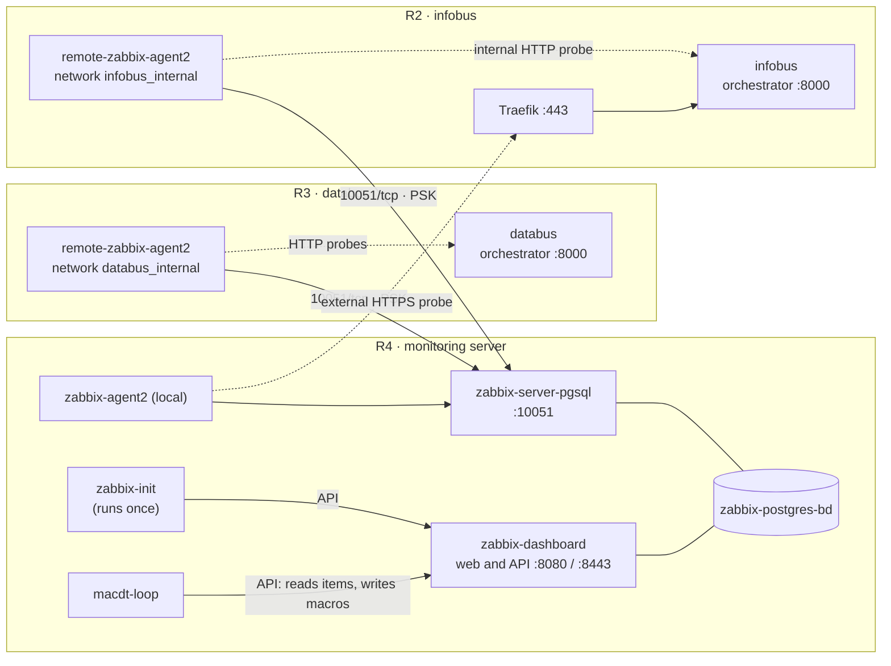
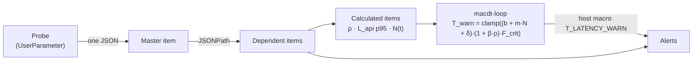
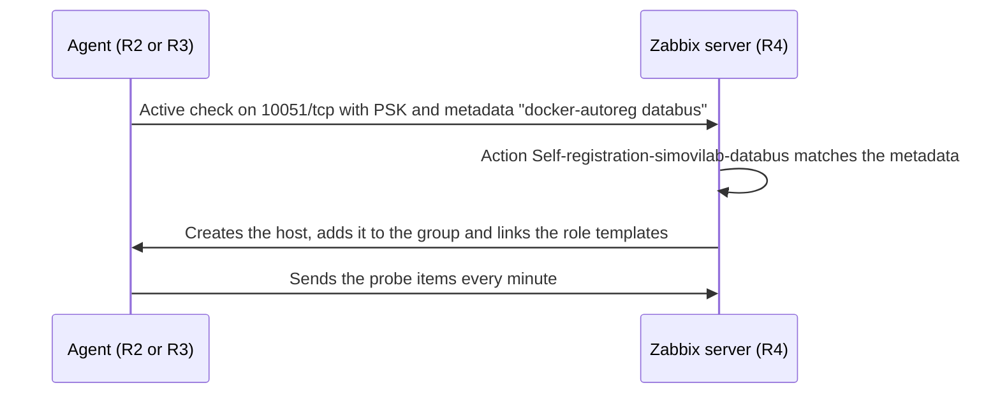

# Zabbix · databus and infobus monitoring

**English** · [Español](README.es.md)


Docker Compose deployment for monitoring [databus](https://github.com/simovilab/databus) and [infobus](https://github.com/simovilab/infobus). The repository has two modes:

- **Server (`server`):** Zabbix Server, PostgreSQL, the web frontend, a local agent, the `zabbix-init` container that configures Zabbix through its API, and the **MACDT** loop, which adjusts the infobus latency threshold to the transit load.
- **Agent (`agent`):** a Zabbix Agent 2 on each application server. It auto-registers with the server under its role (`databus` or `infobus`), is encrypted with PSK, and runs the domain probes (GTFS, GTFS-RT and the infobus API).


## Architecture

| Service | Where | Role | Tech |
| --- | --- | --- | --- |
| **zabbix-postgres-bd** | Server | Zabbix database | PostgreSQL 17.6 |
| **zabbix-server-pgsql** | Server | Receives agent data (10051/tcp) and evaluates alerts | Zabbix Server 7.4.3 |
| **zabbix-dashboard** | Server | Web frontend and JSON-RPC API | Zabbix Web (nginx) 7.4.3 |
| **zabbix-agent2** | Server | Local agent: operating system and external infobus probe | Zabbix Agent 2 7.4.3 + Python |
| **zabbix-init** | Server | Initial setup through the API. Runs once and exits | alpine/curl + bash + jq |
| **macdt-loop** | Server | MACDT loop: computes T_warn every minute and writes it as a macro | Python 3.12 |
| **remote-zabbix-agent2** | Each application server | Operating system, containers and domain probes | Zabbix Agent 2 7.4.3 + Python |



Probes are agent `UserParameter`s. Each one queries its endpoint, prints **one JSON** (master item) and Zabbix splits it into dependent items. From that data the server computes ρ, the latency p95 and N(t), and the MACDT loop writes the threshold the alerts use:



| Probe (key) | Script | Agent | What it measures |
| --- | --- | --- | --- |
| `gtfs.probe[{$MACDT.STALE_S}]` | `gtfsrt_probe.py` | databus (R3) | GTFS-RT feeds: active trips and vehicles, GPS coverage, freshness and completeness |
| `macdt.window` | `gtfs_window.py` | databus (R3) | Source GTFS schedule: operating window, scheduled trips and V_trips_max |
| `databus.static` | `gtfs_window.py` | databus (R3) | Static GTFS published by databus and its age |
| `infobus.api` | `infobus_probe.py` | infobus (R2) | Internal `next-trips` latency (no Traefik), N(t) and query cost |
| `infobus.api.ext` | `infobus_probe.py` | server (R4) | External `next-trips` latency (network + TLS + Traefik) |
| `host.tcp.established` | `zabbix-host-tcp-established.sh` | all | Established TCP connections on the host |

The `UserParameter` lines live in [`agent2/zabbix_agent2.conf`](agent2/zabbix_agent2.conf).

## Server

The server runs on the monitoring machine (R4). It starts the whole stack with [`docker-compose.yml`](docker-compose.yml) and leaves Zabbix configured with no manual steps in the frontend.

### Quick start

```bash
git clone -b zabbix-fase-2 https://github.com/rsol9000-01/zabbix.git /home/zabbix
cd /home/zabbix
cp .env.example .env     # change passwords, web user and names (see below)
sudo ./scripts/zabbix-dev.sh server 'MySeed.2026'
```

When it finishes, the frontend is at `http://<server>:8080`, with user `API_WEB_USER` and password `API_WEB_PASS` from `.env`.

> The seed **is required** and must be **the same** on the server and on every agent: the PSK is derived from it. Use your own, not the example. See [Seed and PSK](#seed-and-psk).

### How to

#### 1. Prerequisites

- Linux with Docker Engine and the Docker Compose v2 plugin. The `docker` group must exist.
- `python3`, which the script uses to derive the PSK from the seed. `curl` and `openssl` are also needed, but the script installs them with `apt-get` if they are missing.
- Run the script as **root** (`sudo`): it sets owners and permissions on repository files.
- Ports open in the server firewall:

| Port | Use |
| --- | --- |
| `10051/tcp` | Agent data (active checks) and MACDT loop trappers |
| `PORT_HTTP` (8080) | Web frontend and API |
| `PORT_HTTPS` (8443) | Web frontend over HTTPS. Needs certificates in the `zabbix_certificados` volume; the script does not create them |

#### 2. Configure `.env`

Copy `.env.example` to `.env`. `.env` is in `.gitignore`: never commit it. In server mode these are the variables to review; leave the **DO NOT EVER CHANGE** block as it is.

| Variable | Example | What it is |
| --- | --- | --- |
| `API_WEB_USER`, `API_WEB_PASS` | `tfg` / *(your own)* | Administrator created by `zabbix-init`. You log in to the frontend with it and the MACDT loop uses it. The password must meet the Zabbix policy (at least 8 characters, not containing the username) |
| `POSTGRES_PASSWORD` | *(your own)* | Zabbix database password |
| `ZBX_METADATA` | `docker-autoreg` | Auto-registration metadata. On the server it has no role |
| `ZBX_TLSPSKIDENTITY` | `zabbix-databus-psk` | PSK identity. Must be the same on the server and the agents |
| `MACDT_HOST_DATABUS`, `MACDT_HOST_INFOBUS` | `Databus-host`, `Infobus-host` | Agent host names. Must match each agent's `REMOTE_AGENT_HOSTNAME` |
| `MACDT_INTERVAL`, `MACDT_MAX_AGE` | `60`, `180` | MACDT loop period and maximum accepted data age (s) |
| `MACDT_CALIB_*` | see `.env.example` | T_base and β calibration. See [MACDT loop and calibration](#macdt-loop-and-calibration) |
| `LOCAL_TEMPLATE_FILES`, `LOCAL_TEMPLATE_NAMES` | see `.env.example` | Templates for the local host (R4) |
| `ROLE_DATABUS_TEMPLATE_*`, `ROLE_INFOBUS_TEMPLATE_*` | see `.env.example` | Templates each agent receives by role |
| `PORT_HTTP`, `PORT_HTTPS` | `8080`, `8443` | Published frontend ports |
| `TZ`, `PHP_TZ` | `America/Costa_Rica` | Container and frontend time zone |

Template lists go **in the same order**: files separated by commas and names by a vertical bar. The name must be identical to the YAML `name:` field. A `-` instead of a file means a template that already exists in Zabbix (for example, `Docker by Zabbix agent 2`).

#### 3. Deploy

```bash
cd /home/zabbix
sudo ./scripts/zabbix-dev.sh server 'MySeed.2026'
```

The script does this, in order:

1. Checks Docker, the `docker` group, `curl`, `openssl`, `.env` and the initial setup script (`SCRIPT_POST_INSTALL`).
2. Sets permissions on `scripts/user_scripts/` and `agent2/` (sudoers, `Dockerfile` and `zabbix_agent2.conf`).
3. Adds to `zabbix_agent2.conf` the `UserParameter`s declared in `.env` as `AGENT_PARAMS_<suffix>=key:script.sh`.
4. Derives the PSK from the seed and saves it to `psk/zabbix_agentd.psk`.
5. Starts the stack with `docker compose up -d` and follows the `zabbix-init` log until it ends.

When `zabbix-init` finishes without errors, the script prints `zabbix-init completed successfully` and `macdt-loop` starts.

#### 4. What `zabbix-init` configures

`zabbix-init` runs [`scripts/zabbix-conf-en.sh`](scripts/zabbix-conf-en.sh) against the API:

1. Waits for the API to respond.
2. **First run:** logs in with the initial account (`Admin`), creates `API_WEB_USER`, transfers `Admin`'s maps and dashboards to it and deletes `Admin`. **Later runs:** logs in directly with `API_WEB_USER`.
3. Creates the `HOST_GROUP` host group if it does not exist.
4. Imports or updates the `LOCAL_TEMPLATE_*` and `ROLE_*_TEMPLATE_*` templates, creating what is missing and updating what exists.
5. Creates or updates the local `Zabbix-server` host, links the local templates and deletes the default `Zabbix server` host.
6. Creates or updates one auto-registration action per role (`Self-registration-simovilab-databus` and `-infobus`). Each action adds the host to the group, removes it from *Discovered hosts* and links the templates of its role.
7. Sets auto-registration to PSK encryption (identity `ZBX_TLSPSKIDENTITY` and the key derived from the seed).

#### 5. Verify

```bash
docker compose -f docker-compose.yml ps        # everything running/healthy; zabbix-init exited (0)
docker compose -f docker-compose.yml logs zabbix-init | tail -20
docker logs --tail 5 macdt-loop                # one line per minute with N, T_base, ρ and T_warn
```

In the frontend: **Data collection → Hosts** shows `Zabbix-server` with a green ZBX tag. Agent hosts appear as each agent is deployed (see [Agent](#agent)).

#### MACDT loop and calibration

`macdt-loop` runs `scripts/user_scripts/macdt_loop.py` as a continuous loop, with no arguments and no cron. Every `MACDT_INTERVAL` seconds:

1. Reads ρ, GPS coverage and the operating window from Databus-host, and N(t) from Infobus-host, all through the Zabbix API.
2. Computes `T_warn = clamp((b + m·N(t) + δ) × (1 + β·ρ) × F_crit, T_floor, T_RNF)`.
3. Writes the result to the `{$T_LATENCY_WARN}` host macro on Infobus-host.
4. Sends its status through trappers (`macdt.status`, `macdt.t_warn` and `macdt.t_base`).

Until a calibration runs, `m = 0` and `δ = 0`, so T_base equals `{$MACDT.T_BASE}` (130 ms). Calibration fits the regression `latency = b + m·N + c·V` on the last `MACDT_CALIB_WINDOW_D` days of data and writes b, m, δ and β as host macros:

```bash
docker exec macdt-loop python3 /macdt_loop.py --calibrate --dry-run   # compute and show, write nothing
docker exec macdt-loop python3 /macdt_loop.py --calibrate             # apply if it passes the guards
docker exec macdt-loop python3 /macdt_loop.py --calibrate --force     # apply even if it changes more than MACDT_CALIB_MAX_DRIFT
docker exec macdt-loop python3 /macdt_loop.py --once --dry-run        # one test cycle, no writes
```

Calibration is applied only with at least `MACDT_CALIB_MIN_POINTS` points, R² ≥ `MACDT_CALIB_MIN_R2` and m > 0. If the new line changes more than `MACDT_CALIB_MAX_DRIFT` from the current one, it is held (`macdt.calib = 2`) and the alert *MACDT: la latencia de infobus cambió más de lo permitido* fires. With `MACDT_CALIB_MODE=daily`, it calibrates by itself once a day at `MACDT_CALIB_HOUR`, in the container `TZ`.

If you change the script, `docker compose restart macdt-loop` is enough. If you change `.env` variables, recreate the container:

```bash
docker compose up -d --no-deps --force-recreate macdt-loop
```

#### Update templates on an existing installation

Run the deployment again with the same seed. `zabbix-init` imports the templates again and updates what changed:

```bash
sudo ./scripts/zabbix-dev.sh server 'MySeed.2026'
```

Macros you changed **on the host** are kept. Macros you changed **on the template** from the frontend go back to the YAML value.

#### Common operations

```bash
# The script exports DOCKER_GID; by hand, set it first to avoid Compose warnings
export DOCKER_GID=$(getent group docker | cut -d: -f3)

# Status and logs
docker compose -f docker-compose.yml ps
docker compose -f docker-compose.yml logs -f zabbix-server-pgsql
docker logs -f macdt-loop

# Restart a service
docker compose -f docker-compose.yml restart zabbix-server-pgsql

# Database backup (saved in ./backups)
mkdir -p backups
docker exec zabbix-postgres-bd sh -c 'pg_dump -U "$POSTGRES_USER" "$POSTGRES_DB"' > backups/zabbix-$(date +%F).sql

# Stop (volumes are kept)
docker compose -f docker-compose.yml down
```

## Agent

The agent runs on each application server: R3 with databus and R2 with infobus. It starts with [`agent2/docker-compose-agent2.yml`](agent2/docker-compose-agent2.yml), joins the application Docker network to reach `orchestrator` by name, and registers itself with the server.

### Quick start

```bash
git clone -b zabbix-fase-2 https://github.com/rsol9000-01/zabbix.git /home/zabbix
cd /home/zabbix
cp .env.example .env     # fill in the agent block (see below)
sudo ./scripts/zabbix-dev.sh agent 'MySeed.2026'   # the SAME seed as the server
```

Within a couple of minutes the host shows up in **Data collection → Hosts**, with the templates of its role and PSK encryption.

### How to

#### 1. Prerequisites

- The server already deployed, because `zabbix-init` creates the auto-registration actions.
- The application (databus or infobus) already running, because its Docker network must exist.
- Docker Engine with Compose v2, the `docker` group and `python3`. Run the script as **root** (`sudo`).
- Outbound access to the server on `10051/tcp`, and `SERVER_FQDN` resolvable from the host.
- `10050/tcp` open only if you use passive checks (`ZBX_PORTS`). The probes use active checks.

To find the application network name:

```bash
docker inspect $(docker ps -qf name=orchestrator) --format '{{json .NetworkSettings.Networks}}'
```

#### 2. Configure `.env`

In agent mode only the first block of `.env` needs to be filled in. Leave the rest as it comes in `.env.example`.

| Variable | databus (R3) | infobus (R2) | What it is |
| --- | --- | --- | --- |
| `AGENT_FQDN` | `databus.example.com` | `infobus.example.com` | DNS name of the agent host |
| `REMOTE_AGENT_HOSTNAME` | `Databus-host` | `Infobus-host` | Host name in Zabbix. Must match the server's `MACDT_HOST_DATABUS` or `MACDT_HOST_INFOBUS` |
| `AGENT_DOCKER_NETWORK` | `databus_internal` | `infobus_internal` | Application Docker network the agent joins |
| `AGENT_PGPASSWORD` | *(your own)* | *(your own)* | PostgreSQL password for `psql` inside the agent. Only the `pgsql.bloat.detail` item uses it, currently commented out in `zabbix_agent2.conf` |
| `SERVER_FQDN` | `zabbix.example.com` | `zabbix.example.com` | Zabbix server name or IP |
| `ZBX_METADATA` | `docker-autoreg databus` | `docker-autoreg infobus` | Auto-registration metadata. The role decides which templates the host receives |

`ZBX_TLSPSKIDENTITY` must match the server's. It already does in `.env.example`.

#### 3. Deploy

```bash
cd /home/zabbix
sudo ./scripts/zabbix-dev.sh agent 'MySeed.2026'
```

The script does the same as on the server (permissions, sudoers, `UserParameter`s and PSK) but starts only `remote-zabbix-agent2`. Also, on the first run it creates `agent2/simovilab-plugins.conf` from `agent2/simovilab-plugins.conf.example`.

`simovilab-plugins.conf` holds the PostgreSQL and Redis plugin sessions, with sample passwords. It is in `.gitignore`: each server keeps its own copy. Edit it with that server's real passwords. For PostgreSQL, use a read-only user with the `pg_monitor` role, not `postgres`:

```sql
CREATE ROLE zabbix_ro LOGIN PASSWORD '<your own password>';
GRANT pg_monitor TO zabbix_ro;
```

After editing it, restart the agent:

```bash
docker compose -f agent2/docker-compose-agent2.yml --env-file .env restart
```

#### 4. What happens at startup



#### 5. Adapt the probes to the installation

The addresses the probes query are in [`agent2/zabbix_agent2.conf`](agent2/zabbix_agent2.conf). Review them on every new installation:

| Key | Parameter | What to set |
| --- | --- | --- |
| `gtfs.probe[*]` | `--base` | databus GTFS-RT feed path inside the network (`http://orchestrator:8000/feed/realtime`) |
| `macdt.window` | `--url` | Static GTFS from the official schedule source |
| `databus.static` | `--url` | Static GTFS published by databus (`http://orchestrator:8000/feed/schedule/feed.zip`) |
| `infobus.api` | `--base`, `--host-header`, `--transit-system` | infobus orchestrator inside the network, a value from its `ALLOWED_HOSTS`, and the `TransitSystem` id |
| `infobus.api.ext` | `--base` | infobus public URL, behind Traefik |

Scripts are mounted read-only from `scripts/user_scripts/` and the agent reads them on every run: if you change a script, nothing needs restarting. If you change `zabbix_agent2.conf`, restart the agent.

#### 6. Verify

```bash
docker compose -f agent2/docker-compose-agent2.yml --env-file .env ps
docker logs --tail 20 remote-zabbix-agent2
```

In the frontend: **Data collection → Hosts** shows the host with a green ZBX tag and the PSK lock. **Monitoring → Latest data** shows the items of its role.

> `remote-zabbix-agent2` mounts the host `/proc` read-only, so `docker exec` into that container fails. To test a probe by hand, run it in a temporary container with the same image and network:
>
> ```bash
> docker run --rm --network databus_internal -v "$PWD/scripts/user_scripts":/s:ro --entrypoint bash \
>   simovilab/zabbix-agent2:ubuntu-7.4.3 -c '/s/gtfsrt_probe.py --base http://orchestrator:8000/feed/realtime --stale 60'
> ```

#### Common operations

```bash
export DOCKER_GID=$(getent group docker | cut -d: -f3)   # used by the agent compose file
docker compose -f agent2/docker-compose-agent2.yml --env-file .env ps
docker compose -f agent2/docker-compose-agent2.yml --env-file .env logs -f
docker compose -f agent2/docker-compose-agent2.yml --env-file .env restart
docker compose -f agent2/docker-compose-agent2.yml --env-file .env down
```

## Seed and PSK

The second argument of `zabbix-dev.sh` is a **seed**, not the PSK. The script derives the PSK with PBKDF2-HMAC-SHA256 (600,000 iterations and a fixed project salt) and saves it to `psk/zabbix_agentd.psk`. Because the computation is always the same, the same seed yields the same PSK on every machine, with no files copied between them.

Seed requirements:

- 8 to 64 characters.
- At least one uppercase letter, one lowercase letter, one digit and one of these symbols: `. * + ? -`.
- No `$`, `|`, `&` or `\`.
- Always in single quotes: `'MySeed.2026'`.

Keep the seed outside the repository. Never publish the seed or the PSK. The `psk/` folder is in `.gitignore`.

## Reference

### Templates

| File | Template | Linked to |
| --- | --- | --- |
| [`templates/simovilab-templates.yml`](templates/simovilab-templates.yml) | `simovilab servidor y sistema operativo` | All 3 hosts: operating system, ping from the server and container discovery. Includes the *Servidor* dashboard |
| [`templates/simovilab-databus.yml`](templates/simovilab-databus.yml) | `simovilab-databus` | Role `databus`: GTFS-RT, static GTFS, operating window and ρ. Includes the *Operación databus* dashboard |
| [`templates/simovilab-infobus.yml`](templates/simovilab-infobus.yml) | `simovilab-infobus` | Role `infobus`: API latency, N(t), MACDT loop and calibration. Includes the *Operación infobus* dashboard |
| [`templates/simovilab-infobus-ext.yml`](templates/simovilab-infobus-ext.yml) | `simovilab-infobus-ext` | Server local host: external infobus measurement through Traefik |
| *(official Zabbix)* | `Docker by Zabbix agent 2` | All 3 hosts |

### Items

*Dependent* items query nothing: they take one field from their master item JSON. *Calculated* items are built by the server from other items. Names are shown as they appear in Zabbix (Spanish).

| Template | Applied to | Items |
| --- | --- | --- |
| `simovilab servidor y sistema operativo` | all 3 hosts (Zabbix-server, Databus-host, Infobus-host) | 8 + 1 discovery rule with 5 prototypes per container |
| `simovilab-databus` | Databus-host (R3) | 38 |
| `simovilab-infobus` | Infobus-host (R2) | 30 |
| `simovilab-infobus-ext` | Zabbix-server (R4) | 10 |
| `Docker by Zabbix agent 2` | all 3 hosts | Official Zabbix template, unchanged |

<details>
<summary><code>simovilab servidor y sistema operativo</code> — 8 items</summary>

| Name | Key | Type |
| --- | --- | --- |
| TCP connections ESTABLISHED | `host.tcp.established` | Agent (active) |
| Server UP/DOWN | `icmpping[,3]` | Simple check |
| Load average per CPU (1 min) | `system.cpu.load[percpu,avg1]` | Agent (active) |
| CPU utilization (user + system) | `system.cpu.util` | Agent (passive) |
| Disk I/O wait | `system.cpu.util[,iowait]` | Agent (active) |
| Uptime | `system.uptime` | Agent (active) |
| Disk space free (/) | `vfs.fs.size[/hostfs,pfree]` | Agent (active) |
| Memory utilization (% used) | `vm.memory.size[pused]` | Agent (active) |
| *Contenedores (todos, incluidos los detenidos)* | `docker.containers.discovery[true]` | Discovery |
| ↳ Contenedor {#NAME}: info (short) | `docker.container_info["{#NAME}",short]` | Prototype |
| ↳ Contenedor {#NAME}: código de salida | `simovilab.contenedor.exitcode["{#NAME}"]` | Prototype |
| ↳ Contenedor {#NAME}: reinicios automáticos | `simovilab.contenedor.restart_count["{#NAME}"]` | Prototype |
| ↳ Contenedor {#NAME}: corriendo | `simovilab.contenedor.running["{#NAME}"]` | Prototype |
| ↳ Contenedor {#NAME}: hora de inicio | `simovilab.contenedor.started["{#NAME}"]` | Prototype |

</details>

<details>
<summary><code>simovilab-databus</code> — 38 items</summary>

| Name | Key | Type |
| --- | --- | --- |
| GTFS estático publicado por databus | `databus.static` | Agent (active) |
| databus: antigüedad del estático | `databus.static.age_s` | Dependent |
| databus: desfase del estático frente a la fuente | `databus.static.desfase_s` | Calculated |
| databus: código HTTP del estático | `databus.static.http` | Dependent |
| databus: lectura del estático correcta | `databus.static.ok` | Dependent |
| V_completeness de predicciones | `gtfs.completeness_tu_pct` | Dependent |
| V_completeness de posiciones | `gtfs.completeness_vp_pct` | Dependent |
| Calibrar el --stale contra la cadencia real | `gtfs.data_age_p95_s` | Dependent |
| V_age del publicador de predicciones | `gtfs.feed_age_tu_s` | Dependent |
| V_age del publicador de posiciones | `gtfs.feed_age_vp_s` | Dependent |
| Raíz del árbol de alertas | `gtfs.fetch_ok` | Dependent |
| Latencia del endpoint de predicciones | `gtfs.fetch_tu_ms` | Dependent |
| Latencia del endpoint de posiciones | `gtfs.fetch_vp_ms` | Dependent |
| gtfs-Maestro | `gtfs.probe[{$MACDT.STALE_S}]` | Agent (active) |
| Sospecha de relleno de timestamps | `gtfs.ts_igual_header_pct` | Dependent |
| V_gps. Entrada de F_crit | `gtfs.v_gps_pct` | Dependent |
| V_trips. Entrada de F_load y G_load | `gtfs.v_trips` | Dependent |
| Denominador real de V_gps | `gtfs.v_vehicles` | Dependent |
| Vehículos con GPS fresco | `gtfs.v_gps_frescos` | Dependent |
| Vehículos con GPS viejo | `gtfs.v_gps_viejos` | Dependent |
| Vehículos sin timestamp | `gtfs.v_gps_sin_ts` | Dependent |
| Viajes sin paradas por delante | `gtfs.v_trips_sin_paradas` | Dependent |
| Umbral de GPS fresco usado por la sonda | `gtfs.stale_s` | Dependent |
| Edad máxima de la posición GPS | `gtfs.data_age_max_s` | Dependent |
| Edad de la posición GPS por vehículo | `gtfs.vehiculos_texto` | Dependent |
| Tabla de vehículos del feed (HTML) | `gtfs.vehiculos_html` | Dependent |
| Calendar age | `macdt.cal_dias_vigencia` | Dependent |
| Schedule | `macdt.gate` | Dependent |
| Horario de servicio (texto) | `macdt.horario_texto` | Dependent |
| Huecos sin buses programados (texto) | `macdt.huecos_texto` | Dependent |
| scheduled slot | `macdt.hueco_programado` | Dependent |
| static_zip_age | `macdt.static_zip_age_s` | Dependent |
| SIMOVI: código HTTP del GTFS estático | `macdt.static_zip_http` | Dependent |
| Scheduled trips | `macdt.s_t` | Dependent |
| Max trips | `macdt.v_trips_max` | Dependent |
| macd-Maestro | `macdt.window` | Agent (active) |
| Raíz del árbol de la ventana | `macdt.window_ok` | Dependent |
| Calculo de p | `p.calculated` | Calculated |

</details>

<details>
<summary><code>simovilab-infobus</code> — 30 items</summary>

| Name | Key | Type |
| --- | --- | --- |
| Sonda de la API de InfoBus | `infobus.api` | Agent (active) |
| Parada medida por la sonda | `infobus.api.stop_id` | Dependent |
| Horas de paso en 5 h de la parada medida (pico) | `infobus.api.stop_pico_5h` | Dependent |
| Eleccion automatica de parada activa | `infobus.api.stop_auto` | Dependent |
| Día sin servicio (next-trips responde 204) | `infobus.api.sin_servicio` | Dependent |
| Tabla API INFOBUS (HTML) | `infobus.api.tabla_html` | Dependent |
| API de InfoBus responde correctamente | `infobus.api.ok` | Dependent |
| Llegadas programadas en 5 h, N(t) | `infobus.api.llegadas` | Dependent |
| Buses en camino a la parada medida | `infobus.api.buses_parada` | Dependent |
| N(t) para MACDT: p95 de llegadas, ventana de 1 h | `infobus.api.llegadas_p95_1h` | Calculated |
| L_api p50 del ciclo | `infobus.api.lat_p50` | Dependent |
| Latencia en día sin servicio (respuestas 204) | `infobus.api.lat_sin_servicio` | Dependent |
| L_api p90 del ciclo | `infobus.api.lat_p90` | Dependent |
| L_api maxima del ciclo | `infobus.api.lat_max` | Dependent |
| Costo de la consulta, aislado del transporte | `infobus.api.query_p50` | Dependent |
| Piso de transporte, conexion abierta | `infobus.api.health_ms` | Dependent |
| Primera peticion de la sesion (abre la conexion) | `infobus.api.health_cold_ms` | Dependent |
| Costo de abrir la conexión (DNS + TCP) | `infobus.api.setup_ms` | Dependent |
| Disponibilidad de /health/ | `infobus.api.health_ok` | Dependent |
| Too Many Requests (429): peticiones rechazadas por la cuota | `infobus.api.throttled` | Dependent |
| L_api p95 real, ventana de 1 h | `infobus.api.lat_p95_1h` | Calculated |
| Conexion TCP al orchestrator | `infobus.api.tcp_connect_ms` | Dependent |
| Red: RTT de R4 a R2, promedio 15 min | `infobus.net.rtt_ms` | Calculated |
| Externo - interno: red + TLS + Traefik | `infobus.net.delta_ms` | Calculated |
| TLS + Traefik (sin red) | `infobus.net.tls_traefik_ms` | Calculated |
| Estado del bucle MACDT | `macdt.status` | Trapper |
| T_warn escrito por MACDT | `macdt.t_warn` | Trapper |
| T_base(t) calculado por MACDT | `macdt.t_base` | Trapper |
| Resultado de la calibración de MACDT | `macdt.calib` | Trapper |
| Detalle de la calibración de MACDT | `macdt.calib.info` | Trapper |

</details>

<details>
<summary><code>simovilab-infobus-ext</code> — 10 items</summary>

| Name | Key | Type |
| --- | --- | --- |
| Sonda externa de la API de InfoBus | `infobus.api.ext` | Agent (active) |
| Externo: API responde correctamente | `infobus.api.ext.ok` | Dependent |
| Externo: Too Many Requests (429): peticiones rechazadas por la cuota | `infobus.api.ext.throttled` | Dependent |
| Externo: L_api p50 del ciclo | `infobus.api.ext.lat_p50` | Dependent |
| Externo: L_api p90 del ciclo | `infobus.api.ext.lat_p90` | Dependent |
| Externo: costo de la consulta | `infobus.api.ext.query_p50` | Dependent |
| Externo: piso con conexion abierta (red + TLS + Traefik + Daphne) | `infobus.api.ext.health_ms` | Dependent |
| Externo: primera peticion (abre la conexion) | `infobus.api.ext.health_cold_ms` | Dependent |
| Externo: costo de abrir la conexion (TCP + TLS) | `infobus.api.ext.setup_ms` | Dependent |
| Externo: conexion TCP de R4 a Traefik (red) | `infobus.api.ext.tcp_connect_ms` | Dependent |

</details>

### Macros

To change a macro without losing the change on the next template import, override it on the host: Data collection → Hosts → *host* → **Macros** tab → **Inherited and host macros** → **Change**. To change the default value, edit the template YAML and import it.

**Written by the MACDT loop**

| Macro | Default | Template | What it controls |
| --- | --- | --- | --- |
| `{$T_LATENCY_WARN}` | `130` | `simovilab-infobus` | L_api warning threshold. Overwritten every minute by the MACDT loop (host macro). |

**Set by calibration (or by several days of data)**

| Macro | Default | Template | What it controls |
| --- | --- | --- | --- |
| `{$MACDT.TSFILL.WARN}` | `50` | `simovilab-databus` | % of vehicles carrying the header time that counts as filler. |
| `{$MACDT.T_BASE}` | `130` | `simovilab-infobus` | T_base seed. Used only when N(t) is missing or stale. |
| `{$MACDT.B}` | `130` | `simovilab-infobus` | b in T_base(t): fixed request cost (ms). Written by calibration. |
| `{$MACDT.M}` | `0` | `simovilab-infobus` | m in T_base(t): ms per scheduled arrival in 5 h. With 0, T_base is constant. |
| `{$MACDT.DELTA}` | `0` | `simovilab-infobus` | δ in T_base(t): margin, P95 of the regression residuals. |
| `{$MACDT.BETA}` | `0.35` | `simovilab-infobus` | β: weight of active buses (ρ). β = c·V_max ÷ mean T_base with buses. |

**Review on every new installation**

| Macro | Default | Template | What it controls |
| --- | --- | --- | --- |
| `{$CONTENEDOR.IGNORAR}` | `-init\|migrat\|-run-` | `simovilab servidor y sistema operativo` | Regex of containers that exit on purpose (init, migrations, run) and are not watched. |
| `{$MACDT.STALE_S}` | `60` | `simovilab-databus` | Seconds a position counts as fresh. Must equal databus TELEMETRY_GRACE_S. |
| `{$MACDT.V_AGE.CRIT}` | `70` | `simovilab-databus` | Maximum trip-updates feed age before the high alert (below the 75 s infobus tolerates). |
| `{$MACDT.V_AGE.WARN}` | `45` | `simovilab-databus` | Maximum trip-updates feed age before warning (3 cycles of 15 s). |

**Alert fine-tuning (only if they are noisy or miss events)**

| Macro | Default | Template | What it controls |
| --- | --- | --- | --- |
| `{$CONTENEDOR.REINICIO.VENTANA}` | `600` | `simovilab servidor y sistema operativo` | Seconds the "se reinició" alert stays active. |
| `{$MACDT.CAL.DIAS.WARN}` | `7` | `simovilab-databus` | Days in advance to warn that the GTFS calendar expires. |
| `{$MACDT.COMPL.CRIT}` | `80` | `simovilab-databus` | Minimum trip-updates completeness (critical level, %). |
| `{$MACDT.COMPL.WARN}` | `90` | `simovilab-databus` | Minimum trip-updates completeness before warning (%). |
| `{$MACDT.ZIP.DESFASE.WARN}` | `21600` | `simovilab-databus` | Maximum gap (s) between the databus GTFS and the source GTFS. |
| `{$T_LATENCY_WARN.SOSTENIDO}` | `30m` | `simovilab-infobus` | Time the p95 must stay above T_warn for the "sostenido" high alert. |
| `{$INFOBUS.SETUP.FACTOR}` | `2` | `simovilab-infobus` | Times the daily median connection-setup cost that fires the alert. |
| `{$INFOBUS.SETUP.MIN_MS}` | `5` | `simovilab-infobus` | Minimum (ms) to alert on connection-setup cost. |
| `{$INFOBUS.T204.FACTOR}` | `2` | `simovilab-infobus` | Times the daily median 204 latency that fires the alert. |
| `{$INFOBUS.EXT.SETUP.FACTOR}` | `2` | `simovilab-infobus-ext` | Same as INFOBUS.SETUP.FACTOR, for the public connection. |
| `{$INFOBUS.EXT.SETUP.MIN_MS}` | `5` | `simovilab-infobus-ext` | Same as INFOBUS.SETUP.MIN_MS, for the public connection. |

**Almost fixed: change only if the requirement or the design changes**

| Macro | Default | Template | What it controls |
| --- | --- | --- | --- |
| `{$MACDT.RHO_CAP}` | `1.2` | `simovilab-databus` | Cap for ρ (fleet load). |
| `{$MACDT.V_GPS.CRIT}` | `70` | `simovilab-databus` | % of fresh GPS below which F_crit (3 cycles) and the high alert activate. |
| `{$MACDT.V_GPS.WARN}` | `85` | `simovilab-databus` | % of fresh GPS below which a warning fires. F_crit is released above it. |
| `{$T_LATENCY_CRIT}` | `200` | `simovilab-infobus` | L_api critical threshold: the non-functional requirement. MACDT never changes it. |
| `{$MACDT.T_FLOOR}` | `91` | `simovilab-infobus` | T_warn floor (ms). |
| `{$MACDT.T_RNF}` | `200` | `simovilab-infobus` | T_warn ceiling (ms). |
| `{$MACDT.F_CRIT}` | `0.7` | `simovilab-infobus` | Factor that tightens T_warn when GPS coverage is critical. |

**Not used**

| Macro | Default | Template | What it controls |
| --- | --- | --- | --- |
| `{$Q_WARN}` | `80` | `simovilab-infobus` | Not used yet (infobus Redis event queue). |
| `{$Q_CRIT}` | `150` | `simovilab-infobus` | Not used yet (infobus Redis event queue). |

### Alerts by severity

"Per container" = one alert for each discovered container. Alerts from the official Docker template are marked *(official)*.

**Disaster**

| Alert | Template | Fires when |
| --- | --- | --- |
| Server DOWN!!! | `simovilab servidor y sistema operativo` | 3 consecutive pings (about 30 s) unanswered from R4. "Capa D: sonda sin datos" depends on this alert. |
| GTFS estático vencido | `simovilab-databus` | The GTFS calendar has no valid days left. |
| Sin viajes activos sostenido | `simovilab-databus` | During service hours, with scheduled trips, 10 min without any trip in the feed. |

**High**

| Alert | Template | Fires when |
| --- | --- | --- |
| Too many established TCP connections | `simovilab servidor y sistema operativo` | More than 1200 established TCP connections for 5 min. |
| System load per CPU is critical | `simovilab servidor y sistema operativo` | Load per CPU > 1 for 5 min. |
| CPU utilization critical | `simovilab servidor y sistema operativo` | CPU > 90 % for 5 min. |
| Disk I/O wait critical | `simovilab servidor y sistema operativo` | Disk I/O wait > 30 % for 5 min. |
| Disk space critical (/) | `simovilab servidor y sistema operativo` | Less than 10 % free on /. |
| Memory utilization critical | `simovilab servidor y sistema operativo` | Memory > 90 % for 5 min. |
| Feed GTFS-RT muy atrasado | `simovilab-databus` | The trip-updates feed is older than {$MACDT.V_AGE.CRIT} s for 3 min. |
| Capa D: feed GTFS-RT no alcanzable | `simovilab-databus` | The probe could not download the realtime feed. |
| Capa D: sonda sin datos | `simovilab-databus` | 5 min without data from gtfs.probe. |
| GTFS estático por vencer | `simovilab-databus` | {$MACDT.CAL.DIAS.WARN} days or less of calendar left. |
| Capa D: ventana operativa no derivable | `simovilab-databus` | The service window could not be derived from the GTFS. |
| Cobertura GPS crítica | `simovilab-databus` | During service hours, less than {$MACDT.V_GPS.CRIT} % of vehicles with fresh GPS for 5 min. |
| La API de InfoBus no responde correctamente | `simovilab-infobus` | The next-trips burst did not answer all 200/204 (500, no connection, 429…). |
| L_api p95 sostenido sobre el umbral adaptativo de MACDT | `simovilab-infobus` | The last-hour p95 stays above {$T_LATENCY_WARN} for {$T_LATENCY_WARN.SOSTENIDO}. The "sobre el umbral" warning depends on this one. |
| Container {#NAME}: Health state container is unhealthy *(official)* | `Docker by Zabbix agent 2` | Per container: the healthcheck fails twice within 2 min. |

**Average**

| Alert | Template | Fires when |
| --- | --- | --- |
| Contenedor {#NAME} apagado | `simovilab servidor y sistema operativo` | Per container: it exists and is not running. |
| databus no publica el GTFS estático | `simovilab-databus` | The databus feed.zip does not return 200. |
| SIMOVI no sirve el GTFS estático | `simovilab-databus` | Downloading the source gtfs.zip does not return 200. |
| Déficit de viajes | `simovilab-databus` | During service hours, half or more of the scheduled trips are missing from the feed for 5 min. |
| L_api p95 incumple el RNF de 200 ms | `simovilab-infobus` | The last-hour p95 is above {$T_LATENCY_CRIT} (fixed non-functional requirement). |
| El bucle MACDT no reporta: puede estar caido | `simovilab-infobus` | 5 min without data from macdt.status. |
| Container {#NAME}: Container has been stopped with error code *(official)* | `Docker by Zabbix agent 2` | Per container: stopped with an exit code above 0. |
| Docker: Service is down *(official)* | `Docker by Zabbix agent 2` | The agent cannot talk to Docker. |

**Warning**

| Alert | Template | Fires when |
| --- | --- | --- |
| Too many established TCP connections | `simovilab servidor y sistema operativo` | More than 800 established TCP connections for 5 min. |
| System load per CPU is high | `simovilab servidor y sistema operativo` | Load per CPU > 0.7 for 5 min. |
| CPU utilization high | `simovilab servidor y sistema operativo` | CPU > 70 % for 5 min. |
| Disk I/O wait high | `simovilab servidor y sistema operativo` | Disk I/O wait > 15 % for 5 min. |
| Server has been restarted recently | `simovilab servidor y sistema operativo` | The server has been up for less than 5 min. |
| Disk space low (/) | `simovilab servidor y sistema operativo` | Less than 20 % free on /. |
| Memory utilization high | `simovilab servidor y sistema operativo` | Memory > 75 % for 5 min. |
| Contenedor {#NAME} se reinició | `simovilab servidor y sistema operativo` | Per container: it started less than {$CONTENEDOR.REINICIO.VENTANA} s ago. |
| Feed GTFS-RT atrasado | `simovilab-databus` | The trip-updates feed is older than {$MACDT.V_AGE.WARN} s for 3 min. |
| Cobertura GPS baja | `simovilab-databus` | During service hours, less than {$MACDT.V_GPS.WARN} % of vehicles with fresh GPS for 5 min. |
| Completitud de predicciones baja | `simovilab-databus` | During service hours, completeness below {$MACDT.COMPL.WARN} % for 5 min. |
| Más viajes que el máximo programado | `simovilab-databus` | More trips in the feed than the schedule maximum for 5 min (ghost trips). |
| Sin viajes activos | `simovilab-databus` | During service hours, with scheduled trips, 3 min without trips in the feed. |
| Sospecha de relleno de timestamps | `simovilab-databus` | During service hours, more than {$MACDT.TSFILL.WARN} % of vehicles carry the header time for 10 min. |
| Latencia de día sin servicio fuera de lo normal (204) | `simovilab-infobus` | 10-min average above {$INFOBUS.T204.FACTOR} × the daily median. |
| Costo de abrir la conexión fuera de lo normal | `simovilab-infobus` | 10-min average above {$INFOBUS.SETUP.FACTOR} × the daily median and above {$INFOBUS.SETUP.MIN_MS} ms. |
| La sonda agota su cuota: la medicion no es valida | `simovilab-infobus` | At least one 429 response in the cycle. |
| L_api p95 sobre el umbral adaptativo de MACDT | `simovilab-infobus` | The last-hour p95 is above {$T_LATENCY_WARN} (written by the MACDT loop). |
| MACDT degradado: el umbral no se esta actualizando | `simovilab-infobus` | The loop runs but cannot compute (stale or missing data). |
| MACDT: la latencia de infobus cambió más de lo permitido | `simovilab-infobus` | Calibration was held: the new line changes more than MACDT_CALIB_MAX_DRIFT. A person decides whether to apply it. |
| Externo: costo de abrir la conexión fuera de lo normal | `simovilab-infobus-ext` | Same as above, for the public connection (DNS + TCP + TLS). |
| Container {#NAME}: An error has occurred in the container *(official)* | `Docker by Zabbix agent 2` | Per container: Docker reports a new error. |
| Docker: Failed to fetch info data *(official)* | `Docker by Zabbix agent 2` | The agent cannot read Docker information. |

**Information**

| Alert | Template | Fires when |
| --- | --- | --- |
| Docker: Version has changed *(official)* | `Docker by Zabbix agent 2` | The Docker version changed. |

**Not classified**

| Alert | Template | Fires when |
| --- | --- | --- |
| El GTFS que publica databus está desactualizado | `simovilab-databus` | Gap between the databus GTFS and the source GTFS above {$MACDT.ZIP.DESFASE.WARN} s for 15 min. |


## Security notes

- **Credentials:** they go only in `.env`, `agent2/simovilab-plugins.conf` and `psk/`, which are in `.gitignore`. Change every sample value before deploying.
- **Docker socket:** agents mount it read-only to discover containers. That grants significant host access, so deploy agents only on trusted servers and watch that access with Wazuh.
- **PostgreSQL user:** use a read-only one with `pg_monitor`, not `postgres`.
- **Firewall:** open only `10051/tcp` and the web ports on the server, and `10050/tcp` on agents only if you use passive checks.
- **Pinned versions:** Zabbix images are pinned to `7.4.3` and PostgreSQL to `17.6`. Change them on purpose and test before.

## Documentation

- [`docker-compose.yml`](docker-compose.yml): server stack.
- [`agent2/docker-compose-agent2.yml`](agent2/docker-compose-agent2.yml): remote agent.
- [`agent2/zabbix_agent2.conf`](agent2/zabbix_agent2.conf): probe `UserParameter`s.
- [`scripts/zabbix-dev.sh`](scripts/zabbix-dev.sh): server and agent deployment.
- [`scripts/zabbix-conf-en.sh`](scripts/zabbix-conf-en.sh): initial setup run by `zabbix-init`.
- [`scripts/user_scripts/`](scripts/user_scripts/): probes and MACDT loop.
- [`templates/`](templates/): Zabbix templates.
- [`diagramas/`](diagramas/): architecture diagram in draw.io, SVG and PNG.
