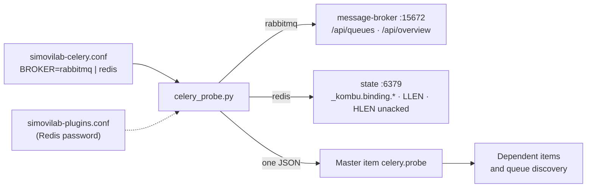

# `celery_probe.py` · Celery task queue probe


Probe of the template [`simovilab-celery`](README-template-simovilab-celery.md). It answers one question: **are the background tasks of the project being processed?** It reads the broker that Celery uses and prints **one JSON** (master item `celery.probe`). Every other item of the template takes one field of it.

The two projects use different brokers, so the probe reads both:

| Server | Broker | How it is read |
| --- | --- | --- |
| srv-databus | RabbitMQ (compose service `message-broker`) | Management API (`:15672`) with the read-only user `zabbix_mon` |
| srv-infobus | Redis (compose service `state`, database `0`) | Redis protocol, directly: one list per queue, the hash `unacked` and the sets `_kombu.binding.*` that name the queues |

## Overview

| Item | Value |
| --- | --- |
| **Location** | `scripts/user_scripts/celery_probe.py` (Spanish comments: `celery_probe-es.py`) |
| **Runs on** | `zabbix-agent2` on srv-databus and srv-infobus |
| **Run by** | Zabbix Agent 2, `UserParameter=celery.probe` |
| **Item key** | `celery.probe` (template `simovilab-celery`) |
| **Settings** | `/etc/zabbix/simovilab-celery.conf` (`agent2/simovilab-celery.conf`, outside git) |
| **Redis password** | Not repeated: taken from the Redis session in `simovilab-plugins.conf` |
| **Dependencies** | Python standard library only |



## Usage

### Quick start

```bash
# Inside the agent, with the default settings file
docker exec zabbix-agent2 zabbix_agent2 -t celery.probe

# By hand, with other files
./celery_probe.py --conf ./simovilab-celery.conf --plugins ./simovilab-plugins.conf
```

### How to

#### 1. Prerequisites

- The agent in the Docker network of the project (`AGENT_DOCKER_NETWORK`), so that `message-broker` and `state` resolve.
- srv-databus: the RabbitMQ image with the management plugin (`rabbitmq:4-management` in `compose.prod.yml` of databus) and the user `zabbix_mon` (step 2).
- srv-infobus: the Redis session `infobus` already written in `agent2/simovilab-plugins.conf` (template `simovilab-database`).

#### 2. srv-databus only: create the RabbitMQ user

Read-only user: tag `monitoring` and empty permissions (`^$`). It can read the management API but cannot configure, write or read messages. Replace the container name if it is different (`docker ps --format '{{.Names}}' | grep message-broker`).

```bash
read -rs RMQ && export RMQ
docker exec -e RMQ databus-prod-message-broker-1 sh -c 'rabbitmqctl add_user zabbix_mon "$RMQ"'
docker exec databus-prod-message-broker-1 rabbitmqctl set_user_tags zabbix_mon monitoring
docker exec databus-prod-message-broker-1 rabbitmqctl set_permissions -p / zabbix_mon '^$' '^$' '^$'
```

#### 3. Fill in `simovilab-celery.conf`

`zabbix-dev.sh agent` creates `agent2/simovilab-celery.conf` from `agent2/simovilab-celery.conf.example` when it does not exist. Leave active **only the block of the server** and comment out the other one:

| Server | Lines to leave active |
| --- | --- |
| srv-databus | `BROKER=rabbitmq`, `RABBITMQ_URL`, `RABBITMQ_USER`, `RABBITMQ_PASSWORD` (the password of step 2) |
| srv-infobus | `BROKER=redis`, `REDIS_SESSION=infobus`, `REDIS_DB=0` |

The file is mounted read-only in the agent. After changing it, nothing needs restarting: the probe reads it on every run.

#### 4. Test it from the agent

```bash
docker exec zabbix-agent2 zabbix_agent2 -t celery.probe
```

`"ok": 1` means the broker was read. With `"ok": 0`, the reason is in `"error"` (see [Notes](#notes)).

#### 5. What the probe does

1. Reads `simovilab-celery.conf`. `BROKER` decides the path.
2. **RabbitMQ:** requests `/api/queues` and `/api/overview`. Counts as a live worker every control queue (`<worker>.celery.pidbox`) that has a consumer.
3. **Redis:** reads the queue names from the sets `_kombu.binding.*`, adds the tasks of each queue (`LLEN` of the list and of its priority lists 3, 6 and 9) and counts the running tasks with `HLEN unacked`.
4. Drops the queues that are not work queues (`QUEUE_EXCLUDE`, default `\.pidbox$|^celeryev\.`): worker control channels and Flower event queues, whose name changes on every restart.
5. Prints one JSON. It always exits with code `0`: on any error it prints `"ok": 0` and the reason, so Zabbix keeps a value and the alert **Celery DOWN: broker not reachable** can fire.

#### 6. Verify in Zabbix

**Monitoring → Latest data**: host `srv-databus` or `srv-infobus`, items `celery.*`. Dashboard **CELERY → Celery** of the host.

## Reference

### Options

| Option | Default | Description |
| --- | --- | --- |
| `--conf` | `/etc/zabbix/simovilab-celery.conf` | Broker settings file |
| `--plugins` | `/etc/zabbix/zabbix_agent2.d/plugins.d/simovilab-plugins.conf` | File with the Redis session (password) |
| `--timeout` | `5.0` | Timeout per request to the broker (s) |

### Settings file

| Key | Default | Description |
| --- | --- | --- |
| `BROKER` | *(required)* | `rabbitmq` or `redis` |
| `RABBITMQ_URL` | `http://message-broker:15672` | Management API address |
| `RABBITMQ_USER` | `zabbix_mon` | Read-only user |
| `RABBITMQ_PASSWORD` | *(empty)* | Password of that user |
| `REDIS_SESSION` | `infobus` | Session name `Plugins.Redis.Sessions.<name>` in `simovilab-plugins.conf` |
| `REDIS_DB` | `0` | Redis logical database used by Celery |
| `REDIS_UNACKED_KEY` | `unacked` | Hash of tasks taken and not finished |
| `QUEUE_EXCLUDE` | `\.pidbox$\|^celeryev\.` | Regular expression of queues that are not reported |

### Output

| Field | Item | RabbitMQ | Redis | Description |
| --- | --- | --- | --- | --- |
| `ok` | `celery.ok` | ✔ | ✔ | `1` if the broker was read, `0` if not |
| `error` | `celery.error` | ✔ | ✔ | Reason of the failure. Empty when `ok = 1` |
| `broker` | `celery.broker` | ✔ | ✔ | `rabbitmq` or `redis` |
| `ready_total` | `celery.ready_total` | ✔ | ✔ | Tasks waiting, all work queues |
| `unacked_total` | `celery.unacked_total` | ✔ | ✔ | Tasks taken by a worker and not finished |
| `workers` | `celery.workers` | ✔ | `null` | Workers alive (control queues with a consumer) |
| `unroutable_rate` | `celery.unroutable_rate` | ✔ | `null` | Messages per second dropped because no queue was bound |
| `elapsed_ms` | `celery.elapsed_ms` | ✔ | ✔ | Time the probe took (ms) |
| `queues` | per-queue items, `celery.html` | ✔ | ✔ | One object per work queue: `queue`, `vhost`, `ready`, `unacked`, `consumers` (the last three only with RabbitMQ) |
| `queue_names` | `celery.queues.discovery` | ✔ | ✔ | List for the discovery of work queues |
| `detail_queues` | `celery.queues.detail.discovery` | ✔ | `[]` | Same list, only when the broker reports running tasks and consumers per queue |

## Notes

- **`file not found: /etc/zabbix/simovilab-celery.conf`:** the file does not exist in `agent2/`, or Docker created a **folder** with that name because the file was missing when the agent started. Remove the folder (`rmdir agent2/simovilab-celery.conf`), run `zabbix-dev.sh agent` again or copy the example, and recreate the agent.
- **`HTTPError: HTTP Error 401`:** wrong user or password of `zabbix_mon`.
- **`URLError` / `ConnectionRefusedError`:** the broker is stopped, or the agent is not in the network of the project.
- **`RuntimeError: Redis: WRONGPASS ...` / `NOAUTH`:** the Redis password of the session in `simovilab-plugins.conf` is wrong or missing.
- **`BROKER must be rabbitmq or redis`:** both blocks of `simovilab-celery.conf` are commented out. If both are active, the last `BROKER` line wins.
- **Redis gives fewer data than RabbitMQ:** with Redis there is no running tasks per queue, no consumers and no workers count; the related items stay empty and their alerts never fire. This is a limit of the broker, not an error.
