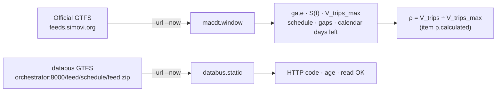

# `gtfs_window.py` · operating window from the static GTFS

**English** · [Español](README-gtfs_window.es.md)


Derives the MACDT operating parameters from the static GTFS (GTFS Schedule) instead of setting them by hand: service window, service days, scheduled concurrency per minute, V_trips_max and gaps with no scheduled trips. When the GTFS changes (new schedule or route), the thresholds follow it with no change in Zabbix.

The same script feeds two master items:

- **`macdt.window`:** reads the GTFS from the official schedule source and reports the current minute (service window gate, S(t), V_trips_max, calendar validity).
- **`databus.static`:** reads the GTFS that databus publishes, to check that it is served and how old it is.

## Overview

| Item | Value |
| --- | --- |
| **Location** | `scripts/user_scripts/gtfs_window.py` |
| **Runs on** | `remote-zabbix-agent2` of databus (R3) |
| **Run by** | Zabbix Agent 2, `UserParameter=macdt.window` and `UserParameter=databus.static` |
| **Item keys** | `macdt.window`, `databus.static` (template `simovilab-databus`) |
| **Sources** | GTFS ZIP by URL (`--url`), local file (`--zip`) or databus PostgreSQL (`--pg`) |
| **Dependencies** | None for `--zip` and `--url`; `psycopg[binary]` for `--pg` |



## Usage

### Quick start

```bash
# As the agent runs it: current minute, one JSON line
./gtfs_window.py --url https://feeds.simovi.org/bucr/schedule/gtfs.zip --now

# Full analysis of a local GTFS
./gtfs_window.py --zip GTFS_bUCR.zip

# Values ready to load as Zabbix macros
./gtfs_window.py --zip GTFS_bUCR.zip --macros

# Against the current feed in the databus database
./gtfs_window.py --pg "host=... dbname=databus user=zbx_ro password=..."
```

### How to

#### 1. Prerequisites

- For `--url`: outbound access from the agent to the GTFS address.
- For `--pg`: `psycopg[binary]` and a read-only PostgreSQL user. The agent image does not install `psycopg`.

#### 2. Set the addresses in the agent

The lines are in [`agent2/zabbix_agent2.conf`](../../agent2/zabbix_agent2.conf):

```text
UserParameter=macdt.window,/var/lib/zabbix/user_scripts/gtfs_window.py --url https://feeds.simovi.org/bucr/schedule/gtfs.zip --now
UserParameter=databus.static,/var/lib/zabbix/user_scripts/gtfs_window.py --url http://orchestrator:8000/feed/schedule/feed.zip --now
```

Review both addresses on every new installation and restart the agent after changing them.

#### 3. Test it by hand

```bash
cd /home/zabbix
docker run --rm --network databus_internal -v "$PWD/scripts/user_scripts":/s:ro --entrypoint bash \
  simovilab/zabbix-agent2:ubuntu-7.4.3 -c '/s/gtfs_window.py --url http://orchestrator:8000/feed/schedule/feed.zip --now'
```

`"window_ok": 1` means the GTFS was downloaded and analyzed.

#### 4. What the script does

1. Gets the GTFS: downloads the ZIP (`--url`, with a browser `User-Agent`), opens the file (`--zip`) or queries the current feed (`--pg`).
2. Reads `trips.txt`, `stop_times.txt` and `calendar.txt`, and computes the span (first departure, last arrival) of each trip. It accepts times above 24:00.
3. For each `service_id`, computes the window, the scheduled concurrency per minute, its percentiles, V_trips_max (P99) and the minutes with no scheduled trips.
4. Prints the result in the selected mode. With `--now`, it uses the `service_id` with the most trips (or `--servicio`).

#### 5. Verify in Zabbix

**Monitoring → Latest data**, host `Databus-host`: items `macdt.*` and `databus.static.*`. *Horario de servicio (texto)* shows the window, for example `Mon-Fri from 6:10 a.m. to 9:58 p.m.`.

## Reference

### Options

| Option | Default | Description |
| --- | --- | --- |
| `--url` | — | GTFS ZIP address. One of `--url`, `--zip` or `--pg` is required |
| `--zip` | — | Local GTFS ZIP file |
| `--pg` | — | PostgreSQL DSN of databus (`feed_*` tables of the current feed) |
| `--host-header` | *(none)* | `Host` header for `--url`. Must be a value in databus `ALLOWED_HOSTS` |
| `--timeout` | `20.0` | Download timeout (s) |
| `--now` | off | Print only the current minute (mode used by Zabbix) |
| `--macros` | off | Print only the values as Zabbix macros |
| `--servicio` | busiest | `service_id` to use with `--now` and `--macros` |

### Output with `--now`

| Field | Item (`macdt.window`) | Description |
| --- | --- | --- |
| `window_ok` | `macdt.window_ok` | `1` if the GTFS was read, `0` if not. Root of the window alert tree |
| `error` | — | Error text (only when `window_ok = 0`) |
| `static_zip_http` | `macdt.static_zip_http` | HTTP code of the download |
| `static_zip_age_s` | `macdt.static_zip_age_s` | ZIP age from its `Last-Modified` header (s) |
| `minuto` | — | Current minute (`HH:MM`, agent time zone) |
| `service_id` | — | Service used |
| `horario_texto` | `macdt.horario_texto` | Service days and hours, readable |
| `huecos_texto` | `macdt.huecos_texto` | Times with no scheduled buses, readable |
| `gate_ventana` | `macdt.gate` | `1` inside the service window on a service day, `0` outside |
| `s_t` | `macdt.s_t` | Trips scheduled for this minute, S(t) |
| `v_trips_max` | `macdt.v_trips_max` | P99 of the scheduled concurrency: normalizer of ρ |
| `hueco_cero_programado` | `macdt.hueco_programado` | `1` inside the window in a minute with no scheduled trips |
| `dias_a_fin_vigencia` | `macdt.cal_dias_vigencia` | Days until the GTFS calendar `end_date` |

`databus.static` uses `window_ok`, `static_zip_http` and `static_zip_age_s` (items `databus.static.ok`, `databus.static.http` and `databus.static.age_s`).

If the download or the analysis fails, `--now` still prints a JSON with the same keys, `window_ok = 0` and the HTTP code when there is one, so Zabbix can alert. Without `--now`, the error stops the script.

### Output with `--macros`

| Macro | Value |
| --- | --- |
| `{$MACDT.SERVICE_ID}` | Service used |
| `{$MACDT.VTRIPS_MAX}` | V_trips_max |
| `{$MACDT.WIN_START}`, `{$MACDT.WIN_END}` | Window start and end (`HH:MM`) |
| `{$MACDT.WIN_DAYS}` | Service days (1 = Monday … 7 = Sunday) |
| `{$MACDT.HOP_MIN_DIA}` | Window length per day (min) |
| `{$MACDT.HOP_HORAS_MES}` | Operating hours per month |
| `{$MACDT.PERIOD_ZBX}` | Window in Zabbix time period format |

### Output without `--now` or `--macros`

Full JSON with one block per `service_id`: `dias`, `vigencia`, `ventana`, `viajes_dia`, `concurrencia` (mean, P50, P75, P90, P99, max), `v_trips_max`, `huecos_cero` and `programado_por_minuto`.

### Notes

- If the calendar has no service days for the chosen service, `--now` and `--macros` assume Monday to Friday.
- `--now` uses the agent clock and time zone (`TZ` of the container).
- `--pg` reads times as `TIME` columns from databus, which do not accept values above 24:00.

## Documentation

- [`README.md`](../../README.md): full deployment guide, items and alerts.
- [`agent2/zabbix_agent2.conf`](../../agent2/zabbix_agent2.conf): `UserParameter` lines.
- [`templates/simovilab-databus.yml`](../../templates/simovilab-databus.yml): master and dependent items.
- [`gtfsrt_probe.py`](gtfsrt_probe.py): GTFS-RT probe. See [its README](README-gtfsrt_probe.md).
