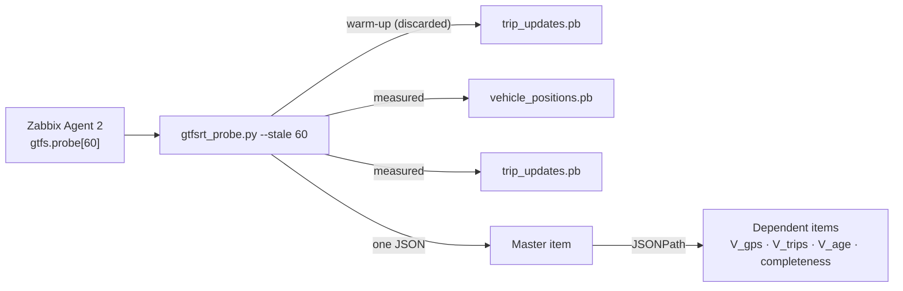

# `gtfsrt_probe.py` · databus GTFS-RT probe

**English** · [Español](README-gtfsrt_probe.es.md)


MACDT Layer D probe. It downloads the two GTFS-RT feeds that databus publishes (vehicle positions and trip updates), computes freshness, load and completeness, and prints **one JSON**. Zabbix stores that JSON in the master item `gtfs.probe[{$MACDT.STALE_S}]` and splits it into dependent items with JSONPath.

## Overview

| Item | Value |
| --- | --- |
| **Location** | `scripts/user_scripts/gtfsrt_probe.py` |
| **Runs on** | `remote-zabbix-agent2` of databus (R3), inside the `databus_internal` network |
| **Run by** | Zabbix Agent 2, `UserParameter=gtfs.probe[*]` in [`agent2/zabbix_agent2.conf`](../../agent2/zabbix_agent2.conf) |
| **Item key** | `gtfs.probe[{$MACDT.STALE_S}]` (template `simovilab-databus`) |
| **Queries** | `<base>/vehicle_positions.pb` and `<base>/trip_updates.pb` |
| **Dependencies** | `requests`, `gtfs-realtime-bindings` (installed in the agent image) |



## Usage

### Quick start

```bash
# As the agent runs it (inside the databus network)
./gtfsrt_probe.py --base http://orchestrator:8000/feed/realtime --stale 60

# With a Host header accepted by databus ALLOWED_HOSTS
./gtfsrt_probe.py --base http://orchestrator:8000/feed/realtime --host-header databus.ucr.ac.cr --stale 60

# Offline, from saved .pb files
./gtfsrt_probe.py --vp-file vp.pb --tu-file tu.pb
```

### How to

#### 1. Prerequisites

- The databus orchestrator reachable from the agent at the `--base` address.
- `requests` and `gtfs-realtime-bindings`. The agent image ([`agent2/Dockerfile`](../../agent2/Dockerfile)) already installs them.

#### 2. Set the address in the agent

The line is in [`agent2/zabbix_agent2.conf`](../../agent2/zabbix_agent2.conf):

```text
UserParameter=gtfs.probe[*],/var/lib/zabbix/user_scripts/gtfsrt_probe.py --base http://orchestrator:8000/feed/realtime --stale $1
```

`$1` takes the value of the `{$MACDT.STALE_S}` macro (default `60`). Restart the agent after changing this file. Changing the script needs no restart: the agent reads it on every run.

#### 3. Test it by hand

`remote-zabbix-agent2` mounts the host `/proc`, so `docker exec` into it fails. Run the probe in a temporary container with the same image and network:

```bash
cd /home/zabbix
docker run --rm --network databus_internal -v "$PWD/scripts/user_scripts":/s:ro --entrypoint bash \
  simovilab/zabbix-agent2:ubuntu-7.4.3 -c '/s/gtfsrt_probe.py --base http://orchestrator:8000/feed/realtime --stale 60'
```

The output is one JSON line. `"fetch_ok": 1` means both feeds were downloaded and parsed.

#### 4. What the probe does

1. Opens one HTTP session, so both downloads reuse the same TCP connection.
2. Sends a warm-up request to `trip_updates.pb` and discards it (unless `--no-warmup`).
3. Downloads `vehicle_positions.pb` and `trip_updates.pb`, timing each one.
4. Classifies each vehicle by the age of its position: `fresco` (0 to `--stale` s), `viejo` (older, or in the future) or `sin_ts` (no timestamp).
5. Computes freshness, load, completeness and the vehicle table.
6. Prints one JSON and exits with code `0`. If a download fails, it prints `fetch_ok = 0` with the error.

#### 5. Verify in Zabbix

**Monitoring → Latest data**, host `Databus-host`, items `gtfs.*`. The *Tabla de vehículos del feed (HTML)* item shows the per-vehicle table.

## Reference

### Options

| Option | Default | Description |
| --- | --- | --- |
| `--base` | `https://databus.ucr.ac.cr/feed/realtime` | Feed path. Inside the network: `http://orchestrator:8000/feed/realtime` |
| `--host-header` | *(none)* | `Host` header to send. Must be a value in databus `ALLOWED_HOSTS`; otherwise Django answers `400 DisallowedHost` |
| `--stale` | `60` | Seconds a position counts as fresh. Must equal databus `TELEMETRY_GRACE_S` |
| `--timeout` | `10.0` | Timeout per request (s) |
| `--no-warmup` | off | Do not discard the first request. Latencies then include opening the connection |
| `--vp-file`, `--tu-file` | *(none)* | Read both feeds from files instead of the network. Both are required together |

### Output

| Field | Item | Description |
| --- | --- | --- |
| `fetch_ok` | `gtfs.fetch_ok` | `1` if both feeds were downloaded and parsed, `0` if not. Root of the alert tree |
| `error` | — | Error text (only when `fetch_ok = 0`) |
| `fetch_vp_ms`, `fetch_tu_ms` | `gtfs.fetch_vp_ms`, `gtfs.fetch_tu_ms` | Download time of each feed (ms) |
| `warmup` | — | `1` if the warm-up request succeeded |
| `ts_sonda` | — | Probe time (Unix) |
| `stale_s` | `gtfs.stale_s` | Fresh threshold used in this run |
| `feed_age_vp_s`, `feed_age_tu_s` | `gtfs.feed_age_vp_s`, `gtfs.feed_age_tu_s` | Age of each feed header: whether the publisher runs (V_age) |
| `v_trips` | `gtfs.v_trips` | Trips in the trip-updates feed (V_trips) |
| `v_vehicles` | `gtfs.v_vehicles` | Vehicles in the positions feed: denominator of V_gps |
| `data_age_p50_s`, `data_age_p95_s`, `data_age_max_s` | `gtfs.data_age_p95_s`, `gtfs.data_age_max_s` | Age of the vehicle positions: p50, p95 and maximum (s) |
| `v_gps_pct` | `gtfs.v_gps_pct` | % of vehicles with a fresh position (V_gps). `null` with no vehicles |
| `v_gps_frescos`, `v_gps_viejos`, `v_gps_sin_ts` | `gtfs.v_gps_frescos`, `gtfs.v_gps_viejos`, `gtfs.v_gps_sin_ts` | Vehicles by state |
| `v_trips_sin_paradas` | `gtfs.v_trips_sin_paradas` | Published trips with no stops ahead |
| `ts_igual_header_pct` | `gtfs.ts_igual_header_pct` | % of vehicles whose time equals the header time (±1 s): possible filler by databus |
| `v_completeness_vp_pct` | `gtfs.completeness_vp_pct` | % of positions with trip, latitude, longitude and timestamp |
| `v_completeness_tu_pct` | `gtfs.completeness_tu_pct` | % of trip updates with trip and at least one stop |
| `vehiculos` | — | List per vehicle: id, trip, timestamp, age, state, position, time source and stops ahead |
| `vehiculos_texto` | `gtfs.vehiculos_texto` | One-line summary for the dashboard |
| `vehiculos_html` | `gtfs.vehiculos_html` | HTML table for the *Item history* widget |

### Design decisions

| Decision | Reason |
| --- | --- |
| Two ages (`feed_age_*` and `data_age_*`) | The header time is when Celery Beat built the file (every 15 s): it shows the publisher runs, not that vehicles report. The vehicle time shows real telemetry |
| `ts_igual_header_pct` | If a vehicle omits its time, databus fills it with the build time, so a feed with no telemetry can look fresh. This field flags it |
| `--stale 60` and not 90 | databus accepts telemetry for up to `TELEMETRY_GRACE_S = 60` s. With 90, monitoring would report better health than databus itself |
| One session and a warm-up | Without them, the first download pays DNS and the TCP handshake and the two latencies are not comparable (measured: 848 ms versus 12 ms) |
| Exit code always `0` | A failure is reported as `fetch_ok = 0`, so Zabbix stores it and can alert on it instead of marking the item unsupported |

## Documentation

- [`README.md`](../../README.md): full deployment guide, items and alerts.
- [`agent2/zabbix_agent2.conf`](../../agent2/zabbix_agent2.conf): `UserParameter` lines.
- [`templates/simovilab-databus.yml`](../../templates/simovilab-databus.yml): master and dependent items.
- [`gtfs_window.py`](gtfs_window.py): operating window probe. See [its README](README-gtfs_window.md).
