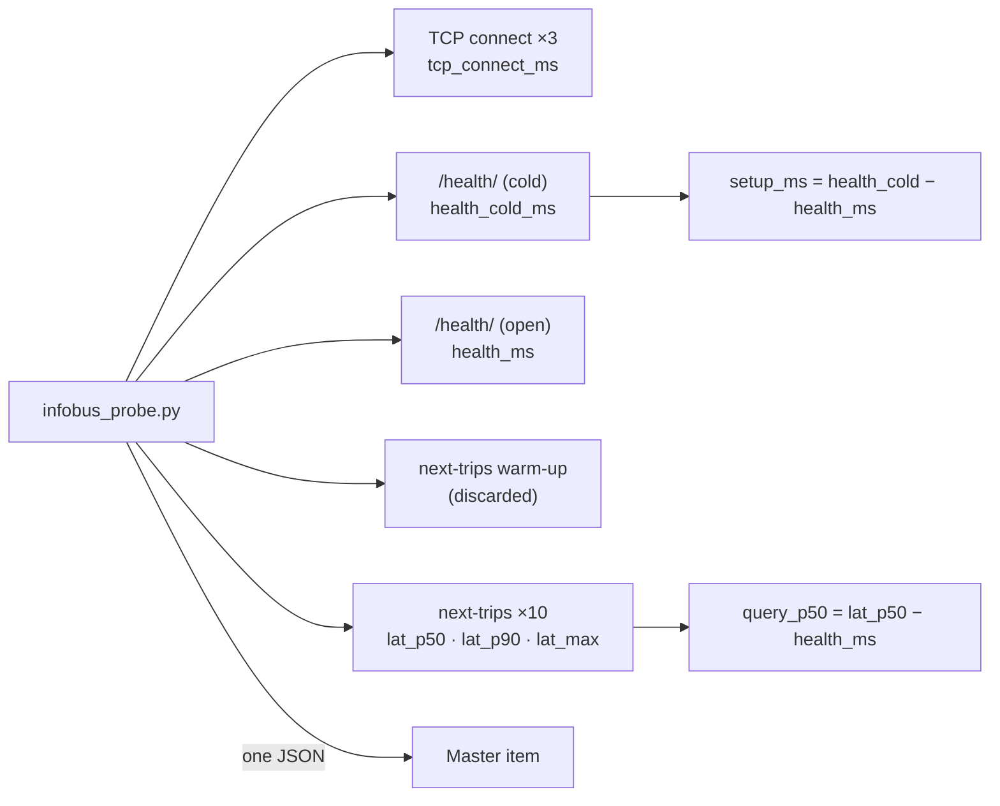

# `infobus_probe.py` · infobus API latency probe

**English** · [Español](README-infobus_probe.es.md)


MACDT Layer I probe. It measures the latency of the infobus `next-trips` endpoint with a short burst of requests, separates the transport cost from the query cost, and prints **one JSON**. The same script runs from two places:

- **Internal (`infobus.api`, R2 agent):** straight to the orchestrator (`http://orchestrator:8000`): Daphne + query, without Traefik.
- **External (`infobus.api.ext`, R4 agent):** through the public address (`https://<domain>`): network + TLS + Traefik + Daphne + query.

Zabbix computes the external minus internal difference in the `simovilab-infobus` template.

## Overview

| Item | Value |
| --- | --- |
| **Location** | `scripts/user_scripts/infobus_probe.py` |
| **Runs on** | `remote-zabbix-agent2` of infobus (R2) and `zabbix-agent2` of the server (R4) |
| **Run by** | Zabbix Agent 2, `UserParameter=infobus.api` and `UserParameter=infobus.api.ext` |
| **Item keys** | `infobus.api` (template `simovilab-infobus`), `infobus.api.ext` (template `simovilab-infobus-ext`) |
| **Queries** | `<base>/health/` and `<base>/api/next-trips/?stop_id=...&transit_system=...` |
| **Dependencies** | `requests` (stop selection uses only the standard library) |



## Usage

### Quick start

```bash
# Internal measurement (as the R2 agent runs it)
./infobus_probe.py --base http://orchestrator:8000 --host-header localhost \
  --stop-id auto --repeat 10 --transit-system 1

# External measurement (as the R4 agent runs it)
./infobus_probe.py --base https://infobus.ucr.ac.cr --stop-id auto --repeat 10 --transit-system 1

# Fixed stop
./infobus_probe.py --base https://infobus.ucr.ac.cr --stop-id bUCR_0_01 --transit-system 1
```

### How to

#### 1. Prerequisites

- The infobus orchestrator reachable at `--base`. For the internal measurement, the agent must be in the `infobus_internal` network.
- For the internal measurement, a `--host-header` value that is in infobus `ALLOWED_HOSTS`. Otherwise Django answers `400`.
- The numeric `TransitSystem` ID of infobus (`--transit-system`). Without it, `next-trips` answers `500`.
- With `--stop-id auto`, outbound access to the static GTFS (`--gtfs-url`).

#### 2. Set the addresses in the agent

The lines are in [`agent2/zabbix_agent2.conf`](../../agent2/zabbix_agent2.conf):

```text
UserParameter=infobus.api,/var/lib/zabbix/user_scripts/infobus_probe.py --base http://orchestrator:8000 --host-header localhost --stop-id auto --repeat 10 --transit-system 1
UserParameter=infobus.api.ext,/var/lib/zabbix/user_scripts/infobus_probe.py --base https://infobus.ucr.ac.cr --stop-id auto --repeat 10 --transit-system 1
```

Review `--base`, `--host-header` and `--transit-system` on every new installation and restart the agent after changing them. The external line works only when the API is behind Traefik.

#### 3. Test it by hand

```bash
cd /home/zabbix
docker run --rm --network infobus_internal -v "$PWD/scripts/user_scripts":/s:ro --entrypoint bash \
  simovilab/zabbix-agent2:ubuntu-7.4.3 -c '/s/infobus_probe.py --base http://orchestrator:8000 --host-header localhost --stop-id auto --repeat 10 --transit-system 1'
```

`"ok": 1` means every request in the burst answered `200` or `204`.

#### 4. What the probe does

1. With `--stop-id auto`, selects the stop (see [Stop selection](#stop-selection)).
2. Measures the TCP connection to the `--base` host and port: median of 3 attempts, without DNS.
3. Requests `/health/` twice in the same session: the first one opens the connection (`health_cold_ms`), the second reuses it (`health_ms`).
4. Sends one warm-up request to `next-trips` and discards it (unless `--no-warmup`).
5. Sends `--repeat` requests to `next-trips` and classifies each answer: `200` (latency), `204` (no service that day), `429` (throttled) or error.
6. Computes the burst statistics, the query cost and the probe's own last-hour p95.
7. Builds the HTML table for the dashboard and prints one JSON. It always exits with code `0`.

#### 5. Verify in Zabbix

**Monitoring → Latest data**: host `Infobus-host`, items `infobus.api.*`; host `Zabbix-server`, items `infobus.api.ext.*`. *Tabla API INFOBUS (HTML)* shows the service status and the latencies.

## Reference

### Options

| Option | Default | Description |
| --- | --- | --- |
| `--base` | `https://infobus.ucr.ac.cr` | infobus origin, with scheme |
| `--stop-id` | *(required)* | GTFS `stop_id`, or `auto` to measure the worst-case stop |
| `--gtfs-url` | `https://feeds.simovi.org/bucr/schedule/gtfs.zip` | Static GTFS used by `--stop-id auto` |
| `--gtfs-check-s` | `3600` | Seconds between checks for a new GTFS |
| `--stop-id-fallback` | `bUCR_0_01` | Stop used if `auto` cannot compute one |
| `--cache` | `/tmp/infobus_probe_parada.json` | Cache file of the selected stop |
| `--repeat` | `10` | Requests per cycle. Above `25` the probe refuses to run |
| `--timeout` | `5.0` | Timeout per request (s) |
| `--insecure` | off | Disable TLS verification. Only while the certificate is not valid yet |
| `--no-warmup` | off | Do not discard the first `next-trips` request |
| `--host-header` | *(none)* | `Host` header for a direct connection to the orchestrator. Also sends `X-Forwarded-Proto: https` |
| `--transit-system` | *(none)* | Numeric `TransitSystem` ID in infobus |

### Output

| Field | Item (internal / external) | Description |
| --- | --- | --- |
| `ok` | `infobus.api.ok` / `infobus.api.ext.ok` | `1` if every answer was `200` or `204` and the most frequent code is one of them |
| `status`, `status_codes` | — | Most frequent code and list of distinct codes in the burst |
| `n`, `n_ok` | — | Requests sent and `200` answers |
| `sin_servicio` | `infobus.api.sin_servicio` | `1` if every answer was `204` (no service that day) |
| `throttled` | `infobus.api.throttled` / `infobus.api.ext.throttled` | `429` answers: the measurement is not valid |
| `errors` | — | Answers other than `200`, `204` and `429`, or no connection |
| `warmup` | — | `1` if the warm-up request got an answer |
| `stop_id` | `infobus.api.stop_id` | Stop measured |
| `stop_auto` | `infobus.api.stop_auto` | `1` if the stop came from `auto`, `0` if the fallback was used |
| `stop_pico_5h` | `infobus.api.stop_pico_5h` | Peak of scheduled stop times in 5 h at the measured stop |
| `gtfs_last_modified`, `gtfs_check_ok` | — | GTFS version used for `auto` and result of the last check |
| `tcp_connect_ms` | `infobus.api.tcp_connect_ms` / `infobus.api.ext.tcp_connect_ms` | TCP connection time (ms) |
| `health_ok`, `health_status` | `infobus.api.health_ok` | `/health/` availability and code |
| `health_cold_ms` | `infobus.api.health_cold_ms` / `infobus.api.ext.health_cold_ms` | First request: opens the connection (ms) |
| `health_ms` | `infobus.api.health_ms` / `infobus.api.ext.health_ms` | Transport floor with the connection open (ms) |
| `setup_ms` | `infobus.api.setup_ms` / `infobus.api.ext.setup_ms` | Connection setup cost: `health_cold_ms − health_ms` |
| `lat_min_ms`, `lat_mean_ms`, `lat_stdev_ms` | — | Burst minimum, mean and standard deviation (`200` answers) |
| `lat_p50_ms` | `infobus.api.lat_p50` / `infobus.api.ext.lat_p50` | Burst median (L_api p50) |
| `lat_p90_ms` | `infobus.api.lat_p90` / `infobus.api.ext.lat_p90` | Burst p90 |
| `lat_max_ms` | `infobus.api.lat_max` | Burst maximum |
| `query_p50_ms` | `infobus.api.query_p50` / `infobus.api.ext.query_p50` | Query cost: `lat_p50_ms − health_ms` |
| `bytes_mean` | — | Mean body size of the `200` answers |
| `lat_sin_servicio_p50_ms` | `infobus.api.lat_sin_servicio` | Median of the `204` answers: fixed request cost |
| `query_sin_servicio_p50_ms` | — | `204` median minus `health_ms` |
| `lat_p95_1h_sonda_ms`, `n_p95_1h_sonda` | — | p95 of the last hour of `lat_p50_ms`, kept by the probe for the HTML table |
| `lat_sin_servicio_p95_1h_sonda_ms`, `n_sin_servicio_p95_1h_sonda` | — | Same, for the `204` series |
| `llegadas` | `infobus.api.llegadas` | Scheduled stop times in the 5 h window that `next-trips` returned in the cycle (`in_progress = false`). It is N(t) of T_base(t) and the regressor of m in the calibration. *(Pending: confirm against the script)* |
| `buses_parada` | `infobus.api.buses_parada` | Trips in progress that still have the measured stop ahead (`in_progress = true`). *(Pending: confirm against the script)* |
| `tabla_html` | `infobus.api.tabla_html` | HTML tables *INFOBUS API* and *LATENCIES* for the *Item history* widget |
| `error` | — | Error text, if the probe failed |

The real L_api p95 is not computed by the probe: Zabbix computes it over the stored series with `percentile(/HOST/infobus.api.lat_p50,1h,95)` (item `infobus.api.lat_p95_1h`).

### Stop selection

With `--stop-id auto`, the probe measures the stop with the highest number of scheduled stop times in a 5 h window, according to the GTFS: the worst case to compare with the non-functional requirement.

1. If the cache is from the same `--gtfs-url` and is younger than `--gtfs-check-s`, it uses the cached stop.
2. Otherwise it asks the server for the GTFS with `If-Modified-Since` / `If-None-Match`. A `304` downloads nothing and renews the cache.
3. A `200` recomputes the stop: arrival times only, all services, window `[t, t + 5 h]`. Ties are broken by daily total and then by `stop_id`.
4. If the check fails, it keeps the cached stop (`gtfs_check_ok = 0`). If there is no stop at all, it uses `--stop-id-fallback` (`stop_auto = 0`).

### Design decisions

| Decision | Reason |
| --- | --- |
| `--repeat 10` | `next-trips` has `throttle_scope = "realtime"`, limited to 30/min per IP. 10 per 60 s cycle is one third of the limit and leaves room for retries. More than 30/min would measure `429` instead of latency |
| Burst p50, not p95 | With n = 10, the p95 is the maximum. Zabbix computes the real p95 over about 600 samples per hour |
| `/health/` twice | It is a plain Django view, not throttled. Cold and open requests give the setup cost and a floor comparable to `lat_p50_ms` |
| `200` with body required | `400` (no `stop_id`) and `404` (unknown stop) are fast paths. Measuring them would report a misleadingly low latency |
| `204` is not a failure | It means no service that day (for example, weekends in bUCR). Its timings go to a separate series so they do not distort the p95 |
| One session and a warm-up | The first request pays DNS, TCP and TLS. Without reuse, it would contaminate the burst |

## Security notes

- **`--insecure`:** use it only while the certificate is not valid yet. It disables TLS verification.
- **Rate limit:** keep `--repeat` at 10. The limit is per IP, so the probe does not take capacity from passengers, but going above it invalidates the measurement.

## Documentation

- [`README.md`](../../README.md): full deployment guide, items and alerts.
- [`agent2/zabbix_agent2.conf`](../../agent2/zabbix_agent2.conf): `UserParameter` lines.
- [`templates/simovilab-infobus.yml`](../../templates/simovilab-infobus.yml) and [`templates/simovilab-infobus-ext.yml`](../../templates/simovilab-infobus-ext.yml): master and dependent items.
- [`macdt_loop.py`](macdt_loop.py): MACDT loop that uses N(t) and the latency. See [its README](README-macdt_loop.md).
