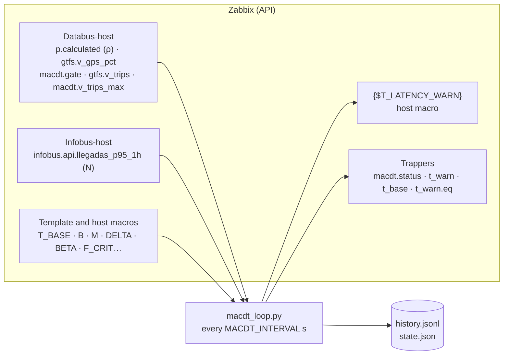

# `macdt_loop.py` · MACDT adaptive threshold loop

**English** · [Español](README-macdt_loop.es.md)


Executor of the MACDT loop (F5). Every minute it reads the transit load from databus and N(t) from infobus through the Zabbix API, computes the infobus latency warning threshold, and writes it as the `{$T_LATENCY_WARN}` host macro on Infobus-host. It also calibrates the T_base(t) line from the probe's own data. It follows the MAPE-K model:

| Phase | What the loop does |
| --- | --- |
| **Monitor** | Reads ρ, V_gps and the service window gate from databus, and N(t) from infobus |
| **Analyze** | Decides whether to tighten the threshold because of degraded GPS coverage |
| **Plan** | Computes `T_warn = clamp(T_base(t) × (1 + β·ρ) × F, T_floor, T_RNF)`, with `T_base(t) = b + m·N(t) + δ` |
| **Execute** | Writes `{$T_LATENCY_WARN}` as a host macro on Infobus-host |
| **Knowledge** | Records each cycle in `history.jsonl` |

## Overview

| Item | Value |
| --- | --- |
| **Location** | `scripts/user_scripts/macdt_loop.py`, mounted as `/macdt_loop.py` |
| **Runs on** | The `macdt-loop` container on the server (R4), image `simovilab/macdt-loop:1.0` ([`agent2/Dockerfile_local`](../../agent2/Dockerfile_local)) |
| **Run by** | The container entrypoint, as a continuous loop, after `zabbix-init` ends successfully |
| **Talks to** | Zabbix JSON-RPC API (`ZBX_API_URL`) |
| **Writes** | Host macros on Infobus-host, trapper items, files in `/var/lib/macdt` (volume `macdt_state`) |
| **Dependencies** | `requests` |



## Usage

### Quick start

The loop starts with the server stack. To check it:

```bash
docker logs --tail 5 macdt-loop    # one line per minute with N, T_base, ρ and T_warn
```

One-off runs inside the container:

```bash
docker exec macdt-loop python3 /macdt_loop.py --once --dry-run        # one test cycle, no writes
docker exec macdt-loop python3 /macdt_loop.py --calibrate --dry-run   # compute the line and show it, no writes
docker exec macdt-loop python3 /macdt_loop.py --calibrate             # calibrate and apply if it passes the guards
docker exec macdt-loop python3 /macdt_loop.py --calibrate --force     # apply even if it changes more than MACDT_CALIB_MAX_DRIFT
```

### How to

#### 1. Prerequisites

- `zabbix-init` finished successfully: the `macdt-loop` service waits for it.
- Databus-host and Infobus-host registered, with the `simovilab-databus` and `simovilab-infobus` templates.
- `API_WEB_USER` and `API_WEB_PASS` in `.env`: the loop logs in with them.

#### 2. Review the variables

`docker-compose.yml` passes them from `.env`. Every variable has a default except the credentials.

| Variable | Default | Use |
| --- | --- | --- |
| `ZBX_API_URL` | `http://zabbix-dashboard:8080/api_jsonrpc.php` | API address (from `API_URL`) |
| `ZBX_API_USER`, `ZBX_API_PASS` | *(required)* | API user (from `API_WEB_USER` and `API_WEB_PASS`) |
| `MACDT_HOST_DATABUS`, `MACDT_HOST_INFOBUS` | `Databus-host`, `Infobus-host` | Host names in Zabbix |
| `MACDT_TPL_DATABUS`, `MACDT_TPL_INFOBUS` | `simovilab-databus`, `simovilab-infobus` | Templates with the calculation macros |
| `MACDT_INTERVAL` | `60` | Seconds between cycles |
| `MACDT_MAX_AGE` | `180` | Maximum accepted data age (s) |
| `MACDT_STATE_DIR` | `/var/lib/macdt` | Folder of the state and history files |
| `MACDT_CALIB_MODE` | `manual` | `manual` (only with `--calibrate`) or `daily` |
| `MACDT_CALIB_HOUR` | `03:30` | Time of the daily calibration (`HH:MM`, container `TZ`) |
| `MACDT_CALIB_WINDOW_D` | `7` | Days of data used by the calibration |
| `MACDT_CALIB_MIN_R2` | `0.8` | Minimum R² to apply a calibration |
| `MACDT_CALIB_MIN_POINTS` | `300` | Minimum points to apply a calibration |
| `MACDT_CALIB_MAX_DRIFT` | `0.25` | Maximum change from the current line before holding it |
| `ZBX_SERVER`, `ZBX_SERVER_PORT` | `zabbix-server-pgsql`, `10051` | Read for compatibility. Trappers are sent through the API, not through this port |

After changing `.env`, recreate the container:

```bash
docker compose up -d --no-deps --force-recreate macdt-loop
```

After changing only the script, a restart is enough:

```bash
docker compose restart macdt-loop
```

#### 3. What one cycle does

1. Reads the last value and time of `p.calculated`, `gtfs.v_gps_pct`, `macdt.gate`, `gtfs.v_trips`, `macdt.v_trips_max` and `gtfs.fetch_ok` from Databus-host.
2. Reads the calculation macros from both templates. Host macros on Infobus-host override them.
3. If ρ is missing or older than `MACDT_MAX_AGE`, marks the cycle as **degraded**: keeps the current threshold, sends `macdt.status = 0` and ends.
4. If the service window is closed or V_gps is older than `MACDT_MAX_AGE`, ignores V_gps and resets the hysteresis.
5. Computes the GPS factor F (see [GPS factor](#gps-factor)).
6. Reads N(t) (`infobus.api.llegadas_p95_1h`). If it is missing or stale, uses `{$MACDT.T_BASE}` as T_base; otherwise `T_base = b + m·N + δ`.
7. Computes T_warn and clamps it between `{$MACDT.T_FLOOR}` and `{$MACDT.T_RNF}`.
8. Writes `{$T_LATENCY_WARN}` on Infobus-host (create, update or no change), saves the hysteresis state and sends the trappers.
9. Appends the cycle to `history.jsonl` and prints one log line.

With `MACDT_CALIB_MODE=daily`, before the first cycle at or after `MACDT_CALIB_HOUR` each day, the loop runs a calibration.

#### 4. Calibrate T_base(t) and β

The calibration fits `latency = b + m·N + c·V` over the last `MACDT_CALIB_WINDOW_D` days:

- `latency` = `infobus.api.lat_p50`, `N` = `infobus.api.llegadas` (same master item, same clock).
- `V` = `gtfs.v_trips` of databus, taken at or before each point and no older than `MACDT_MAX_AGE`.
- δ = p95 of the residuals (never below 0).
- β = c × V_max ÷ mean T_base while buses are running. With no buses in the window, c cannot be measured and β is kept.

It applies the result only if it passes every guard:

| Guard | Condition | If it fails |
| --- | --- | --- |
| Enough data | At least `MACDT_CALIB_MIN_POINTS` points | Rejected (`macdt.calib = 0`) |
| Fit | R² ≥ `MACDT_CALIB_MIN_R2` and m > 0 | Rejected (`macdt.calib = 0`) |
| Drift | The new line (at low and high N of the window) and β change no more than `MACDT_CALIB_MAX_DRIFT` from the current ones. Checked only when a previous calibration (m > 0) exists | Held (`macdt.calib = 2`), unless `--force` |

When applied (`macdt.calib = 1`), it writes `{$MACDT.M}`, `{$MACDT.B}`, `{$MACDT.DELTA}` and, if measured, `{$MACDT.BETA}` as host macros on Infobus-host. A held calibration fires the alert *MACDT: la latencia de infobus cambió más de lo permitido*; a person reviews it and applies it with `--calibrate --force` if it is the new normal.

Until the first calibration, `m = 0` and `δ = 0`, so T_base equals `{$MACDT.T_BASE}` (130 ms).

#### 5. Verify

```bash
docker logs --tail 5 macdt-loop
docker exec macdt-loop tail -n 3 /var/lib/macdt/history.jsonl
```

In the frontend: **Data collection → Hosts → Infobus-host → Macros** shows `{$T_LATENCY_WARN}` as a host macro. **Monitoring → Latest data** shows `macdt.status = 1` and the current `macdt.t_warn`.

#### Common operations

```bash
docker logs -f macdt-loop                                            # follow the loop
docker exec macdt-loop python3 /macdt_loop.py --once --dry-run        # test without writing
docker exec macdt-loop python3 /macdt_loop.py --calibrate --dry-run   # preview a calibration
docker compose restart macdt-loop                                    # after changing the script
```

## Reference

### Options

| Option | Description |
| --- | --- |
| *(none)* | Continuous loop, one cycle every `MACDT_INTERVAL` seconds |
| `--once` | Run one cycle and exit |
| `--dry-run` | Compute and show, without writing macros, history or trappers |
| `--calibrate` | Calibrate b, m, δ and β and exit |
| `--force` | With `--calibrate`: apply even if the line changes more than `MACDT_CALIB_MAX_DRIFT` |

### Values sent to Zabbix

All are trapper items on Infobus-host, sent with `history.push` through the API.

| Item | When | Value |
| --- | --- | --- |
| `macdt.status` | Every cycle | `1` OK; `0` degraded or error |
| `macdt.t_warn` | Every OK cycle | T_warn written (ms) |
| `macdt.t_base` | Every OK cycle | T_base(t) used (ms) |
| `macdt.t_warn.eq` | Every OK cycle | Equation with the cycle values, for the dashboard |
| `macdt.calib` | After a calibration | `1` applied; `0` rejected; `2` held |
| `macdt.calib.info` | After a calibration | JSON with b, m, c, δ, β, R², points and drift |

### Macros

| Macro | Read or written | Role |
| --- | --- | --- |
| `{$T_LATENCY_WARN}` | Written (host) | Output: warning threshold |
| `{$MACDT.T_BASE}` | Read | T_base seed when N(t) is missing |
| `{$MACDT.B}`, `{$MACDT.M}`, `{$MACDT.DELTA}` | Read; written by calibration (host) | T_base(t) line |
| `{$MACDT.BETA}` | Read; written by calibration (host) | Weight of ρ |
| `{$MACDT.F_CRIT}` | Read | Factor applied when GPS coverage is critical |
| `{$MACDT.V_GPS.CRIT}`, `{$MACDT.V_GPS.WARN}` | Read | Hysteresis limits of the GPS factor |
| `{$MACDT.T_FLOOR}`, `{$MACDT.T_RNF}` | Read | T_warn floor and ceiling |

`{$T_LATENCY_CRIT}` (200 ms, the non-functional requirement) is never changed.

### GPS factor

| State | Changes when | F |
| --- | --- | --- |
| Normal | 3 consecutive samples below `{$MACDT.V_GPS.CRIT}` → Tightened | `1.0` |
| Tightened | One sample above `{$MACDT.V_GPS.WARN}` → Normal | `{$MACDT.F_CRIT}` |
| No GPS data, window closed or stale V_gps | Resets to Normal | `1.0` |

### State files

| File | Content |
| --- | --- |
| `state.json` | Hysteresis state of the GPS factor |
| `history.jsonl` | One JSON line per cycle and per calibration |
| `calib.json` | Day of the last daily calibration |

They live in the `macdt_state` volume and survive restarts.

### Design decisions

| Decision | Reason |
| --- | --- |
| Host macro, not template macro | `zabbix-init` reimports templates with `updateExisting`. A template macro would go back to its seed on every redeployment |
| Reads `p.calculated` instead of computing ρ | That item already applies `{$MACDT.RHO_CAP}`. Computing it again would duplicate the definition |
| GPS factor only with the window open | With no buses, Zabbix keeps the last V_gps of the day. Using it would tighten the threshold at night |
| Freshness check | Writing a threshold from stale data is worse than not writing one |
| Persistence and hysteresis | Without them, one bad sample would tighten the threshold and the next would release it |
| Drift guard | Keeps the loop from learning a degradation as the new normal |
| Trappers through the API | Auto-registered hosts accept PSK only; an unencrypted connection to `10051` would be rejected silently |

## Security notes

- **API user:** the loop uses the administrator in `API_WEB_USER`. Its password lives only in `.env`.
- **Writes:** the loop changes only host macros on Infobus-host and its trapper items. It never changes templates or `{$T_LATENCY_CRIT}`.

## Documentation

- [`README.md`](../../README.md#macdt-loop-and-calibration): MACDT loop and calibration.
- [`docker-compose.yml`](../../docker-compose.yml): `macdt-loop` service.
- [`templates/simovilab-infobus.yml`](../../templates/simovilab-infobus.yml): MACDT macros and trapper items.
- [`infobus_probe.py`](infobus_probe.py): source of N(t) and the latency. See [its README](README-infobus_probe.md).
- [`gtfsrt_probe.py`](gtfsrt_probe.py) and [`gtfs_window.py`](gtfs_window.py): sources of V_gps, V_trips and the window.
