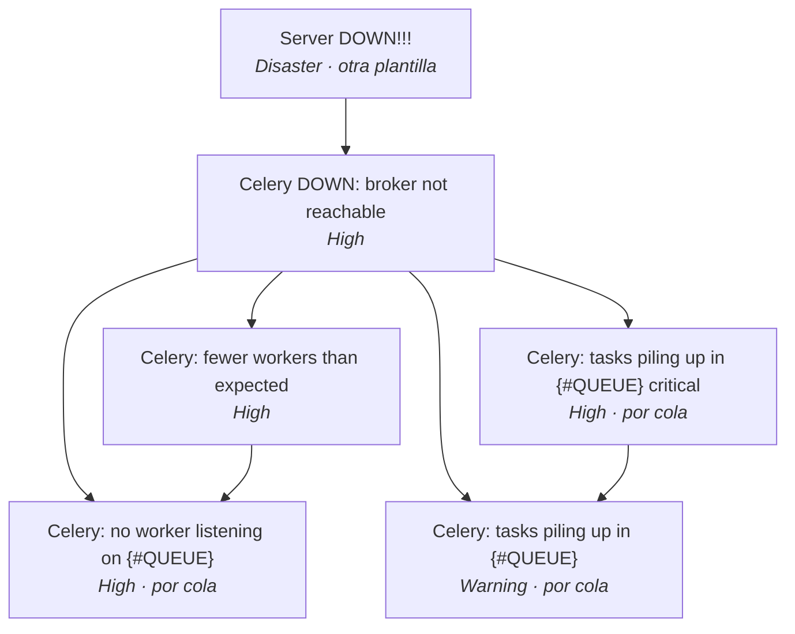

# `simovilab-celery` · Colas de tareas Celery de databus e infobus

> [English](README-template-simovilab-celery.md) · **Español**

 

Capa de tareas en segundo plano de los dos proyectos. Responde una sola pregunta: **¿se están procesando las tareas en segundo plano?** En databus los feeds de tiempo real y de horario los construyen tareas de Celery: si las colas se detienen, los feeds se detienen.

Una sola plantilla sirve para los dos proyectos. El broker cambia (databus: RabbitMQ, infobus: Redis) y se define en cada servidor en `simovilab-celery.conf`, que lee [`celery_probe.py`](README-celery_probe.md). Las colas se descubren solas.

## Resumen

| | |
| --- | --- |
| **Archivo** | [`templates/simovilab-celery.yml`](../templates/simovilab-celery.yml) |
| **Plantilla** | `simovilab-celery` |
| **Se vincula a** | `srv-databus` y `srv-infobus`, por `ROLE_DATABUS_TEMPLATE_*` y `ROLE_INFOBUS_TEMPLATE_*`. El autoregistro la vincula solo cuando un host se registra por primera vez: en hosts que ya existían, vincularla una vez a mano en *Data collection → Hosts → host → Templates*. |
| **Contenido** | 10 ítems, 2 reglas de descubrimiento con 3 prototipos, 5 alertas, 4 macros |

## Requisitos

| # | Requisito | Cómo |
| --- | --- | --- |
| 1 | `celery_probe.py` y la línea `UserParameter=celery.probe` en `agent2/zabbix_agent2.conf` | Ya están en el repositorio |
| 2 | `agent2/simovilab-celery.conf` con el bloque del servidor activo, montado en `/etc/zabbix/simovilab-celery.conf` | Lo crea `zabbix-dev.sh agent` desde el `.example`. Ver [guía de la sonda, paso 3](README-celery_probe.md#3-fill-in-simovilab-celeryconf) |
| 3 | srv-databus: usuario de RabbitMQ `zabbix_mon` (etiqueta `monitoring`, sin permisos) | [Guía de la sonda, paso 2](README-celery_probe.md#2-srv-databus-only-create-the-rabbitmq-user) |
| 4 | srv-infobus: sesión Redis `infobus` en `agent2/simovilab-plugins.conf` | La misma sesión que usa `simovilab-database` |
| 5 | Agente en la red Docker del proyecto | `AGENT_DOCKER_NETWORK`, para que resuelvan `message-broker` y `state` |
| 6 | `simovilab servidor y sistema operativo` en el mismo host | **Celery DOWN** depende de **Server DOWN!!!** |

**Probar desde el agente:**

```bash
docker exec zabbix-agent2 zabbix_agent2 -t celery.probe
```

Debe responder `"ok": 1`. Con `"ok": 0`, el motivo está en `"error"`.

## Qué mide

| Medición | Ítem | RabbitMQ (databus) | Redis (infobus) | Advertencia | Crítico | Ventana |
| --- | --- | --- | --- | --- | --- | --- |
| Broker alcanzable | `celery.ok` | ✔ | ✔ | — | 2 lecturas fallidas seguidas = **High** | 1 min |
| Tareas en espera por cola | `celery.queue.ready[*]` | ✔ | ✔ | > 30 | > 60 | 5 min |
| Workers vivos | `celery.workers` | ✔ | — | — | < 1 = **High** | 5 min |
| Workers escuchando cada cola | `celery.queue.consumers[*]` | ✔ | — | — | < 1 = **High** | 5 min |
| Tareas en ejecución (total y por cola) | `celery.unacked_total`, `celery.queue.unacked[*]` | ✔ | solo total | solo tendencia | — | — |
| Mensajes sin ruta | `celery.unroutable_rate` | ✔ | — | solo tendencia | — | — |

Los umbrales de cola salen del documento de especificación (sección 2.4: rango MACDT 30–200 advertencia y 60–400 crítico). Por ahora se usa el piso del rango. Son macros con contexto, así que se pueden fijar por cola.

**Qué no se mide con Redis, y por qué:** tareas en ejecución por cola, consumidores y workers. kombu sobre Redis no lleva un conteo de ejecución por cola ni un canal por worker; esos ítems quedan vacíos y sus alertas nunca se disparan.

## Árbol de alertas

La flecha va de la alerta que suprime a la alerta suprimida: mientras la de arriba está abierta, la de abajo no se abre.



## Alertas

| Alerta | Severidad | Se dispara cuando | La suprime |
| --- | --- | --- | --- |
| Celery DOWN: broker not reachable | High | Dos lecturas seguidas sin poder leer el broker. Las tareas no se pueden encolar ni vigilar: en databus deja de construirse el feed de tiempo real. El motivo queda en el ítem *Celery: probe error*. | Server DOWN!!! |
| Celery: fewer workers than expected | High | Menos de {$CELERY.WORKERS.MIN} workers durante 5 minutos (solo RabbitMQ). Un contenedor worker se detuvo o perdió la conexión (databus: `schedule-engine`, `realtime-engine`). | Celery DOWN: broker not reachable |
| Celery: no worker listening on {#QUEUE} | High | Menos de {$CELERY.CONSUMERS.MIN:"{#QUEUE}"} consumidores durante 5 minutos (solo RabbitMQ). Las tareas enviadas a esa cola nunca se ejecutan. | Celery DOWN: broker not reachable, Celery: fewer workers than expected |
| Celery: tasks piling up in {#QUEUE} critical | High | Más de {$CELERY.QUEUE.CRIT:"{#QUEUE}"} tareas en espera durante 5 minutos. El atraso sigue creciendo; las tareas pueden vencer antes de ejecutarse. | Celery DOWN: broker not reachable |
| Celery: tasks piling up in {#QUEUE} | Warning | Más de {$CELERY.QUEUE.WARN:"{#QUEUE}"} tareas en espera durante 5 minutos. Los workers toman tareas más lento de lo que llegan: feeds y predicciones salen tarde. | Celery DOWN: broker not reachable, Celery: tasks piling up in {#QUEUE} critical |

## Macros

Sobrescribir la macro en el host para conservar el cambio en la siguiente importación: *Data collection → Hosts → host → Macros → Inherited and host macros → Change*. Las tres macros por cola aceptan contexto: `{$CELERY.QUEUE.WARN:"realtime_engine"}` aplica solo a esa cola.

| Macro | Valor por defecto | Qué controla |
| --- | --- | --- |
| `{$CELERY.QUEUE.WARN}` | `30` | [ESP] 2.4 · tareas en espera por cola, 5 min. Piso del rango MACDT 30–200 |
| `{$CELERY.QUEUE.CRIT}` | `60` | [ESP] 2.4 · tareas en espera por cola, 5 min. Piso del rango MACDT 60–400 |
| `{$CELERY.WORKERS.MIN}` | `1` | Workers vivos esperados en el broker. Solo RabbitMQ |
| `{$CELERY.CONSUMERS.MIN}` | `1` | Workers que deben escuchar cada cola de trabajo. Solo RabbitMQ |

**Cola que nadie lee:** los workers de databus leen solo `realtime_engine` y `schedule_engine`. La cola por defecto `celery` puede existir en RabbitMQ sin consumidor, por eso `simovilab-databus` fija `{$CELERY.CONSUMERS.MIN:"celery"}` = `0`. La macro con contexto gana sobre el valor por defecto de esta plantilla, así que **Celery: no worker listening on celery** queda cerrada y las demás colas siguen exigiendo 1 consumidor. En otro sistema, agregar la misma macro (en el host o en la plantilla del rol) para cada cola que nadie lea.

## Dashboard

- **CELERY → Celery** (11 widgets): *Broker*, *Broker type*, *Tasks waiting*, *Tasks running*, *Workers alive*, *Unroutable messages*, *Local time*, *Celery queues*, *Tasks waiting per queue*, *Tasks running · workers alive*, *Unroutable messages · probe duration*

## Ítems

<details>
<summary>10 ítems + 2 reglas de descubrimiento</summary>

| Nombre | Llave | Tipo | Unidades |
| --- | --- | --- | --- |
| Celery: queue probe | `celery.probe` | Agente (activo) | — |
| Celery: broker reachable | `celery.ok` | Dependiente | — |
| Celery: probe error | `celery.error` | Dependiente | — |
| Celery: broker type | `celery.broker` | Dependiente | — |
| Celery: tasks waiting (all queues) | `celery.ready_total` | Dependiente | — |
| Celery: tasks running (all queues) | `celery.unacked_total` | Dependiente | — |
| Celery: workers alive | `celery.workers` | Dependiente | — |
| Celery: unroutable messages | `celery.unroutable_rate` | Dependiente | msg/s |
| Celery: probe duration | `celery.elapsed_ms` | Dependiente | ms |
| Celery: queue table (HTML) | `celery.html` | Dependiente | — |
| *Celery: work queues* | `celery.queues.discovery` | Descubrimiento | — |
| ↳ Celery: tasks waiting in {#QUEUE} | `celery.queue.ready[{#QUEUE}]` | Prototipo | — |
| *Celery: queue workers (RabbitMQ)* | `celery.queues.detail.discovery` | Descubrimiento | — |
| ↳ Celery: tasks running in {#QUEUE} | `celery.queue.unacked[{#QUEUE}]` | Prototipo | — |
| ↳ Celery: consumers on {#QUEUE} | `celery.queue.consumers[{#QUEUE}]` | Prototipo | — |

</details>

## Notas

- **Errores de la sonda** (`"ok": 0`): ver la [guía de la sonda](README-celery_probe.md#notes).
- **Recrear el agente a mano:** un volumen nuevo obliga a recrear el contenedor, no basta con reiniciarlo. `DOCKER_GID` lo calcula `zabbix-dev.sh`: `DOCKER_GID=$(getent group docker | cut -d: -f3) docker compose -f agent2/docker-compose-agent2.yml --env-file .env up -d`.
- **Colas de control de los workers y de Flower** (`*.pidbox`, `celeryev.*`) nunca se reportan como colas de trabajo. Para cambiarlo, editar `QUEUE_EXCLUDE` en `simovilab-celery.conf`.
