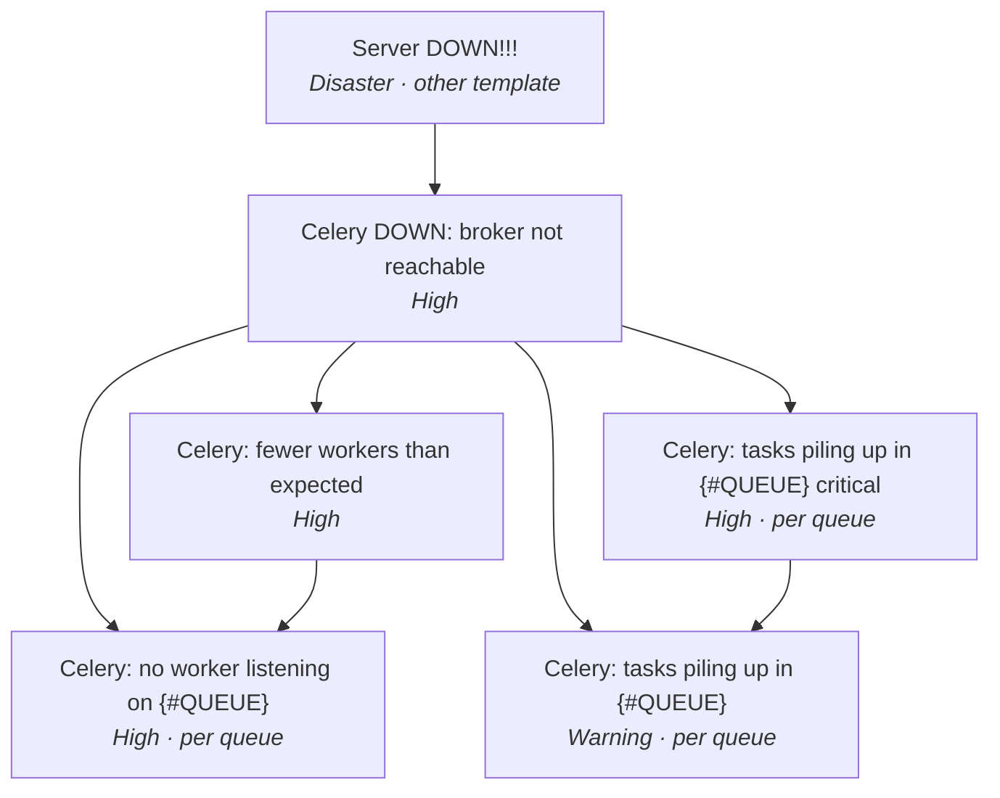

# `simovilab-celery` · Celery task queues of databus and infobus

 

Background task layer of both projects. It answers one question: **are the background tasks being processed?** In databus the realtime and schedule feeds are built by Celery tasks: if the queues stop, the feeds stop.

One template serves both projects. The broker differs (databus: RabbitMQ, infobus: Redis) and is set per server in `simovilab-celery.conf`, read by [`celery_probe.py`](README-celery_probe.md). Queues are discovered automatically.

## Overview

| | |
| --- | --- |
| **File** | [`templates/simovilab-celery.yml`](../templates/simovilab-celery.yml) |
| **Template** | `simovilab-celery` |
| **Linked to** | `srv-databus` and `srv-infobus`, through `ROLE_DATABUS_TEMPLATE_*` and `ROLE_INFOBUS_TEMPLATE_*`. Autoregistration links it only when a host registers for the first time: on hosts that already existed, link it once by hand in *Data collection → Hosts → host → Templates*. |
| **Contents** | 10 items, 2 discovery rules with 3 prototypes, 5 alerts, 4 macros |

## Requirements

| # | Requirement | How |
| --- | --- | --- |
| 1 | `celery_probe.py` and the line `UserParameter=celery.probe` in `agent2/zabbix_agent2.conf` | Already in the repository |
| 2 | `agent2/simovilab-celery.conf` with the block of the server active, mounted in `/etc/zabbix/simovilab-celery.conf` | Created by `zabbix-dev.sh agent` from the `.example`. See [probe guide, step 3](README-celery_probe.md#3-fill-in-simovilab-celeryconf) |
| 3 | srv-databus: RabbitMQ user `zabbix_mon` (tag `monitoring`, no permissions) | [Probe guide, step 2](README-celery_probe.md#2-srv-databus-only-create-the-rabbitmq-user) |
| 4 | srv-infobus: Redis session `infobus` in `agent2/simovilab-plugins.conf` | Same session used by `simovilab-database` |
| 5 | Agent on the Docker network of the project | `AGENT_DOCKER_NETWORK`, so that `message-broker` and `state` resolve |
| 6 | `simovilab servidor y sistema operativo` on the same host | **Celery DOWN** depends on **Server DOWN!!!** |

**Test from the agent:**

```bash
docker exec zabbix-agent2 zabbix_agent2 -t celery.probe
```

It must answer `"ok": 1`. With `"ok": 0`, the reason is in `"error"`.

## What it measures

| Measurement | Item | RabbitMQ (databus) | Redis (infobus) | Warning | Critical | Window |
| --- | --- | --- | --- | --- | --- | --- |
| Broker reachable | `celery.ok` | ✔ | ✔ | — | 2 failed checks in a row = **High** | 1 min |
| Tasks waiting per queue | `celery.queue.ready[*]` | ✔ | ✔ | > 30 | > 60 | 5 min |
| Workers alive | `celery.workers` | ✔ | — | — | < 1 = **High** | 5 min |
| Workers listening per queue | `celery.queue.consumers[*]` | ✔ | — | — | < 1 = **High** | 5 min |
| Tasks running (total and per queue) | `celery.unacked_total`, `celery.queue.unacked[*]` | ✔ | total only | trend only | — | — |
| Unroutable messages | `celery.unroutable_rate` | ✔ | — | trend only | — | — |

Queue thresholds come from the specification document (section 2.4: MACDT range 30–200 warning and 60–400 critical). For now the floor of the range is used. They are macros with context, so they can be set per queue.

**Not measured with Redis, and why:** running tasks per queue, consumers and workers. kombu over Redis keeps no per-queue running count and no per-worker channel; those items stay empty and their alerts never fire.

## Alert tree

An arrow goes from the alert that suppresses to the alert that is suppressed: while the upper one is open, the lower one does not open.



## Alerts

| Alert | Severity | Fires when | Suppressed by |
| --- | --- | --- | --- |
| Celery DOWN: broker not reachable | High | Two checks in a row without reading the broker. Tasks cannot be queued or watched: in databus the realtime feed stops being built. Reason in item *Celery: probe error*. | Server DOWN!!! |
| Celery: fewer workers than expected | High | Fewer than {$CELERY.WORKERS.MIN} workers during 5 minutes (RabbitMQ only). A worker container stopped or lost its connection (databus: `schedule-engine`, `realtime-engine`). | Celery DOWN: broker not reachable |
| Celery: no worker listening on {#QUEUE} | High | Fewer than {$CELERY.CONSUMERS.MIN:"{#QUEUE}"} consumers during 5 minutes (RabbitMQ only). Tasks sent to this queue will never run. | Celery DOWN: broker not reachable, Celery: fewer workers than expected |
| Celery: tasks piling up in {#QUEUE} critical | High | More than {$CELERY.QUEUE.CRIT:"{#QUEUE}"} tasks waiting during 5 minutes. The backlog keeps growing; tasks may expire before they run. | Celery DOWN: broker not reachable |
| Celery: tasks piling up in {#QUEUE} | Warning | More than {$CELERY.QUEUE.WARN:"{#QUEUE}"} tasks waiting during 5 minutes. Workers take tasks slower than they arrive: feeds and predictions come late. | Celery DOWN: broker not reachable, Celery: tasks piling up in {#QUEUE} critical |

## Macros

Override a macro on the host to keep the change after the next import: *Data collection → Hosts → host → Macros → Inherited and host macros → Change*. The three per-queue macros accept context: `{$CELERY.QUEUE.WARN:"realtime_engine"}` applies only to that queue.

| Macro | Default | What it controls |
| --- | --- | --- |
| `{$CELERY.QUEUE.WARN}` | `30` | [ESP] 2.4 · tasks waiting per queue, 5 min. Floor of the MACDT range 30–200 |
| `{$CELERY.QUEUE.CRIT}` | `60` | [ESP] 2.4 · tasks waiting per queue, 5 min. Floor of the MACDT range 60–400 |
| `{$CELERY.WORKERS.MIN}` | `1` | Workers alive expected on the broker. RabbitMQ only |
| `{$CELERY.CONSUMERS.MIN}` | `1` | Workers that must listen to each work queue. RabbitMQ only |

**Queue that nobody reads:** databus workers read only `realtime_engine` and `schedule_engine`. The default queue `celery` can exist in RabbitMQ with no consumer, so `simovilab-databus` sets `{$CELERY.CONSUMERS.MIN:"celery"}` = `0`. The context macro wins over the default of this template, so **Celery: no worker listening on celery** stays closed and every other queue still needs 1 consumer. On another system, add the same macro (host or role template) for each queue that nobody reads.

## Dashboard

- **CELERY → Celery** (11 widgets): *Broker*, *Broker type*, *Tasks waiting*, *Tasks running*, *Workers alive*, *Unroutable messages*, *Local time*, *Celery queues*, *Tasks waiting per queue*, *Tasks running · workers alive*, *Unroutable messages · probe duration*

## Items

<details>
<summary>10 items + 2 discovery rules</summary>

| Name | Key | Type | Units |
| --- | --- | --- | --- |
| Celery: queue probe | `celery.probe` | Agent (active) | — |
| Celery: broker reachable | `celery.ok` | Dependent | — |
| Celery: probe error | `celery.error` | Dependent | — |
| Celery: broker type | `celery.broker` | Dependent | — |
| Celery: tasks waiting (all queues) | `celery.ready_total` | Dependent | — |
| Celery: tasks running (all queues) | `celery.unacked_total` | Dependent | — |
| Celery: workers alive | `celery.workers` | Dependent | — |
| Celery: unroutable messages | `celery.unroutable_rate` | Dependent | msg/s |
| Celery: probe duration | `celery.elapsed_ms` | Dependent | ms |
| Celery: queue table (HTML) | `celery.html` | Dependent | — |
| *Celery: work queues* | `celery.queues.discovery` | Discovery | — |
| ↳ Celery: tasks waiting in {#QUEUE} | `celery.queue.ready[{#QUEUE}]` | Prototype | — |
| *Celery: queue workers (RabbitMQ)* | `celery.queues.detail.discovery` | Discovery | — |
| ↳ Celery: tasks running in {#QUEUE} | `celery.queue.unacked[{#QUEUE}]` | Prototype | — |
| ↳ Celery: consumers on {#QUEUE} | `celery.queue.consumers[{#QUEUE}]` | Prototype | — |

</details>

## Notes

- **Probe errors** (`"ok": 0`): see the [probe guide](README-celery_probe.md#notes).
- **Recreating the agent by hand:** a new volume needs the container to be recreated, not restarted. `DOCKER_GID` is computed by `zabbix-dev.sh`: `DOCKER_GID=$(getent group docker | cut -d: -f3) docker compose -f agent2/docker-compose-agent2.yml --env-file .env up -d`.
- **Flower and worker control queues** (`celeryev.*`, `*.pidbox`) are never reported as work queues. To change that, edit `QUEUE_EXCLUDE` in `simovilab-celery.conf`.
