# `simovilab-database` · PostgreSQL y Redis de databus e infobus

> [English](README-template-simovilab-database.md) · **Español**

 

Capa de base de datos de los dos proyectos: PostgreSQL (servicio `database` del compose) y Redis (servicio `state`). Una sola plantilla sirve para ambos porque la única diferencia es la macro `{$DB.SESSION}`, que es a la vez el nombre de la sesión del Agent 2 y el nombre de la base PostgreSQL. Esa macro **no** se define aquí: la aporta la plantilla del rol en el mismo host (`simovilab-databus` = `databus`, `simovilab-infobus` = `infobus`), así que el autoregistro no requiere pasos manuales.

En los dos proyectos Redis guarda estado en vivo (viajes en curso, posiciones de vehículos, suscripciones WebSocket), no caché. Por eso no se mide el hit ratio y **cualquier llave desalojada se trata como dato perdido**.

## Resumen

| | |
| --- | --- |
| **Archivo** | [`templates/simovilab-database.yml`](../templates/simovilab-database.yml) |
| **Plantilla** | `simovilab-database` |
| **Se vincula a** | `srv-databus` y `srv-infobus`, por `ROLE_DATABUS_TEMPLATE_*` y `ROLE_INFOBUS_TEMPLATE_*`. El autoregistro la vincula solo cuando un host se registra por primera vez: en hosts que ya existían, vincularla una vez a mano en *Data collection → Hosts → host → Templates*. |
| **Contenido** | 40 ítems, 22 alertas, 14 macros |

## Requisitos

| # | Requisito | Cómo |
| --- | --- | --- |
| 1 | Rol de solo lectura `zabbix_ro` en cada PostgreSQL, con `pg_monitor`. Nunca usar `postgres` | Pasos abajo |
| 2 | Sesiones `databus` / `infobus` en `agent2/simovilab-plugins.conf` (PostgreSQL con `zabbix_ro`, Redis con su contraseña) | Ver `agent2/simovilab-plugins.conf.example` |
| 3 | Consulta propia `agent2/pgsql-queries/simovilab_tables.sql`, montada en `/etc/zabbix/pgsql-queries` | Volumen en `agent2/docker-compose-agent2.yml` + `CustomQueriesPath` y `CustomQueriesEnabled=true` |
| 4 | Agente en la red Docker del proyecto | `AGENT_DOCKER_NETWORK`, para que resuelvan `database` y `state` |
| 5 | Plantilla del rol en el mismo host | Aporta `{$DB.SESSION}` |
| 6 | `simovilab servidor y sistema operativo` en el mismo host | Las dos alertas DOWN dependen de **Server DOWN!!!** |

**Crear `zabbix_ro`** (una vez por servidor PostgreSQL; cambiar el nombre del contenedor y la base: `databus` o `infobus`):

```bash
read -rs ZRO && export ZRO
docker exec -i -e ZRO infobus-prod-database-1 sh -c 'psql -U postgres -d infobus -v ON_ERROR_STOP=1 -v p="$ZRO" <<"SQL"
CREATE ROLE zabbix_ro LOGIN PASSWORD :'"'"'p'"'"';
GRANT pg_monitor TO zabbix_ro;
SQL'
docker exec -e PGPASSWORD="$ZRO" infobus-prod-database-1 psql -h localhost -U zabbix_ro -d infobus -c "select count(*) from pg_stat_activity;"
```

`pg_monitor` es un rol predefinido de PostgreSQL. Lee las vistas de estadísticas y las funciones de tamaño; no lee los datos de las tablas. La contraseña va solo en `simovilab-plugins.conf`, que no está en git.

**Probar las claves desde el agente** (`databus` en srv-databus, `infobus` en srv-infobus):

```bash
S=infobus
for k in "pgsql.ping[\"$S\"]" "pgsql.dbstat[\"$S\"]" "pgsql.queries[\"$S\",,,,\"1\"]" "pgsql.db.size[\"$S\"]" "pgsql.custom.query[\"$S\",,,,simovilab_tables]" "redis.ping[\"$S\"]" "redis.info[\"$S\"]"; do docker exec zabbix-agent2 zabbix_agent2 -t "$k" | cut -c1-200; echo; done
```

Cada clave debe responder `[s|...]`. `[m|ZBX_NOTSUPPORTED]` apunta a la sesión, la contraseña o la red.

## Qué mide

| Medición | Fuente | Advertencia | Crítica | Ventana |
| --- | --- | --- | --- | --- |
| Disponibilidad de PostgreSQL | `pgsql.ping` | — | 2 lecturas fallidas seguidas = **Alta** | 1 min |
| Conexiones activas | `pgsql.connections` | > 80 | > 120 | 5 min |
| Idle in transaction | `pgsql.connections` | > 10 | > 20 | 5 min |
| Conexiones usadas de `max_connections` | `pgsql.connections` | — | > 90 % | 5 min |
| Cache hit | `pgsql.dbstat` (tasas por minuto) | < 95 % | < 90 % | promedio de 15 min |
| Dead tuples, todas las tablas | `simovilab_tables.sql` | > 10 000 | > 50 000 | cada 5 min |
| Consultas de más de 1 s | `pgsql.queries` | en cada lectura durante 5 min | — | 5 min |
| Deadlocks | `pgsql.dbstat` | alguno en 15 min (**Media**) | — | 15 min |
| Reinicio | `pgsql.uptime` | uptime < 10 min (**Información**) | — | — |
| Tamaño, commits/rollbacks por segundo, consulta y transacción más largas | varios | solo tendencia | — | — |
| Disponibilidad de Redis | `redis.ping` | — | 2 lecturas fallidas seguidas = **Alta** | 1 min |
| Clientes conectados | `redis.info` | > 200 | > 400 | 5 min |
| Memoria usada de `maxmemory` | `redis.info` | > 75 % | > 90 % | 5 min |
| Llaves desalojadas | `redis.info` | alguna en 15 min (**Media**): se pierde estado | — | 15 min |
| Último snapshot RDB | `redis.info` | falló (**Advertencia**) | — | — |
| `maxmemory` sin definir | `redis.info` | **Información**: la alerta de memoria no puede dispararse | — | — |
| Reinicio | `redis.info` | uptime < 10 min (**Información**) | — | — |

Los umbrales salen del documento de especificación (secciones 2.2 y 2.3) y son macros, así que se pueden ajustar por host.

**Qué no se mide y por qué:** tiempo de ping en ms (los plugins solo devuelven 1 o 0; las consultas lentas cubren el tiempo de respuesta), retraso de replicación (no hay réplicas) y hit ratio de Redis (aquí Redis no es caché).

## Árbol de alertas

Cada flecha va de la alerta que suprime a la alerta suprimida: mientras la de arriba está abierta, la de abajo no se abre. En cada par, la de menor severidad depende de la de mayor, así solo se muestra el nivel más grave de un problema.

```mermaid
flowchart TD
  T0["Server DOWN!!!<br/><i>Desastre · otra plantilla</i>"]
  T1["PostgreSQL DOWN: database not reachable<br/><i>Alta</i>"]
  T2["PostgreSQL: active connections critical<br/><i>Alta</i>"]
  T3["PostgreSQL: cache hit ratio critical<br/><i>Alta</i>"]
  T4["PostgreSQL: connections close to max_connections<br/><i>Alta</i>"]
  T5["PostgreSQL: connections stuck in a transaction critical<br/><i>Alta</i>"]
  T6["PostgreSQL: vacuum falling behind critical<br/><i>Alta</i>"]
  T7["Redis DOWN: state store not reachable<br/><i>Alta</i>"]
  T8["Redis: memory usage critical<br/><i>Alta</i>"]
  T9["Redis: too many clients critical<br/><i>Alta</i>"]
  T10["PostgreSQL: deadlock detected<br/><i>Media</i>"]
  T11["Redis: keys evicted, state data lost<br/><i>Media</i>"]
  T12["PostgreSQL: connections stuck in a transaction<br/><i>Advertencia</i>"]
  T13["PostgreSQL: low cache hit ratio<br/><i>Advertencia</i>"]
  T14["PostgreSQL: slow queries for 5 minutes<br/><i>Advertencia</i>"]
  T15["PostgreSQL: too many active connections<br/><i>Advertencia</i>"]
  T16["PostgreSQL: vacuum falling behind<br/><i>Advertencia</i>"]
  T17["Redis: memory usage high<br/><i>Advertencia</i>"]
  T18["Redis: snapshot to disk failed<br/><i>Advertencia</i>"]
  T19["Redis: too many clients<br/><i>Advertencia</i>"]
  T20["PostgreSQL: service restarted<br/><i>Información</i>"]
  T21["Redis: no memory limit set<br/><i>Información</i>"]
  T22["Redis: service restarted<br/><i>Información</i>"]
  T1 --> T2
  T1 --> T3
  T1 --> T4
  T1 --> T12
  T1 --> T5
  T1 --> T10
  T1 --> T13
  T1 --> T20
  T1 --> T14
  T1 --> T15
  T1 --> T16
  T1 --> T6
  T2 --> T15
  T3 --> T13
  T5 --> T12
  T6 --> T16
  T7 --> T11
  T7 --> T8
  T7 --> T17
  T7 --> T21
  T7 --> T22
  T7 --> T18
  T7 --> T19
  T7 --> T9
  T8 --> T17
  T9 --> T19
  T0 --> T1
  T0 --> T7
```



## Alertas

Los nombres de las alertas son los que muestra Zabbix.

| Alerta | Severidad | Se dispara cuando | La suprime |
| --- | --- | --- | --- |
| PostgreSQL DOWN: database not reachable | Alta | 2 lecturas seguidas sin respuesta. La aplicación no puede leer ni escribir datos. | Server DOWN!!! |
| PostgreSQL: active connections critical | Alta | Más de {$PG.CONN.ACTIVE.CRIT} durante 5 min. La base está saturada y la API empieza a agotar tiempos. | PostgreSQL DOWN: database not reachable |
| PostgreSQL: connections stuck in a transaction critical | Alta | Más de {$PG.CONN.IDLETX.CRIT} durante 5 min. Crecen los bloqueos y el tamaño de las tablas hasta que la aplicación se bloquea. | PostgreSQL DOWN: database not reachable |
| PostgreSQL: connections close to max_connections | Alta | Más de {$PG.CONN.PCT.CRIT} % de max_connections durante 5 min. Al llegar a 100 % PostgreSQL rechaza toda conexión nueva. | PostgreSQL DOWN: database not reachable |
| PostgreSQL: cache hit ratio critical | Alta | Cache hit bajo {$PG.CACHE.HIT.CRIT} %. La mayoría de las lecturas va a disco y los tiempos empeoran. | PostgreSQL DOWN: database not reachable |
| PostgreSQL: vacuum falling behind critical | Alta | Más de {$PG.DEAD.TUP.CRIT} dead tuples. El crecimiento ya afecta el rendimiento; puede hacer falta un VACUUM manual. | PostgreSQL DOWN: database not reachable |
| Redis DOWN: state store not reachable | Alta | 2 lecturas seguidas sin respuesta. El proyecto pierde su estado en vivo (viajes en curso, posiciones, canales WebSocket). | Server DOWN!!! |
| Redis: too many clients critical | Alta | Más de {$REDIS.CLIENTS.CRIT} clientes durante 5 min. Cerca de rechazar conexiones nuevas. | Redis DOWN: state store not reachable |
| Redis: memory usage critical | Alta | Memoria sobre {$REDIS.MEM.PCT.CRIT} % de maxmemory durante 5 min. Están por fallar las escrituras del estado o por desalojarse llaves. | Redis DOWN: state store not reachable |
| PostgreSQL: deadlock detected | Media | Algún deadlock en los últimos 15 min: PostgreSQL canceló una transacción y falló una operación de la aplicación. Se cierra sola. | PostgreSQL DOWN: database not reachable |
| Redis: keys evicted, state data lost | Media | Alguna llave desalojada en 15 min. En databus e infobus Redis guarda estado, no caché: cada llave desalojada es un dato perdido. Se cierra sola. | Redis DOWN: state store not reachable |
| PostgreSQL: too many active connections | Advertencia | Más de {$PG.CONN.ACTIVE.WARN} conexiones ejecutando consultas durante 5 min. Se acumulan consultas: consultas lentas, bloqueos o una ráfaga de workers. | PostgreSQL DOWN: database not reachable, PostgreSQL: active connections critical |
| PostgreSQL: connections stuck in a transaction | Advertencia | Más de {$PG.CONN.IDLETX.WARN} conexiones idle in transaction durante 5 min. Suele ser código que no hace commit; retienen bloqueos e impiden el vacuum. | PostgreSQL DOWN: database not reachable, PostgreSQL: connections stuck in a transaction critical |
| PostgreSQL: low cache hit ratio | Advertencia | Cache hit bajo {$PG.CACHE.HIT.WARN} % (promedio de 15 min). Las consultas van a disco: shared_buffers pequeño o recorridos completos sin índice. | PostgreSQL DOWN: database not reachable, PostgreSQL: cache hit ratio critical |
| PostgreSQL: slow queries for 5 minutes | Advertencia | En cada lectura durante 5 min hubo al menos una consulta de más de {$PG.SLOW.QUERY.S} s. | PostgreSQL DOWN: database not reachable |
| PostgreSQL: vacuum falling behind | Advertencia | Más de {$PG.DEAD.TUP.WARN} dead tuples sumando todas las tablas. Las tablas crecen y las consultas recorren filas inútiles. | PostgreSQL DOWN: database not reachable, PostgreSQL: vacuum falling behind critical |
| Redis: too many clients | Advertencia | Más de {$REDIS.CLIENTS.WARN} clientes durante 5 min. Suele ser una fuga de conexiones o demasiados suscriptores WebSocket. | Redis DOWN: state store not reachable, Redis: too many clients critical |
| Redis: memory usage high | Advertencia | Memoria sobre {$REDIS.MEM.PCT.WARN} % de maxmemory durante 5 min. Al llegar a 100 % Redis desaloja llaves o rechaza escrituras. | Redis DOWN: state store not reachable, Redis: memory usage critical |
| Redis: snapshot to disk failed | Advertencia | Falló el último snapshot RDB (disco lleno o sin permiso). Si Redis se reinicia ahora, se pierde el estado desde el último snapshot bueno. | Redis DOWN: state store not reachable |
| PostgreSQL: service restarted | Información | PostgreSQL lleva menos de 10 min encendido (despliegue, reinicio del contenedor o caída). Se cierra sola. | PostgreSQL DOWN: database not reachable |
| Redis: no memory limit set | Información | maxmemory = 0: sin límite, la alerta de memoria no puede dispararse y Redis puede crecer hasta agotar la memoria del servidor. No es una caída. | Redis DOWN: state store not reachable |
| Redis: service restarted | Información | Redis lleva menos de 10 min encendido. Se cierra sola. | Redis DOWN: state store not reachable |

## Macros

Para que un cambio sobreviva a la siguiente importación, sobrescribir la macro en el host: *Data collection → Hosts → host → Macros → Inherited and host macros → Change*.

| Macro | Valor por defecto | Qué controla |
| --- | --- | --- |
| `{$PG.CACHE.HIT.CRIT}` | `90` | [ESP] 2.2 · cache hit crítico, %, promedio de 15 min |
| `{$PG.CACHE.HIT.WARN}` | `95` | [ESP] 2.2 · cache hit de advertencia, %, promedio de 15 min |
| `{$PG.CONN.ACTIVE.CRIT}` | `120` | [ESP] 2.2 · conexiones activas, 5 min |
| `{$PG.CONN.ACTIVE.WARN}` | `80` | [ESP] 2.2 · conexiones activas, 5 min |
| `{$PG.CONN.IDLETX.CRIT}` | `20` | [ESP] 2.2 · idle in transaction, 5 min |
| `{$PG.CONN.IDLETX.WARN}` | `10` | [ESP] 2.2 · idle in transaction, 5 min |
| `{$PG.CONN.PCT.CRIT}` | `90` | % de max_connections ocupado. Al 100 % se rechazan conexiones nuevas |
| `{$PG.DEAD.TUP.CRIT}` | `50000` | [ESP] 2.2 · dead tuples, todas las tablas |
| `{$PG.DEAD.TUP.WARN}` | `10000` | [ESP] 2.2 · dead tuples, todas las tablas |
| `{$PG.SLOW.QUERY.S}` | `1` | [INF] Segundos desde los que una consulta en curso cuenta como lenta |
| `{$REDIS.CLIENTS.CRIT}` | `400` | [ESP] 2.3 · clientes conectados, 5 min |
| `{$REDIS.CLIENTS.WARN}` | `200` | [ESP] 2.3 · clientes conectados, 5 min |
| `{$REDIS.MEM.PCT.CRIT}` | `90` | [ESP] 2.3 · % de maxmemory, 5 min |
| `{$REDIS.MEM.PCT.WARN}` | `75` | [ESP] 2.3 · % de maxmemory, 5 min |

## Dashboard

- **DATABASE → PostgreSQL** (15 widgets): *PostgreSQL*, *Redis*, *Active connections*, *Idle in transaction*, *Cache hit ratio*, *Database size*, *Local time*, *PostgreSQL*, *Dead tuples by table*, *Connections used of max_connections*, *Connections by state*, *Transactions per second*, *Cache hit ratio*, *Longest query and transaction · slow queries*, *Dead tuples · database size*
- **DATABASE → Redis** (13 widgets): *PostgreSQL*, *Redis*, *Connected clients*, *Memory used*, *Keys*, *Operations per second*, *Local time*, *Redis*, *Memory used of maxmemory*, *Last snapshot to disk*, *Memory used and limit*, *Clients*, *Operations per second · keys*

## Ítems

<details>
<summary>40 ítems</summary>

| Nombre | Clave | Tipo | Unidades |
| --- | --- | --- | --- |
| PostgreSQL: availability (ping) | `pgsql.ping["{$DB.SESSION}"]` | Agente (activo) | — |
| PostgreSQL: connections (raw) | `pgsql.connections["{$DB.SESSION}"]` | Agente (activo) | — |
| PostgreSQL: active connections | `pgsql.conn.active` | Dependiente | — |
| PostgreSQL: idle connections | `pgsql.conn.idle` | Dependiente | — |
| PostgreSQL: idle in transaction connections | `pgsql.conn.idle_in_tx` | Dependiente | — |
| PostgreSQL: connections waiting on a lock | `pgsql.conn.waiting` | Dependiente | — |
| PostgreSQL: total connections | `pgsql.conn.total` | Dependiente | — |
| PostgreSQL: connections used of max_connections | `pgsql.conn.total_pct` | Dependiente | % |
| PostgreSQL: database statistics (raw, all databases) | `pgsql.dbstat["{$DB.SESSION}"]` | Agente (activo) | — |
| PostgreSQL: database statistics (raw, this database) | `pgsql.db.stat` | Dependiente | — |
| PostgreSQL: commits per second | `pgsql.db.commits.rate` | Dependiente | tps |
| PostgreSQL: rollbacks per second | `pgsql.db.rollbacks.rate` | Dependiente | tps |
| PostgreSQL: blocks read from cache per second | `pgsql.db.blks_hit.rate` | Dependiente | — |
| PostgreSQL: blocks read from disk per second | `pgsql.db.blks_read.rate` | Dependiente | — |
| PostgreSQL: cache hit ratio | `pgsql.db.cache_hit` | Calculado | % |
| PostgreSQL: new deadlocks | `pgsql.db.deadlocks` | Dependiente | — |
| PostgreSQL: summary table (HTML) | `pgsql.db.summary_html` | Dependiente | — |
| PostgreSQL: running queries (raw, all databases) | `pgsql.queries["{$DB.SESSION}",,,,"{$PG.SLOW.QUERY.S}"]` | Agente (activo) | — |
| PostgreSQL: running queries (raw, this database) | `pgsql.db.queries` | Dependiente | — |
| PostgreSQL: slow queries running | `pgsql.db.slow_queries` | Dependiente | — |
| PostgreSQL: longest running query | `pgsql.db.query_time_max` | Dependiente | s |
| PostgreSQL: longest open transaction | `pgsql.db.tx_time_max` | Dependiente | s |
| PostgreSQL: database size | `pgsql.db.size["{$DB.SESSION}"]` | Agente (activo) | B |
| PostgreSQL: uptime | `pgsql.uptime["{$DB.SESSION}"]` | Agente (activo) | uptime |
| PostgreSQL: table statistics (raw) | `pgsql.custom.query["{$DB.SESSION}",,,,simovilab_tables]` | Agente (activo) | — |
| PostgreSQL: dead tuples (all tables) | `pgsql.db.dead_tuples` | Dependiente | — |
| PostgreSQL: dead tuples by table (HTML) | `pgsql.db.tables_html` | Dependiente | — |
| Redis: availability (ping) | `redis.ping["{$DB.SESSION}"]` | Agente (activo) | — |
| Redis: INFO (raw) | `redis.info["{$DB.SESSION}"]` | Agente (activo) | — |
| Redis: connected clients | `redis.clients` | Dependiente | — |
| Redis: blocked clients | `redis.clients.blocked` | Dependiente | — |
| Redis: memory used | `redis.mem.used` | Dependiente | B |
| Redis: memory limit (maxmemory) | `redis.mem.max` | Dependiente | B |
| Redis: memory used of maxmemory | `redis.mem.pct` | Dependiente | % |
| Redis: operations per second | `redis.ops` | Dependiente | ops |
| Redis: keys | `redis.keys` | Dependiente | — |
| Redis: new evicted keys | `redis.evicted` | Dependiente | — |
| Redis: last RDB save status | `redis.rdb_status` | Dependiente | — |
| Redis: uptime | `redis.uptime` | Dependiente | uptime |
| Redis: summary table (HTML) | `redis.summary_html` | Dependiente | — |

</details>

## Notas

- **`query "simovilab_tables" not found`:** el plugin no cargó el `.sql`. Revisar que el archivo esté dentro del contenedor (`ls /etc/zabbix/pgsql-queries/`), que las dos líneas `CustomQueries*` estén en `simovilab-plugins.conf`, y reiniciar el agente: el plugin lee la carpeta solo al arrancar. Un volumen nuevo exige recrear el contenedor, no basta con reiniciarlo.
- **Recrear el agente a mano:** `DOCKER_GID` lo calcula `zabbix-dev.sh`, no está en `.env`. Usar `DOCKER_GID=$(getent group docker | cut -d: -f3) docker compose -f agent2/docker-compose-agent2.yml --env-file .env up -d`.
- **Columna Status de las tablas HTML:** usa los valores de las macros cuando Zabbix las expande en el script de preprocesamiento y, si no, los valores por defecto de esta plantilla.
- **VACUUM DUE** en la tabla de dead tuples usa la regla del propio autovacuum de PostgreSQL (filas muertas > 50 + 20 % de las vivas); es información, no una alerta.
