# `simovilab-database` · PostgreSQL and Redis of databus and infobus

 

Database layer of both projects: PostgreSQL (compose service `database`) and Redis (compose service `state`). One template serves both, because the only difference is the macro `{$DB.SESSION}`, which is at the same time the Agent 2 session name and the PostgreSQL database name. That macro is **not** defined here: it comes from the role template on the same host (`simovilab-databus` = `databus`, `simovilab-infobus` = `infobus`), so autoregistration needs no manual step.

In both projects Redis keeps live state (runs in progress, vehicle positions, WebSocket subscriptions), not cache. For that reason the hit ratio is not measured and **any evicted key is treated as lost data**.

## Overview

| | |
| --- | --- |
| **File** | [`templates/simovilab-database.yml`](../templates/simovilab-database.yml) |
| **Template** | `simovilab-database` |
| **Linked to** | `srv-databus` and `srv-infobus`, through `ROLE_DATABUS_TEMPLATE_*` and `ROLE_INFOBUS_TEMPLATE_*`. Autoregistration links it only when a host registers for the first time: on hosts that already existed, link it once by hand in *Data collection → Hosts → host → Templates*. |
| **Contents** | 40 items, 22 alerts, 14 macros |

## Requirements

| # | Requirement | How |
| --- | --- | --- |
| 1 | Read-only PostgreSQL role `zabbix_ro` in each server, with `pg_monitor`. Never use `postgres` | Steps below |
| 2 | Sessions `databus` / `infobus` in `agent2/simovilab-plugins.conf` (PostgreSQL with `zabbix_ro`, Redis with its password) | See `agent2/simovilab-plugins.conf.example` |
| 3 | Custom query `agent2/pgsql-queries/simovilab_tables.sql`, mounted in `/etc/zabbix/pgsql-queries` | Volume in `agent2/docker-compose-agent2.yml` + `CustomQueriesPath` and `CustomQueriesEnabled=true` |
| 4 | Agent on the Docker network of the project | `AGENT_DOCKER_NETWORK`, so that `database` and `state` resolve |
| 5 | Role template on the same host | Provides `{$DB.SESSION}` |
| 6 | `simovilab servidor y sistema operativo` on the same host | The two DOWN alerts depend on **Server DOWN!!!** |

**Create `zabbix_ro`** (once per PostgreSQL server; replace the container name and the database: `databus` or `infobus`):

```bash
read -rs ZRO && export ZRO
docker exec -i -e ZRO infobus-prod-database-1 sh -c 'psql -U postgres -d infobus -v ON_ERROR_STOP=1 -v p="$ZRO" <<"SQL"
CREATE ROLE zabbix_ro LOGIN PASSWORD :'"'"'p'"'"';
GRANT pg_monitor TO zabbix_ro;
SQL'
docker exec -e PGPASSWORD="$ZRO" infobus-prod-database-1 psql -h localhost -U zabbix_ro -d infobus -c "select count(*) from pg_stat_activity;"
```

`pg_monitor` is a predefined PostgreSQL role. It reads the statistics views and the size functions; it does not read table data. The password goes only in `simovilab-plugins.conf`, which is not in git.

**Test the keys from the agent** (`databus` on srv-databus, `infobus` on srv-infobus):

```bash
S=infobus
for k in "pgsql.ping[\"$S\"]" "pgsql.dbstat[\"$S\"]" "pgsql.queries[\"$S\",,,,\"1\"]" "pgsql.db.size[\"$S\"]" "pgsql.custom.query[\"$S\",,,,simovilab_tables]" "redis.ping[\"$S\"]" "redis.info[\"$S\"]"; do docker exec zabbix-agent2 zabbix_agent2 -t "$k" | cut -c1-200; echo; done
```

Each key must answer `[s|...]`. `[m|ZBX_NOTSUPPORTED]` points to the session, the password or the network.

## What it measures

| Measurement | Source | Warning | Critical | Window |
| --- | --- | --- | --- | --- |
| PostgreSQL availability | `pgsql.ping` | — | 2 failed checks in a row = **High** | 1 min |
| Active connections | `pgsql.connections` | > 80 | > 120 | 5 min |
| Idle in transaction | `pgsql.connections` | > 10 | > 20 | 5 min |
| Connections used of `max_connections` | `pgsql.connections` | — | > 90 % | 5 min |
| Cache hit ratio | `pgsql.dbstat` (per-minute rates) | < 95 % | < 90 % | 15 min average |
| Dead tuples, all tables | `simovilab_tables.sql` | > 10 000 | > 50 000 | every 5 min |
| Queries running longer than 1 s | `pgsql.queries` | in every check for 5 min | — | 5 min |
| Deadlocks | `pgsql.dbstat` | any in 15 min (**Average**) | — | 15 min |
| Restart | `pgsql.uptime` | uptime < 10 min (**Information**) | — | — |
| Size, commits/rollbacks per second, longest query and transaction | several | trend only | — | — |
| Redis availability | `redis.ping` | — | 2 failed checks in a row = **High** | 1 min |
| Connected clients | `redis.info` | > 200 | > 400 | 5 min |
| Memory used of `maxmemory` | `redis.info` | > 75 % | > 90 % | 5 min |
| Evicted keys | `redis.info` | any in 15 min (**Average**): state lost | — | 15 min |
| Last RDB snapshot | `redis.info` | failed (**Warning**) | — | — |
| `maxmemory` not set | `redis.info` | **Information**: the memory alert cannot fire | — | — |
| Restart | `redis.info` | uptime < 10 min (**Information**) | — | — |

Thresholds come from the specification document (sections 2.2 and 2.3) and are macros, so they can be overridden per host.

**Not measured, and why:** ping time in ms (the plugins only return 1 or 0; slow queries cover the response time), replication lag (there are no replicas), Redis hit ratio (Redis is not a cache here).

## Alert tree

An arrow goes from the alert that suppresses to the alert that is suppressed: while the upper one is open, the lower one does not open. The lower severity of a pair depends on the higher one, so only the most serious level of a problem is shown.

```mermaid
flowchart TD
  T0["Server DOWN!!!<br/><i>Disaster · other template</i>"]
  T1["PostgreSQL DOWN: database not reachable<br/><i>High</i>"]
  T2["PostgreSQL: active connections critical<br/><i>High</i>"]
  T3["PostgreSQL: cache hit ratio critical<br/><i>High</i>"]
  T4["PostgreSQL: connections close to max_connections<br/><i>High</i>"]
  T5["PostgreSQL: connections stuck in a transaction critical<br/><i>High</i>"]
  T6["PostgreSQL: vacuum falling behind critical<br/><i>High</i>"]
  T7["Redis DOWN: state store not reachable<br/><i>High</i>"]
  T8["Redis: memory usage critical<br/><i>High</i>"]
  T9["Redis: too many clients critical<br/><i>High</i>"]
  T10["PostgreSQL: deadlock detected<br/><i>Average</i>"]
  T11["Redis: keys evicted, state data lost<br/><i>Average</i>"]
  T12["PostgreSQL: connections stuck in a transaction<br/><i>Warning</i>"]
  T13["PostgreSQL: low cache hit ratio<br/><i>Warning</i>"]
  T14["PostgreSQL: slow queries for 5 minutes<br/><i>Warning</i>"]
  T15["PostgreSQL: too many active connections<br/><i>Warning</i>"]
  T16["PostgreSQL: vacuum falling behind<br/><i>Warning</i>"]
  T17["Redis: memory usage high<br/><i>Warning</i>"]
  T18["Redis: snapshot to disk failed<br/><i>Warning</i>"]
  T19["Redis: too many clients<br/><i>Warning</i>"]
  T20["PostgreSQL: service restarted<br/><i>Information</i>"]
  T21["Redis: no memory limit set<br/><i>Information</i>"]
  T22["Redis: service restarted<br/><i>Information</i>"]
  T1 --> T2
  T1 --> T3
  T1 --> T4
  T1 --> T12
  T1 --> T5
  T1 --> T10
  T1 --> T13
  T1 --> T20
  T1 --> T14
  T1 --> T15
  T1 --> T16
  T1 --> T6
  T2 --> T15
  T3 --> T13
  T5 --> T12
  T6 --> T16
  T7 --> T11
  T7 --> T8
  T7 --> T17
  T7 --> T21
  T7 --> T22
  T7 --> T18
  T7 --> T19
  T7 --> T9
  T8 --> T17
  T9 --> T19
  T0 --> T1
  T0 --> T7
```



## Alerts

| Alert | Severity | Fires when | Suppressed by |
| --- | --- | --- | --- |
| PostgreSQL DOWN: database not reachable | High | Two checks in a row without answer. The application cannot read or write data. | Server DOWN!!! |
| PostgreSQL: active connections critical | High | More than {$PG.CONN.ACTIVE.CRIT} during 5 minutes. The database is saturated and the API will start to time out. | PostgreSQL DOWN: database not reachable |
| PostgreSQL: connections stuck in a transaction critical | High | More than {$PG.CONN.IDLETX.CRIT} during 5 minutes. Locks and table bloat grow until the application blocks. | PostgreSQL DOWN: database not reachable |
| PostgreSQL: connections close to max_connections | High | Above {$PG.CONN.PCT.CRIT} % for 5 minutes. When it reaches 100 %, PostgreSQL rejects every new connection (API and workers fail). | PostgreSQL DOWN: database not reachable |
| PostgreSQL: cache hit ratio critical | High | Under {$PG.CACHE.HIT.CRIT} %. Most reads hit the disk and response times degrade. | PostgreSQL DOWN: database not reachable |
| PostgreSQL: vacuum falling behind critical | High | More than {$PG.DEAD.TUP.CRIT}. Bloat is affecting performance; a manual VACUUM may be needed. | PostgreSQL DOWN: database not reachable |
| Redis DOWN: state store not reachable | High | Two checks in a row without answer. The project loses its live state (runs in progress, positions, WebSocket channels). | Server DOWN!!! |
| Redis: too many clients critical | High | More than {$REDIS.CLIENTS.CRIT} during 5 minutes. Close to rejecting new connections. | Redis DOWN: state store not reachable |
| Redis: memory usage critical | High | Above {$REDIS.MEM.PCT.CRIT} % for 5 minutes. Writes of live state are about to fail or keys to be evicted. | Redis DOWN: state store not reachable |
| PostgreSQL: deadlock detected | Average | Any deadlock in the last 15 minutes. Two transactions blocked each other and PostgreSQL cancelled one: an operation of the application failed. | PostgreSQL DOWN: database not reachable |
| Redis: keys evicted, state data lost | Average | Any eviction in the last 15 minutes. In databus and infobus Redis keeps live state, not cache: an evicted key is a run, a position or a subscription that disappears. | Redis DOWN: state store not reachable |
| PostgreSQL: too many active connections | Warning | More than {$PG.CONN.ACTIVE.WARN} during 5 minutes. Queries are piling up: slow queries, locks or a burst of workers. | PostgreSQL DOWN: database not reachable, PostgreSQL: active connections critical |
| PostgreSQL: connections stuck in a transaction | Warning | More than {$PG.CONN.IDLETX.WARN} during 5 minutes. Usually application code that does not commit; they hold locks and prevent vacuum. | PostgreSQL DOWN: database not reachable, PostgreSQL: connections stuck in a transaction critical |
| PostgreSQL: low cache hit ratio | Warning | Under {$PG.CACHE.HIT.WARN} %. Queries go to disk: shared_buffers too small for the data or full scans without index. | PostgreSQL DOWN: database not reachable, PostgreSQL: cache hit ratio critical |
| PostgreSQL: slow queries for 5 minutes | Warning | There was at least one in every check during 5 minutes. A heavy query, a missing index or a lock is slowing the application. | PostgreSQL DOWN: database not reachable |
| PostgreSQL: vacuum falling behind | Warning | More than {$PG.DEAD.TUP.WARN}. Tables grow (bloat) and queries scan useless rows. | PostgreSQL DOWN: database not reachable, PostgreSQL: vacuum falling behind critical |
| Redis: too many clients | Warning | More than {$REDIS.CLIENTS.WARN} during 5 minutes. Usually a connection leak in the application or too many WebSocket subscribers. | Redis DOWN: state store not reachable, Redis: too many clients critical |
| Redis: memory usage high | Warning | Above {$REDIS.MEM.PCT.WARN} % for 5 minutes. When it reaches 100 %, Redis evicts keys or rejects writes. | Redis DOWN: state store not reachable, Redis: memory usage critical |
| Redis: snapshot to disk failed | Warning | The last save failed (disk full or no write permission). If Redis restarts now, the state since the last good snapshot is lost. | Redis DOWN: state store not reachable |
| PostgreSQL: service restarted | Information | It restarted in the last 10 minutes (deploy, container restart or crash). Closes by itself. | PostgreSQL DOWN: database not reachable |
| Redis: no memory limit set | Information | There is no limit, so the memory usage alert cannot work and Redis can grow until the server runs out of memory. | Redis DOWN: state store not reachable |
| Redis: service restarted | Information | It restarted in the last 10 minutes. Live state is rebuilt by the application or reloaded from the snapshot. Closes by itself. | Redis DOWN: state store not reachable |

## Macros

Override a macro on the host to keep the change after the next import: *Data collection → Hosts → host → Macros → Inherited and host macros → Change*.

| Macro | Default | What it controls |
| --- | --- | --- |
| `{$PG.CACHE.HIT.CRIT}` | `90` | [ESP] 2.2 · cache hit ratio, %, 15 min average |
| `{$PG.CACHE.HIT.WARN}` | `95` | [ESP] 2.2 · cache hit ratio, %, 15 min average |
| `{$PG.CONN.ACTIVE.CRIT}` | `120` | [ESP] 2.2 · active connections, 5 min |
| `{$PG.CONN.ACTIVE.WARN}` | `80` | [ESP] 2.2 · active connections, 5 min |
| `{$PG.CONN.IDLETX.CRIT}` | `20` | [ESP] 2.2 · idle in transaction, 5 min |
| `{$PG.CONN.IDLETX.WARN}` | `10` | [ESP] 2.2 · idle in transaction, 5 min |
| `{$PG.CONN.PCT.CRIT}` | `90` | Connections used of max_connections, %. At 100 % new connections are rejected |
| `{$PG.DEAD.TUP.CRIT}` | `50000` | [ESP] 2.2 · dead tuples, all tables |
| `{$PG.DEAD.TUP.WARN}` | `10000` | [ESP] 2.2 · dead tuples, all tables |
| `{$PG.SLOW.QUERY.S}` | `1` | [INF] Seconds after which a running query counts as slow |
| `{$REDIS.CLIENTS.CRIT}` | `400` | [ESP] 2.3 · connected clients, 5 min |
| `{$REDIS.CLIENTS.WARN}` | `200` | [ESP] 2.3 · connected clients, 5 min |
| `{$REDIS.MEM.PCT.CRIT}` | `90` | [ESP] 2.3 · memory used of maxmemory, %, 5 min |
| `{$REDIS.MEM.PCT.WARN}` | `75` | [ESP] 2.3 · memory used of maxmemory, %, 5 min |

## Dashboard

- **DATABASE → PostgreSQL** (15 widgets): *PostgreSQL*, *Redis*, *Active connections*, *Idle in transaction*, *Cache hit ratio*, *Database size*, *Local time*, *PostgreSQL*, *Dead tuples by table*, *Connections used of max_connections*, *Connections by state*, *Transactions per second*, *Cache hit ratio*, *Longest query and transaction · slow queries*, *Dead tuples · database size*
- **DATABASE → Redis** (13 widgets): *PostgreSQL*, *Redis*, *Connected clients*, *Memory used*, *Keys*, *Operations per second*, *Local time*, *Redis*, *Memory used of maxmemory*, *Last snapshot to disk*, *Memory used and limit*, *Clients*, *Operations per second · keys*

## Items

<details>
<summary>40 items</summary>

| Name | Key | Type | Units |
| --- | --- | --- | --- |
| PostgreSQL: availability (ping) | `pgsql.ping["{$DB.SESSION}"]` | Agent (active) | — |
| PostgreSQL: connections (raw) | `pgsql.connections["{$DB.SESSION}"]` | Agent (active) | — |
| PostgreSQL: active connections | `pgsql.conn.active` | Dependent | — |
| PostgreSQL: idle connections | `pgsql.conn.idle` | Dependent | — |
| PostgreSQL: idle in transaction connections | `pgsql.conn.idle_in_tx` | Dependent | — |
| PostgreSQL: connections waiting on a lock | `pgsql.conn.waiting` | Dependent | — |
| PostgreSQL: total connections | `pgsql.conn.total` | Dependent | — |
| PostgreSQL: connections used of max_connections | `pgsql.conn.total_pct` | Dependent | % |
| PostgreSQL: database statistics (raw, all databases) | `pgsql.dbstat["{$DB.SESSION}"]` | Agent (active) | — |
| PostgreSQL: database statistics (raw, this database) | `pgsql.db.stat` | Dependent | — |
| PostgreSQL: commits per second | `pgsql.db.commits.rate` | Dependent | tps |
| PostgreSQL: rollbacks per second | `pgsql.db.rollbacks.rate` | Dependent | tps |
| PostgreSQL: blocks read from cache per second | `pgsql.db.blks_hit.rate` | Dependent | — |
| PostgreSQL: blocks read from disk per second | `pgsql.db.blks_read.rate` | Dependent | — |
| PostgreSQL: cache hit ratio | `pgsql.db.cache_hit` | Calculated | % |
| PostgreSQL: new deadlocks | `pgsql.db.deadlocks` | Dependent | — |
| PostgreSQL: summary table (HTML) | `pgsql.db.summary_html` | Dependent | — |
| PostgreSQL: running queries (raw, all databases) | `pgsql.queries["{$DB.SESSION}",,,,"{$PG.SLOW.QUERY.S}"]` | Agent (active) | — |
| PostgreSQL: running queries (raw, this database) | `pgsql.db.queries` | Dependent | — |
| PostgreSQL: slow queries running | `pgsql.db.slow_queries` | Dependent | — |
| PostgreSQL: longest running query | `pgsql.db.query_time_max` | Dependent | s |
| PostgreSQL: longest open transaction | `pgsql.db.tx_time_max` | Dependent | s |
| PostgreSQL: database size | `pgsql.db.size["{$DB.SESSION}"]` | Agent (active) | B |
| PostgreSQL: uptime | `pgsql.uptime["{$DB.SESSION}"]` | Agent (active) | uptime |
| PostgreSQL: table statistics (raw) | `pgsql.custom.query["{$DB.SESSION}",,,,simovilab_tables]` | Agent (active) | — |
| PostgreSQL: dead tuples (all tables) | `pgsql.db.dead_tuples` | Dependent | — |
| PostgreSQL: dead tuples by table (HTML) | `pgsql.db.tables_html` | Dependent | — |
| Redis: availability (ping) | `redis.ping["{$DB.SESSION}"]` | Agent (active) | — |
| Redis: INFO (raw) | `redis.info["{$DB.SESSION}"]` | Agent (active) | — |
| Redis: connected clients | `redis.clients` | Dependent | — |
| Redis: blocked clients | `redis.clients.blocked` | Dependent | — |
| Redis: memory used | `redis.mem.used` | Dependent | B |
| Redis: memory limit (maxmemory) | `redis.mem.max` | Dependent | B |
| Redis: memory used of maxmemory | `redis.mem.pct` | Dependent | % |
| Redis: operations per second | `redis.ops` | Dependent | ops |
| Redis: keys | `redis.keys` | Dependent | — |
| Redis: new evicted keys | `redis.evicted` | Dependent | — |
| Redis: last RDB save status | `redis.rdb_status` | Dependent | — |
| Redis: uptime | `redis.uptime` | Dependent | uptime |
| Redis: summary table (HTML) | `redis.summary_html` | Dependent | — |

</details>

## Notes

- **`query "simovilab_tables" not found`:** the plugin did not load the `.sql`. Check that the file is inside the container (`ls /etc/zabbix/pgsql-queries/`), that the two `CustomQueries*` lines are in `simovilab-plugins.conf`, and restart the agent: the plugin reads the folder only at start. A new volume needs the container to be recreated, not restarted.
- **Recreating the agent by hand:** `DOCKER_GID` is computed by `zabbix-dev.sh`, it is not in `.env`. Use `DOCKER_GID=$(getent group docker | cut -d: -f3) docker compose -f agent2/docker-compose-agent2.yml --env-file .env up -d`.
- **Status column of the HTML tables:** it uses the macro values when Zabbix expands them in the preprocessing script, and the defaults of this template otherwise.
- **VACUUM DUE** in the table of dead tuples uses the autovacuum rule of PostgreSQL itself (dead rows > 50 + 20 % of live rows); it is information, not an alert.
