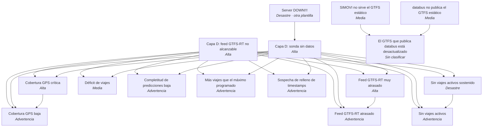

# `simovilab-databus` · capa D de MACDT (dominio de transporte)

> [English](README-template-simovilab-databus.md) · **Español**

 

Capa de dominio de databus. Mide si los datos de transporte en tiempo real que publica databus están completos y frescos: feeds GTFS-RT (`vehicle_positions.pb`, `trip_updates.pb`), el GTFS estático, la ventana de servicio derivada del horario y la carga de flota ρ que alimenta el bucle MACDT. Las alertas solo se disparan en horario de servicio (`macdt.gate = 1`), así que las noches y los días sin servicio no generan falsas alarmas.

## Resumen

| | |
| --- | --- |
| **Archivo** | [`templates/simovilab-databus.yml`](../templates/simovilab-databus.yml) |
| **Plantilla** | `simovilab-databus` |
| **Se vincula a** | `srv-databus`, por `ROLE_DATABUS_TEMPLATE_*` (metadata de autoregistro `docker-autoreg databus`). También define `{$DB.SESSION} = databus`, que usa `simovilab-database` en el mismo host. |
| **Contenido** | 38 ítems, 18 alertas, 13 macros |

## Requisitos

| Requisito | Para qué | Dónde |
| --- | --- | --- |
| `gtfsrt_probe.py` (`gtfs.probe[{$MACDT.STALE_S}]`) | Maestro de todos los ítems `gtfs.*` | [README](README-gtfsrt_probe.md) |
| `gtfs_window.py` (`macdt.window`, `databus.static`) | Ventana de servicio y viajes programados según el GTFS de SIMOVI; GTFS estático que publica databus | [README](README-gtfs_window.md) |
| Agente en la red Docker de databus | Las sondas llaman a `http://orchestrator:8000` | `AGENT_DOCKER_NETWORK` en el `.env` del agente |
| NTP en el servidor de databus | La sonda compara los timestamps de los vehículos con la hora actual | Host |
| `simovilab servidor y sistema operativo` en el mismo host | **Capa D: sonda sin datos** depende de **Server DOWN!!!** | Plantillas del rol en `.env` |

## Árbol de alertas

Cada flecha va de la alerta que suprime a la alerta suprimida: mientras la de arriba está abierta, la de abajo no se abre. En cada par, la de menor severidad depende de la de mayor, así solo se muestra el nivel más grave de un problema.

## Alertas

Los nombres de las alertas son los que muestra Zabbix.

| Alerta | Severidad | Se dispara cuando | La suprime |
| --- | --- | --- | --- |
| GTFS estático vencido | Desastre | El calendario del GTFS ya no tiene días vigentes. | — |
| Sin viajes activos sostenido | Desastre | En horario de servicio y con viajes programados, 10 min sin ningún viaje en el feed. | Capa D: feed GTFS-RT no alcanzable, Capa D: sonda sin datos |
| Feed GTFS-RT muy atrasado | Alta | El feed de predicciones tiene más de {$MACDT.V_AGE.CRIT} s durante 3 min. | Capa D: feed GTFS-RT no alcanzable, Capa D: sonda sin datos |
| Capa D: feed GTFS-RT no alcanzable | Alta | La sonda no pudo descargar el feed de tiempo real. | — |
| Capa D: sonda sin datos | Alta | 5 min sin datos de gtfs.probe. | Server DOWN!!! |
| GTFS estático por vencer | Alta | Quedan {$MACDT.CAL.DIAS.WARN} días o menos de calendario. | — |
| Capa D: ventana operativa no derivable | Alta | No se pudo calcular el horario de servicio desde el GTFS. | — |
| Cobertura GPS crítica | Alta | En horario, menos de {$MACDT.V_GPS.CRIT} % de vehículos con GPS fresco durante 5 min. | Capa D: feed GTFS-RT no alcanzable, Capa D: sonda sin datos |
| databus no publica el GTFS estático | Media | El feed.zip de databus no devuelve 200. | — |
| SIMOVI no sirve el GTFS estático | Media | La descarga del gtfs.zip de la fuente no devuelve 200. | — |
| Déficit de viajes | Media | En horario, faltan en el feed la mitad o más de los viajes programados durante 5 min. | Capa D: feed GTFS-RT no alcanzable, Capa D: sonda sin datos |
| Feed GTFS-RT atrasado | Advertencia | El feed de predicciones tiene más de {$MACDT.V_AGE.WARN} s durante 3 min. | Capa D: feed GTFS-RT no alcanzable, Capa D: sonda sin datos, Feed GTFS-RT muy atrasado |
| Cobertura GPS baja | Advertencia | En horario, menos de {$MACDT.V_GPS.WARN} % de vehículos con GPS fresco durante 5 min. | Capa D: feed GTFS-RT no alcanzable, Capa D: sonda sin datos, Cobertura GPS crítica |
| Completitud de predicciones baja | Advertencia | En horario, completitud menor a {$MACDT.COMPL.WARN} % durante 5 min. | Capa D: feed GTFS-RT no alcanzable, Capa D: sonda sin datos |
| Más viajes que el máximo programado | Advertencia | Más viajes en el feed que el máximo del horario durante 5 min (viajes fantasma). | Capa D: feed GTFS-RT no alcanzable, Capa D: sonda sin datos |
| Sin viajes activos | Advertencia | En horario y con viajes programados, 3 min sin viajes en el feed. | Capa D: feed GTFS-RT no alcanzable, Capa D: sonda sin datos, Sin viajes activos sostenido |
| Sospecha de relleno de timestamps | Advertencia | Dependiente | Capa D: feed GTFS-RT no alcanzable, Capa D: sonda sin datos |
| El GTFS que publica databus está desactualizado | Sin clasificar | Desfase entre el GTFS de databus y el de la fuente mayor a {$MACDT.ZIP.DESFASE.WARN} s durante 15 min. | databus no publica el GTFS estático, SIMOVI no sirve el GTFS estático |

## Macros

Para que un cambio sobreviva a la siguiente importación, sobrescribir la macro en el host: *Data collection → Hosts → host → Macros → Inherited and host macros → Change*.

| Macro | Valor por defecto | Qué controla |
| --- | --- | --- |
| `{$DB.SESSION}` | `databus` | Sesión del Agent 2 (simovilab-plugins.conf) y nombre de la base PostgreSQL que usa simovilab-database en el mismo host. |
| `{$MACDT.CAL.DIAS.WARN}` | `7` | Días de anticipación para avisar que vence el calendario del GTFS. |
| `{$MACDT.COMPL.CRIT}` | `80` | Completitud mínima de predicciones (nivel crítico, %). |
| `{$MACDT.COMPL.WARN}` | `90` | Completitud mínima de predicciones antes de avisar (%). |
| `{$MACDT.RHO_CAP}` | `1.2` | Tope de ρ (carga de la flota). |
| `{$MACDT.STALE_S}` | `60` | Segundos para contar como fresca una posición. Igual a TELEMETRY_GRACE_S de databus. |
| `{$MACDT.TSFILL.WARN}` | `50` | % de vehículos con la hora del encabezado que se considera relleno. |
| `{$MACDT.V_AGE.CRIT}` | `70` | Edad máxima del feed de predicciones antes de la alerta alta (bajo los 75 s que tolera infobus). |
| `{$MACDT.V_AGE.WARN}` | `45` | Edad máxima del feed de predicciones antes de avisar (3 ciclos de 15 s). |
| `{$MACDT.V_GPS.CRIT}` | `70` | % de GPS fresco bajo el que se activa F_crit (3 ciclos) y la alerta alta. |
| `{$MACDT.V_GPS.WARN}` | `85` | % de GPS fresco bajo el que se avisa. Sobre este valor se libera F_crit. |
| `{$MACDT.ZIP.DESFASE.TIEMPO}` | `25h` | Tiempo máximo que databus puede servir un GTFS estático más viejo que el de SIMOVI (1 h para detectar el cambio + 24 h hasta la siguiente exportación). |
| `{$MACDT.ZIP.DESFASE.WARN}` | `600` | Desfase máximo (s) entre el GTFS de databus y el de la fuente. |

## Dashboard

- **Operación databus → Operación** (27 widgets): *Horario de servicio*, *Huecos sin buses programados*, *Vehículos del feed: edad de la posición GPS (ahora − timestamp)*, *Horario de operación*, *Viajes en el feed (V_trips)*, *Viajes máximos programados*, *Viajes programados ahora*, *Carga de transporte (ρ)*, *Viajes sin paradas por delante*, *Vehículos en el feed*, *Con GPS fresco*, *Con GPS viejo*, *Sin timestamp*, *Cobertura GPS % (V_gps)*, *Umbral de GPS fresco*, *Edad máxima del GPS*, *Edad p95 del GPS*, *Edad del feed (V_age)*, *Desfase del GTFS estático (databus vs SIMOVI)*, *Completitud predicciones %*, *Completitud posiciones %*, *Días de vigencia del GTFS*, *Viajes en el feed vs programados y máximo*, *Vehículos del feed por estado del GPS*, *Carga de transporte (ρ)*, *Edad de la posición GPS*, *Edad del feed GTFS-RT*

## Ítems

38 ítems

| Nombre | Clave | Tipo | Unidades |
| --- | --- | --- | --- |
| GTFS estático publicado por databus | `databus.static` | Agente (activo) | — |
| databus: antigüedad del estático | `databus.static.age_s` | Dependiente | s |
| databus: desfase del estático frente a la fuente | `databus.static.desfase_s` | Calculado | s |
| databus: código HTTP del estático | `databus.static.http` | Dependiente | — |
| databus: lectura del estático correcta | `databus.static.ok` | Dependiente | — |
| V_completeness de predicciones | `gtfs.completeness_tu_pct` | Dependiente | — |
| V_completeness de posiciones | `gtfs.completeness_vp_pct` | Dependiente | — |
| Edad máxima de la posición GPS | `gtfs.data_age_max_s` | Dependiente | s |
| Calibrar el --stale contra la cadencia real | `gtfs.data_age_p95_s` | Dependiente | — |
| V_age del publicador de predicciones | `gtfs.feed_age_tu_s` | Dependiente | s |
| V_age del publicador de posiciones | `gtfs.feed_age_vp_s` | Dependiente | s |
| Raíz del árbol de alertas | `gtfs.fetch_ok` | Dependiente | — |
| Latencia del endpoint de predicciones | `gtfs.fetch_tu_ms` | Dependiente | ms |
| Latencia del endpoint de posiciones | `gtfs.fetch_vp_ms` | Dependiente | ms |
| gtfs-Maestro | `gtfs.probe[{$MACDT.STALE_S}]` | Agente (activo) | — |
| Umbral de GPS fresco usado por la sonda | `gtfs.stale_s` | Dependiente | s |
| Sospecha de relleno de timestamps | `gtfs.ts_igual_header_pct` | Dependiente | — |
| Tabla de vehículos del feed (HTML) | `gtfs.vehiculos_html` | Dependiente | — |
| Edad de la posición GPS por vehículo | `gtfs.vehiculos_texto` | Dependiente | — |
| Vehículos con GPS fresco | `gtfs.v_gps_frescos` | Dependiente | — |
| V_gps. Entrada de F_crit | `gtfs.v_gps_pct` | Dependiente | — |
| Vehículos sin timestamp | `gtfs.v_gps_sin_ts` | Dependiente | — |
| Vehículos con GPS viejo | `gtfs.v_gps_viejos` | Dependiente | — |
| V_trips. Entrada de F_load y G_load | `gtfs.v_trips` | Dependiente | — |
| Viajes sin paradas por delante | `gtfs.v_trips_sin_paradas` | Dependiente | — |
| Denominador real de V_gps | `gtfs.v_vehicles` | Dependiente | — |
| Calendar age | `macdt.cal_dias_vigencia` | Dependiente | — |
| Schedule | `macdt.gate` | Dependiente | — |
| Horario de servicio (texto) | `macdt.horario_texto` | Dependiente | — |
| Huecos sin buses programados (texto) | `macdt.huecos_texto` | Dependiente | — |
| scheduled slot | `macdt.hueco_programado` | Dependiente | — |
| static_zip_age | `macdt.static_zip_age_s` | Dependiente | — |
| SIMOVI: código HTTP del GTFS estático | `macdt.static_zip_http` | Dependiente | — |
| Scheduled trips | `macdt.s_t` | Dependiente | — |
| Max trips | `macdt.v_trips_max` | Dependiente | — |
| macd-Maestro | `macdt.window` | Agente (activo) | — |
| Raíz del árbol de la ventana | `macdt.window_ok` | Dependiente | — |
| Calculo de p | `p.calculated` | Calculado | — |

## Notas

- **ρ (`p.calculated`)** es `V_trips ÷ máximo de viajes programados`, con tope `{$MACDT.RHO_CAP}`. El bucle MACDT lo lee cada minuto para adaptar el umbral de latencia de infobus.
- **`{$MACDT.STALE_S}` debe coincidir con `TELEMETRY_GRACE_S` de databus** (60 s). Si difiere, V_gps cuenta vehículos como frescos o viejos con una regla distinta a la del propio databus.
- **Relleno de timestamps:** databus rellena `vehicle.timestamp` con la hora del encabezado a propósito; la sonda lo cuenta como fresco solo si `vehicle.timestamp >= header.timestamp`. Ver [README-gtfsrt_probe](README-gtfsrt_probe.md).
