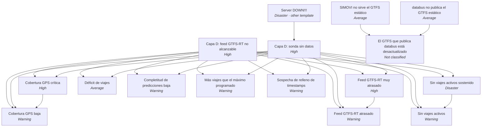

# `simovilab-databus` · MACDT layer D (transit domain)

 

Domain layer of databus. It measures whether the realtime transit data that databus publishes is complete and fresh: GTFS-RT feeds (`vehicle_positions.pb`, `trip_updates.pb`), the static GTFS, the service window derived from the schedule and the fleet load ρ that feeds the MACDT loop. Alerts only fire during service hours (`macdt.gate = 1`), so nights and days without service do not raise false alarms.

## Overview

| | |
| --- | --- |
| **File** | [`templates/simovilab-databus.yml`](../templates/simovilab-databus.yml) |
| **Template** | `simovilab-databus` |
| **Linked to** | `srv-databus`, through `ROLE_DATABUS_TEMPLATE_*` (autoregistration metadata `docker-autoreg databus`). It also defines `{$DB.SESSION} = databus`, used by `simovilab-database` on the same host. |
| **Contents** | 43 items, 18 alerts, 14 macros |

## Requirements

| Requirement | Why | Where |
| --- | --- | --- |
| `gtfsrt_probe.py` (`gtfs.probe[{$MACDT.STALE_S}]`) | Master of all `gtfs.*` items | [README](README-gtfsrt_probe.md) |
| `gtfs_window.py` (`macdt.window`, `databus.static`) | Service window and scheduled trips from the SIMOVI GTFS; static GTFS published by databus | [README](README-gtfs_window.md) |
| Custom query `databus_static.sql` and `GRANT SELECT ON feed_feed TO zabbix_ro` | `databus.static.lm`, `databus.static.age_s` and `databus.static.version_texto`: the `feed.zip` of databus has no `Last-Modified` header, so the version of its version is read from `feed_feed.http_last_modified` | `agent2/pgsql-queries/`, [database guide](README-template-simovilab-database.md) |
| Agent on the databus Docker network | The probes call `http://orchestrator:8000` | `AGENT_DOCKER_NETWORK` in the agent `.env` |
| NTP on the databus server | The probe compares vehicle timestamps against the current time | Host |
| `simovilab servidor y sistema operativo` on the same host | **Capa D: sonda sin datos** depends on **Server DOWN!!!** | Role templates in `.env` |

## Alert tree

An arrow goes from the alert that suppresses to the alert that is suppressed: while the upper one is open, the lower one does not open. The lower severity of a pair depends on the higher one, so only the most serious level of a problem is shown.

## Alerts

| Alert | Severity | Fires when | Suppressed by |
| --- | --- | --- | --- |
| GTFS estático vencido | Disaster | The GTFS calendar has no valid days left. | — |
| Sin viajes activos sostenido | Disaster | During service hours, with scheduled trips, 10 min without any trip in the feed. | Capa D: feed GTFS-RT no alcanzable, Capa D: sonda sin datos |
| Feed GTFS-RT muy atrasado | High | The trip-updates feed is older than {$MACDT.V_AGE.CRIT} s for 3 min. | Capa D: feed GTFS-RT no alcanzable, Capa D: sonda sin datos |
| Capa D: feed GTFS-RT no alcanzable | High | The probe could not download the realtime feed. | — |
| Capa D: sonda sin datos | High | 5 min without data from gtfs.probe. | Server DOWN!!! |
| GTFS estático por vencer | High | {$MACDT.CAL.DIAS.WARN} days or less of calendar left. | — |
| Capa D: ventana operativa no derivable | High | The service window could not be derived from the GTFS. | — |
| Cobertura GPS crítica | High | During service hours, less than {$MACDT.V_GPS.CRIT} % of vehicles with fresh GPS for 5 min. | Capa D: feed GTFS-RT no alcanzable, Capa D: sonda sin datos |
| databus no publica el GTFS estático | Average | The databus feed.zip does not return 200. | — |
| SIMOVI no sirve el GTFS estático | Average | Downloading the source gtfs.zip does not return 200. | — |
| Déficit de viajes | Average | During service hours, half or more of the scheduled trips are missing from the feed for 5 min. | Capa D: feed GTFS-RT no alcanzable, Capa D: sonda sin datos |
| Feed GTFS-RT atrasado | Warning | The trip-updates feed is older than {$MACDT.V_AGE.WARN} s for 3 min. | Capa D: feed GTFS-RT no alcanzable, Capa D: sonda sin datos, Feed GTFS-RT muy atrasado |
| Cobertura GPS baja | Warning | During service hours, less than {$MACDT.V_GPS.WARN} % of vehicles with fresh GPS for 5 min. | Capa D: feed GTFS-RT no alcanzable, Capa D: sonda sin datos, Cobertura GPS crítica |
| Completitud de predicciones baja | Warning | During service hours, completeness below {$MACDT.COMPL.WARN} % for 5 min. | Capa D: feed GTFS-RT no alcanzable, Capa D: sonda sin datos |
| Más viajes que el máximo programado | Warning | More trips in the feed than the schedule maximum for 5 min (ghost trips). | Capa D: feed GTFS-RT no alcanzable, Capa D: sonda sin datos |
| Sin viajes activos | Warning | During service hours, with scheduled trips, 3 min without trips in the feed. | Capa D: feed GTFS-RT no alcanzable, Capa D: sonda sin datos, Sin viajes activos sostenido |
| Sospecha de relleno de timestamps | Warning | Dependent | Capa D: feed GTFS-RT no alcanzable, Capa D: sonda sin datos |
| El GTFS que publica databus está desactualizado | Not classified | SIMOVI publishes a newer static GTFS version than the one databus holds (gap above {$MACDT.ZIP.DESFASE.WARN} s) during {$MACDT.ZIP.DESFASE.TIEMPO}. | databus no publica el GTFS estático, SIMOVI no sirve el GTFS estático |

## Macros

Override a macro on the host to keep the change after the next import: *Data collection → Hosts → host → Macros → Inherited and host macros → Change*.

| Macro | Default | What it controls |
| --- | --- | --- |
| `{$CELERY.CONSUMERS.MIN:"celery"}` | `0` | Default Celery queue `celery`: no databus worker reads it. Keeps the `simovilab-celery` alert *no worker listening* closed for this queue only. |
| `{$DB.SESSION}` | `databus` | Agent 2 session (simovilab-plugins.conf) and PostgreSQL database name used by the simovilab-database template linked to the same host. |
| `{$MACDT.CAL.DIAS.WARN}` | `7` | Days in advance to warn that the GTFS calendar expires. |
| `{$MACDT.COMPL.CRIT}` | `80` | Minimum trip-updates completeness (critical level, %). |
| `{$MACDT.COMPL.WARN}` | `90` | Minimum trip-updates completeness before warning (%). |
| `{$MACDT.RHO_CAP}` | `1.2` | Cap for ρ (fleet load). |
| `{$MACDT.STALE_S}` | `60` | Seconds a position counts as fresh. Must equal databus TELEMETRY_GRACE_S. |
| `{$MACDT.TSFILL.WARN}` | `50` | % of vehicles carrying the header time that counts as filler. |
| `{$MACDT.V_AGE.CRIT}` | `70` | Maximum trip-updates feed age before the high alert (below the 75 s infobus tolerates). |
| `{$MACDT.V_AGE.WARN}` | `45` | Maximum trip-updates feed age before warning (3 cycles of 15 s). |
| `{$MACDT.V_GPS.CRIT}` | `70` | % of fresh GPS below which F_crit (3 cycles) and the high alert activate. |
| `{$MACDT.V_GPS.WARN}` | `85` | % of fresh GPS below which a warning fires. F_crit is released above it. |
| `{$MACDT.ZIP.DESFASE.TIEMPO}` | `25h` | Tiempo máximo que databus puede servir una versión del GTFS estático más vieja que la de SIMOVI: 1 h para detectar el cambio (revisión horaria a los :30) + 24 h hasta la siguiente exportación diaria |
| `{$MACDT.ZIP.DESFASE.WARN}` | `0` | Allowed gap (s) between the version date of SIMOVI and the one of databus. Both dates are the same `Last-Modified` of SIMOVI, so the same version gives exactly 0. |

## Dashboard

- **Operación databus → Operación** (29 widgets): *Horario de servicio*, *Huecos sin buses programados*, *Vehículos del feed: edad de la posición GPS (ahora − timestamp)*, *Horario de operación*, *Viajes en el feed (V_trips)*, *Viajes máximos programados*, *Viajes programados ahora*, *Carga de transporte (ρ)*, *Viajes sin paradas por delante*, *Vehículos en el feed*, *Con GPS fresco*, *Con GPS viejo*, *Sin timestamp*, *Cobertura GPS % (V_gps)*, *Umbral de GPS fresco*, *Edad máxima del GPS*, *Edad p95 del GPS*, *Edad del feed (V_age)*, *Desfase del GTFS estático (SIMOVI − databus)*, *Completitud predicciones %*, *Completitud posiciones %*, *Días de vigencia del GTFS*, *Viajes en el feed vs programados y máximo*, *Vehículos del feed por estado del GPS*, *Carga de transporte (ρ)*, *Edad de la posición GPS*, *Edad del feed GTFS-RT*, *GTFS estático publicado por SIMOVI (versión · días)*, *GTFS estático vigente en databus (versión · días)*

## Items

43 items

| Name | Key | Type | Units |
| --- | --- | --- | --- |
| GTFS estático publicado por databus | `databus.static` | Agent (active) | — |
| databus: versión vigente del estático (raw) | `pgsql.custom.query["{$DB.SESSION}",,,,databus_static]` | Agent (active) | — |
| databus: antigüedad del estático | `databus.static.age_s` | Dependent | s |
| databus: desfase del estático frente a la fuente | `databus.static.desfase_s` | Calculated | s |
| databus: fecha de la versión vigente del estático | `databus.static.lm` | Dependent | unixtime |
| databus: versión vigente del estático (texto) | `databus.static.version_texto` | Dependent | — |
| databus: código HTTP del estático | `databus.static.http` | Dependent | — |
| databus: lectura del estático correcta | `databus.static.ok` | Dependent | — |
| V_completeness de predicciones | `gtfs.completeness_tu_pct` | Dependent | — |
| V_completeness de posiciones | `gtfs.completeness_vp_pct` | Dependent | — |
| Edad máxima de la posición GPS | `gtfs.data_age_max_s` | Dependent | s |
| Calibrar el --stale contra la cadencia real | `gtfs.data_age_p95_s` | Dependent | — |
| V_age del publicador de predicciones | `gtfs.feed_age_tu_s` | Dependent | s |
| V_age del publicador de posiciones | `gtfs.feed_age_vp_s` | Dependent | s |
| Raíz del árbol de alertas | `gtfs.fetch_ok` | Dependent | — |
| Latencia del endpoint de predicciones | `gtfs.fetch_tu_ms` | Dependent | ms |
| Latencia del endpoint de posiciones | `gtfs.fetch_vp_ms` | Dependent | ms |
| gtfs-Maestro | `gtfs.probe[{$MACDT.STALE_S}]` | Agent (active) | — |
| Umbral de GPS fresco usado por la sonda | `gtfs.stale_s` | Dependent | s |
| Sospecha de relleno de timestamps | `gtfs.ts_igual_header_pct` | Dependent | — |
| Tabla de vehículos del feed (HTML) | `gtfs.vehiculos_html` | Dependent | — |
| Edad de la posición GPS por vehículo | `gtfs.vehiculos_texto` | Dependent | — |
| Vehículos con GPS fresco | `gtfs.v_gps_frescos` | Dependent | — |
| V_gps. Entrada de F_crit | `gtfs.v_gps_pct` | Dependent | — |
| Vehículos sin timestamp | `gtfs.v_gps_sin_ts` | Dependent | — |
| Vehículos con GPS viejo | `gtfs.v_gps_viejos` | Dependent | — |
| V_trips. Entrada de F_load y G_load | `gtfs.v_trips` | Dependent | — |
| Viajes sin paradas por delante | `gtfs.v_trips_sin_paradas` | Dependent | — |
| Denominador real de V_gps | `gtfs.v_vehicles` | Dependent | — |
| Calendar age | `macdt.cal_dias_vigencia` | Dependent | — |
| Schedule | `macdt.gate` | Dependent | — |
| Horario de servicio (texto) | `macdt.horario_texto` | Dependent | — |
| Huecos sin buses programados (texto) | `macdt.huecos_texto` | Dependent | — |
| scheduled slot | `macdt.hueco_programado` | Dependent | — |
| static_zip_age | `macdt.static_zip_age_s` | Dependent | — |
| SIMOVI: fecha de la versión del GTFS estático | `macdt.static_zip_lm` | Dependent | unixtime |
| SIMOVI: versión del GTFS estático (texto) | `macdt.static_zip_version_texto` | Dependent | — |
| SIMOVI: código HTTP del GTFS estático | `macdt.static_zip_http` | Dependent | — |
| Scheduled trips | `macdt.s_t` | Dependent | — |
| Max trips | `macdt.v_trips_max` | Dependent | — |
| macd-Maestro | `macdt.window` | Agent (active) | — |
| Raíz del árbol de la ventana | `macdt.window_ok` | Dependent | — |
| Calculo de p | `p.calculated` | Calculated | — |

## Notes

- **ρ (`p.calculated`)** is `V_trips ÷ maximum scheduled trips`, capped at `{$MACDT.RHO_CAP}`. The MACDT loop reads it every minute to adapt the infobus latency threshold.
- **`{$MACDT.STALE_S}` must match `TELEMETRY_GRACE_S` of databus** (60 s). If it differs, V_gps counts vehicles as fresh or stale with a different rule than databus itself.
- **Timestamp filler:** databus fills `vehicle.timestamp` with the header time on purpose; the probe counts it as fresh only when `vehicle.timestamp >= header.timestamp`. See [README-gtfsrt_probe](README-gtfsrt_probe.md).
