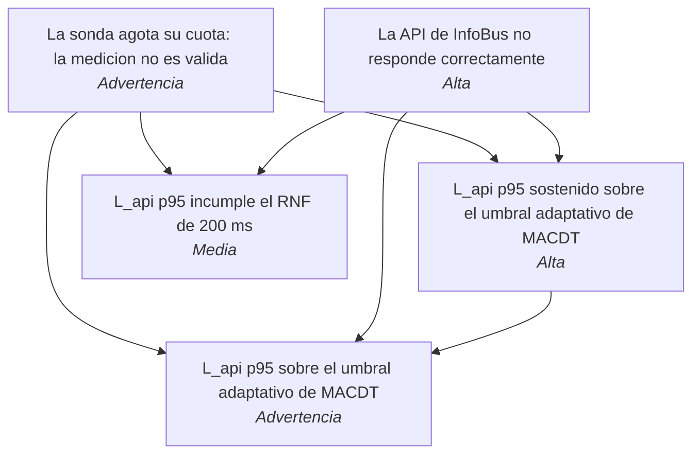

# `simovilab-infobus` · capa I de MACDT (latencia interna de la API)

> [English](README-template-simovilab-infobus.md) · **Español**

 

Mide la latencia de la API de infobus desde adentro (agente en srv-infobus, directo al orchestrator, sin Traefik ni TLS). Es el requisito no funcional de rendimiento del proyecto: el p95 de la última hora debe quedar bajo `{$T_LATENCY_CRIT}`. También recibe los resultados del bucle MACDT (umbral adaptativo `{$T_LATENCY_WARN}` y calibración de T_base) y resta la medición externa de `simovilab-infobus-ext` para separar red, TLS y Traefik.

## Resumen

| | |
| --- | --- |
| **Archivo** | [`templates/simovilab-infobus.yml`](../templates/simovilab-infobus.yml) |
| **Plantilla** | `simovilab-infobus` |
| **Se vincula a** | `srv-infobus`, por `ROLE_INFOBUS_TEMPLATE_*` (metadata de autoregistro `docker-autoreg infobus`). También define `{$DB.SESSION} = infobus`, que usa `simovilab-database` en el mismo host. |
| **Contenido** | 31 ítems, 10 alertas, 17 macros |

## Requisitos

| Requisito | Para qué | Dónde |
| --- | --- | --- |
| `infobus_probe.py` (`infobus.api`) | Maestro de todos los ítems `infobus.api.*`: ráfaga de 10 peticiones a next-trips por minuto | [README](README-infobus_probe.md) |
| Agente en la red Docker de infobus | La sonda llama a `http://orchestrator:8000` | `AGENT_DOCKER_NETWORK` en el `.env` del agente |
| Bucle MACDT (contenedor `macdt-loop` en srv-gestion) | Envía los trappers `macdt.*` y escribe `{$T_LATENCY_WARN}` | [README](README-macdt_loop.md) |
| `simovilab-infobus-ext` en `Zabbix-server` | Los ítems `infobus.net.*` lo leen por el nombre fijo del host `Zabbix-server` | `LOCAL_TEMPLATE_*` |

## Árbol de alertas

Cada flecha va de la alerta que suprime a la alerta suprimida: mientras la de arriba está abierta, la de abajo no se abre. En cada par, la de menor severidad depende de la de mayor, así solo se muestra el nivel más grave de un problema.

## Alertas

Los nombres de las alertas son los que muestra Zabbix.

| Alerta | Severidad | Se dispara cuando | La suprime |
| --- | --- | --- | --- |
| L_api p95 sostenido sobre el umbral adaptativo de MACDT | Alta | El p95 de la última hora no baja de {$T_LATENCY_WARN} durante {$T_LATENCY_WARN.SOSTENIDO}. La advertencia "sobre el umbral" depende de esta. | La API de InfoBus no responde correctamente, La sonda agota su cuota: la medicion no es valida |
| La API de InfoBus no responde correctamente | Alta | La ráfaga de next-trips no respondió todo 200/204 (500, sin conexión, 429…). | — |
| L_api p95 incumple el RNF de 200 ms | Media | El p95 de la última hora supera {$T_LATENCY_CRIT} (requisito no funcional, fijo). | La API de InfoBus no responde correctamente, La sonda agota su cuota: la medicion no es valida |
| El bucle MACDT no reporta: puede estar caido | Media | 5 min sin datos de macdt.status. | — |
| L_api p95 sobre el umbral adaptativo de MACDT | Advertencia | El p95 de la última hora supera {$T_LATENCY_WARN} (lo escribe el bucle MACDT). | La API de InfoBus no responde correctamente, La sonda agota su cuota: la medicion no es valida, L_api p95 sostenido sobre el umbral adaptativo de MACDT |
| Latencia de día sin servicio fuera de lo normal (204) | Advertencia | Promedio de 10 min mayor a {$INFOBUS.T204.FACTOR} × la mediana diaria. | — |
| Costo de abrir la conexión fuera de lo normal | Advertencia | Promedio de 10 min mayor a {$INFOBUS.SETUP.FACTOR} × la mediana diaria y mayor a {$INFOBUS.SETUP.MIN_MS} ms. | — |
| La sonda agota su cuota: la medicion no es valida | Advertencia | Alguna respuesta 429 en el ciclo. | — |
| MACDT: la latencia de infobus cambió más de lo permitido | Advertencia | La calibración quedó retenida: la recta nueva cambia más de MACDT_CALIB_MAX_DRIFT. Una persona decide si la aplica. | — |
| MACDT degradado: el umbral no se esta actualizando | Advertencia | El bucle corre pero no puede calcular (datos viejos o faltantes). | — |

## Macros

Para que un cambio sobreviva a la siguiente importación, sobrescribir la macro en el host: *Data collection → Hosts → host → Macros → Inherited and host macros → Change*.

| Macro | Valor por defecto | Qué controla |
| --- | --- | --- |
| `{$DB.SESSION}` | `infobus` | Sesión del Agent 2 (simovilab-plugins.conf) y nombre de la base PostgreSQL que usa simovilab-database en el mismo host. |
| `{$INFOBUS.SETUP.FACTOR}` | `2` | Veces la mediana diaria del costo de abrir la conexión que dispara la alerta. |
| `{$INFOBUS.SETUP.MIN_MS}` | `5` | Mínimo (ms) para alertar el costo de abrir la conexión. |
| `{$INFOBUS.T204.FACTOR}` | `2` | Veces la mediana diaria de la latencia 204 que dispara la alerta. |
| `{$MACDT.B}` | `130` | b de T_base(t): costo fijo de la petición (ms). Lo escribe la calibración. |
| `{$MACDT.BETA}` | `0.35` | β: peso de los buses activos (ρ). β = c·V_max ÷ promedio de T_base con buses. |
| `{$MACDT.DELTA}` | `0` | δ de T_base(t): margen, P95 de los residuos de la regresión. |
| `{$MACDT.F_CRIT}` | `0.7` | Factor que endurece T_warn con cobertura GPS crítica. |
| `{$MACDT.M}` | `0` | m de T_base(t): ms por cada hora de paso en 5 h. Con 0, T_base es constante. |
| `{$MACDT.T_BASE}` | `130` | Semilla de T_base. Se usa solo si N(t) falta o está viejo. |
| `{$MACDT.T_FLOOR}` | `91` | Piso de T_warn (ms). |
| `{$MACDT.T_RNF}` | `350` | Techo de T_warn (ms). |
| `{$Q_CRIT}` | `150` | Sin uso todavía (cola de eventos de Redis de infobus). |
| `{$Q_WARN}` | `80` | Sin uso todavía (cola de eventos de Redis de infobus). |
| `{$T_LATENCY_CRIT}` | `200` | Umbral crítico de L_api: el requisito no funcional. MACDT no lo cambia. |
| `{$T_LATENCY_WARN}` | `130` | Umbral de advertencia de L_api. Lo sobrescribe el bucle MACDT cada minuto (macro de host). |
| `{$T_LATENCY_WARN.SOSTENIDO}` | `30m` | Tiempo que el p95 debe mantenerse sobre T_warn para la alerta alta "sostenido". |

## Dashboard

- **Operación infobus → Operación** (10 widgets): *T_LATENCY_WARN actual (escrito por MACDT)*, *Hora local*, *Estado del bucle MACDT*, *L_api p95 (última hora)*, *Too Many Requests (429)*, *API INFOBUS*, *T_warn = clamp((b + m·N(t) + δ)·(1 + β·ρ)·F_crit,  {T_FLOOR, T_RNF})*, *N(t). llegadas programas en 5 horas*, *Latencia de la API vs umbral de MACDT*, *Desglose de latencia*

## Ítems

31 ítems

| Nombre | Clave | Tipo | Unidades |
| --- | --- | --- | --- |
| Sonda de la API de InfoBus | `infobus.api` | Agente (activo) | — |
| Buses en camino a la parada medida | `infobus.api.buses_parada` | Dependiente | — |
| Primera peticion de la sesion (abre la conexion) | `infobus.api.health_cold_ms` | Dependiente | ms |
| Piso de transporte, conexion abierta | `infobus.api.health_ms` | Dependiente | ms |
| Disponibilidad de /health/ | `infobus.api.health_ok` | Dependiente | — |
| L_api maxima del ciclo | `infobus.api.lat_max` | Dependiente | ms |
| L_api p50 del ciclo | `infobus.api.lat_p50` | Dependiente | ms |
| L_api p90 del ciclo | `infobus.api.lat_p90` | Dependiente | ms |
| L_api p95 real, ventana de 1 h | `infobus.api.lat_p95_1h` | Calculado | ms |
| Latencia en día sin servicio (respuestas 204) | `infobus.api.lat_sin_servicio` | Dependiente | ms |
| Llegadas programadas en 5 h, N(t) | `infobus.api.llegadas` | Dependiente | — |
| N(t) para MACDT: p95 de llegadas, ventana de 1 h | `infobus.api.llegadas_p95_1h` | Calculado | — |
| API de InfoBus responde correctamente | `infobus.api.ok` | Dependiente | — |
| Costo de la consulta, aislado del transporte | `infobus.api.query_p50` | Dependiente | ms |
| Costo de abrir la conexión (DNS + TCP) | `infobus.api.setup_ms` | Dependiente | ms |
| Día sin servicio (next-trips responde 204) | `infobus.api.sin_servicio` | Dependiente | — |
| Eleccion automatica de parada activa | `infobus.api.stop_auto` | Dependiente | — |
| Parada medida por la sonda | `infobus.api.stop_id` | Dependiente | — |
| Horas de paso en 5 h de la parada medida (pico) | `infobus.api.stop_pico_5h` | Dependiente | — |
| Tabla API INFOBUS (HTML) | `infobus.api.tabla_html` | Dependiente | — |
| Conexion TCP al orchestrator | `infobus.api.tcp_connect_ms` | Dependiente | ms |
| Too Many Requests (429): peticiones rechazadas por la cuota | `infobus.api.throttled` | Dependiente | — |
| Externo - interno: red + TLS + Traefik | `infobus.net.delta_ms` | Calculado | ms |
| Red: RTT de R4 a R2, promedio 15 min | `infobus.net.rtt_ms` | Calculado | ms |
| TLS + Traefik (sin red) | `infobus.net.tls_traefik_ms` | Calculado | ms |
| Resultado de la calibración de MACDT | `macdt.calib` | Trapper | — |
| Detalle de la calibración de MACDT | `macdt.calib.info` | Trapper | — |
| Estado del bucle MACDT | `macdt.status` | Trapper | — |
| T_base(t) calculado por MACDT | `macdt.t_base` | Trapper | ms |
| T_warn escrito por MACDT | `macdt.t_warn` | Trapper | ms |
| Ecuación de T_warn con valores | `macdt.t_warn.eq` | Trapper | — |

## Notas

- **Cuota:** next-trips permite 30 peticiones por minuto por IP. La sonda usa 10; si salta **La sonda agota su cuota**, el ciclo midió el 429 y no la latencia, y las alertas de latencia quedan suprimidas.
- **p95 real:** con 10 peticiones, el p95 de la ráfaga es el máximo. El p95 real es `infobus.api.lat_p95_1h`, que calcula el servidor sobre unos 60 ciclos de la última hora.
- **`{$T_LATENCY_WARN}` es una macro de host que el bucle MACDT escribe cada minuto.** El valor de la plantilla es solo la semilla.
