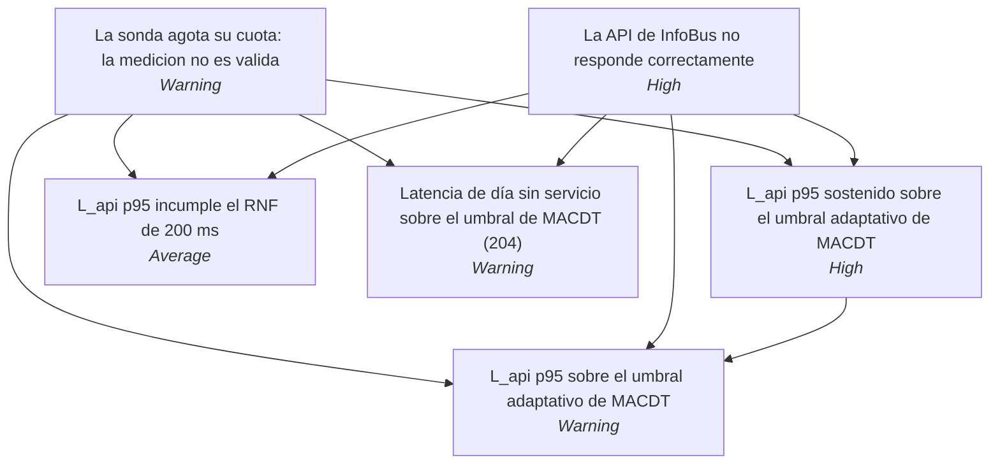

# `simovilab-infobus` · MACDT layer I (internal API latency)

 

Measures the latency of the infobus API from inside (agent on srv-infobus, straight to the orchestrator, without Traefik or TLS). It is the performance non-functional requirement of the project: the p95 of the last hour must stay under `{$T_LATENCY_CRIT}`. It also receives the results of the MACDT loop (adaptive threshold `{$T_LATENCY_WARN}` and calibration of T_base) and subtracts the external measurement of `simovilab-infobus-ext` to separate network, TLS and Traefik.

## Overview

| | |
| --- | --- |
| **File** | [`templates/simovilab-infobus.yml`](../templates/simovilab-infobus.yml) |
| **Template** | `simovilab-infobus` |
| **Linked to** | `srv-infobus`, through `ROLE_INFOBUS_TEMPLATE_*` (autoregistration metadata `docker-autoreg infobus`). It also defines `{$DB.SESSION} = infobus`, used by `simovilab-database` on the same host. |
| **Contents** | 32 items, 11 alerts, 17 macros |

## Requirements

| Requirement | Why | Where |
| --- | --- | --- |
| `infobus_probe.py` (`infobus.api`) | Master of all `infobus.api.*` items: burst of 10 next-trips requests per minute | [README](README-infobus_probe.md) |
| Agent on the infobus Docker network | The probe calls `http://orchestrator:8000` | `AGENT_DOCKER_NETWORK` in the agent `.env` |
| MACDT loop (`macdt-loop` container on srv-gestion) | Sends the trappers `macdt.*` and writes `{$T_LATENCY_WARN}` | [README](README-macdt_loop.md) |
| `simovilab-infobus-ext` on `Zabbix-server` | The `infobus.net.*` items read it by the fixed host name `Zabbix-server` | `LOCAL_TEMPLATE_*` |

## Alert tree

An arrow goes from the alert that suppresses to the alert that is suppressed: while the upper one is open, the lower one does not open. The lower severity of a pair depends on the higher one, so only the most serious level of a problem is shown.

## Alerts

| Alert | Severity | Fires when | Suppressed by |
| --- | --- | --- | --- |
| L_api p95 sostenido sobre el umbral adaptativo de MACDT | High | The last-hour p95 stays above {$T_LATENCY_WARN} for {$T_LATENCY_WARN.SOSTENIDO}. The "sobre el umbral" warning depends on this one. | La API de InfoBus no responde correctamente, La sonda agota su cuota: la medicion no es valida |
| La API de InfoBus no responde correctamente | High | The next-trips burst did not answer all 200/204 (500, no connection, 429…). | — |
| L_api p95 incumple el RNF de 200 ms | Average | The last-hour p95 is above {$T_LATENCY_CRIT} (fixed non-functional requirement). | La API de InfoBus no responde correctamente, La sonda agota su cuota: la medicion no es valida |
| El bucle MACDT no reporta: puede estar caido | Average | 5 min without data from macdt.status. | — |
| L_api p95 sobre el umbral adaptativo de MACDT | Warning | The last-hour p95 is above {$T_LATENCY_WARN} (written by the MACDT loop). | La API de InfoBus no responde correctamente, La sonda agota su cuota: la medicion no es valida, L_api p95 sostenido sobre el umbral adaptativo de MACDT |
| Latencia de día sin servicio fuera de lo normal (204) | Warning | 10-min average above {$INFOBUS.T204.FACTOR} × the daily median. | — |
| Latencia de día sin servicio sobre el umbral de MACDT (204) | Warning | The last-hour p95 of the 204 responses is above {$T_LATENCY_WARN}. With no service there is no N(t), so MACDT leaves the threshold at the {$MACDT.T_BASE} seed (idle threshold). | La API de InfoBus no responde correctamente, La sonda agota su cuota: la medicion no es valida |
| Costo de abrir la conexión fuera de lo normal | Warning | 10-min average above {$INFOBUS.SETUP.FACTOR} × the daily median and above {$INFOBUS.SETUP.MIN_MS} ms. | — |
| La sonda agota su cuota: la medicion no es valida | Warning | At least one 429 response in the cycle. | — |
| MACDT: la latencia de infobus cambió más de lo permitido | Warning | Calibration was held: the new line changes more than MACDT_CALIB_MAX_DRIFT. A person decides whether to apply it. | — |
| MACDT degradado: el umbral no se esta actualizando | Warning | The loop runs but cannot compute (stale or missing data). | — |

## Macros

Override a macro on the host to keep the change after the next import: *Data collection → Hosts → host → Macros → Inherited and host macros → Change*.

| Macro | Default | What it controls |
| --- | --- | --- |
| `{$DB.SESSION}` | `infobus` | Agent 2 session (simovilab-plugins.conf) and PostgreSQL database name used by the simovilab-database template linked to the same host. |
| `{$INFOBUS.SETUP.FACTOR}` | `2` | Times the daily median connection-setup cost that fires the alert. |
| `{$INFOBUS.SETUP.MIN_MS}` | `5` | Minimum (ms) to alert on connection-setup cost. |
| `{$INFOBUS.T204.FACTOR}` | `2` | Times the daily median 204 latency that fires the alert. |
| `{$MACDT.B}` | `130` | b in T_base(t): fixed request cost (ms). Written by calibration. |
| `{$MACDT.BETA}` | `0.35` | β: weight of active buses (ρ). β = c·V_max ÷ mean T_base with buses. |
| `{$MACDT.DELTA}` | `0` | δ in T_base(t): margin, P95 of the regression residuals. |
| `{$MACDT.F_CRIT}` | `0.7` | Factor that tightens T_warn when GPS coverage is critical. |
| `{$MACDT.M}` | `0` | m in T_base(t): ms per scheduled arrival in 5 h. With 0, T_base is constant. |
| `{$MACDT.T_BASE}` | `160` | T_base seed. Used only when N(t) is missing or stale: days without service or a probe failure. On a day without service it is the idle threshold. It can be changed in operation as a host macro on srv-infobus; the loop reads it every cycle. |
| `{$MACDT.T_FLOOR}` | `91` | T_warn floor (ms). |
| `{$MACDT.T_RNF}` | `350` | T_warn ceiling (ms). |
| `{$Q_CRIT}` | `150` | Not used yet (infobus Redis event queue). |
| `{$Q_WARN}` | `80` | Not used yet (infobus Redis event queue). |
| `{$T_LATENCY_CRIT}` | `200` | L_api critical threshold: the non-functional requirement. MACDT never changes it. |
| `{$T_LATENCY_WARN}` | `160` | L_api warning threshold. Overwritten every minute by the MACDT loop (host macro). |
| `{$T_LATENCY_WARN.SOSTENIDO}` | `30m` | Time the p95 must stay above T_warn for the "sostenido" high alert. |

## Dashboard

- **Operación infobus → Operación** (10 widgets): *T_LATENCY_WARN actual (escrito por MACDT)*, *Hora local*, *Estado del bucle MACDT*, *L_api p95 (última hora)*, *Too Many Requests (429)*, *API INFOBUS*, *T_warn = clamp((b + m·N(t) + δ)·(1 + β·ρ)·F_crit,  {T_FLOOR, T_RNF})*, *N(t). llegadas programas en 5 horas*, *Latencia de la API vs umbral de MACDT*, *Desglose de latencia*

## Items

31 items

| Name | Key | Type | Units |
| --- | --- | --- | --- |
| Sonda de la API de InfoBus | `infobus.api` | Agent (active) | — |
| Buses en camino a la parada medida | `infobus.api.buses_parada` | Dependent | — |
| Primera peticion de la sesion (abre la conexion) | `infobus.api.health_cold_ms` | Dependent | ms |
| Piso de transporte, conexion abierta | `infobus.api.health_ms` | Dependent | ms |
| Disponibilidad de /health/ | `infobus.api.health_ok` | Dependent | — |
| L_api maxima del ciclo | `infobus.api.lat_max` | Dependent | ms |
| L_api p50 del ciclo | `infobus.api.lat_p50` | Dependent | ms |
| L_api p90 del ciclo | `infobus.api.lat_p90` | Dependent | ms |
| L_api p95 real, ventana de 1 h | `infobus.api.lat_p95_1h` | Calculated | ms |
| Latencia en día sin servicio (respuestas 204) | `infobus.api.lat_sin_servicio` | Dependent | ms |
| Latencia en día sin servicio p95, ventana de 1 h (204) | `infobus.api.lat_sin_servicio_p95_1h` | Calculated | ms |
| Llegadas programadas en 5 h, N(t) | `infobus.api.llegadas` | Dependent | — |
| N(t) para MACDT: p95 de llegadas, ventana de 1 h | `infobus.api.llegadas_p95_1h` | Calculated | — |
| API de InfoBus responde correctamente | `infobus.api.ok` | Dependent | — |
| Costo de la consulta, aislado del transporte | `infobus.api.query_p50` | Dependent | ms |
| Costo de abrir la conexión (DNS + TCP) | `infobus.api.setup_ms` | Dependent | ms |
| Día sin servicio (next-trips responde 204) | `infobus.api.sin_servicio` | Dependent | — |
| Eleccion automatica de parada activa | `infobus.api.stop_auto` | Dependent | — |
| Parada medida por la sonda | `infobus.api.stop_id` | Dependent | — |
| Horas de paso en 5 h de la parada medida (pico) | `infobus.api.stop_pico_5h` | Dependent | — |
| Tabla API INFOBUS (HTML) | `infobus.api.tabla_html` | Dependent | — |
| Conexion TCP al orchestrator | `infobus.api.tcp_connect_ms` | Dependent | ms |
| Too Many Requests (429): peticiones rechazadas por la cuota | `infobus.api.throttled` | Dependent | — |
| Externo - interno: red + TLS + Traefik | `infobus.net.delta_ms` | Calculated | ms |
| Red: RTT de srv-gestion a srv-infobus, promedio 15 min | `infobus.net.rtt_ms` | Calculated | ms |
| TLS + Traefik (sin red) | `infobus.net.tls_traefik_ms` | Calculated | ms |
| Resultado de la calibración de MACDT | `macdt.calib` | Trapper | — |
| Detalle de la calibración de MACDT | `macdt.calib.info` | Trapper | — |
| Estado del bucle MACDT | `macdt.status` | Trapper | — |
| T_base(t) calculado por MACDT | `macdt.t_base` | Trapper | ms |
| T_warn escrito por MACDT | `macdt.t_warn` | Trapper | ms |
| Ecuación de T_warn con valores | `macdt.t_warn.eq` | Trapper | — |

## Notes

- **Rate limit:** next-trips allows 30 requests per minute per IP. The probe uses 10; if **La sonda agota su cuota** fires, the cycle measured the 429, not the latency, and the latency alerts are suppressed.
- **Real p95:** with 10 requests the p95 of the burst is the maximum. The real p95 is `infobus.api.lat_p95_1h`, computed by the server over about 60 cycles of the last hour.
- **`{$T_LATENCY_WARN}` is a host macro written every minute by the MACDT loop.** The template value is only the seed.
