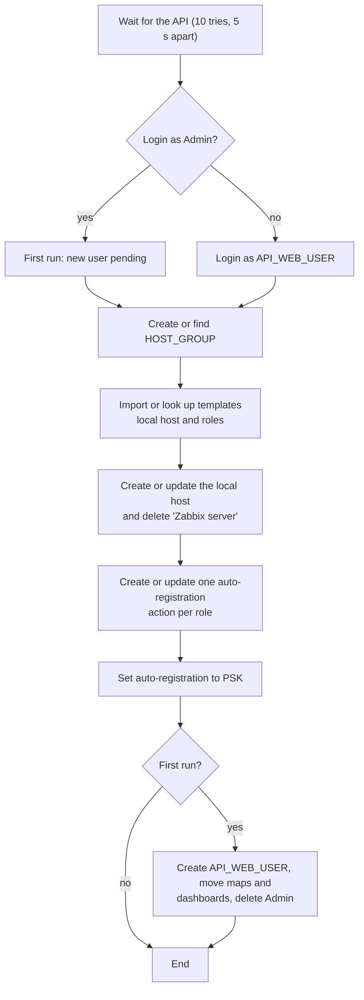

# `zabbix-conf-en.sh` · initial Zabbix setup through the API

**English** · [Español](README-zabbix-conf-en.es.md)


Post-install script of the Zabbix server. The `zabbix-init` container runs it once, after the frontend and the server are healthy, and it leaves Zabbix configured with no manual steps in the frontend: administrator user, host group, templates, local host, auto-registration actions by role and PSK encryption. It can run again on an existing installation: it creates what is missing and updates what exists.

## Overview

| Item | Value |
| --- | --- |
| **Location** | `scripts/zabbix-conf-en.sh` (selected with `SCRIPT_POST_INSTALL` in `.env`) |
| **Runs on** | The `zabbix-init` container on the server (R4), mounted as `/init.sh` |
| **Run by** | `docker compose up` (started by [`zabbix-dev.sh`](README-zabbix-dev.md) in `server` mode) |
| **Talks to** | Zabbix JSON-RPC API at `API_URL` |
| **Reads** | Environment variables from `.env`, `/zabbix_agentd.psk`, templates in `/templates` |
| **Tools** | `bash`, `curl`, `jq` (the container installs `bash` and `jq` at startup) |



## Usage

### Quick start

The script is not run by hand. It runs as part of the server deployment:

```bash
cd /home/zabbix
sudo ./scripts/zabbix-dev.sh server 'MySeed.2026'
```

To run it again on an existing installation (for example, after changing templates or `.env`):

```bash
docker compose -f docker-compose.yml up -d zabbix-init
docker compose -f docker-compose.yml logs -f zabbix-init
```

### How to

#### 1. Prerequisites

- `zabbix-dashboard` and `zabbix-server-pgsql` healthy. `zabbix-init` waits for both in `docker-compose.yml`.
- `psk/zabbix_agentd.psk` already generated by `zabbix-dev.sh`.
- Template YAML files in `templates/`, mounted read-only at `/templates`.

#### 2. Review the variables

`zabbix-init` loads the whole `.env` (`env_file`). The script uses these variables:

| Variable | Example | Use |
| --- | --- | --- |
| `API_URL` | `http://zabbix-dashboard:8080/api_jsonrpc.php` | JSON-RPC API address |
| `DEFAULT_USER`, `DEFAULT_PASS` | `Admin` / `zabbix` | Initial account. If login with it works, the run is treated as the first one |
| `API_WEB_USER`, `API_WEB_PASS` | `tfg` / *(own value)* | Administrator to create, or to log in with on later runs. The password must meet the Zabbix policy |
| `HOST_GROUP` | `Monitoring hosting` | Host group for the local host and the auto-registered agents |
| `LOCAL_HOST_NAME` | `Zabbix-server` | Name of the local host |
| `HOST_DNS`, `HOST_PORT` | `zabbix-agent2`, `10050` | Agent interface of the local host |
| `LOCAL_TEMPLATE_FILES`, `LOCAL_TEMPLATE_NAMES` | see `.env.example` | Templates of the local host |
| `ROLE_DATABUS_TEMPLATE_FILES`, `ROLE_DATABUS_TEMPLATE_NAMES` | see `.env.example` | Templates for agents with the `databus` role |
| `ROLE_INFOBUS_TEMPLATE_FILES`, `ROLE_INFOBUS_TEMPLATE_NAMES` | see `.env.example` | Templates for agents with the `infobus` role |
| `ZBX_METADATA` | `docker-autoreg` | Common metadata that every auto-registration action requires |
| `ZBX_TLSPSKIDENTITY` | `zabbix-databus-psk` | PSK identity for auto-registration |
| `ZBX_TLSPSKFILENAME` | `zabbix_agentd.psk` | PSK file name, read from `/` inside the container |

Template lists follow these rules:

- Files separated by commas and names by a vertical bar, **in the same order**.
- The name must be identical to the `name:` field of the YAML.
- A `-` instead of a file means a template that already exists in Zabbix (for example, `Docker by Zabbix agent 2`).
- If the local host has no templates, the script links `ICMP Ping`.
- If a role has no templates, its auto-registration action is not created.

`AGENT_TEMPLATE_FILE(S)` and `AGENT_TEMPLATE_NAME(S)` are obsolete. If either is defined, the script stops.

#### 3. What the script configures

1. **API:** waits until `apiinfo.version` responds. It tries 10 times, 5 s apart.
2. **Login:** tries `DEFAULT_USER`. If it fails, it logs in with `API_WEB_USER`. If both fail, it stops.
3. **Host group:** finds `HOST_GROUP` or creates it.
4. **Templates:** imports each YAML with `configuration.import` (creates what is missing and updates templates, items, triggers, graphs, discovery rules, value maps and dashboards), then reads its ID by name. A file imported once is not imported again in the same run.
5. **Local host:** if `LOCAL_HOST_NAME` exists, it updates its interface to `HOST_DNS:HOST_PORT`, links the local templates and unlinks and clears the ones no longer listed. If it does not exist, it creates it with its interface, group and templates.
6. **Default host:** deletes the `Zabbix server` host that comes with the image.
7. **Previous action:** deletes `Self-registration-agents-simovilab`, which applied the same templates to every agent.
8. **Actions by role:** creates or updates `Self-registration-simovilab-databus` and `Self-registration-simovilab-infobus`. Each one:
   - Matches when the agent metadata contains `ZBX_METADATA` **and** the role name.
   - Adds the host, adds it to `HOST_GROUP`, removes it from *Discovered hosts* and links the templates of its role.
9. **Encryption:** sets auto-registration to accept PSK only, with `ZBX_TLSPSKIDENTITY` and the key from the PSK file.
10. **User (first run only):**
    1. Finds the *Super admin role* and the *Zabbix administrators* and *Internal* groups.
    2. Creates `API_WEB_USER` if it does not exist.
    3. Logs in with the new user.
    4. Transfers the maps and dashboards of `Admin` to the new user.
    5. Deletes `Admin`.

#### 4. Verify

```bash
docker compose -f docker-compose.yml ps zabbix-init        # Exited (0)
docker compose -f docker-compose.yml logs zabbix-init | tail -20
```

The last line must be `🎉 Initialization complete`. In the frontend:

- **Data collection → Hosts:** `Zabbix-server` with its templates; no `Zabbix server` host.
- **Alerts → Actions → Autoregistration actions:** the two `Self-registration-simovilab-*` actions.
- **Administration → General → Autoregistration:** encryption level PSK.
- **Users → Users:** `API_WEB_USER` exists and `Admin` does not.

#### Common operations

```bash
# Run it again after changing templates or .env
docker compose -f docker-compose.yml up -d zabbix-init
docker compose -f docker-compose.yml logs -f zabbix-init
```

Macros changed **on the host** are kept. Macros changed **on the template** from the frontend go back to the YAML value.

## Reference

### Run types

| Run | How it is detected | User step |
| --- | --- | --- |
| First | Login with `DEFAULT_USER` works | Creates `API_WEB_USER`, moves maps and dashboards, deletes `Admin` |
| Later | Login with `DEFAULT_USER` fails and login with `API_WEB_USER` works | None: `No new user required` |

### Auto-registration action by role

| Part | Value |
| --- | --- |
| Name | `Self-registration-simovilab-<role>` |
| Conditions (AND) | Host metadata contains `ZBX_METADATA`; host metadata contains `<role>` |
| Operations | Add host · Add to `HOST_GROUP` · Remove from *Discovered hosts* · Link the `ROLE_<ROLE>_TEMPLATE_*` templates |

Requiring both conditions keeps the local host (metadata without a role) out of the remote actions.

### Common errors

| Message | Cause | Fix |
| --- | --- | --- |
| `API not available after 10 attempts` | The frontend did not respond within about 50 s | Check `zabbix-dashboard` and run `zabbix-init` again |
| `Could not authenticate with any user` | Neither `DEFAULT_*` nor `API_WEB_*` work | Check `API_WEB_USER` and `API_WEB_PASS` in `.env` |
| `found N files and M names` | The template lists do not have the same length | Fix the commas and vertical bars in `.env` |
| `could not retrieve the ID for template` | The name in `.env` differs from `name:` in the YAML | Copy the exact name from the YAML |
| `Zabbix does not have a template named` | A `-` entry names a template that does not exist | Copy the exact name from Data collection → Templates |
| `Something went wrong creating user` | The password does not meet the Zabbix policy | At least 8 characters, not containing the user name, not a common password. `Admin` is not deleted |

## Security notes

- **`Admin`:** it is deleted only after the new user logs in successfully. If the user cannot be created, `Admin` is kept and the script stops.
- **PSK:** the script reads the key from the mounted file and sends it to the API. It is never printed in the log.
- **Credentials:** `API_WEB_PASS` and `DEFAULT_PASS` live only in `.env`, which is in `.gitignore`.

## Documentation

- [`README.md`](../README.md#4-what-zabbix-init-configures): what `zabbix-init` configures.
- [`scripts/zabbix-dev.sh`](zabbix-dev.sh): deployment that starts `zabbix-init`. See [its README](README-zabbix-dev.md).
- [`docker-compose.yml`](../docker-compose.yml): `zabbix-init` service.
- [`templates/`](../templates/): Zabbix templates.
