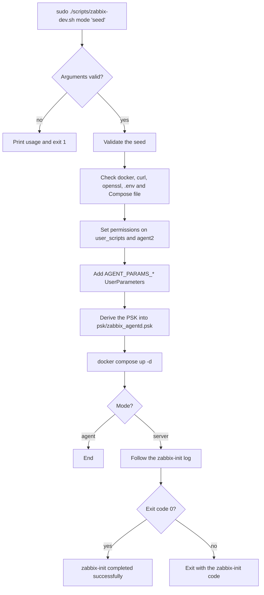

# `zabbix-dev.sh` · server and agent deployment

**English** · [Español](README-zabbix-dev.es.md)


-white?logo=linux)


Deployment script for the Zabbix stack. It prepares the host (dependencies, permissions, agent configuration and PSK) and starts the services with Docker Compose. It has two modes:

- **Server (`server`):** starts the full stack from [`docker-compose.yml`](../docker-compose.yml) and follows the `zabbix-init` log until it ends.
- **Agent (`agent`):** starts only `remote-zabbix-agent2` from [`agent2/docker-compose-agent2.yml`](../agent2/docker-compose-agent2.yml).

## Overview

| Item | Value |
| --- | --- |
| **Location** | `scripts/zabbix-dev.sh` |
| **Runs on** | The host: R4 in `server` mode, R2 or R3 in `agent` mode |
| **Run by** | An administrator, as root (`sudo`) |
| **Reads** | `.env`, `agent2/simovilab-plugins.conf.example` |
| **Writes** | `agent2/` (sudoers, `Dockerfile`, `zabbix_agent2.conf`, `simovilab-plugins.conf`), `psk/zabbix_agentd.psk` |
| **Starts** | The Docker Compose stack of the selected mode |



## Usage

### Quick start

```bash
cd /home/zabbix
cp .env.example .env                               # fill in the values for the mode
sudo ./scripts/zabbix-dev.sh server 'MySeed.2026'  # on R4
sudo ./scripts/zabbix-dev.sh agent 'MySeed.2026'   # on R2 and R3, with the SAME seed
```

### How to

#### 1. Prerequisites

- Linux with Docker Engine and the Docker Compose v2 plugin. The `docker` group must exist.
- `python3`, used to derive the PSK from the seed.
- `curl` and `openssl`. If they are missing, the script installs them with `apt-get`.
- Root access (`sudo`): the script changes owners and permissions of repository files.
- A `.env` file in the repository root. If it does not exist, the script copies `.env.example` to `.env` and exits so that it can be edited first.

#### 2. Review the variables the script reads from `.env`

| Variable | Mode | Use in the script |
| --- | --- | --- |
| `SCRIPT_POST_INSTALL` | server | Initial setup script run by `zabbix-init`. The file must exist (default `scripts/zabbix-conf-en.sh`) |
| `AGENT_SUDOERS_FILE` | both | Name of the sudoers file inside `agent2/` (default `simovilab-sudoers`) |
| `ZBX_AGENT_CONFIG_FILE` | both | Name of the agent configuration file inside `agent2/` (default `zabbix_agent2.conf`) |
| `AGENT_PARAMS_<suffix>` | both | `key:script` pairs added as `UserParameter` lines. Example: `AGENT_PARAMS_00=host.tcp.established:zabbix-host-tcp-established.sh` |

The rest of `.env` is read by Docker Compose, not by the script. See the main [README](../README.md#2-configure-env).

#### 3. Choose a seed

The second argument is a **seed**, not the PSK. It must:

- Have 8 to 64 characters.
- Contain at least one uppercase letter, one lowercase letter, one digit and one of `. * + ? -`.
- Contain no `$`, `|`, `&` or `\`.
- Go in single quotes: `'MySeed.2026'`.

Use the same seed on the server and on every agent. See [Seed and PSK](../README.md#seed-and-psk).

#### 4. Run the script

```bash
cd /home/zabbix
sudo ./scripts/zabbix-dev.sh server 'MySeed.2026'
```

The script does this, in order:

1. Validates the arguments: one or two, with `agent` or `server` first. Otherwise it prints the usage and exits with code `1`.
2. Validates the seed, if one is given.
3. Selects the Compose file of the mode and exports `DOCKER_GID` (the `docker` group ID).
4. Checks `docker`, and installs `curl` and `openssl` if they are missing.
5. Checks `.env` and the Compose file. In `server` mode, also checks the `SCRIPT_POST_INSTALL` file.
6. Sets `root:root 775` on `scripts/user_scripts/` and its `.sh` and `.py` files.
7. Creates the sudoers file if it is missing (`zabbix ALL=(root) NOPASSWD: /var/lib/zabbix/user_scripts/*`) and sets `root:root 440`.
8. Creates `agent2/Dockerfile` if it is missing and sets `root:root 644`.
9. Creates `zabbix_agent2.conf` if it is missing.
10. In `agent` mode only, creates `agent2/simovilab-plugins.conf` from its `.example` if it is missing.
11. Adds each `AGENT_PARAMS_*` entry as `UserParameter=<key>,sudo /var/lib/zabbix/user_scripts/<script>`, skipping lines already present. Then sets `root:root 644` on the file.
12. Derives the PSK and saves it to `psk/zabbix_agentd.psk` (see [PSK generation](#psk-generation)).
13. Runs `docker compose up -d` with the `.env` file.
14. In `server` mode, follows the `zabbix-init` log and waits for its exit code.

#### 5. Verify

```bash
docker compose -f docker-compose.yml ps                                    # server
docker compose -f agent2/docker-compose-agent2.yml --env-file .env ps      # agent
ls -l psk/zabbix_agentd.psk agent2/
```

In `server` mode, the last lines must show `zabbix-init completed successfully`.

#### Common operations

```bash
# Redeploy after changing templates or .env (same seed)
sudo ./scripts/zabbix-dev.sh server 'MySeed.2026'

# Print the usage
./scripts/zabbix-dev.sh
```

## Reference

### Arguments

| Position | Value | Required | Description |
| --- | --- | --- | --- |
| 1 | `server` or `agent` | Yes | Deployment mode |
| 2 | Seed | In practice, yes | Seed used to derive the PSK. See [PSK generation](#psk-generation) |

### PSK generation

| Case | Result |
| --- | --- |
| Seed given | PBKDF2-HMAC-SHA256 with 600,000 iterations and the salt `simovilab-zabbix-psk-v1`. The same seed yields the same PSK on every machine |
| No seed, `server` mode | Random PSK (`openssl rand -hex 32`). It must be copied by hand to every agent |
| No seed, `agent` mode | No PSK is generated. If `psk/zabbix_agentd.psk` does not exist yet, the script stops when it sets its permissions |

### Files created or changed

| File | When | Owner and mode |
| --- | --- | --- |
| `scripts/user_scripts/`, `*.sh`, `*.py` | Always | `root:root 775` |
| `agent2/<AGENT_SUDOERS_FILE>` | Created if missing | `root:root 440` |
| `agent2/Dockerfile` | Created if missing | `root:root 644` |
| `agent2/<ZBX_AGENT_CONFIG_FILE>` | Created if missing; `UserParameter` lines appended | `root:root 644` |
| `agent2/simovilab-plugins.conf` | `agent` mode, created if missing | `644` |
| `psk/zabbix_agentd.psk` | Always (except `agent` mode without a seed) | `644` |

### Exit codes

| Code | Cause |
| --- | --- |
| `0` | Deployment finished. In `server` mode, `zabbix-init` also ended with `0` |
| `1` | Wrong arguments, invalid seed, missing dependency, missing `.env`, Compose file, `SCRIPT_POST_INSTALL` or a required variable |
| Other | Exit code of `zabbix-init` when it fails |

## Security notes

- **Seed:** keep it outside the repository and never publish it. Anyone with the seed can derive the PSK.
- **`psk/`:** it is in `.gitignore`. Never commit it.
- **Sudoers:** the `zabbix` user can run every file in `user_scripts/` as root without a password. Keep that folder `root:root` and only add reviewed scripts to it.
- **`simovilab-plugins.conf`:** it is created with sample passwords. Edit it with the real ones before using the PostgreSQL and Redis plugins.

## Documentation

- [`README.md`](../README.md): full deployment guide.
- [`docker-compose.yml`](../docker-compose.yml): server stack.
- [`agent2/docker-compose-agent2.yml`](../agent2/docker-compose-agent2.yml): remote agent.
- [`scripts/zabbix-conf-en.sh`](zabbix-conf-en.sh): initial setup run by `zabbix-init`. See [its README](README-zabbix-conf-en.md).
- [`scripts/user_scripts/`](user_scripts/): probes and MACDT loop.
