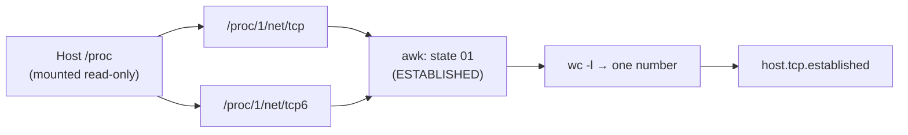

# `zabbix-host-tcp-established.sh` · established TCP connections on the host

**English** · [Español](README-zabbix-host-tcp-established.es.md)


Counts the TCP connections in `ESTABLISHED` state on the **host**, not inside the agent container. It reads the host IPv4 and IPv6 connection tables and prints one number. Zabbix stores it in the `host.tcp.established` item.

## Overview

| Item | Value |
| --- | --- |
| **Location** | `scripts/user_scripts/zabbix-host-tcp-established.sh` |
| **Runs on** | Every Zabbix agent: `zabbix-agent2` (R4) and `remote-zabbix-agent2` (R2 and R3) |
| **Run by** | Zabbix Agent 2, `UserParameter=host.tcp.established` with `sudo` |
| **Item key** | `host.tcp.established` (template `simovilab servidor y sistema operativo`) |
| **Reads** | `/proc/1/net/tcp` and `/proc/1/net/tcp6` |
| **Output** | One integer |



## Usage

### Quick start

```bash
sudo /var/lib/zabbix/user_scripts/zabbix-host-tcp-established.sh   # inside the agent
```

### How to

#### 1. Prerequisites

- The host `/proc` mounted read-only in the agent container (`/proc:/proc:ro`). Both Compose files already do it.
- The sudoers file created by [`zabbix-dev.sh`](../README-zabbix-dev.md), which lets the `zabbix` user run `user_scripts/*` as root.

#### 2. Register the item in the agent

`zabbix-dev.sh` adds the line from this `.env` entry:

```text
AGENT_PARAMS_00=host.tcp.established:zabbix-host-tcp-established.sh
```

The result in [`agent2/zabbix_agent2.conf`](../../agent2/zabbix_agent2.conf) is:

```text
UserParameter=host.tcp.established,sudo /var/lib/zabbix/user_scripts/zabbix-host-tcp-established.sh
```

#### 3. What the script does

1. Reads `/proc/1/net/tcp` and `/proc/1/net/tcp6`. PID 1 of the host `/proc` is the host init process, so the tables are those of the host network namespace.
2. Skips the header line of each file.
3. Keeps the lines whose fourth column (`st`) is `01`, which is `ESTABLISHED`.
4. Prints how many lines it kept.

It needs no extra tools and no `nsenter`.

#### 4. Verify

On the host, compare with `ss`:

```bash
ss -Htn state established | wc -l
```

In the frontend: **Monitoring → Latest data**, item *TCP connections ESTABLISHED* on each host.

## Reference

### Output

| Value | Meaning |
| --- | --- |
| Integer ≥ 0 | Established TCP connections (IPv4 + IPv6) on the host |

### Alerts that use it

| Alert | Severity | Fires when |
| --- | --- | --- |
| Too many established TCP connections | High | More than 1200 for 5 min |
| Too many established TCP connections | Warning | More than 800 for 5 min |

## Security notes

- **Read-only:** the script only reads `/proc`. It runs with `sudo` because of the `UserParameter` line, not because it needs to write anything.
- **Sudoers:** every file in `user_scripts/` runs as root. Keep the folder `root:root` and review any new script before adding it.

## Documentation

- [`README.md`](../../README.md): full deployment guide, items and alerts.
- [`agent2/zabbix_agent2.conf`](../../agent2/zabbix_agent2.conf): `UserParameter` lines.
- [`templates/simovilab-templates.yml`](../../templates/simovilab-templates.yml): item and alerts.
- [`scripts/zabbix-dev.sh`](../zabbix-dev.sh): adds the `UserParameter` line and the sudoers file.
